# Chapter 01: Fundamentals of RAG, Embeddings, Similarity & Search Strategies

*AI track · Chapter 01 · Course: Coding Shuttle, "From SDE to AI Engineering" (Week 1, Class 1) · Started 2026-10-09*

> [!NOTE]
> **This chapter is being written in parts.** It's a big topic, so I'm saving each part as I finish it.
> **Part 1 (done):** calling an LLM through OpenRouter, request/response vs streaming, how RAG works (sections 1–3).
> **Part 2 (done):** the RAG big picture (indexing vs querying), parsing and chunking, RAG vs fine-tuning, embeddings, dimensions, how a vector is built, and dimension trade-offs and compatibility (sections 4–11).
> **Part 3 (done):** measuring similarity (cosine, Euclidean/L2, dot product, Manhattan/L1) and a hands-on notebook lab: embed 20 docs, score a query, top-K retrieval and a score threshold (sections 12–13).
> **Part 4 (done):** choosing a metric (decision tree + real-world cheat sheet), why a vector database, Qdrant hands-on (in-memory → Docker, collection, upsert, query, dashboard), recall vs precision, and search strategies: exact vs approximate (ANN) search and HNSW (sections 14–17).
> ✅ **Chapter complete.** Parsing and chunking get their own lectures next.

## Agenda for this class

| # | Topic | Status |
|---|---|---|
| 1 | Call an LLM with OpenRouter | ✅ Part 1 |
| 2 | RAG: how it works | ✅ Part 1 + 2 |
| 3 | Embeddings (vectors, dimensions, compatibility) | ✅ Part 2 |
| 4 | Similarity | ✅ Part 3 |
| 5 | Qdrant (vector database) | ✅ Part 4 |
| 6 | Search strategies (exact vs ANN, HNSW) | ✅ Part 4 |

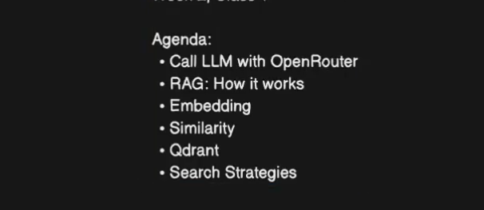

---

## 1. The problem: an LLM doesn't know *your* world

An **LLM (Large Language Model)** is trained on a huge amount of data, but that data was collected **at some point in the past**. That gives two gaps:

1. **No current information.** The model was trained up to a cut-off date, so it doesn't know what's happening right now (for example in 2026).
2. **No private information.** Say I work at **XYZ company**. The LLM has no idea what XYZ does, what data we have, or what our policies are, because that data was never public.

Now suppose I want to build a **chatbot or help-desk bot for my own company**. The question is: **how do I give my company's information to the LLM** so it can answer correctly?

There are two ways:

| Approach | What it means | When it fits |
|---|---|---|
| **Fine-tuning** | Re-train the model on your data, so the knowledge goes *into the model's weights* | Teaching a style, format or domain behaviour. Expensive, and it has to be redone every time the data changes |
| **RAG pipeline** | Keep the model as it is. At question time, **fetch the relevant data and hand it to the model along with the question** | Company knowledge that changes often (policies, runbooks, Confluence, tickets). This is what this chapter is about |

> [!TIP]
> **RAG = Retrieval-Augmented Generation.** Before learning RAG, we first learn how to call an LLM from code. Every RAG system ends with exactly that call.

---

## 2. Calling an LLM with OpenRouter

### 2.1 What OpenRouter is

**OpenRouter** is a single gateway in front of hundreds of LLMs (OpenAI, Anthropic, Google, DeepSeek, NVIDIA, …). You get **one account and one API key**, and you switch models just by changing the model name in your code. Its API is **OpenAI-compatible**, so we can use the normal `openai` Python SDK and only point it at OpenRouter's URL.

- You can create an account **for free**. No payment method is needed to use the free models.
- Requests flow like this: **my code → OpenRouter → the actual provider** (e.g. DeepInfra or AtlasCloud serving DeepSeek). OpenRouter picks the provider and logs the call.

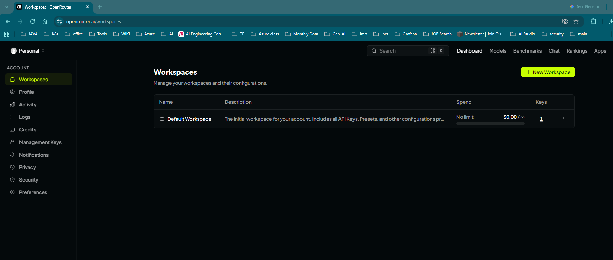

### 2.2 The Models page: finding a model

Under **Models** you can filter everything:

- **Pricing filter → Free** shows only the free models (`$0/M input tokens`, `$0/M output tokens`).
- **Sort** by *Newest* or *Most Popular*.
- **Category tabs** tell you what each model is for: **Text** (chat, which is what we use now), Image, Video, Speech, Decisions, **Embeddings** (we'll need these for RAG), **Rerank** (also used later in RAG), Transcription, Audio.
- Each card shows the **context window** (e.g. 262K, 1M), price per million tokens, and total tokens served.

To use a specific model, copy its ID from the card (e.g. `nvidia/nemotron-3-ultra-550b-a55b:free`) and paste it into the code.

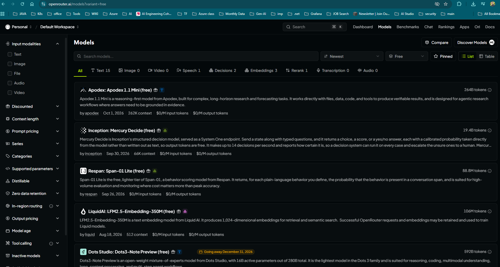

### 2.3 The Compare tab: choosing between models

**Compare** puts models side by side: context length, reasoning support, input/output types, number of providers, price, latency, throughput, features (tool use, caching, no-prompt-training) and benchmarks. Example from class:

| Metric | Claude Haiku 5.5 (Anthropic, via Google Vertex) | GPT-6 Astra (OpenAI, via Azure) |
|---|---|---|
| Context length | 1M tokens | 1.05M tokens |
| Input price | **$0.10** / M tokens | $10 / M tokens |
| Output price | **$0.50** / M tokens | $50 / M tokens |
| Latency (p50) | **0.98 s** | 6.11 s |
| Throughput (p50) | **177 tok/s** | 32 tok/s |
| Max output tokens | 128K | 128K |
| Stream cancellation | ✗ | ✓ |
| Intelligence benchmark | 43 | **53** |

> [!TIP]
> **Production lesson:** the "smartest" model isn't automatically the right one. Here GPT-6 Astra scores higher on intelligence, but Haiku 5.5 is **~100× cheaper and ~6× faster**. For a high-volume help-desk bot that's usually the better trade. Pick per use case: **cost × latency × quality**.

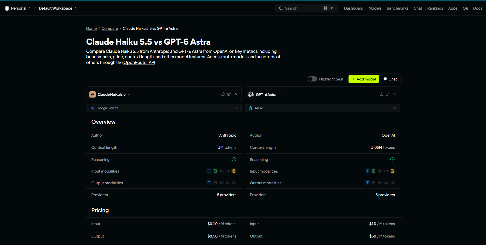

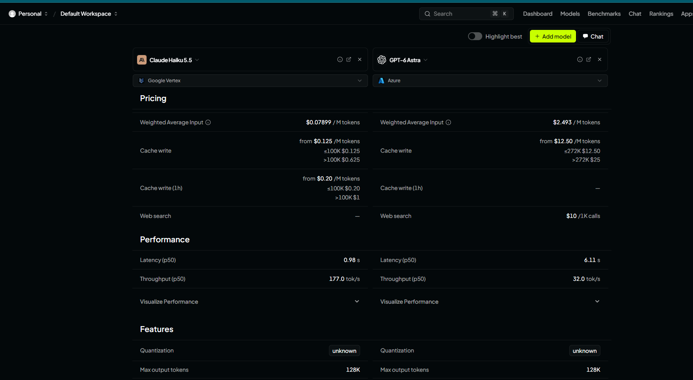

### 2.4 Creating an API key

**Workspace → API Keys → New Key**, then fill in:

- **Name**, e.g. `open-router-key`
- **Expiration**, e.g. 1 year (keys should expire, the same hygiene as any cloud credential)
- **Credit limit**, e.g. **$50**. Requests are rejected once this key has used $50 in total. It works as a built-in **budget guardrail**.
- **Reset limit every…**: optional, e.g. monthly

> [!WARNING]
> The full key (`sk-or-v1-…`) is shown **only once**. Copy it straight into your `.env` file. **Never** put it in code or commit it to Git.

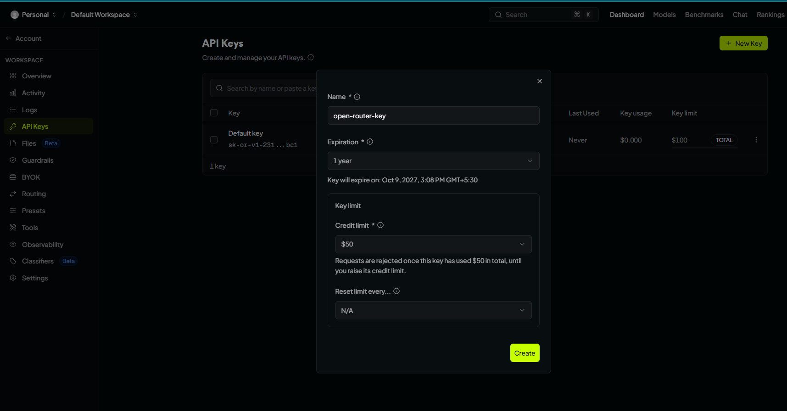

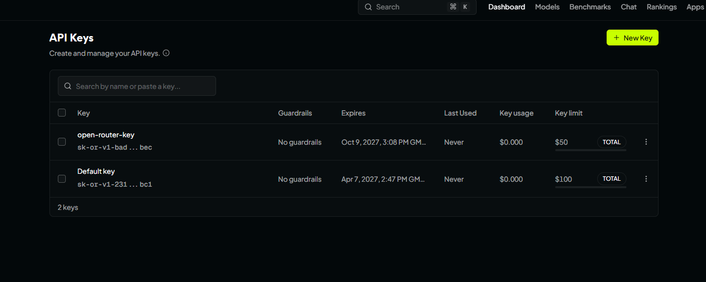

### 2.5 Project setup with `uv`

`uv` is a fast Python package and project manager. It handles the virtual env, dependencies and the lock file in one tool.

```bash
uv init                      # creates the project: pyproject.toml, src/ai_engg_rag/, .python-version, README.md, .gitignore
uv add openai                # adds the OpenAI SDK; creates .venv + uv.lock and writes it into pyproject.toml
uv add python-dotenv         # lets Python read the .env file
```

After both `uv add` commands, `pyproject.toml` has:

```toml
[project]
name = "ai-engg-rag"
version = "0.1.0"
requires-python = ">=3.11"
dependencies = [
    "openai>=3.24.0",
    "python-dotenv>=1.2.4",
]
```

Create a **`.env` file in the project root** with the key:

```bash
OPENROUTER_API_KEY=sk-or-v1-xxxxxxxxxxxxxxxxxxxx
```

> [!IMPORTANT]
> The line must be `NAME=value`. The code reads `os.environ["OPENROUTER_API_KEY"]`, so if the file holds only the bare key with no `OPENROUTER_API_KEY=` in front, you get a `KeyError`. Also check that `.env` is listed in `.gitignore`.

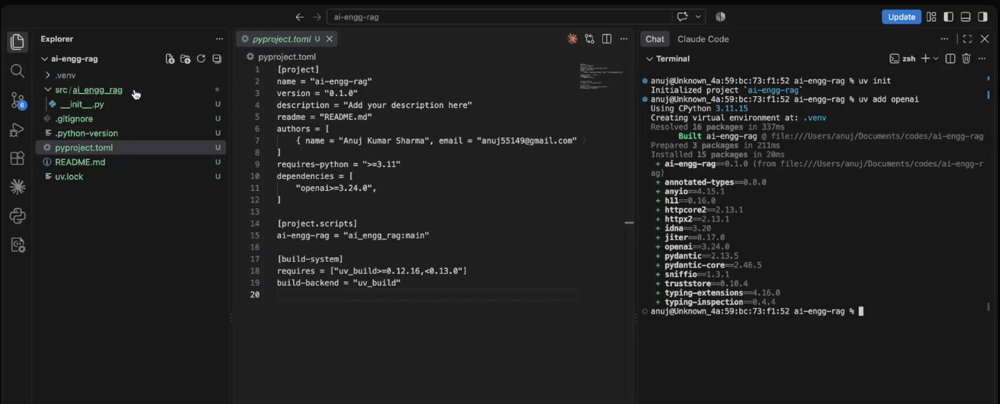

### 2.6 Request/response code: `main.py`

Some terms before the code:

- **SDK (Software Development Kit):** a library that lets your program talk to a third-party service. Here the **OpenAI SDK** talks to OpenRouter.
- **`AsyncOpenAI` vs `OpenAI`:** both work. **`AsyncOpenAI`** lets you `await` calls, so one program can handle **many concurrent requests** (important for a real chatbot serving many users).
- **`load_dotenv()`** loads everything from `.env` into the environment variables.

```python
import asyncio
import os

from dotenv import load_dotenv
from openai import AsyncOpenAI

load_dotenv()                                   # read .env → environment variables

class ChatService:

    def __init__(self):                         # constructor: build the client once
        api_key = os.environ["OPENROUTER_API_KEY"]

        self.client = AsyncOpenAI(
            api_key=api_key,
            base_url="https://openrouter.ai/api/v1",   # ← this one line points the OpenAI SDK at OpenRouter
        )

    async def ask(self, question: str) -> str:
        response = await self.client.chat.completions.create(
            model="openrouter/free",            # or a specific model ID, e.g. "deepseek/deepseek-v4.1-flash"
            messages=[
                {"role": "user", "content": question}
            ],
        )

        if not response.choices:                # guard added after the error in 2.7
            raise ValueError(f"Empty choices in response. Full response: {response}")

        return response.choices[0].message.content


async def main():
    chat_service = ChatService()                # calls the constructor → we have an instance

    query = input("Query:")
    answer = await chat_service.ask(query)      # await the LLM's answer
    print(answer)


if __name__ == "__main__":
    asyncio.run(main())                         # starts the asyncio event loop
```

Run it:

```bash
uv run src/ai_engg_rag/main.py
```

**Choosing the model:**

| `model=` value | What happens |
|---|---|
| `openrouter/free` | OpenRouter picks **any free model** at runtime |
| `nvidia/nemotron-3-ultra-550b-a55b:free` | A specific free model, copied from Models → Text → Free → Most Popular |
| `deepseek/deepseek-v4.1-flash` | A specific paid model. It was much faster, at a fraction of a cent per call |

### 2.7 Troubleshooting: the first run failed

The first query ("How was the solar system formed?") crashed with:

```text
TypeError: 'NoneType' object is not subscriptable
    return response.choices[0].message.content
```

**Why:** `response.choices` was `None`. OpenRouter returned an **error response** (the model didn't exist or the request failed upstream) instead of an answer, and the code blindly read `choices[0]`. Claude added the `if not response.choices: raise ValueError(...)` guard so that the **real API error is printed** instead of a confusing `TypeError`. The free model was also very slow. **Switching to DeepSeek** gave a fast, proper answer.

> [!TIP]
> Free models are great for learning but are **shared and rate-limited**. They can be slow or "temporarily overloaded". In production you pin a reliable (paid) model and handle errors and retries explicitly.

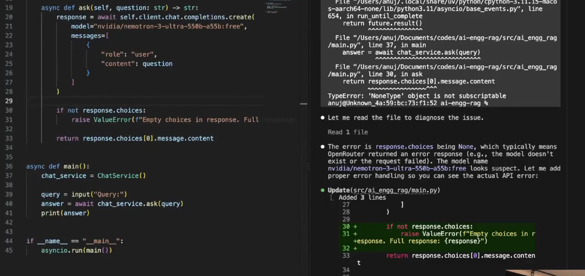

### 2.8 Streaming vs non-streaming

The call above is **non-streaming**: you wait until the whole answer is generated, then get it in one go. **Streaming** sends the answer in tiny pieces (chunks) as it's generated. That's how ChatGPT "types" word by word.

| | Streaming | Non-streaming |
|---|---|---|
| How data arrives | Continuous tiny pieces (chunks) as they're generated | All at once, after it's completely finished |
| Perceived speed | **Fast.** The first words appear almost instantly | **Slow.** You wait for the full answer |
| Real-world analogy | Watching a YouTube video / ChatGPT typing | Downloading a whole PDF |

For this we reorganised the project into a `call_llm/` folder:

```text
src/ai_engg_rag/call_llm/
├── call_llm_request_response.py   # the old main.py (non-streaming)
└── call_llm_streaming.py          # new: streaming version
```

```python
# call_llm_streaming.py  (imports, load_dotenv and __init__ are the same as before)
class ChatService:
    ...
    async def stream(self, question: str):
        stream = await self.client.chat.completions.create(
            model="deepseek/deepseek-v4.1-flash",
            messages=[{"role": "user", "content": question}],
            stream=True,                                  # ← turn on streaming
            stream_options={"include_usage": True},       # ← also send token usage at the end
        )

        async for chunk in stream:
            # Text generated by the model
            if chunk.choices:
                delta = chunk.choices[0].delta            # delta = the NEW piece of text in this chunk
                if delta.content:
                    yield {"type": "content", "content": delta.content}

            # Usage information arrives in the final chunk
            if chunk.usage:
                yield {
                    "type": "usage",
                    "usage": {
                        "prompt_tokens": chunk.usage.prompt_tokens,
                        "completion_tokens": chunk.usage.completion_tokens,
                        "total_tokens": chunk.usage.total_tokens,
                    },
                }


async def main():
    chat_service = ChatService()
    query = input("Query:")

    print("Assistant: ", end="", flush=True)
    async for event in chat_service.stream(query):
        if event["type"] == "content":
            print(event["content"], end="", flush=True)   # print each piece immediately, no newline
        elif event["type"] == "usage":
            usage = event["usage"]
            print("\n")
            print("Usage:")
            print(f"  Prompt tokens:     {usage['prompt_tokens']}")
            print(f"  Completion tokens: {usage['completion_tokens']}")
            print(f"  Total tokens:      {usage['total_tokens']}")
    print()


if __name__ == "__main__":
    asyncio.run(main())
```

Key points:

- `stream=True` turns the response into an **async iterator of chunks**.
- `chunk.choices[0].delta.content` holds **only the new text** in that chunk, not the whole answer so far.
- `stream()` is an **async generator** (`yield`), which hands each piece to `main()` as soon as it arrives.
- `flush=True` makes the terminal print immediately instead of buffering.
- `include_usage` makes the **last chunk** carry token counts. For "How does the LLM work?" that was **37 prompt + 2,059 completion = 2,096 total tokens**.

> [!WARNING]
> With the NVIDIA free model the streaming run failed with `openai.APIError: Upstream error from Nvidia: Service temporarily overloaded`. Switching to DeepSeek fixed it. **When choosing a model, check that it supports streaming** (and that its provider is healthy).

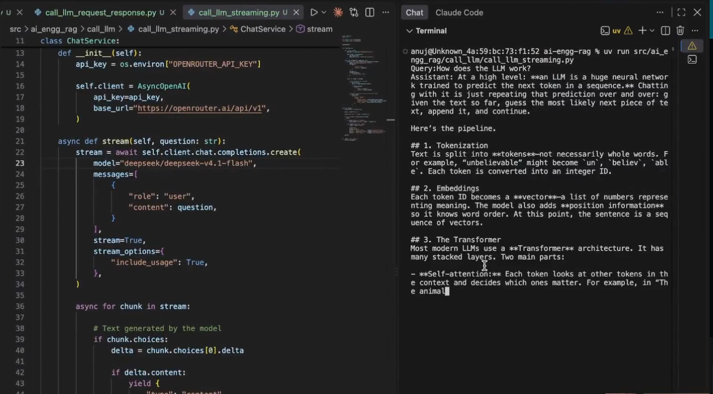

### 2.9 OpenRouter Logs: what actually happened

**Logs** in OpenRouter shows every call we made from code: model, **provider** that served it, input/output tokens, **cost**, speed and routing overhead. Example rows:

| Model | Provider | Input | Output | Cost | Speed |
|---|---|---|---|---|---|
| DeepSeek V4.1 Flash | DeepInfra | 37 tok | 2,059 tok | $0.00087 | 47.4 tok/s |
| DeepSeek V4.1 Flash | AtlasCloud | 35 tok | 940 tok | $0.000535 | 46.2 tok/s |
| Nemotron 3 Ultra (free) | NVIDIA | 20 tok | 1,836 tok | $0.00 | 20.2 tok/s |

The first row matches the 37 / 2,059 tokens our streaming code printed. So the flow was: **our code → OpenRouter → DeepSeek model (served by DeepInfra)**.

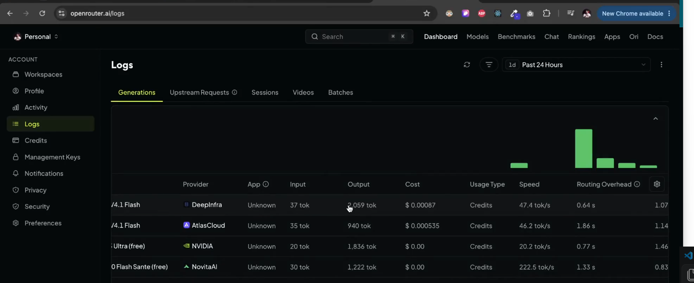

### 2.10 Other ways to call an LLM

We used one way: the **OpenAI SDK pointed at OpenRouter**. Every LLM vendor also ships **its own SDK** (Anthropic, Google, etc.), and you can call them directly. In Python the pattern is always the same: **create a client, then call it from your code.**

---

## 3. RAG: how it works

So far the LLM answered our questions because it was **trained on that kind of data** (the solar system, how LLMs work). But what about something **specific to my organisation**, which the LLM has never seen?

### 3.1 The example: "How many leaves do I get?"

My company has its own knowledge: **databases, knowledge base, runbooks, guidelines, Confluence pages, policies…** The LLM has none of it.

If I ask the LLM directly *"How many leaves do I get in a year?"*, it can't answer properly. Which company? Which policy? It doesn't have that information.

**The RAG way:**

1. Take the user's **query**.
2. Use it to **pull the relevant data from the company's data** (e.g. the leave-policy section).
3. Send that relevant data **along with the query** to the LLM. This relevant data is called the **context**.
4. Now the LLM can **answer properly**, grounded in our own data.

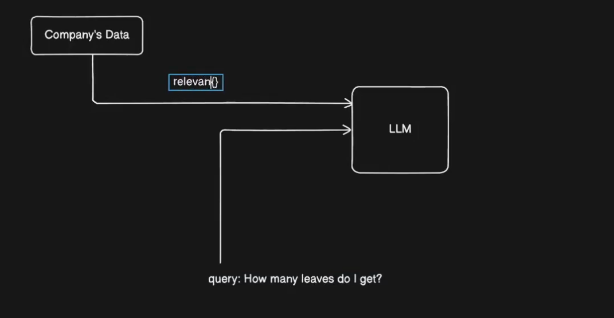

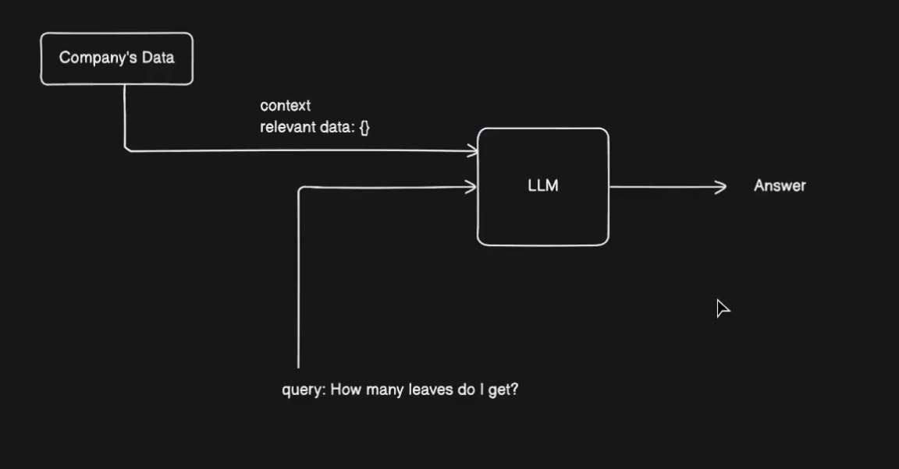

### 3.2 What we really did: we modified the input

We didn't change the model at all. We **changed what we send to it**: the original query **plus** the retrieved context. That's the whole idea, and it's where the name comes from:

| Letter | Word | Meaning in our example |
|---|---|---|
| **R** | **Retrieval** | Go to your own data and **fetch the relevant pieces** to build the context |
| **A** | **Augmented** | **Augment (enrich) the original query with that context**: query + context together |
| **G** | **Generation** | The LLM **generates** the answer from the augmented input |

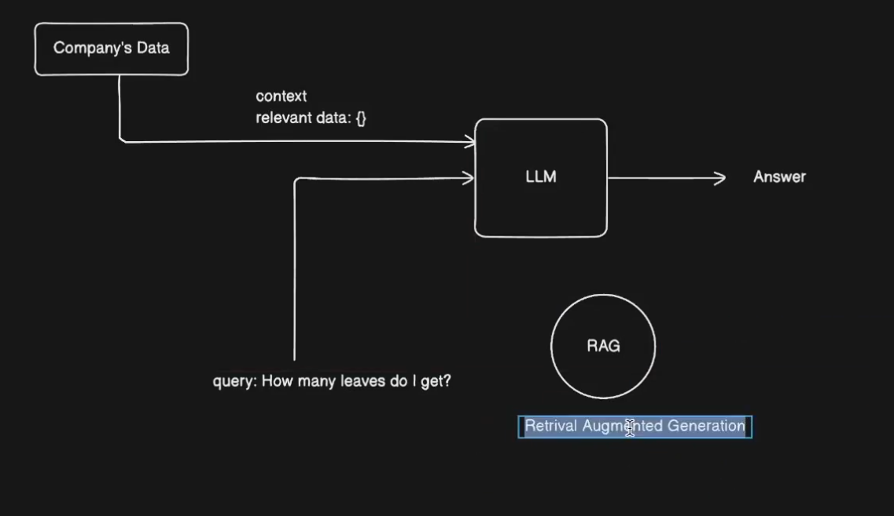

In code terms, the "augmented" prompt is just a richer `messages` list:

```python
messages = [
    {"role": "system", "content": "Answer using ONLY the context below. If it isn't there, say you don't know."},
    {"role": "user",   "content": f"Context:\n{retrieved_chunks}\n\nQuestion: {query}"},
]
```

> [!TIP]
> **Open-book vs closed-book exam.** A plain LLM is a closed-book exam: it answers from memory and may confidently make things up (hallucinate). RAG turns it into an **open-book exam**: we hand it the right pages first.

The big open question is **step 2: how do we find the "relevant" data** among thousands of documents? That's what the rest of this chapter covers: **embeddings → similarity → vector DB (Qdrant) → search strategies.**

---

## 4. The RAG big picture: two pipelines joined by a database

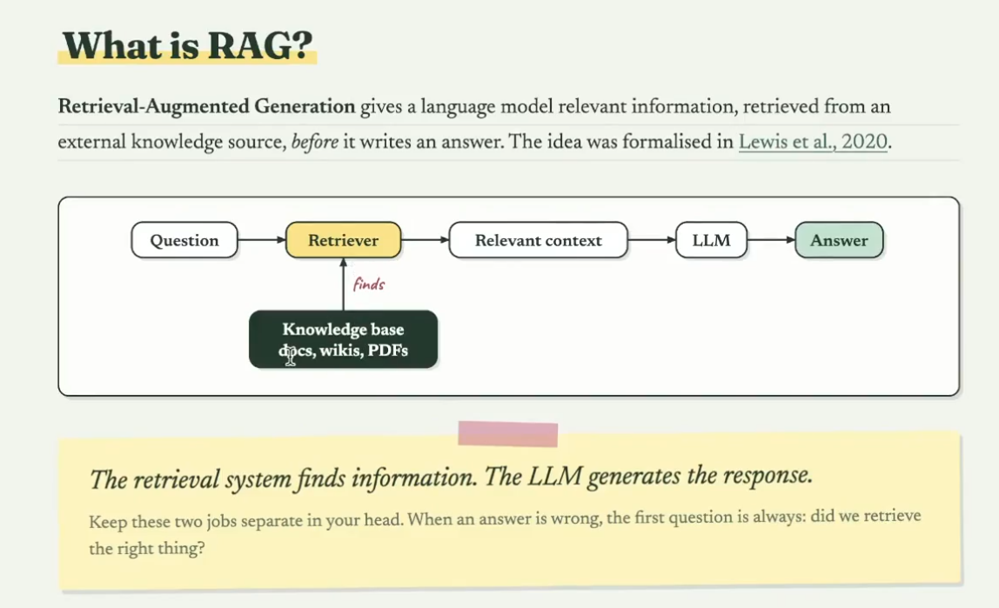

### 4.1 Two separate jobs: retrieval finds, the LLM generates

In RAG there are **two different jobs**, and you should keep them separate in your head:

- The **retrieval system** *finds* the information.
- The **LLM** *generates* the response from it.

> [!IMPORTANT]
> **Debugging rule:** when a RAG answer is wrong, the first question is always **"did we retrieve the right thing?"** If the right chunk never reached the LLM, no prompt tweak or bigger model will fix it.

### 4.2 Indexing (offline) and querying (online)

Every RAG system, from a weekend project to an enterprise search engine, is **two pipelines joined by a (vector) database**:

| Pipeline | When it runs | Steps |
|---|---|---|
| **Indexing** | **Offline**, ahead of time, **once per document** (and again when the document changes) | Documents → **Parse** → **Chunk** → **Embed** → **Store in Qdrant** (vector + payload) |
| **Querying** | **Online**, live, **once per question** | User query → **Query embedding** → **Vector (similarity) search** → **Top-K chunks** → Prompt + context → **LLM** → Answer |

The vector database sits in the middle: **indexing writes into it, querying reads from it.**

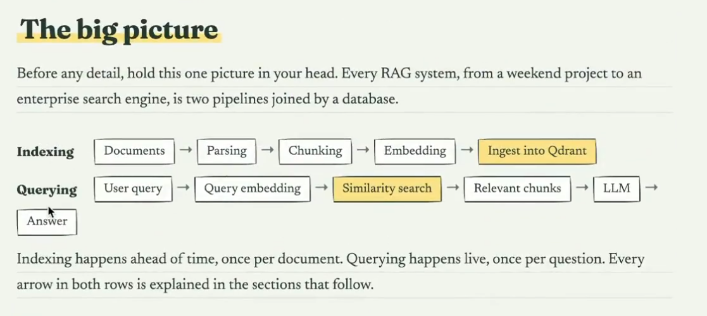

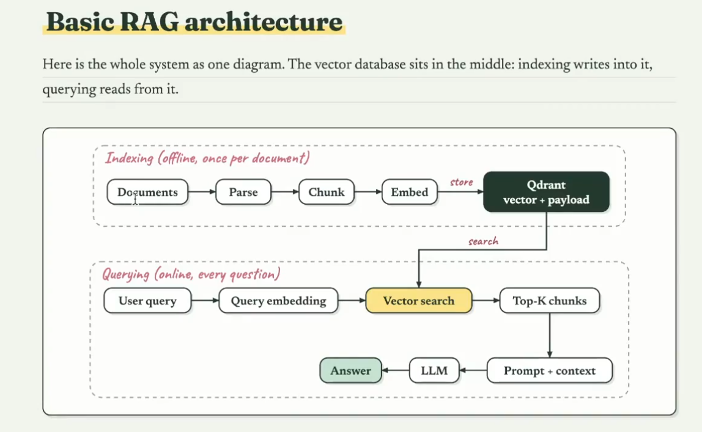

### 4.3 Why not just search the PDF for the words?

Say the leave policy is a PDF and the question is *"How many leaves do I get?"*. A normal **exact / keyword search** fails here:

- The **whole sentence** "how many leaves do I get" will never appear in the PDF as it is.
- The PDF may use **different words** for the same thing, e.g. "annual paid time off" or "PTO" instead of "leaves".
- The PDF may be **scanned images** with no searchable text at all.

So we need a search that matches on **meaning**, not on exact strings. That's what **embeddings** give us (section 7).

### 4.4 Why not send the whole document to the LLM?

Why not put all the company data (leave policy, termination policy, T&Cs, …) into the prompt?

1. **Latency:** a bigger context takes longer to process.
2. **Cost:** you are **charged per token**, so the more context you pass, the bigger the bill on *every* question.
3. **Quality:** given a huge amount of text, LLMs get confused and **start hallucinating**. The one relevant line gets **buried**.

So the goal of retrieval is to find **only the best 2–3 chunks** for this question and send just those. We never send all 100 pages.

---

## 5. Indexing step by step: parse and chunk

*(Parsing and chunking get their own deep-dive lectures later. This is the overview.)*

### 5.1 Parsing: document → clean text

A **document** can be anything: PDF, images, Markdown/MD files, wiki pages… **Parsing** means taking that messy raw blob and **turning it into organised, usable text** (pulling out the relevant and meaningful content). E.g. a PDF → **100 pages of text-format data**.

> [!TIP]
> **Analogy: reading a recipe.** `takethreeeggsbeatthemwelladdatwistofsaltandcook` is useless until your brain parses it: *take | three | eggs | beat | them | well …*. Parsing turns a raw blob into pieces a computer can work with.

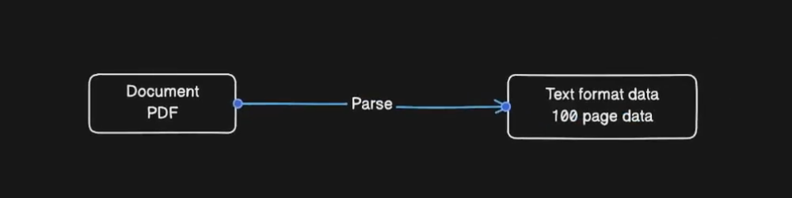

### 5.2 Chunking: big text → bite-sized pieces

**Chunking** splits that large text into **smaller, manageable pieces (chunks)**, e.g. 100 pages → 100 chunks. Each chunk is later embedded and stored on its own, so retrieval can return *just the relevant piece*. Cleaning and sanitising the text (removing junk, headers, noise) is also done as part of this step.

> [!TIP]
> **Analogy: a credit card number.** `4128001234567890` is hard to remember, but `4128 — 0012 — 3456 — 7890` is easy. It's the same data in **4 chunks**.

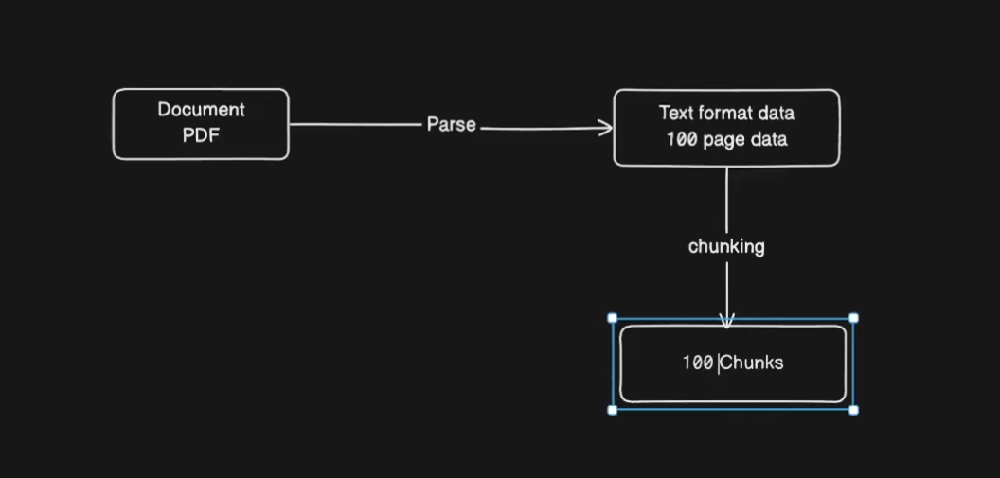

There are different **chunking strategies**:

| Strategy | How it decides where to cut | Best used for |
|---|---|---|
| **Fixed-size** | Counts characters/tokens exactly | Quick prototypes, simple raw text |
| **Structural** | Looks for periods, paragraphs or headers | Code, FAQs, highly structured PDFs |
| **Recursive** | Tries paragraphs, then sentences, then words | General documentation, books, articles |
| **Semantic** | Looks for shifts in the actual topic/meaning | Complex research papers, chaotic chat logs |

---

## 6. Why RAG, and RAG vs LLM-only vs fine-tuning

### 6.1 Why RAG is needed

An LLM's parameters are a **poor database**. They were frozen at training time, they mix facts with style, and you **can't point to where an answer came from**. They're especially unreliable for:

- **Private** information and **internal documentation**
- **Frequently changing** information
- **Customer-specific** data
- Large **proprietary** document collections

This data is **dynamic**. It changes over time, and you **can't retrain the model every time** a document changes (that's a difficult, expensive job). With RAG you just **update the document**. The retrieval pipeline picks up the new version and builds fresh context for the LLM.

> [!WARNING]
> RAG **improves grounding**. It does **not guarantee correct answers**. Bad retrieval still produces a bad answer, just a more confident-looking one.

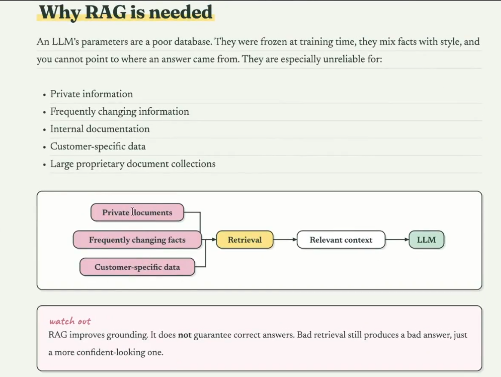

### 6.2 Three ways to answer a question

| Approach | Flow | What it does |
|---|---|---|
| **LLM-only** | Question → LLM → Answer | Answers **from memory** (whatever it was trained on) |
| **RAG** | Question → **Retrieval** → Context → LLM → Answer | **Looks things up at runtime.** Fetches relevant data per query and passes it as context |
| **Fine-tuning** | Training data → **Fine-tuning** → LLM with **new weights** → Answer | **Changes the model itself**: modifies its weights and biases (some layers or all), giving you effectively a new model |

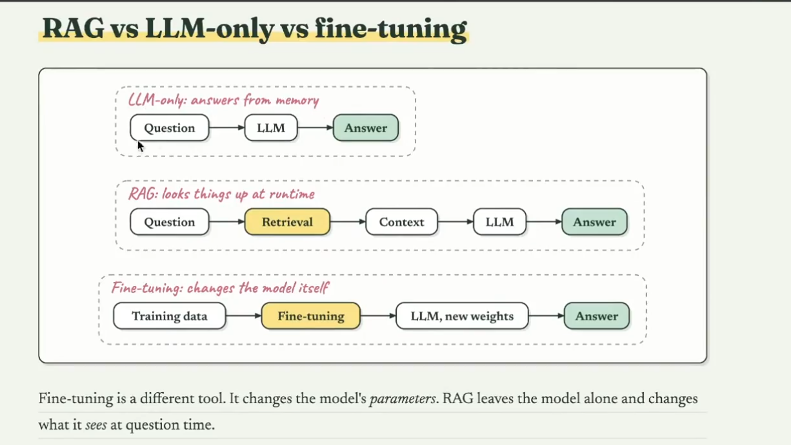

| | RAG | Fine-tuning |
|---|---|---|
| **Best for** | External, current knowledge | Behaviour and task adaptation |
| **Updating data** | Update the index, independent of the model | Needs a training run for every change |
| **Quality depends on** | **Retrieval** quality | **Training-data** quality |

> [!TIP]
> **Rule of thumb:** *"The model needs access to this information"* → think **RAG**. *"The model should behave differently"* → **fine-tuning** may be relevant.

---

## 7. Embeddings: turning text into numbers

### 7.1 Text → vector

An **embedding** is a **numerical representation** of an object. For us the object is text, and the representation is a list of numbers called a **vector** (a vector is just an **array of numbers**).

```text
"Java is a programming language"  →  [ Embedding model ]  →  [0.12, -0.31, 0.81, 0.04, -0.57, ...]   (1536 numbers)
```

The conversion is done by an **embedding model**. On OpenRouter they have their own **Embeddings** tab (37 models when we looked). Key properties:

- You can pass text of **any length up to the model's context** (e.g. 512 tokens, 32K tokens).
- The output is **always a fixed-size vector** for that model, whether you pass one word or a full page.
- Examples: **LiquidAI LFM2.5-Embedding-350M (free)** gives **1,024-dimensional** vectors (512 context). **voyage-code-4** is a code-specific embedding model with 32K context and selectable 1024/512/256 dimensions.

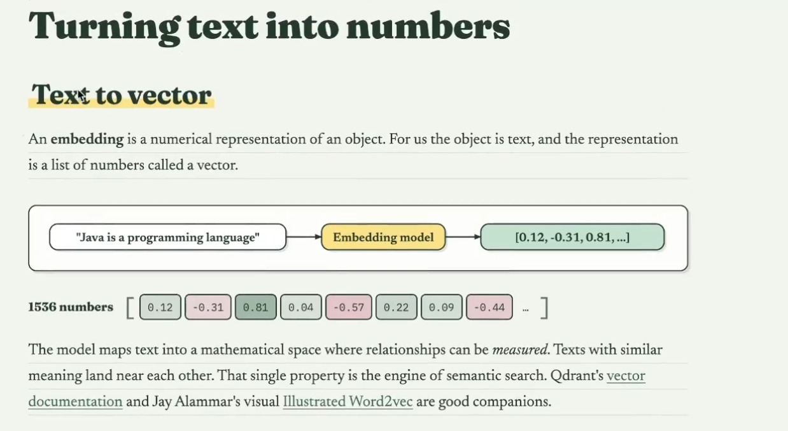

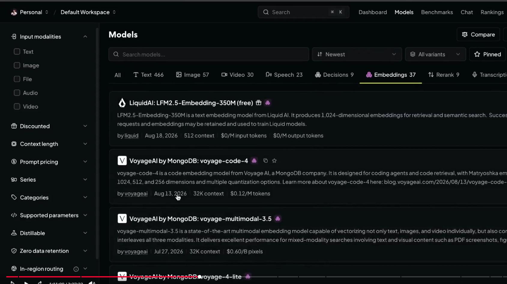

### 7.2 Why vectors? Distance = difference in meaning

Once text becomes a vector, it's a **point in a space**, and then we can **measure** things:

- Points **close to each other** have **similar meaning** (similar semantics).
- Points **far apart** have **different meanings**.

That single property is **the engine of semantic search**. *Java, Python, Spring Boot* sit together (programming). *Delhi, Paris, Tokyo* sit together somewhere else (places). A query like *"language for AI?"* lands near **Python**, even though the word "Python" isn't in the query.

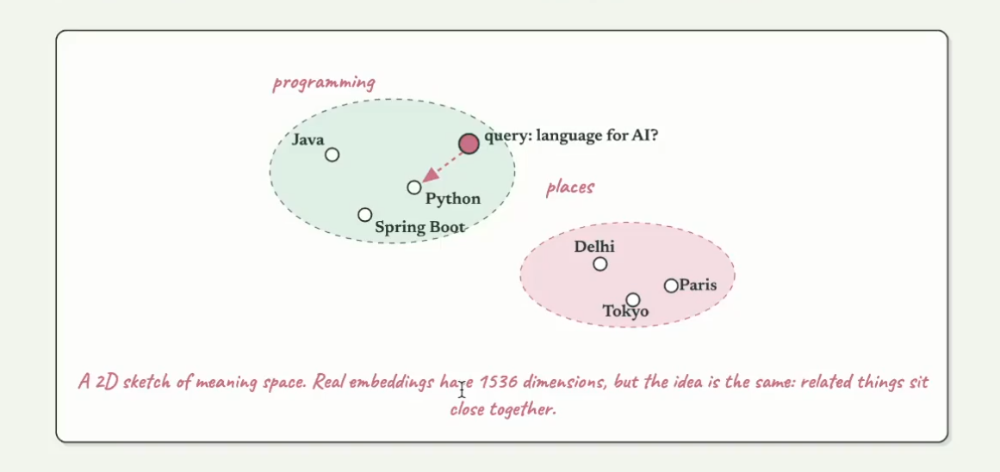

**Semantics = the actual meaning, from how words relate.** The word **bank** means different things depending on its neighbours:

- *bank* + money → a place to keep money
- *bank* + river → a river bank
- *bank* + blood → a blood bank

A good embedding model captures this, so the right meaning ends up in the right place in the space.

---

## 8. Dimensions

### 8.1 What is a dimension?

A **dimension** is simply **one number that locates a point along one axis**. The number of dimensions is **how many numbers you need** to say exactly where something is.

| Dimensions | Example | Numbers needed |
|---|---|---|
| **1D** | A position on a ruler | 1, e.g. `7 cm` |
| **2D** | A spot on a map | 2: latitude, longitude |
| **3D** | A drone in the air | 3: latitude, longitude, height |

### 8.2 The food example (2D → 3D)

Describe every dish with two scores between 0 and 1: **x-axis = spicy**, **y-axis = sweet**. Each dish becomes a point:

- **Gulab Jamun** `[0.05, 0.95]` and **Rasmalai**: very sweet, not spicy, so high up on the y-axis near the start of x. They sit **close together**.
- **Samosa**: a bit spicy, no sweetness, so on the x-axis.
- **Paneer Tikka**: spicier than samosa, a little sweet, so further along x.
- **Butter Chicken** `[0.60, 0.20]`: spicy and a little sweet. It sits close to samosa and paneer tikka.

A query *"something sweet"* lands next to Gulab Jamun and Rasmalai. **Dishes that taste alike end up close together.**

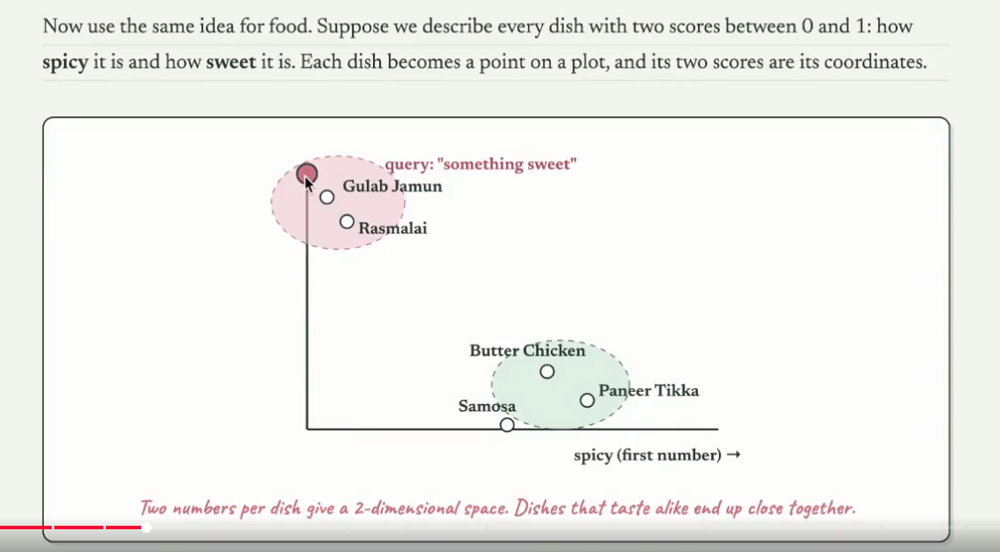

Add a third property, **crunchiness**, and every dish becomes a **3-number (3D) vector**, with a new axis coming out of the page. Samosa would shoot up along it. There's **no limit** to how many properties we can add.

### 8.3 Real embeddings: many dimensions, learned axes

Two differences from the food example:

1. **Far more numbers.** Instead of 2 or 3, a text gets **384, 768, 1536 or 3072** numbers. A 1536-number vector is a point in a **1536-dimensional space**. "Dimension" just means *"how many numbers per text"*.
2. **The axes are learned, not named.** Nobody decides that dimension 17 means "spiciness". The model **discovers useful axes during training**, and each one is usually a blend of many ideas. For us it's a **black box**. You can't label the dimensions, but the **distances between points still mean something**.

---

## 9. How an embedding model builds the vector (6 steps)

Example sentence: **"Butter chicken is spicy"** (a small model with **384** dimensions).

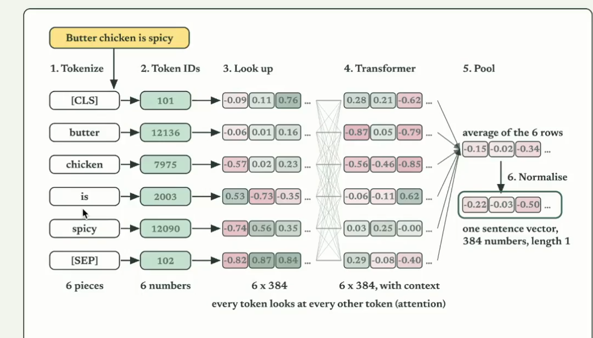

| Step | What happens | Shape |
|---|---|---|
| **1. Tokenize** | A **tokenizer** chops text into pieces from a fixed vocabulary (~30,000 entries). Rare/long words are split into smaller known pieces (that's how it copes with unseen words). Special markers `[CLS]` (start) and `[SEP]` (end) are added → `[CLS] butter chicken is spicy [SEP]` | 6 pieces |
| **2. Token → ID** | Every vocabulary piece has an integer ID: `101, 12136, 7975, 2003, 12090, 102`. **No meaning yet.** IDs are just positions in the vocabulary | 6 numbers |
| **3. Look up** | The model has a big learned table, the **embedding matrix** (one row per vocabulary entry, one column per dimension). Each ID selects its row. At this stage "bank" has the **same vector in every sentence** | 6 × 384 |
| **4. Transformer layers** | Stacked layers let every token **look at every other token (attention)** and rewrite its vector using its neighbours. The numbers now carry **meaning in context** | 6 × 384 (with context) |
| **5. Pool** | Combine the 6 token vectors into **one sentence vector**. The common choice is simply their **average** | 1 × 384 |
| **6. Normalise** | Scale the vector so its **length (magnitude) = 1** | 384 numbers, length 1 |

**Attention, with examples:**

- *"I deposited cash at the **bank**"* vs *"We sat on the river **bank**"*. "bank" starts with identical numbers in both, but after the transformer layers its vector is pulled **towards money** in one and **towards water** in the other.
- **butter** + *chicken* → food. **butter** + *skin* → "silky smooth, buttery skin". Same word, different meaning from context.

**Normalisation, the maths:** the length of a vector is

- 2D: `|v| = √(x² + y²)`
- 3D: `|v| = √(x² + y² + z²)`
- nD: `|v| = √(v₁² + v₂² + … + vₙ²)`

Normalising divides every number by `|v|`, so the final vector has **length exactly 1**. Embedding models do this at the end so that comparing vectors depends only on **direction (meaning)**, not on size.

> [!WARNING]
> **A vector only makes sense to the model that produced it.** Every embedding model is trained on different data and learns different axes, so model A's vectors are meaningless to model B. That's why you **can't mix models** (section 11).

---

## 10. Does more dimensions mean a better RAG system?

**Not by itself.** Extra dimensions give the model **more room to tell similar chunks apart**, which can lift **recall and precision a little**, mostly in large collections full of near-duplicate text. But you pay for every dimension, on every chunk, in **memory, storage, search time and cost**.

**Analogy: photo resolution.** Two blurry, low-resolution photos are hard to tell apart. Add pixels (dimensions) and differences become visible. Likewise, two dishes that are both "sweet and spicy" look identical in 2D. Add **crunchiness** and you can tell them apart.

**Storage maths:** each dimension is a **4-byte float**.

| Dimensions | One vector | 1 million chunks |
|---|---|---|
| 256 | 256 × 4 = **1 KB** | ~1 GB |
| 1536 | 1536 × 4 = **6 KB** | ~6 GB |
| 3072 | 3072 × 4 = **12 KB** | ~12 GB (**12×** the 256 version) |

| Choice | You gain | You lose |
|---|---|---|
| **Fewer** (e.g. 256) | Much less memory, faster search, lower cost | A little recall and precision, as fine distinctions blur |
| **More** (e.g. 3072) | Finer distinctions, a small gain in recall and precision | ~12× the memory of 256, slower search, a bigger bill |

**Recall, with an example:** if 6 chunks are truly relevant to a question and search returns only 3 of them, **recall = 3/6 = 50%**. **Precision** = how many of the returned chunks are actually relevant.

> [!TIP]
> **Chunking, embedding-model quality and metadata filters usually matter far more than the number of dimensions.** Start with the model's default, **measure recall on your own questions**, and shorten vectors only if cost or speed forces you to.

---

## 11. Embeddings in code, and dimension compatibility

### 11.1 Getting embeddings

```bash
pip install openai numpy scikit-learn qdrant-client     # or: uv add openai numpy scikit-learn qdrant-client
```

```python
from openai import OpenAI

client = OpenAI()        # reads OPENAI_API_KEY from your environment

response = client.embeddings.create(
    model="text-embedding-3-small",
    input=[
        "Java is a programming language",
        "Python is used for machine learning",
    ],
)

embeddings = [item.embedding for item in response.data]

print(len(embeddings))       # 2 texts
print(len(embeddings[0]))    # 1536 numbers each
print(embeddings[0][:5])     # first five numbers
```

Same SDK pattern as the chat call, but `client.embeddings.create(...)` instead of `client.chat.completions.create(...)`, and **one vector per input text**. Model names and limits change, so always confirm against the provider's embeddings docs.

### 11.2 Where embeddings fit in the leave-policy diagram

Back to *"How many leaves do I get?"*. A RAG system uses **two different kinds of model**:

- **Retrieval** needs an **embedding model**. It turns chunks (at indexing time) and the question (at query time) into vectors so we can find the closest chunks.
- **Generation** needs an **LLM**. It writes the answer from the question + retrieved context.

### 11.3 Dimension compatibility

If your embedding model outputs **1536** dimensions, the vector-database collection must be configured for **exactly 1536**, or **inserts fail**. Qdrant sets the **dimensionality and the distance metric at the collection level**.

```python
dim = len(embeddings[0])     # always read it from the model, never hard-code
print("Collection must use size =", dim)
```

- `text-embedding-3-small` (1536 dims) → collection size 1536 → ✅ match
- Some other model (768 dims) → same collection → ❌ **mismatch error**

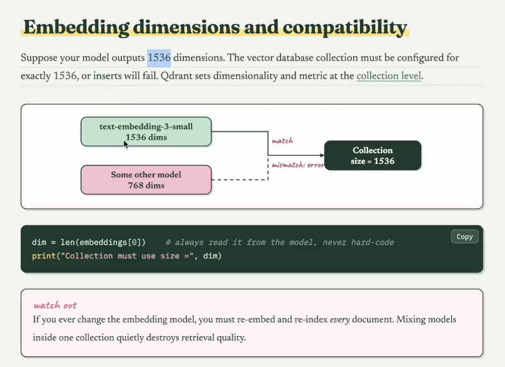

> [!CAUTION]
> **If you ever change the embedding model, you must re-embed and re-index every document.** Vectors from different models live in different "spaces". Mixing models inside one collection quietly destroys retrieval quality, even when the dimensions happen to match.

---

## 12. Measuring similarity: distance metrics

### 12.1 Why we need a metric

Say we have 100 people and want to know "who is better". We can't answer until we **define a metric**, e.g. "run a race: fastest wins". Embeddings are the same. Once text is a vector, *"how similar are these two texts?"* becomes *"how close are these two vectors?"*, and **"close" depends on the distance metric you choose.**

**Why this matters for our problem:** for *"How many leaves do I get?"*, the company data is chunked, every chunk is embedded and stored in a vector DB, and the **query is embedded too**. Retrieval = **find the chunk vectors closest to the query vector**. The metric decides what "closest" means.

### 12.2 The four metrics at a glance

| Metric | Intuition | Retrieval direction |
|---|---|---|
| **Cosine** | **Angle** between the two vectors | **Higher = more similar** |
| **Euclidean / L2** | **Straight-line** distance between the two points | **Lower = closer** |
| **Dot product** | **Alignment plus magnitude** | **Higher = better** |
| **Manhattan / L1** | **City-block** distance: sum of the per-dimension gaps | **Lower = closer** |

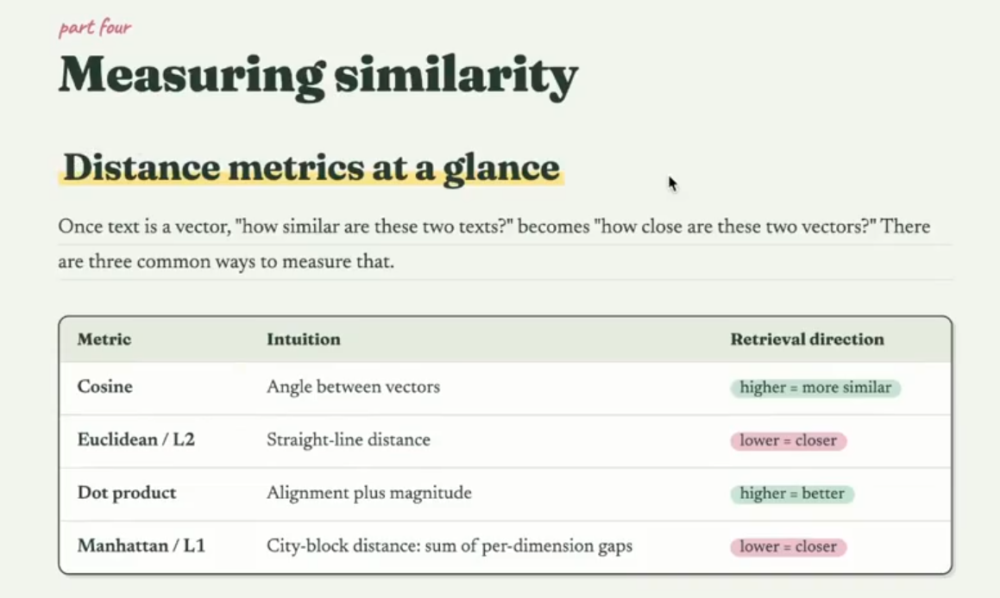

### 12.3 Cosine similarity: the angle

```text
              A · B
cos(A,B) = -----------          small angle between arrows  →  high similarity
           ||A|| * ||B||
```

- Two vectors **pointing the same way** → angle ≈ 0° → **cos 0° = 1** → very similar.
- **Unrelated** (perpendicular) → angle 90° → cos = **0**.
- **Opposite** directions → angle 180° → cos = **−1**.
- Range is **−1 to 1**. For text embeddings you'll mostly see values **between about 0 and 1**.
- Cosine ignores vector length and looks only at **direction (meaning)**, which is why it's the default for text retrieval.

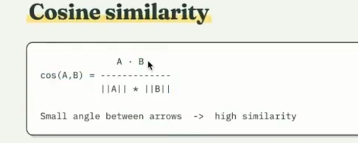

### 12.4 Euclidean (L2) vs Manhattan (L1)

- **Euclidean / L2:** the ordinary **straight-line** distance between two points, extended to many dimensions: `√((a₁−b₁)² + (a₂−b₂)² + …)`. Same √x²+y² idea from section 9.
- **Manhattan / L1:** walk the **city blocks** (only along the axes) and add up the gaps: `|a₁−b₁| + |a₂−b₂| + …`.

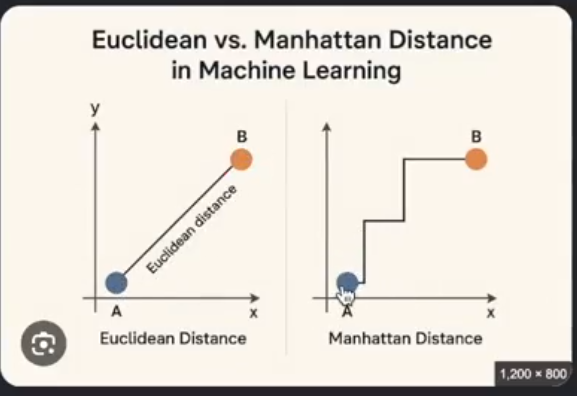

### 12.5 Dot product (inner product)

```text
A · B = a1*b1 + a2*b2 + a3*b3 + ...          (2D: x1*x2 + y1*y2)
```

It measures how **aligned** two vectors are **and** is affected by their **length (magnitude)**. **If all vectors are normalised to length 1** (which most embedding models do, see section 9), **dot product and cosine give identical rankings**. That's why you see both used. Dot product is cheaper (no division).

> [!WARNING]
> **Cosine → higher score = more similar. L2 → lower distance = more similar.** Reading the number in the wrong direction is **the most common beginner bug** in this topic.

> [!TIP]
> **Understand the intuition, don't memorise the maths.** Libraries like **scikit-learn** already implement all of these. One function call each:
> `from sklearn.metrics.pairwise import cosine_similarity, euclidean_distances`

---

## 13. Hands-on lab: embeddings + similarity in a notebook

Goal: embed a small **knowledge base**, embed a **question**, and find the most relevant documents with cosine (and L2). This is **retrieval by hand**, exactly what a vector DB / LangChain will do for us later "under the hood".

### 13.1 Setup

New folder + Jupyter notebook in the same project:

```text
src/ai_engg_rag/
├── call_llm/
└── learn_rag_basics/
    └── 1_rag_basics.ipynb
```

```bash
uv add scikit-learn          # pulls numpy + scipy too
```

```python
import os
from dotenv import load_dotenv
from openai import OpenAI                          # plain (sync) client is fine in a notebook
from sklearn.metrics.pairwise import (
    cosine_similarity,
    euclidean_distances)

load_dotenv()

client = OpenAI(
    api_key=os.environ["OPENROUTER_API_KEY"],
    base_url="https://openrouter.ai/api/v1",
)

EMBEDDING_MODEL = "nvidia/nemotron-3-embed-1b:free"    # free embedding model on OpenRouter
print(EMBEDDING_MODEL)
```

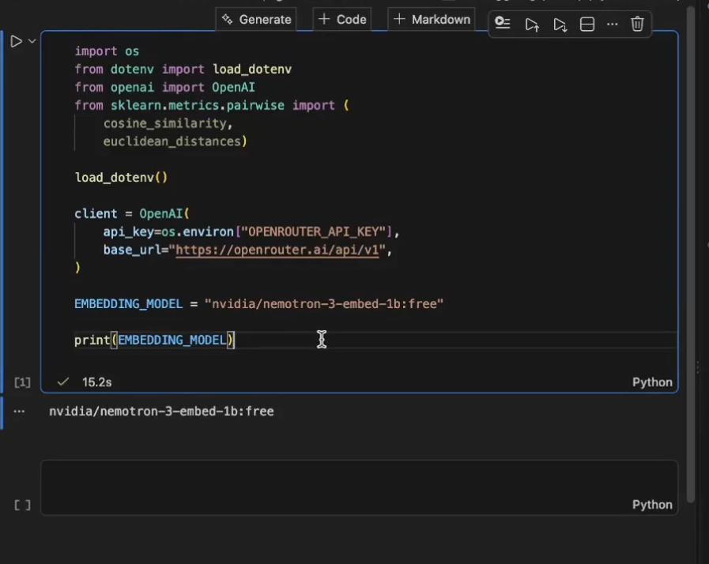

### 13.2 The knowledge base: 20 small documents

For now no PDF (that comes later). A list of 20 one-line docs with **metadata** (`topic`, `level`):

```python
documents = [
    {"id": 1,  "text": "Spring Boot simplifies building production-ready Java backend applications.", "topic": "backend", "level": "beginner"},
    {"id": 2,  "text": "Kubernetes orchestrates containers and provides scheduling, service discovery, and self-healing.", "topic": "devops", "level": "intermediate"},
    {"id": 3,  "text": "Redis is an in-memory data store commonly used for caching, sessions, and fast lookups.", "topic": "databases", "level": "beginner"},
    # ... Kafka, PostgreSQL, vector DBs, RAG, embedding model, cosine, HNSW, exact NN, quantization, payload indexes ...
    {"id": 14, "text": "Python is widely used for machine learning, data processing, and building AI applications.", "topic": "programming", "level": "beginner"},
    # ... async, API gateways, microservices, observability, cache, reranking ...
    {"id": 20, "text": "Reranking can improve retrieval quality by applying a more expensive relevance model to an initial candidate set.", "topic": "ai", "level": "advanced"},
]

texts = [d["text"] for d in documents]
print(f"{len(documents)} documents")     # 20 documents
```

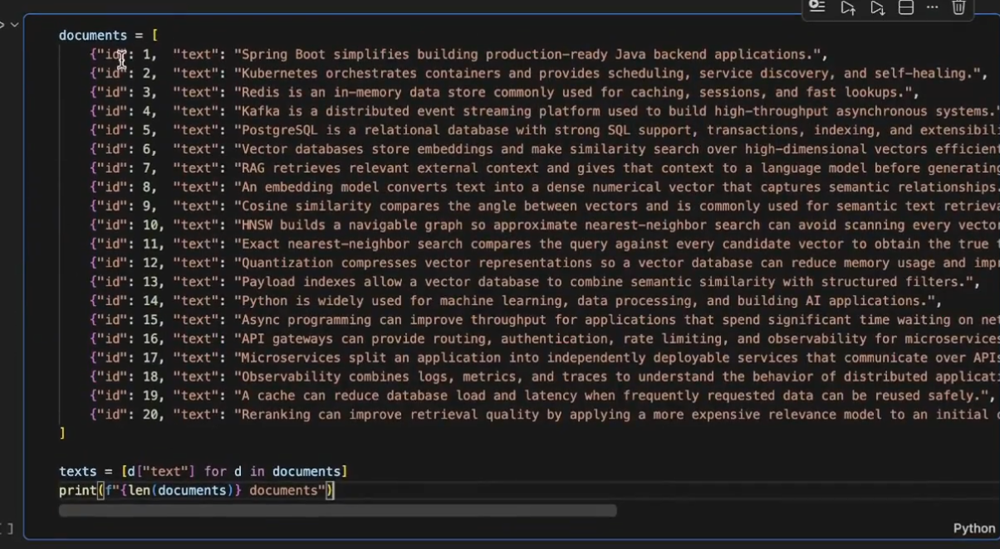

### 13.3 Embed the documents (indexing)

```python
def embed_documents(texts: list[str]) -> list[list[float]]:
    resp = client.embeddings.create(model=EMBEDDING_MODEL, input=texts)
    return [d.embedding for d in resp.data]          # N texts in → N vectors out

doc_embeddings = embed_documents(texts)

print("Number of embeddings:", len(doc_embeddings))      # 20
print("Dimensions per vector:", len(doc_embeddings[0]))  # 2048
print("First 5 values:", doc_embeddings[0][:5])          # [0.0948, 0.0749, -0.0003, -0.0032, 0.0142]
```

- **One API call** embeds the whole list: 20 strings in, **20 vectors** out.
- This NVIDIA model gives **2048 dimensions** (OpenAI `text-embedding-3-small` gives 1536). Always **read** the size, never assume it.

> [!IMPORTANT]
> **Embed once, store, reuse.** Embedding costs time and money. Don't re-embed the same documents on every run or every question. In a real system you embed at **indexing time** and **store** the vectors in a vector DB (next part).

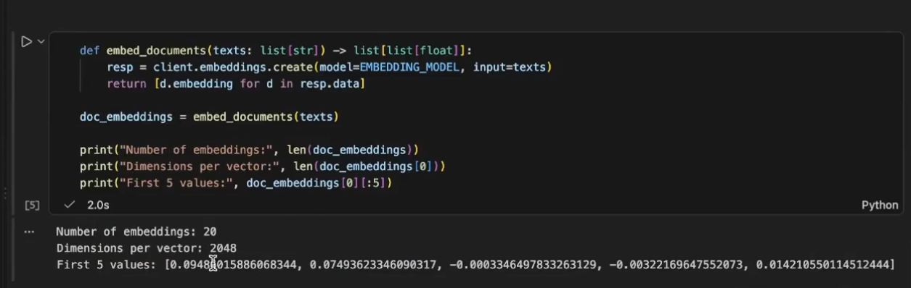

### 13.4 Embed the query

```python
query = "Which programming language is commonly used for AI applications?"

query_embedding = embed_documents([query])    # returns a list with ONE vector

print("Dimensions:", len(query_embedding[0]))                     # 2048
print("Collection must use size =", len(doc_embeddings[0]))       # 2048
```

The query must go through **the same embedding model** as the documents, so both live in the same space with the same dimensions (section 11.3).

### 13.5 Score every document: cosine + L2

```python
cos = cosine_similarity(query_embedding, doc_embeddings)[0]     # [0] = scores for our single query
l2  = euclidean_distances(query_embedding, doc_embeddings)[0]

print(f"{'Cos':>6}  {'L2':>5}  Document")
print("-" * 70)
for doc, c, d in zip(documents, cos, l2):
    print(f"{c:6.3f}  {d:6.3f}  {doc['text']}")
```

Result (selected rows):

| Doc | Text (short) | Cosine ↑ | L2 ↓ |
|---|---|---|---|
| **14** | **Python is widely used for machine learning … AI applications** | **0.614** 🥇 | **0.878** 🥇 |
| 15 | Async programming can improve throughput… | 0.199 | 1.266 |
| 3 | Redis is an in-memory data store… | 0.152 | 1.302 |
| 7 | RAG retrieves relevant external context… | 0.137 | 1.314 |
| 1 | Spring Boot simplifies … Java backend | 0.116 | 1.329 |
| 11 | Exact nearest-neighbour search compares… | **−0.005** | **1.418** (worst) |

How to read it:

- **Doc 14 (Python)** has the **highest cosine (0.614)** *and* the **lowest L2 (0.878)**. Both metrics agree it's the best answer, even though the query says "programming language … AI" and the doc says "Python … machine learning … AI". That's **semantic** matching.
- **Doc 11** has a **negative cosine (−0.005)** and the **largest L2**: the least related to the question.
- Notice that the **ranking is the same** for cosine and L2. Because the vectors are normalised, `L2² = 2 − 2·cos`, so they always agree on order.

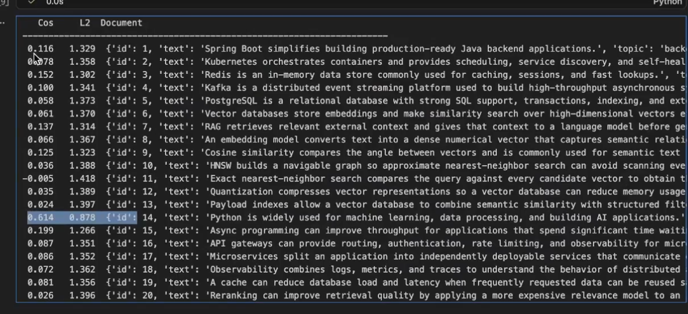

### 13.6 Top-K retrieval

```python
def retrieve(query_emb, doc_embs, docs, top_k=2):
    scores = cosine_similarity(query_emb, doc_embs)[0]

    # pair each document with its score, sort highest first, take top_k
    scored = list(zip(docs, scores))
    scored.sort(key=lambda x: x[1], reverse=True)      # cosine → HIGHEST first

    return [{"document": doc, "score": float(score)} for doc, score in scored[:top_k]]


print("Top-K results:\n")
for hit in retrieve(query_embedding, doc_embeddings, documents, top_k=4):
    print(f"{hit['score']:.3f}  {hit['document']['text']}")
```

```text
0.614  Python is widely used for machine learning, data processing, and building AI applications.
0.199  Async programming can improve throughput for applications that spend significant time waiting on network I/O.
0.152  Redis is an in-memory data store commonly used for caching, sessions, and fast lookups.
0.137  RAG retrieves relevant external context and gives that context to a language model before generating an answer.
```

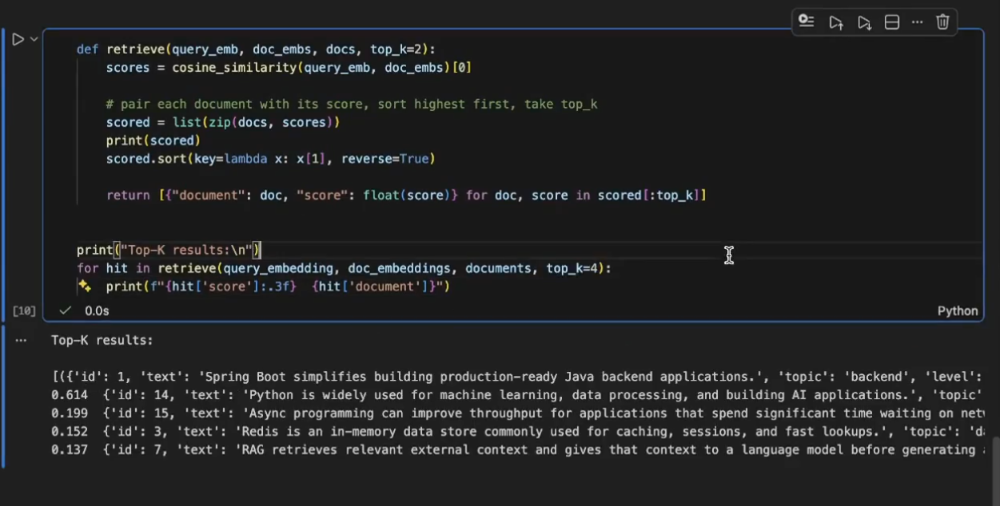

**This is the "R" in RAG.** These top-K docs are what would go to the LLM as **context**.

### 13.7 The problem with plain top-K, and a score threshold

With `top_k=4` we got **one great match (0.614)** and **three weak ones (≤ 0.199)** that have nothing to do with the question. Top-K **always returns K results**, even if they're irrelevant. Sending them to the LLM adds noise and invites **hallucination**.

Fix: add a **minimum score threshold**, e.g. keep only cosine **≥ 0.5**:

```python
def retrieve(query_emb, doc_embs, docs, top_k=4, min_score=0.5):
    scores = cosine_similarity(query_emb, doc_embs)[0]
    scored = sorted(zip(docs, scores), key=lambda x: x[1], reverse=True)
    return [{"document": d, "score": float(s)} for d, s in scored[:top_k] if s >= min_score]
```

Now only the Python doc comes back, which is exactly the context we want.

> [!TIP]
> **The threshold depends on the model.** 0.5 worked for this model and these docs, but every embedding model has its own score range. Tune it on your own questions, and if nothing passes, have the bot say *"I don't know"* instead of guessing.

> [!NOTE]
> Frameworks like **LangChain** (and vector DBs like **Qdrant**) do all of this for us: embed, store, score, sort, top-K, threshold. We built it by hand first so we know **what's happening under the hood**.

---

## 14. Choosing a distance metric

### 14.1 Decision tree

When you're stuck, walk down this tree. **For most RAG work you land on cosine or dot product within the first two questions.**

| # | Question | If **yes** → use | Typical use |
|---|---|---|---|
| 1 | Are the vectors **normalised to length 1**? | **Dot product** | Fastest, and the **same ranking as cosine** |
| 2 | Does the **vector length carry meaning**? | **Dot product** | Popularity, intensity |
| 3 | Are these **text / semantic embeddings**? | **Cosine** | Text search, RAG, NLP |
| 4 | **Outliers**, or **very many dimensions**? | **Manhattan (L1)** | Noisy, high-dimensional data |
| — | None of the above | **Euclidean (L2)** | Coordinates, pixels, physical space |

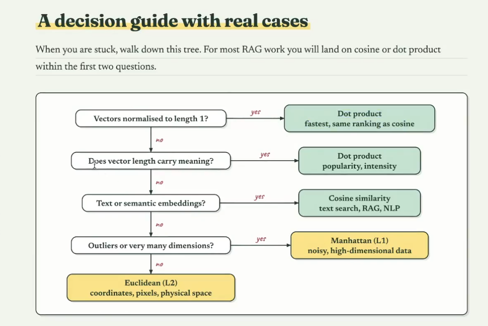

### 14.2 Real-world cheat sheet

| Scenario | Choose | Why |
|---|---|---|
| **Chatbot over company documents** (our RAG project) | **Cosine** | Meaning lives in the **direction**, and a long policy PDF shouldn't be punished for its length |
| **"Customers also liked"** on a shopping site | **Dot product** | A **best-seller should outrank** an obscure item with the same taste profile (magnitude = popularity) |
| Finding **visually similar product photos** | **Euclidean** | Absolute intensity and position matter, not just proportions |
| Estimating **delivery distance on a city grid** | **Manhattan** | Movement follows streets, so you sum blocks, not diagonals |
| **Fraud scoring** on sensor-like features with glitches | **Manhattan** | **One corrupted feature shouldn't dominate** the score (L2 squares a big gap and makes it huge) |

---

## 15. Why we need a vector database

In our lab we compared the query with **all 20 vectors**, which was instant. With **10 million** vectors, comparing the query with every single one, ranking them and taking the top-K is **far too slow** for a live chatbot.

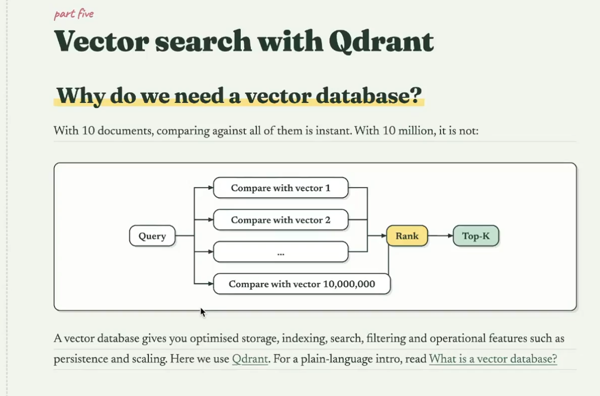

A **vector database** gives you what a Python list can't:

| Feature | What it means |
|---|---|
| **Optimised storage** | Vectors + their **payload** (text, metadata) stored together |
| **Indexing** | A pre-built index (e.g. **HNSW**, section 17) so search does **not** compare against everything |
| **Search** | Similarity search with your chosen metric, top-K, score threshold |
| **Filtering** | Combine "similar to X" with "topic = devops AND level = beginner" |
| **Operations** | Persistence, snapshots, replication, **scaling** |

**Qdrant** is a popular **open-source** vector database (written in Rust) with a Python SDK. Others you'll hear about: **pgvector** (vectors inside PostgreSQL), Pinecone, Weaviate, Milvus, Chroma.

> [!NOTE]
> **Qdrant vocabulary vs SQL:** a **collection** is like a **table** (it holds the same kind of data, with one fixed vector size and metric). A **point** is like a **row**: `id` + `vector` + `payload` (the JSON metadata).

---

## 16. Qdrant hands-on

### 16.1 Install and deployment options

```bash
uv add qdrant-client          # note: the package is qdrant-client, not "qdrant"
```

Qdrant can run in several ways, and **the code is the same for all of them. Only one line changes**:

| Mode | Client line | Data survives? | Use for |
|---|---|---|---|
| **In-memory** | `QdrantClient(":memory:")` | ❌ Lives in RAM, gone when the script ends | Learning the API, no install |
| **Local on-disk** | `QdrantClient(path="./qdrant_data")` | ✅ | Small local projects |
| **Docker server** | `QdrantClient(url="http://localhost:6333")` | ✅ (with a volume) | Dev / realistic testing, dashboard |
| **Managed cloud** | `QdrantClient(url=..., api_key=...)` | ✅ | Production |

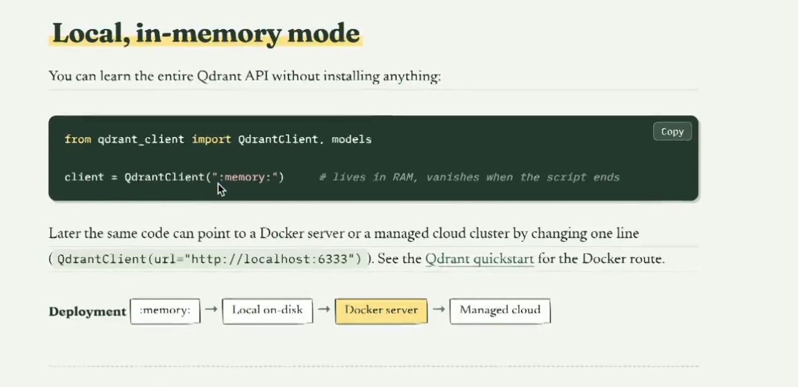

### 16.2 Running Qdrant in Docker

```bash
docker pull qdrant/qdrant

docker run -p 6333:6333 -p 6334:6334 \
    -v "$(pwd)/qdrant_storage:/qdrant/storage:z" \
    qdrant/qdrant
```

| Port | What |
|---|---|
| **6333** | **REST API**, and the **Web UI** at `http://localhost:6333/dashboard` |
| **6334** | **gRPC API** (faster, binary, used by SDKs) |

In class we used **Docker Desktop**: Docker Hub → `qdrant/qdrant` → Run, container name `qdrant-test`, host ports 6333 and 6334. The logs show `Version: 1.19.1` and `Access web UI at http://localhost:6333/dashboard`.

> [!WARNING]
> **DevOps catch from the logs:** class ran the container **without a volume**, and Qdrant warned *"Container filesystem detected – storage might be lost with container re-creation."* Always mount storage (`-v …:/qdrant/storage`). **On Windows** use a **named volume** instead of a folder path: `docker run -p 6333:6333 -p 6334:6334 -v qdrant_storage:/qdrant/storage qdrant/qdrant`.

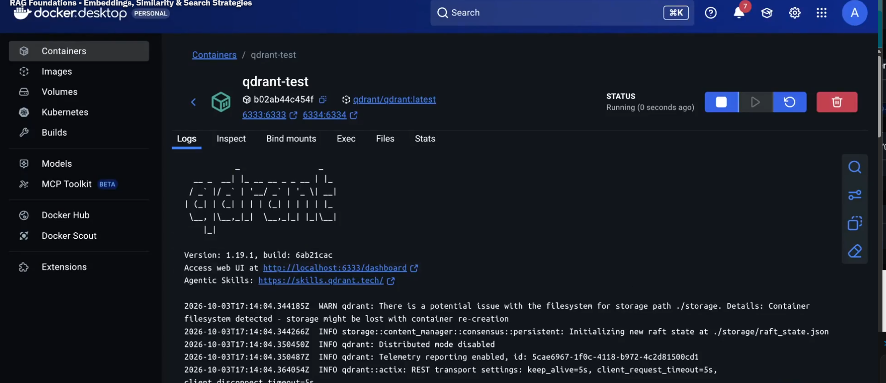

### 16.3 Connect and create a collection

```python
from qdrant_client import QdrantClient, models

qdrant = QdrantClient(":memory:")
# qdrant = QdrantClient(url="http://localhost:6333")   # switch to the Docker server, nothing else changes

COLLECTION = "rag_fundamentals"

if qdrant.collection_exists(COLLECTION):                # makes the cell safe to re-run
    qdrant.delete_collection(COLLECTION)

qdrant.create_collection(
    collection_name=COLLECTION,
    vectors_config=models.VectorParams(
        size=len(doc_embeddings[0]),      # always read from the model, never hard-code (2048 here)
        distance=models.Distance.COSINE,  # COSINE | DOT | EUCLID | MANHATTAN
    ),
)
print("Created:", COLLECTION, "| size:", len(doc_embeddings[0]))   # Created: rag_fundamentals | size: 2048
```

The **size** and the **distance metric** are fixed **per collection**. This is exactly the compatibility rule from section 11.3: a 768-dim vector can't go into this 2048-dim collection.

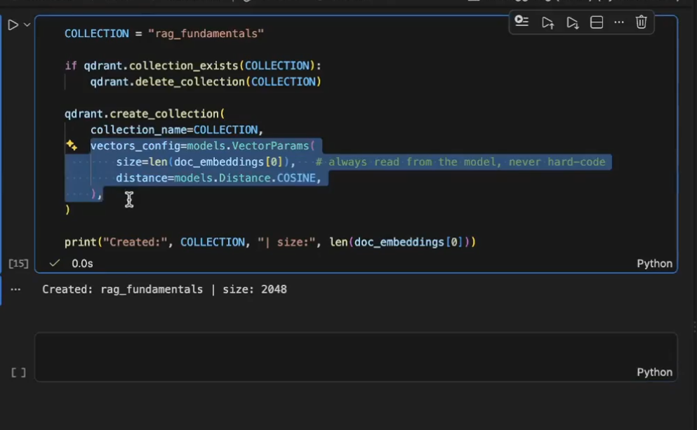

### 16.4 Upsert the points (indexing)

```python
points = [
    models.PointStruct(
        id=doc["id"],
        vector=vec,
        payload={"text": doc["text"], "topic": doc["topic"], "level": doc["level"]},
    )
    for doc, vec in zip(documents, doc_embeddings)
]

qdrant.upsert(collection_name=COLLECTION, points=points, wait=True)
print(f"Inserted {len(points)} points.")       # Inserted 20 points.
```

- **Upsert** = insert, or **update if the id already exists**. Re-running doesn't create duplicates.
- **Payload** = the original text + metadata. We need the **text** back to send to the LLM, and **topic/level** let us **filter** later.
- `wait=True` waits until the data is actually indexed before returning.
- We reuse `doc_embeddings` from section 13, so we **don't re-embed**.

### 16.5 The dashboard

With the client pointed at the Docker server, open **`http://localhost:6333/dashboard` → Collections**. First it shows *"No collection is present"*. After running the cells, **`rag_fundamentals`** appears. Each **point** shows its **payload** (`text`, `topic: backend`, `level: beginner`) and **Default vector – Length: 2048**. The tabs include Info, Memory, **ANN Recall**, Snapshots, Visualize and Graph.

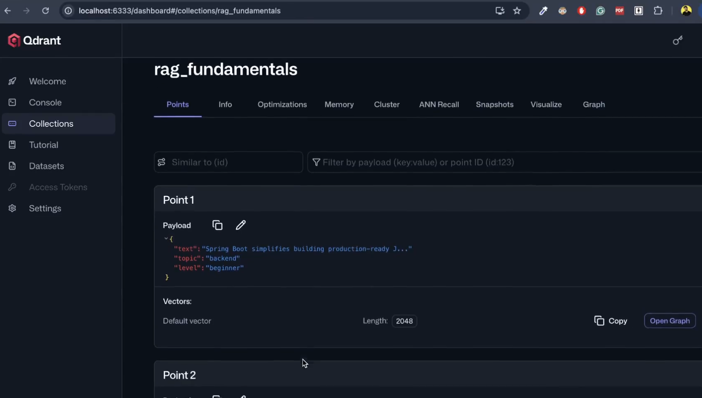

### 16.6 Query (retrieval)

```python
results = qdrant.query_points(
    collection_name=COLLECTION,
    query=query_embedding[0],     # a single vector, not a list
    limit=5,                      # top-K
    with_payload=True,            # give me the text back
    # score_threshold=0.5,        # optional: drop weak matches (section 13.7)
).points

for p in results:
    print(p.id, round(p.score, 3), p.payload["text"])
```

```text
14  0.614  Python is widely used for machine learning, data processing, and building AI applications.
15  0.199  Async programming can improve throughput ...
3   0.152  Redis is an in-memory data store ...
7   0.137  RAG retrieves relevant external context ...
9   0.125  Cosine similarity compares the angle between vectors ...
```

**Same answer as our hand-written version:** doc 14 at **0.614**, the same score sklearn gave in section 13.5. Qdrant did the scoring, sorting and top-K for us, and returned the payload too.

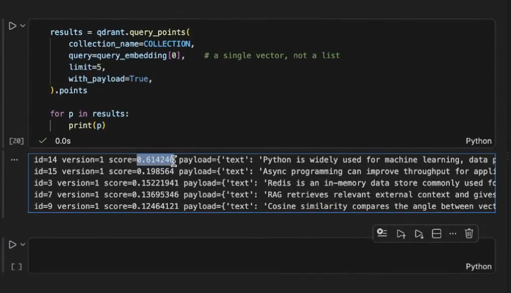

| Our hand-written code (section 13) | Qdrant |
|---|---|
| `doc_embeddings` Python list | **collection** of **points** |
| `cosine_similarity(...)` + `sort` + slice | `query_points(limit=K)` |
| `if s >= min_score` | `score_threshold=` |
| Lost when the notebook stops | Persisted (Docker + volume), indexed, filterable |

---

## 17. Search strategies: exact vs approximate (ANN)

### 17.1 Recall and precision (how we judge retrieval)

- **Recall** = the share of the **right** answers that your search actually returned. Say **4 chunks** truly answer a question and the top 10 results contain **3** of them: recall = **3/4 = 75%**. The missing chunk is **invisible to the LLM**.
- **Precision** = of the results returned, how many were useful: **3/10 = 30%**.
- **A bigger K raises recall and lowers precision.**
- The **same recall measure** is used to judge **approximate indexes**: how many of the *true* nearest neighbours did they find? (That's the **ANN Recall** tab in the Qdrant dashboard.)

### 17.2 Exact (brute-force) vs approximate nearest neighbour

| | **Exact (k-NN / brute force)** | **Approximate (ANN)** |
|---|---|---|
| How | Compare the query with **every** vector | Use a **pre-built index** to jump straight to **promising candidates** |
| Result | The true top-K, guaranteed (100% recall) | Almost always the same top-K, but may **occasionally miss** a true neighbour |
| Speed at 10M vectors | Too slow | Fast, because it does a **small fraction** of the work |
| What we did | Our sklearn lab (section 13) | Qdrant with its default index |

```text
Query → ANN index → Promising candidates → Top-K
```

In the class example the exact search compared the query with **all 15 points**, while ANN checked **only 6 candidates** and found **the same three answers**: **less than half the work**. At 10 million vectors that gap is enormous.

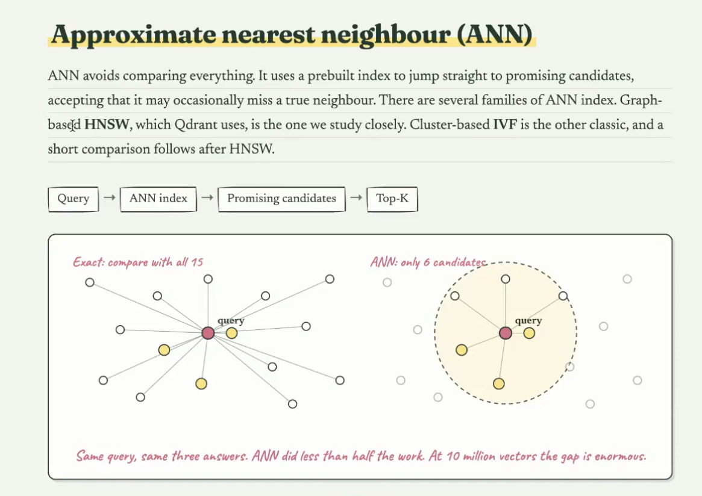

There are several **families of ANN index**: **graph-based HNSW** (what Qdrant uses, studied below) and **cluster-based IVF** (the other classic: group vectors into clusters and search only the nearest clusters).

### 17.3 HNSW: the idea

**HNSW = Hierarchical Navigable Small World**, the index Qdrant uses to make vector search fast. The name is three ideas stuck together:

| Word | Plain meaning |
|---|---|
| **Navigable** | The vectors are linked into a **graph** you can walk along, always moving **closer** to what you want |
| **Small World** | A few **long-range links** mean any vector is only a **few hops** from any other (like "six degrees of separation") |
| **Hierarchical** | The graph is stacked in **layers**: a sparse **high-level overview at the top**, full detail at the bottom |

> [!TIP]
> **Analogy: finding a house in a new city.** You don't knock on every door (that's exact search). You take the **highway** to the right area (top layer), then **main roads** to the neighbourhood (middle layer), then walk the **street** to the door (bottom layer). Each layer gets you closer with very few steps.

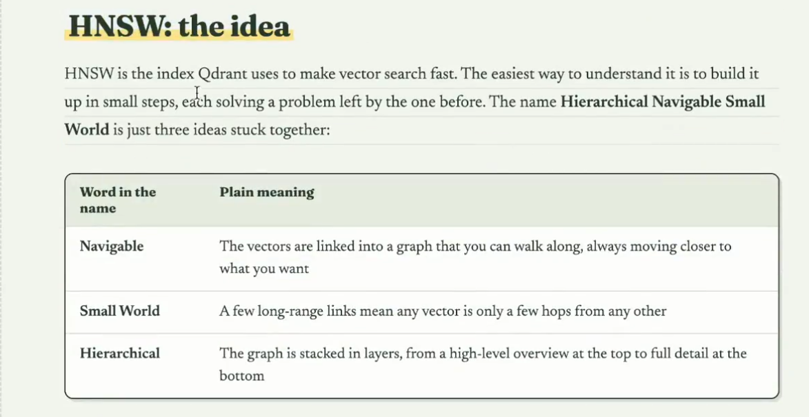

---

## Interview quick answers

1. **"What is RAG?"** Retrieval-Augmented Generation: at question time, retrieve relevant pieces of your own data, add them to the prompt as context, and let the LLM generate an answer grounded in that context.
2. **"RAG vs fine-tuning?"** Fine-tuning changes the model's weights. It's costly and goes stale as data changes. RAG leaves the model untouched and injects fresh data per request, which makes it cheap to update and lets you cite sources. Use fine-tuning for *behaviour/style*, RAG for *knowledge*.
3. **"Why do LLMs need RAG at all?"** Knowledge cut-off (no recent info), no access to private company data, and hallucination when they don't know.
4. **"What is OpenRouter and why use it?"** One OpenAI-compatible API and key in front of hundreds of models and providers. You switch models by changing a string, compare price/latency, set per-key credit limits, and see per-call logs and costs.
5. **"Streaming vs non-streaming?"** Streaming returns tokens as they're generated (`stream=True`, iterate chunks, read `delta.content`). The first output comes much sooner, which makes the bot feel faster. Non-streaming returns the full answer at the end.
6. **"Why `AsyncOpenAI`?"** Non-blocking calls, so one service can handle many concurrent user requests.
7. **"How do you track LLM cost?"** Token usage (prompt + completion) × the model's per-million price. Get it from `usage` (with `include_usage` when streaming) and from the provider/OpenRouter logs.
8. **"Walk me through a RAG architecture."** Two pipelines joined by a vector DB. **Indexing (offline, per document):** parse → chunk → embed → store vector + payload in Qdrant. **Querying (online, per question):** embed the query → similarity search → top-K chunks → prompt + context → LLM → answer.
9. **"A RAG bot gives a wrong answer. Where do you look first?"** Retrieval. Check whether the right chunk was in the top-K. If it wasn't, fix parsing/chunking/embeddings/search before touching the prompt or the LLM.
10. **"Why not just stuff all documents into the prompt?"** Cost (billed per token on every call), latency, and quality: the relevant fact gets buried and the model hallucinates. Retrieve only the best few chunks.
11. **"What is an embedding?"** A fixed-length vector of numbers that represents the meaning of a text. Texts with similar meaning get vectors that are close together, which is what makes semantic search possible.
12. **"What are dimensions? Is more always better?"** The number of values in the vector (e.g. 384/768/1536/3072). More can separate near-duplicates slightly better, but costs 4 bytes × dims × chunks in memory, plus slower search and a bigger bill. Chunking and model quality matter more. Measure recall first.
13. **"How does an embedding model turn a sentence into one vector?"** Tokenize → token IDs → look up rows in the embedding matrix → transformer layers (attention adds context, e.g. river bank vs money bank) → pool (average) → normalise to length 1.
14. **"You switch embedding models. What happens?"** Old vectors are meaningless to the new model. Re-embed and re-index everything into a collection sized for the new dimension. Never mix models in one collection.
15. **"RAG or fine-tuning?"** Needs *access to information* → RAG (update the index any time). Needs to *behave differently* → fine-tuning (changes weights, needs retraining per change).
16. **"Which similarity metrics do you know?"** Cosine (angle, higher = more similar, −1..1), Euclidean/L2 (straight line, lower = closer), dot product (alignment + magnitude, higher = better), Manhattan/L1 (sum of per-dimension gaps, lower = closer).
17. **"Cosine vs dot product?"** Cosine ignores length and dot product doesn't. For normalised (length-1) vectors they give the **same ranking**, and dot product is cheaper.
18. **"Most common similarity bug?"** Sorting in the wrong direction: cosine/dot sort descending, L2/L1 sort ascending.
19. **"What's the problem with top-K, and how do you fix it?"** It always returns K results, even irrelevant ones, which adds noise and hallucination. Add a minimum score threshold (tuned per model) and return "I don't know" when nothing passes.
20. **"Walk me through retrieval in code."** Embed the docs once (`embeddings.create`, N in → N vectors), embed the query with the same model, compute `cosine_similarity(query, docs)`, sort descending, take top-K above the threshold, and pass those as context.

21. **"Which metric would you choose for a RAG chatbot? For 'customers also liked'?"** RAG: cosine (meaning is direction; long docs aren't penalised), or dot product if vectors are normalised. Recommendations: dot product, because magnitude (popularity) should count.
22. **"Why do you need a vector database? Why not numpy?"** Brute force over millions of vectors is too slow. A vector DB adds an ANN index (HNSW), payload storage, metadata filtering, persistence, snapshots and scaling.
23. **"Explain Qdrant's data model."** Collection (like a table, fixed vector size + distance metric) → points (id + vector + payload JSON). `create_collection` → `upsert` → `query_points(limit, score_threshold, filter)`.
24. **"How would you run Qdrant?"** `:memory:` to learn. Docker (`qdrant/qdrant`, 6333 REST + dashboard, 6334 gRPC) **with a volume** on `/qdrant/storage` for dev. Managed cloud or a cluster for production. Only the client URL changes.
25. **"Recall vs precision?"** Recall = relevant found ÷ all relevant (4 relevant, 3 found → 75%). Precision = relevant found ÷ returned (3 of 10 → 30%). A bigger K raises recall and lowers precision.
26. **"Exact vs ANN search?"** Exact compares against every vector: 100% recall, slow at scale. ANN uses an index to check only promising candidates: much faster, and occasionally misses a neighbour. Measure that with recall.
27. **"What is HNSW?"** Hierarchical Navigable Small World: a layered graph. Search starts at the sparse top layer and greedily hops closer, descending layers until the dense bottom one. Long-range links keep it to a few hops. It's Qdrant's default index. IVF (cluster-based) is the main alternative.

## What's next
- **Next lectures:** parsing and chunking in depth (how to split PDFs well)
- **Retrieval upgrades to watch for:** metadata filters on payload, hybrid search (keyword BM25 + vector), reranking (doc 20 in our KB!)
- **HNSW tuning:** `m`, `ef_construct` and `ef` (speed vs recall), and IVF in more detail
- **Full RAG loop in code:** Qdrant results → prompt context → LLM answer (joining Part 1 and Part 4)
