# Chapter 02: RAG with LangChain

*AI track · Chapter 02 · Course: Coding Shuttle, "From SDE to AI Engineering" (Week 2, Class 2) · Started 2026-10-10*

> [!NOTE]
> **This chapter is being written in parts.**
> **Part 1 (done):** quantization in Qdrant, what LangChain is (interfaces, components map, packages), project setup, the `Document` object, document loaders (Markdown, PDF, scanned PDF with OCR), and a first look at splitting and tokens.
> **Part 2 (done):** chunking the handbook, stable chunk IDs, compliance (PII redaction, ID documents, multi-tenancy with payload), embeddings with LangChain, `QdrantVectorStore`, similarity search and retrievers, `ChatOpenRouter` + temperature, prompt templates, the explicit 4-step RAG pipeline, the same pipeline as an LCEL chain, and debugging (sections 7–14).
> ✅ **Chapter complete.** A 4-page handwritten synopsis is in `PDF/02-rag-with-langchain-synopsis.pdf`.

## Agenda for this class

| # | Topic | Status |
|---|---|---|
| 1 | Quantization in Qdrant | ✅ Part 1 |
| 2 | Filtering in Qdrant (payload, multi-tenancy) | ✅ Part 2 (concept) |
| 3 | What LangChain is | ✅ Part 1 |
| 4 | Data loaders | ✅ Part 1 |
| 5 | Chunkers | ✅ Part 1 + 2 |
| 6 | Embedding with LangChain | ✅ Part 2 |
| 7 | Generation | ✅ Part 2 |
| 8 | Output parsers | ✅ Part 2 |
| 9 | LCEL | ✅ Part 2 |

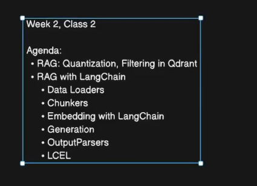

---

## 1. Quantization: shrinking the vectors

### 1.1 The problem: vectors are expensive

From Chapter 01: each dimension is a **float32** = **4 bytes**. A 1536-dimension vector is 1536 × 4 ≈ **6 KB per chunk**, so **1 million chunks ≈ 6 GB** of vectors alone. At real company scale, that's a lot of RAM to pay for.

**Quantization** stores a **compressed, lower-precision version** of each vector instead:

```text
float32 vector  →  lower-precision representation  →  smaller memory footprint
```

| Storage type | Memory for 1M vectors × 1536 dims | How |
|---|---|---|
| **float32** (no quantization) | **6.1 GB** | 4 bytes per number |
| **int8 scalar quantization** | **1.5 GB** (4× smaller) | 1 byte per number |
| **Binary quantization** | **0.19 GB** (32× smaller) | 1 *bit* per number (just + or −) |

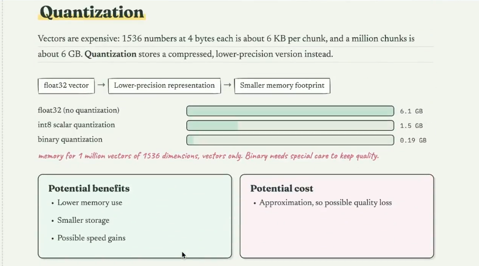

### 1.2 The trade-off, with an example

> [!TIP]
> **Analogy: a measuring tape with only feet marked.** You're building a wall that is **16 ft 3 in** long, but your tape only shows **feet**. You'll record **16 ft** and lose the 3 inches. The measurement isn't *wrong*, it's just **less precise**. Quantization does the same: float32 → int8 rounds each number, so you lose a little precision, **not** the whole answer.

| Potential benefits | Potential cost |
|---|---|
| Lower memory use | It's an **approximation**, so possibly some **quality loss** |
| Smaller storage | **Binary** needs special care to keep quality |
| Possible speed gains | |

### 1.3 In code: set it when you create the collection

```python
client.create_collection(
    collection_name="compressed",
    vectors_config=models.VectorParams(size=1536, distance=models.Distance.COSINE),
    quantization_config=models.ScalarQuantization(
        scalar=models.ScalarQuantizationConfig(
            type=models.ScalarType.INT8,   # float32 -> 8-bit integers
            always_ram=True,               # keep the small quantized copy in RAM for fast search
        )
    ),
)
```

> [!NOTE]
> **For infra people:** Qdrant keeps the **original float32 vectors on disk** and the small int8 copy in **RAM** (`always_ram=True`). Search runs on the fast small copy. This is a classic **RAM-cost vs accuracy** knob, much like choosing an instance size.

---

## 2. What is LangChain?

### 2.1 The idea: a standard interface for every job

**LangChain** is an **open-source framework** that gives every part of an LLM application a **standard interface**. A PDF parser, an embedding API, a vector database and a chat model all come from **different vendors with different SDKs**. LangChain wraps each of them in the **same few shapes**, so you connect them like **building blocks** and can **swap any block without rewriting the rest**.

Read the diagram in **two layers**:

- **Top row (yellow) = what your code uses:** five LangChain interfaces.
- **Underneath = the providers** that do the real work. Green is the one we use, pink are drop-in replacements.

| Interface (what your code calls) | Job | Provider we use | Drop-in replacements |
|---|---|---|---|
| **Document loader** | files → `Document`s | PyPDFLoader | PyMuPDFLoader, Unstructured |
| **Text splitter** | Documents → chunks | Recursive | Markdown header, Token-based |
| **Embeddings** | chunks → vectors | OpenAI | HuggingFace, Ollama |
| **Vector store** | store and search | Qdrant | Chroma, pgvector |
| **Chat model** | writes the answer | OpenRouter | OpenAI, Groq |

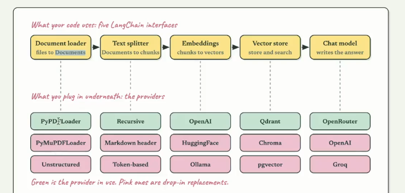

> [!TIP]
> **Infra analogy: the Kubernetes CSI driver.** Your Pod asks for a "volume" through one standard interface, and underneath it might be EBS, Azure Disk or NFS. Swap the driver and the Pod spec doesn't change. LangChain does the same for loaders, splitters, embeddings, vector stores and models.

**Why it matters:** in Chapter 01 we hand-wrote loading, embedding, cosine scoring, sorting and top-K. LangChain gives you ready-made, tested versions, and if a better vendor appears later you **change one line**, not the whole pipeline.

### 2.2 What it is, and what it is not

| ✅ What LangChain gives you | ❌ What LangChain is NOT |
|---|---|
| **One interface per job**, many providers behind it | **Not RAG.** RAG is the *design*; LangChain is a *toolbox* to build it |
| **Ready-made** loaders, splitters and vector-store wrappers | **Not a database.** Qdrant stores the vectors |
| A way to **compose steps into a pipeline** with `\|` (LCEL, coming later) | **Not a model.** OpenAI / OpenRouter do the AI |
| **Streaming, batching and tracing** for free | |

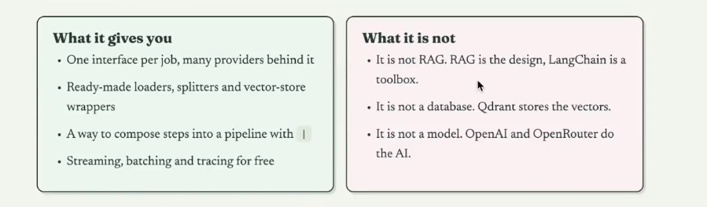

### 2.3 The components map: eight pieces of a RAG app

Eight components cover almost everything a RAG application needs. It's the same two-pipeline picture from Chapter 01, now with LangChain names:

| Row | Runs | Components |
|---|---|---|
| **Prepare the knowledge** | **Once** (indexing) | **Document loader** (files → Documents) → **Text splitter** (Documents → chunks) → **Embedding model** (chunks → vectors) → **Vector store** (Qdrant) |
| **Answer questions** | **Every time** (querying) | **Retriever** (query → Documents, searches the vector store) → **Prompt template** (context + question) → **Chat model** (writes the answer) → **Output parser** (message → string) |

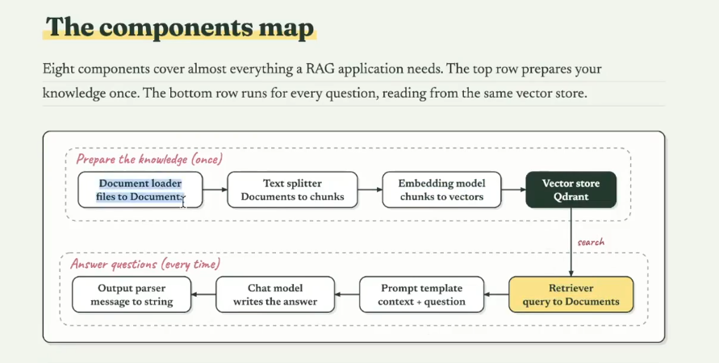

### 2.4 How the packages fit together

LangChain is split into **small packages, so you install only what you use**. Think **hub and spokes**: `langchain-core` defines the shared interfaces and every other package plugs into it.

| Package | What it gives you |
|---|---|
| **`langchain-core`** (the hub) | The base types: `Document`, `Runnable`, prompts, parsers |
| `langchain-community` | Community **document loaders** (TextLoader, PyPDFLoader, Unstructured…) |
| `langchain-text-splitters` | **Chunking** (RecursiveCharacterTextSplitter…) |
| `langchain` | Chains and helpers |
| `langchain-openai` | `OpenAIEmbeddings` |
| `langchain-qdrant` | `QdrantVectorStore` |
| `langchain-openrouter` | `ChatOpenRouter` |

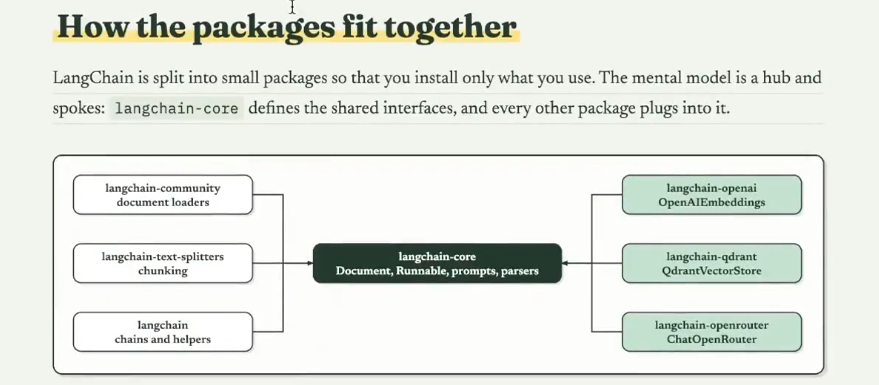

> [!TIP]
> **Infra analogy:** it's like **Terraform core + providers**. You run `terraform init` and pull only the AWS or Azure provider you need, rather than one giant binary with everything.

---

## 3. Project setup

### 3.1 Folders

The project now has one numbered folder per class:

```text
ai-engg-rag/
├── .env                      # OPENROUTER_API_KEY (and OPENAI_API_KEY if used)
├── pyproject.toml
└── src/ai_engg_rag/
    ├── 1_call_llm/           # Ch 01 Part 1
    ├── 2_learn_rag_basics/   # Ch 01 Parts 3-4
    └── 3_langchain_rag/      # this chapter
        ├── main.ipynb
        └── knowledge/        # the sample company knowledge base
```

### 3.2 Install

```bash
uv add langchain langchain-core langchain-community langchain-openai \
    langchain-openrouter langchain-qdrant langchain-text-splitters \
    qdrant-client python-dotenv pypdf pymupdf
```

`uv` resolved **84 packages** and installed 49. It also pulled in **langgraph** and **langsmith** (agents and tracing, for later) and wrote everything into `pyproject.toml`, e.g. `langchain>=1.4.3`, `langchain-core>=1.6.6`, `langchain-qdrant>=1.1.0`.

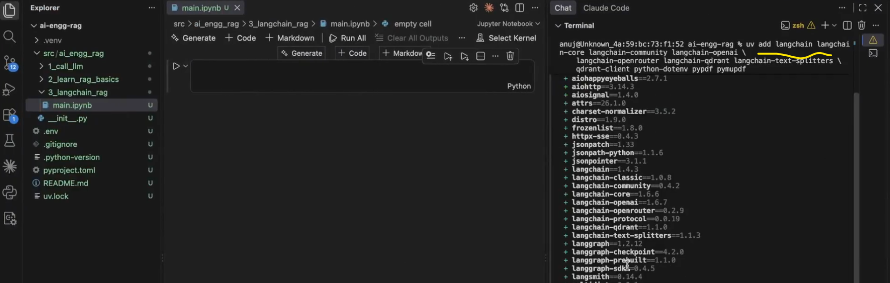

### 3.3 Load the keys

```python
import os
from dotenv import load_dotenv

load_dotenv()

for key in ("OPENAI_API_KEY", "OPENROUTER_API_KEY"):
    assert os.getenv(key), f"{key} is missing from your .env file"

print("API keys loaded")
```

The `assert` **fails fast** with a clear message if a key is missing, which is better than a confusing error ten cells later. In class only OpenRouter is actually used, so the instructor removed the check for `OPENAI_API_KEY`.

> [!TIP]
> **Same pattern as a pre-flight check in a deploy script:** verify required env vars and secrets exist before doing any real work.

---

## 4. The `Document` object

### 4.1 Two fields: text + metadata

Before loading anything, meet the **one object that travels through the entire pipeline**. A LangChain `Document` has just **two fields**:

| Field | What it holds |
|---|---|
| **`page_content`** | The **text itself** |
| **`metadata`** | A **dictionary** describing where the text came from: source, page, any custom keys |

```python
from langchain_core.documents import Document

doc = Document(
    page_content=(
        "Full-time employees receive 24 days of paid annual leave per calendar year. "
        "Up to 5 unused days may be carried over into the next year."
    ),
    metadata={"filename": "employee_handbook.pdf", "page": 1, "area": "policies"},
)

print(doc.page_content)
print(doc.metadata)     # {'filename': 'employee_handbook.pdf', 'page': 1, 'area': 'policies'}
```

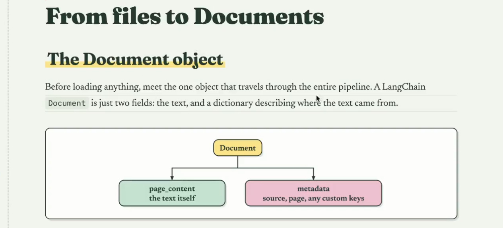

**Why metadata matters:**

- It becomes the **payload** in Qdrant (Chapter 01, section 16.4).
- You can **filter** on it, e.g. "only search `area = policies`" (coming in Qdrant filtering).
- You can **cite sources**: "from employee_handbook.pdf, page 1".

> [!TIP]
> **Infra analogy:** `page_content` is the **log message**, and `metadata` is the **labels** (`pod`, `namespace`, `app`). The labels are what let you filter and trace it back.

---

## 5. Document loaders: files → Documents

### 5.1 What a loader does

A loader's **only job** is to read an external source and return a **list of `Document` objects**. The source can be a PDF, text/Markdown, CSV/JSON, a web page/HTML, Word documents or a database. **The output shape is always the same.** What differs between loaders is **how well they read a particular kind of file**, and that is where your choice matters.

```text
PDF / Text & Markdown / CSV & JSON / Web pages & HTML / Word  →  loader.load()  →  list[Document]
```

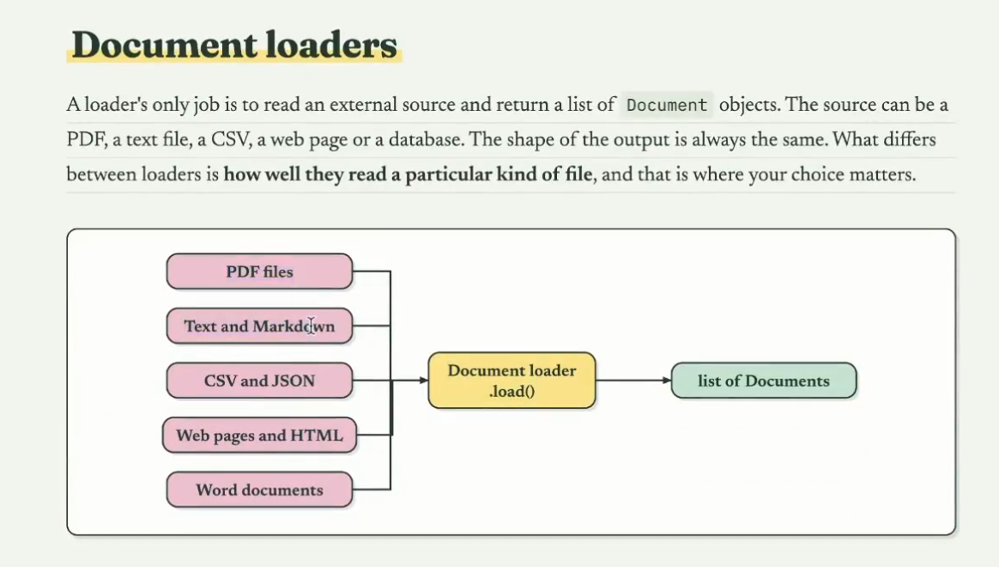

### 5.2 The sample knowledge base: a fictional Zomato

To make it realistic, the class uses a **fake company knowledge base** with every kind of file a real help-desk bot meets:

| Folder | File | Type | What's inside |
|---|---|---|---|
| `catalog/` | `plans.json` | JSON | Product/plan catalogue |
| `faq/` | `support_faq.csv` | CSV | ~40 rows with columns `question, answer, product, category` (Refunds, Delivery, Gold membership, Enterprise SSO/billing…) |
| `policies/` | `employee_handbook.pdf` | PDF (text) | 8 pages: values, probation, working hours, leave… |
| `policies/` | `expense_policy.pdf`, `travel_memo.docx` | PDF, Word | Policies |
| `scans/` | `vendor_contract.pdf` | **Scanned PDF** (images only) | A 7-page Master Services Agreement. **You can't select the text** |
| `wiki/` | `holiday_calendar.html` | HTML | Holidays in tables |
| `wiki/` | `onboarding.md`, `payments_runbook.md` | Markdown | Engineering onboarding, payments runbook |
| `wiki/` | `retry_helper.py` | Python code | Code in the knowledge base |

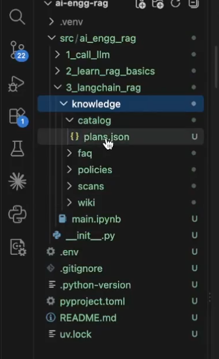

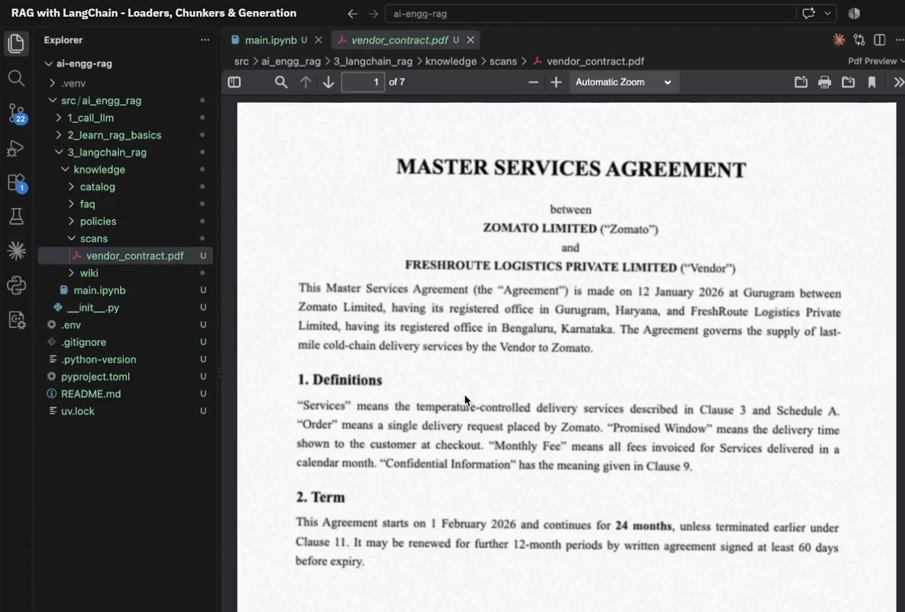

### 5.3 Markdown: `TextLoader` vs `UnstructuredMarkdownLoader`

```python
from langchain_community.document_loaders import TextLoader, UnstructuredMarkdownLoader

# TextLoader is the recommended choice for Markdown: it keeps the headings intact for splitting later
notes = TextLoader("knowledge/wiki/onboarding.md", encoding="utf-8").load()

print(len(notes))                  # 1   -> 1 file = 1 Document
print(notes[0].metadata)           # {'source': 'knowledge/wiki/onboarding.md'}   <- added automatically
print(notes[0].page_content[:200]) # "# Engineering Onboarding\n\nWelcome to Zomato Engineering..."
```

- **One file → one `Document`.** Splitting it into smaller pieces is *our* job, in the next step (the splitter).
- `source` metadata is **added automatically**, and you can add more keys yourself.
- **`TextLoader`** keeps the raw Markdown, including the `#` / `##` headings, which a Markdown-aware splitter can later use to cut at sections.
- **`UnstructuredMarkdownLoader`** strips the Markdown syntax and gives clean text. That's nice to read, but you **lose the heading structure**, so it's not recommended here.

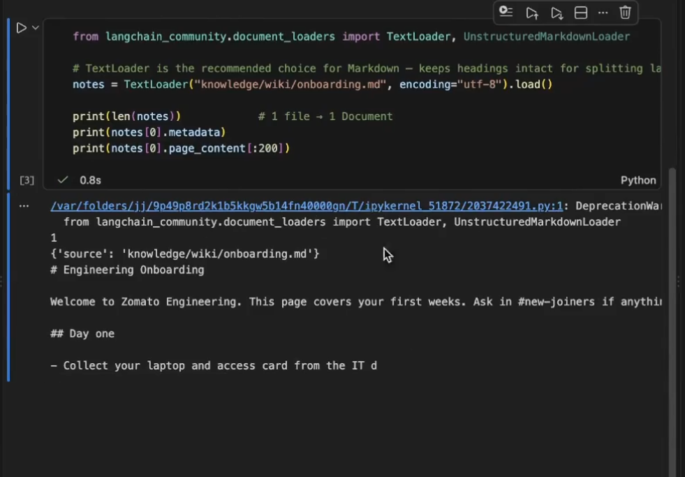

**Troubleshooting `UnstructuredMarkdownLoader`:**

| Step | Error | Fix |
|---|---|---|
| 1 | `ModuleNotFoundError: No module named 'unstructured'` | `uv add unstructured` (big: pulls in spacy, lxml, numba…) |
| 2 | Still fails inside `import markdown` | `uv add markdown` |
| 3 | ✅ Runs (about 9 s the first time) | |

> [!NOTE]
> The `langchain_community` import also printed a **DeprecationWarning**. Community loaders move to their own packages over time. It's a warning, not an error, but in production pin your versions (`uv.lock`) so a library upgrade doesn't break the pipeline.

### 5.4 PDFs with a text layer: `PyPDFLoader`

```python
from langchain_community.document_loaders import PyPDFLoader

pages = PyPDFLoader("knowledge/policies/employee_handbook.pdf").load()

print(f"Pages loaded: {len(pages)}")     # 8   -> one Document PER PAGE
print(pages[1].page_content[:240])       # "4. Working hours\nStandard hours are 10:00 to 19:00, Monday to Friday..."
print(pages[1].metadata)                 # {'producer': 'Skia/PDF m154', 'creator': 'Mozilla/5.0 ...', 'page': 1, ...}
```

Unlike TextLoader, a PDF loader returns **one Document per page**, with the **page number in metadata**, which is useful for citations.

**Choosing a PDF loader:**

| Loader | Install | Strengths | Weaknesses |
|---|---|---|---|
| **PyPDFLoader** | `pypdf` | Pure Python, trivial to install, page labels in metadata | Can scramble columns and tables; mid-range speed |
| **PyMuPDFLoader** | `pymupdf` | **Very fast**, good reading order, rich metadata (often considered the best general choice) | Native dependency; check the licence (**AGPL**) for commercial use |
| **PDFPlumberLoader** | `pdfplumber` | Precise character positions, helpful for extracting **tables** | Slower than the others |

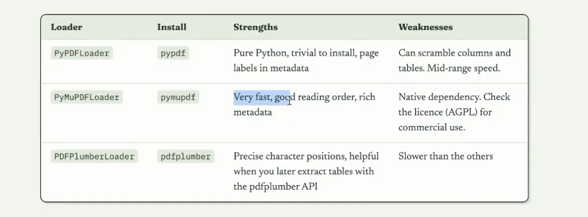

> [!WARNING]
> **AGPL licence on PyMuPDF.** Using it inside a commercial product can oblige you to open-source your code. That's a legal/compliance check, much like reviewing an open-source licence before putting a tool into a company platform.

### 5.5 Scanned PDFs need OCR

**Quick test:** open the PDF and try to select a sentence with your mouse. **If you can't, the pages are pictures of text.** Every loader above would return **empty or garbage** pages, because there is no text layer to read. You need **OCR (Optical Character Recognition)**, which looks at the pixels and guesses the letters.

```text
Scanned PDF (images)  →  OCR engine  →  recognised text  →  Document objects
```

**How it works** with `strategy="ocr_only"` (the `unstructured` library):

1. **Rendering:** `poppler` / `pdf2image` turns each PDF page into an image.
2. **Recognition:** the **Tesseract** OCR engine (maintained by Google) scans the pixels for characters and bounding boxes.
3. **Partitioning:** the boxes are grouped into **elements** such as `Title`, `NarrativeText` and `Table`.

> [!IMPORTANT]
> **System dependencies:** `tesseract` and `poppler` must be **installed on the OS** (apt/brew/choco), not just pip/uv packages. That's an infra concern: bake them into the **Docker image** for the indexing job.

```bash
uv add "unstructured[pdf]"      # quotes needed in zsh, otherwise: "zsh: no matches found: unstructured[pdf]"
```

```python
from langchain_community.document_loaders import UnstructuredPDFLoader

scan = UnstructuredPDFLoader(
    "knowledge/scans/vendor_contract.pdf",
    mode="elements",       # titles, paragraphs and tables as separate Documents
    strategy="ocr_only",   # force OCR instead of reading a text layer
).load()

print(len(scan), "elements")                                          # 56 elements
print(scan[0].metadata.get("category"), "|", scan[0].page_content[:300])   # Title | MASTER SERVICES AGREEMENT
```

Result: **56 elements** from a 7-page scanned contract, with the first one correctly identified as a **Title**. It took **1 min 54 s**, so OCR is **slow**.

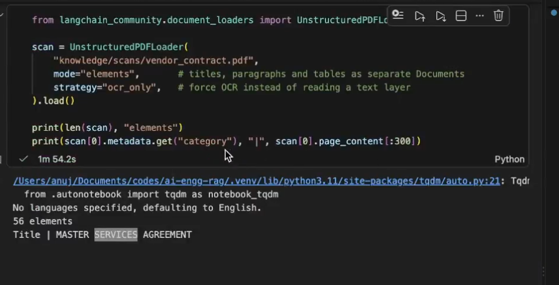

> [!WARNING]
> **OCR makes mistakes** (an "O" read as a zero, a missing comma). For contracts and financial documents, **spot-check the recognised text** and keep the **original file as the source of truth** for any legal question.

When PDFs are truly hard (merged table cells, multi-column layouts, handwriting), teams move to a **managed parser** such as **LlamaParse**, **Azure Document Intelligence** or **Amazon Textract**. They cost money but handle layouts open-source tools can't.

> [!TIP]
> **The `[pdf]` in brackets** is a Python **"extra"**, an optional bundle of dependencies. It's huge (torch, onnxruntime, matplotlib, pandas), so expect a big image. Another reason to run OCR as a **separate indexing job**, not inside the chatbot API.

---

## 6. First look at splitting and tokens

*(Chunking gets the full deep dive in Part 2. This is the overview from class.)*

### 6.1 Why split again?

A **page is still too big and too mixed**. A handbook page about annual leave may also contain the first half of the sick-leave rules. We split Documents into **chunks small enough to be about one thing**, because **a retrieved chunk is exactly what the LLM will read**.

**Why not fixed sizes?** Cut a code file every 3 lines and one function ends up spread across 3 chunks. None of them alone explains what the function does. Chunks should keep **things that belong together, together**.

LangChain's most common splitter is **`RecursiveCharacterTextSplitter`**. It tries **paragraph breaks first, then line breaks, then spaces**, so chunks tend to end at **natural boundaries**.

```python
from langchain_text_splitters import RecursiveCharacterTextSplitter

splitter = RecursiveCharacterTextSplitter(
    chunk_size=900,        # maximum characters per chunk
    chunk_overlap=120,     # characters shared between neighbouring chunks
    add_start_index=True,  # remembers where in the page each chunk began
)

chunks = splitter.split_documents(docs)

print(f"Split {len(docs)} documents into {len(chunks)} chunks")
print(chunks[0].page_content[:200])
print(chunks[0].metadata)        # the page's metadata is COPIED onto every chunk (+ start_index)
```

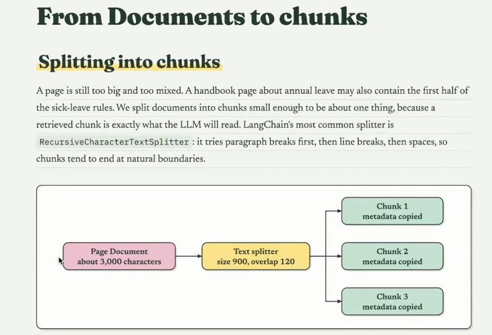

### 6.2 Overlap

The **overlap repeats the end of one chunk at the start of the next**, so an idea that **straddles a boundary survives**. With size 5 and overlap 1, over the letters A–L:

```text
Chunk 1:  A B C D E
Chunk 2:          E F G H I
Chunk 3:                  I J K L
```

E and I appear in two chunks each. A sentence cut at the boundary is still complete in at least one chunk.

### 6.3 What is a token?

A **token** is the small piece of text a language model actually reads: a whole word, part of a word, a single character, punctuation, or a **space glued to the front of a word**. A **tokenizer** cuts text into pieces from a **fixed vocabulary** (tens of thousands of entries), and every piece has an **integer ID**. **The model never sees letters, only a list of numbers.**

Different models use different **encodings** (vocabularies), so **the same sentence gives a different token count**:

| Encoding | Vocabulary size | Used by | "Zomato delivers unbelievably fast." | "Annual leave: 24 days, carry over 5." |
|---|---|---|---|---|
| `r50k_base` | ~50K | GPT-3 (legacy) | 7 tokens | 11 tokens |
| `cl100k_base` | ~100K | GPT-4, GPT-3.5 | 8 tokens | 12 tokens |
| `o200k_base` | ~200K | Newer GPT models | 7 tokens | 12 tokens |

In `cl100k_base`, "Zomato delivers unbelievably fast." becomes `Z | om | ato | ·delivers | ·unbelie | vably | ·fast | .` with IDs `57, 316, 4428, 28421, 40037, 89234, 5043, 13`. Rare words like *Zomato* get split into pieces, and common words stay whole.

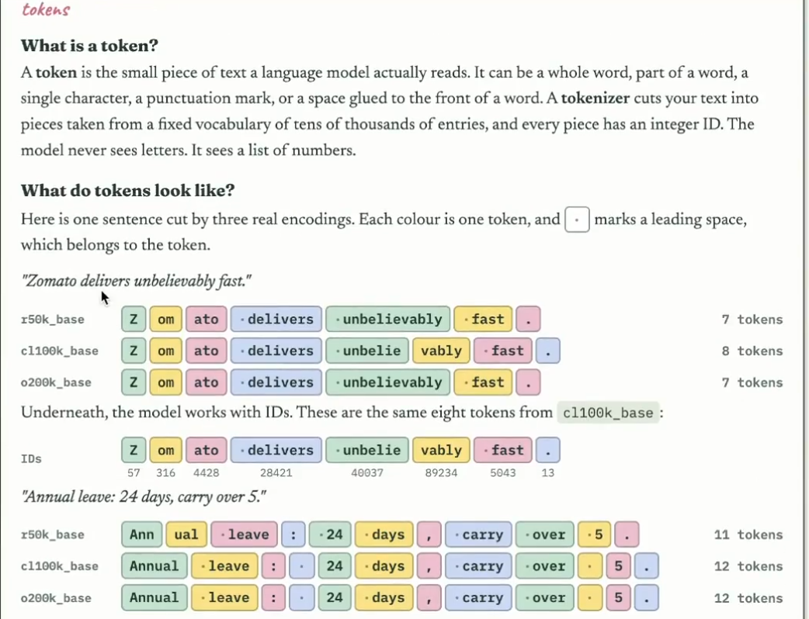

**Try it yourself:** <https://platform.openai.com/tokenizer>. Paste text and see the tokens coloured, e.g. "Zomato delivers unbelievably fast." = **7 tokens, 34 characters**.

> [!TIP]
> **Why an infra person should care:** **tokens = the billing unit and the context-window limit.** A rough rule is **1 token ≈ 4 characters ≈ ¾ of a word** (English). A `chunk_size` of 900 *characters* is roughly 225 tokens. Splitters can also count in tokens (the "Token-based" splitter) when you need exact limits.

---

## 7. Chunking the handbook (hands-on)

Now we split a real document instead of looking at slides. The class used **PyMuPDFLoader** (the fast loader from section 5.4):

```python
from langchain_community.document_loaders import PyMuPDFLoader

handbook_docs = PyMuPDFLoader("knowledge/policies/employee_handbook.pdf").load()
handbook_text = "\n\n".join(doc.page_content for doc in handbook_docs)

print(f"Handbook: {len(handbook_docs)} pages, {len(handbook_text):,} characters")
# Handbook: 8 pages, 11,016 characters
```

```python
from langchain_text_splitters import RecursiveCharacterTextSplitter

splitter = RecursiveCharacterTextSplitter(chunk_size=900, chunk_overlap=120, add_start_index=True)
chunks = splitter.split_documents(handbook_docs)

print(f"Split {len(handbook_docs)} pages into {len(chunks)} chunks")   # Split 8 pages into 16 chunks
print(chunks[1].page_content)        # "Simple and honest... 3. Employment basics  New employees serve a probation period of 6 months..."
print(chunks[0].metadata)            # the page metadata, copied onto the chunk
```

**8 pages → 16 chunks.** About 11,000 characters ÷ 900 per chunk, with overlap, gives roughly 2 chunks per page. Each chunk is small enough to be **about one topic** (e.g. "Employment basics / probation").

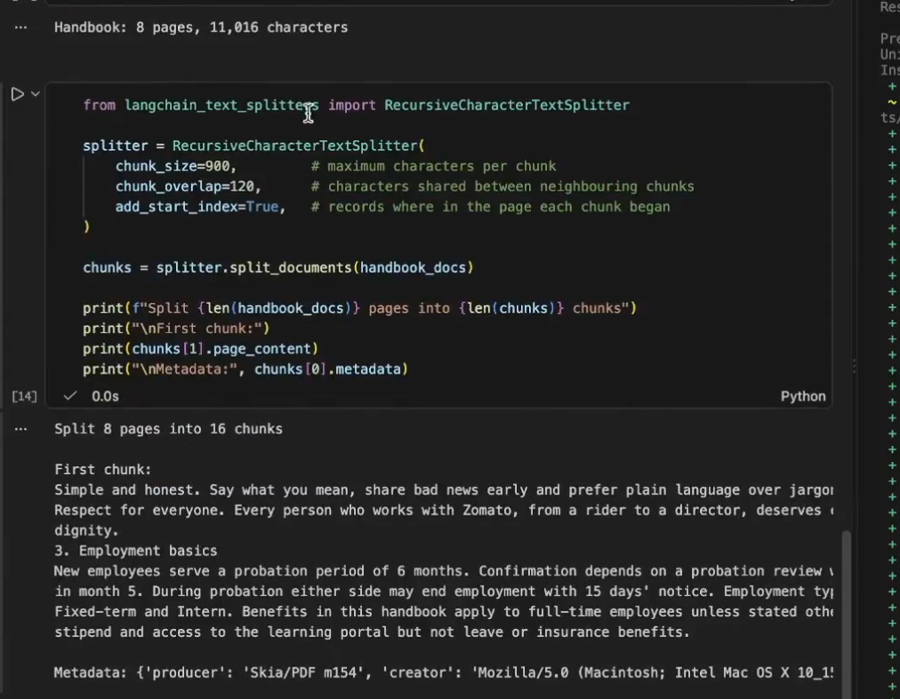

> [!NOTE]
> Small slip in the class notebook: it prints `chunks[1]` under the label "First chunk". Python counts from 0, so `chunks[0]` is the first. It doesn't matter here, but in production off-by-one mistakes like this are how wrong data gets reported.

---

## 8. Before you store: IDs, compliance and multi-tenancy

### 8.1 Stable chunk IDs (no duplicates on re-run)

If you run the indexing job twice, you don't want every chunk stored twice. The fix is to give every chunk an **ID calculated from its content**. The same chunk always gets the same ID, so a re-run **upserts (overwrites)** instead of duplicating.

```python
import hashlib, uuid

def chunk_id(chunk) -> str:
    digest = hashlib.sha1(chunk.page_content.encode("utf-8")).hexdigest()           # fingerprint of the text
    return str(uuid.uuid5(uuid.NAMESPACE_URL, f"{chunk.metadata['filename']}|{digest}"))  # deterministic UUID

# Load + tag every page with our own metadata
handbook_pages = PyMuPDFLoader("knowledge/policies/employee_handbook.pdf").load()
for doc in handbook_pages:
    doc.metadata["filename"]  = "employee_handbook.pdf"
    doc.metadata["area"]      = "policies"
    doc.metadata["doc_type"]  = "pdf"
    doc.metadata["tenant_id"] = "zomato"          # who owns this data (multi-tenancy, 8.3)

handbook_chunks = splitter.split_documents(handbook_pages)
handbook_ids = [chunk_id(c) for c in handbook_chunks]
print(f"Chunks: {len(handbook_chunks)}, unique IDs: {len(set(handbook_ids))}")   # Chunks: 16, unique IDs: 16

vector_store.add_documents(handbook_chunks, ids=handbook_ids)      # upsert
print(vector_store.client.count("helpdesk_kb").count)               # Points in collection: 16
```

- **SHA-1** turns the chunk text into a fixed fingerprint. Any change in the text gives a different fingerprint.
- **`uuid5`** turns "filename | fingerprint" into a valid UUID (Qdrant point IDs must be integers or UUIDs). The **same input always gives the same UUID**.
- **16 chunks, 16 unique IDs**, so there are no accidental collisions. Re-run the cell and the collection **stays at 16 points**.

> [!TIP]
> **Infra analogy:** this is **idempotency**, like `kubectl apply` or Terraform. Running it twice gives the same end state, not double the resources. A content hash as the ID is the same trick as an **image digest** (`sha256:…`) instead of a mutable tag.

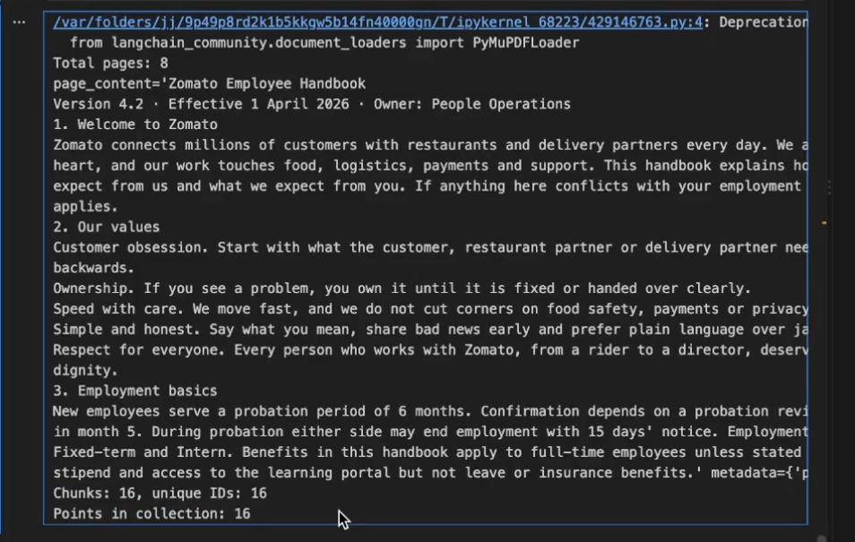

### 8.2 Compliance: what must NOT reach the LLM or the database

Company documents contain sensitive data. Before chunks are embedded and stored, think about:

| Concern | What it means | How |
|---|---|---|
| **PII redaction** | **PII = Personally Identifiable Information**: full name, phone, email, home address, Aadhaar/SSN. Find it and **hide/mask it before** it's sent to an AI model or stored in the vector DB | Redaction libraries/steps in the pipeline (LangChain has integrations, e.g. Microsoft Presidio). You decide what to mask |
| **ID documents in scans** | Images of PAN/Aadhaar cards etc. shouldn't be OCR'd and indexed at all | Configure the OCR/loading step to skip or filter them |
| **Multi-tenancy and isolation** | One vector DB serves several companies, teams or users, and each must see **only its own data** | Put a `tenant_id` / `user_id` in the **payload** and **filter on it in every search** (8.3) |

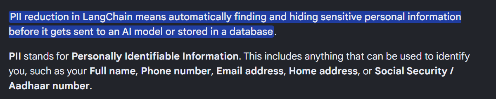

> [!WARNING]
> **Once PII is embedded and stored, it's in your vector DB backups and snapshots too.** Redact *before* indexing. That's far easier than a GDPR/DPDP deletion request across every backup later.

### 8.3 Multi-tenancy with payload filtering

Every chunk carries `tenant_id` in its payload (you can see `"tenant_id": "zomato"` in the dashboard below). At query time you add a **filter**, so the search **only considers points whose `tenant_id` matches the logged-in customer**:

```python
from qdrant_client import models

retriever = vector_store.as_retriever(search_kwargs={
    "k": 4,
    "filter": models.Filter(must=[
        models.FieldCondition(key="metadata.tenant_id", match=models.MatchValue(value="zomato"))
    ]),
})
```

> [!NOTE]
> The class covered **why** (isolation via payload) but didn't run a filter cell. The snippet above is the standard pattern, added for reference. Note the `metadata.` prefix: LangChain stores your metadata **nested under `metadata`** in the Qdrant payload. For speed at scale, also create a **payload index** on that field.

> [!TIP]
> **Infra analogy:** like **Kubernetes namespaces + RBAC**, or a `WHERE tenant_id = ?` that every query *must* include. Enforce it in the backend, never trust the client to send it.

---

## 9. Embeddings with LangChain

### 9.1 One interface, many providers

Every LangChain embedding class has the same two methods:

| Method | Use |
|---|---|
| **`embed_documents(list_of_texts)`** | Indexing: many chunks → many vectors |
| **`embed_query(text)`** | Querying: one question → one vector |

So the rest of the pipeline **neither knows nor cares** which provider you picked. That makes the choice a **business decision about cost, privacy and quality**:

| Provider class | Runs where | Think of it as |
|---|---|---|
| `OpenAIEmbeddings` | Hosted API | Pay per token, nothing to run |
| `HuggingFaceEmbeddings` | **On your machine** | Free, private, uses your CPU/GPU |
| `OllamaEmbeddings` | **Local server** | Self-hosted model server |
| Cohere, Google and others | Hosted APIs | Alternatives on price and quality |

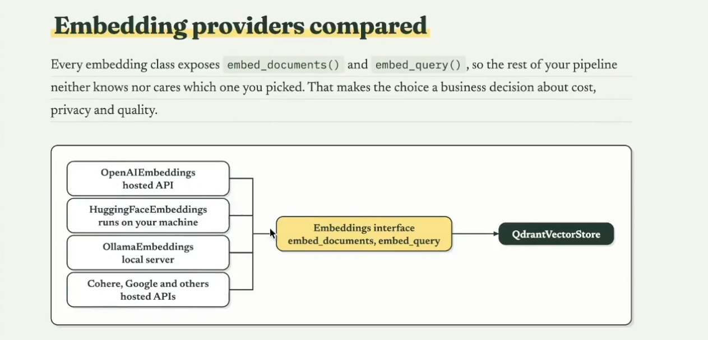

> [!TIP]
> **Privacy angle for regulated companies:** HuggingFace/Ollama keep the text **inside your network**, so no document leaves for a third-party API. That's often the deciding factor for banks and health companies.

### 9.2 Code: OpenAI embeddings through OpenRouter

```python
import os
from langchain_openai import OpenAIEmbeddings

embeddings = OpenAIEmbeddings(
    model="openai/text-embedding-3-small",
    openai_api_base="https://openrouter.ai/api/v1",   # OpenRouter speaks the OpenAI API
    api_key=os.environ["OPENROUTER_API_KEY"],
)

texts = [
    "Full-time employees receive 24 days of paid annual leave.",
    "Client meals are reimbursed up to the per-person limit with a receipt.",
    "Restart the payments service from the runbook, never from the console.",
]

vectors = embeddings.embed_documents(texts)
print("Number of vectors:", len(vectors))        # 3
print("Vector dimension:", len(vectors[0]))      # 1536 for text-embedding-3-small

query_vector = embeddings.embed_query("How many vacation days do I get?")
print("Query vector dimension:", len(query_vector))   # 1536, must match the documents
```

Compare with Chapter 01: we wrote `client.embeddings.create(...)` and unpacked `resp.data` ourselves. LangChain hides that behind `embed_documents` / `embed_query`.

**Troubleshooting: `AuthenticationError: Error code: 401 – 'User not found.'`**

The first run failed. OpenRouter returns this when the **API key it receives is missing or invalid**. Here the notebook was still using an **old environment**: the key wasn't loaded into the running Python kernel. Fix: **restart the kernel and re-run `load_dotenv()`**. After that it ran in 3.6 s.

| Symptom | Likely cause | Fix |
|---|---|---|
| 401 "User not found" | Key not loaded / wrong / revoked | Check `.env` name, `load_dotenv()`, restart kernel, regenerate key |
| Works in terminal, fails in notebook | Notebook kernel started before `.env` existed | Restart the kernel |

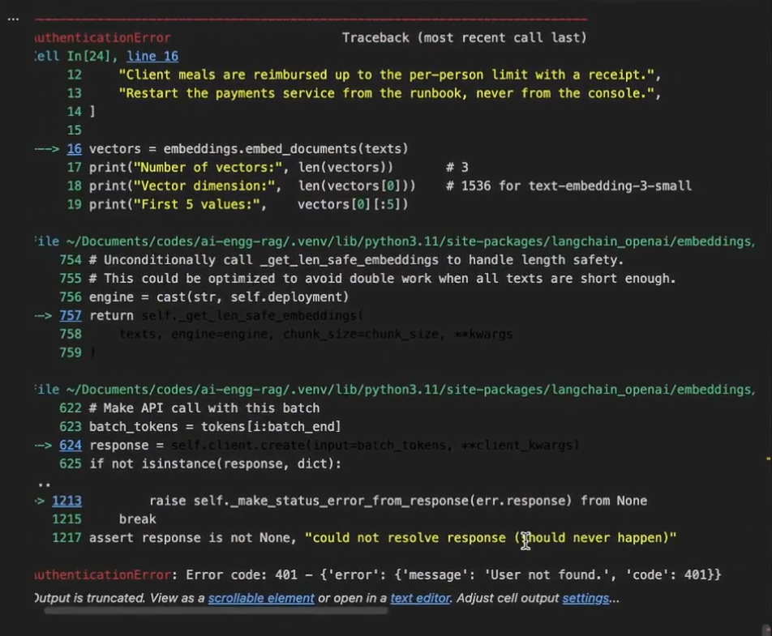

---

## 10. Vector store: `QdrantVectorStore`

### 10.1 The quick way: `from_documents`

```python
from langchain_qdrant import QdrantVectorStore

vector_store = QdrantVectorStore.from_documents(
    documents=chunks,
    embedding=embeddings,
    ids=ids,                          # stable IDs prevent duplicates on re-run (section 8.1)
    location=":memory:",              # or url="http://localhost:6333"
    collection_name="helpdesk_kb",
)
print("Points stored:", vector_store.client.count("helpdesk_kb").count)
```

**One call does all of it:** embeds every chunk, creates the collection (correct size + cosine), and upserts the points with payload. That's everything we wrote by hand in Chapter 01, section 16.

### 10.2 The full-control way: create the collection yourself

In production you usually want to **control the collection settings** (size, distance, quantization, indexes) rather than let a library guess:

```python
from langchain_qdrant import QdrantVectorStore
from qdrant_client import QdrantClient, models

client = QdrantClient(url="http://localhost:6333")
dimension = len(embeddings.embed_query("probe"))       # ask the model for its size, never hard-code

if not client.collection_exists("helpdesk_kb"):
    client.create_collection(
        collection_name="helpdesk_kb",
        vectors_config=models.VectorParams(size=dimension, distance=models.Distance.COSINE),
    )

vector_store = QdrantVectorStore(client=client, collection_name="helpdesk_kb", embedding=embeddings)
```

> [!TIP]
> **Infra view:** `from_documents` is like `kubectl run` (quick and opinionated). Creating the collection yourself is like a reviewed **manifest/Terraform**: explicit settings, created once, `if not exists` guards.

### 10.3 What it looks like in Qdrant

The Docker Qdrant dashboard now shows `helpdesk_kb` with **16 points, 1536 dims, Cosine**, next to Chapter 01's `rag_fundamentals` (20 points, 2048 dims) and the `compressed` collections from the quantization demo. Each point's payload holds:

- `page_content`: the chunk text
- `metadata`: everything the loader found (`source`, `page`, `total_pages`, `format`, `creationdate`…) **plus our own keys** (`filename`, `area`, `doc_type`, `tenant_id`) and `start_index` from the splitter

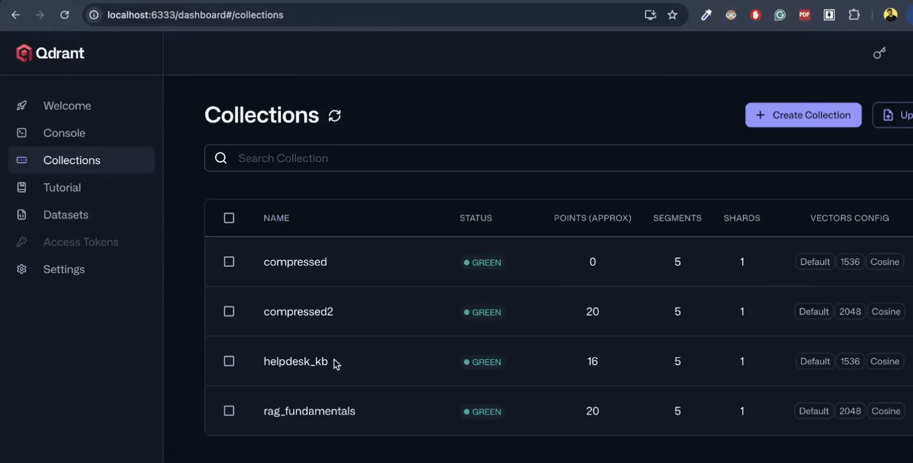

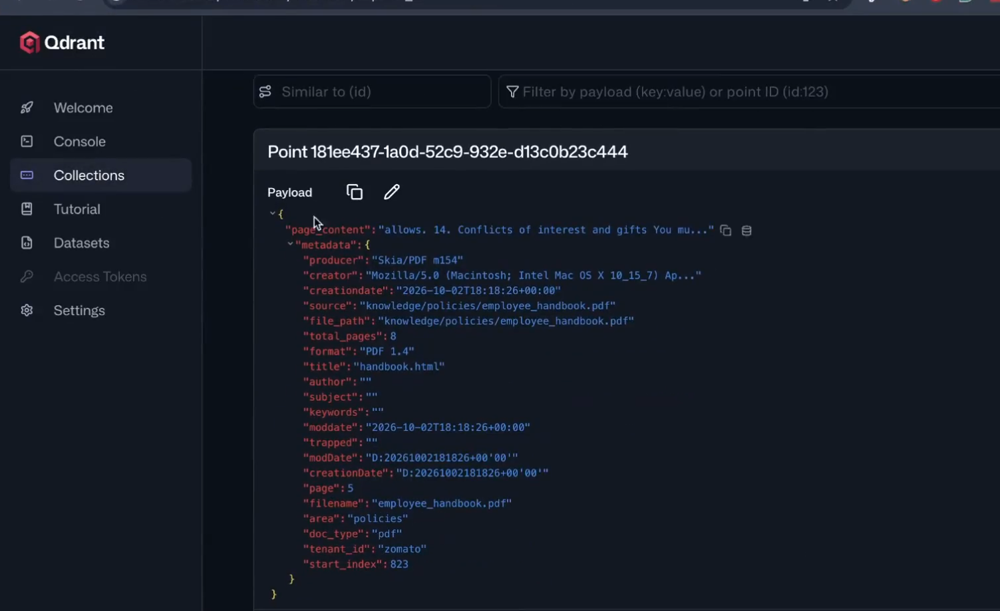

The vector store has two main jobs: **`add_documents`** (write, indexing) and **`similarity_search`** (read, querying).

---

## 11. Retrieval: similarity search and retrievers

### 11.1 `similarity_search`

```python
question = "How many vacation days do I get?"
results = vector_store.similarity_search(question, k=3)

for rank, doc in enumerate(results, start=1):
    print(f"\n--- Result {rank} ---")
    print(doc.metadata.get("filename"), "page:", doc.metadata.get("page"))
    print(doc.page_content[:250])
```

Results came back **with their citation** (file + page): page 2 (floating holidays, study leave, sabbatical) and page 1 ("Up to 5 unused days may be carried over… leave of more than 3 days needs approval 14 days ahead"). The question said **"vacation days"** and the handbook says **"annual leave"**, and it still matched. That's semantic search.

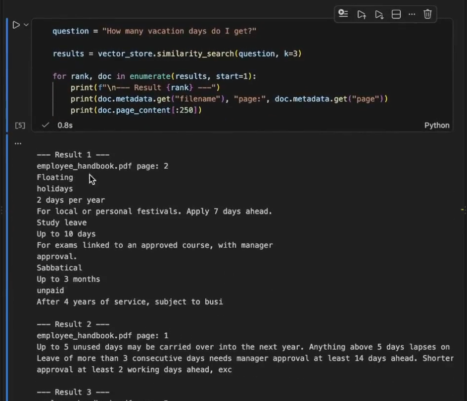

### 11.2 Retriever: the search wrapped as a Runnable

```python
retriever = vector_store.as_retriever(search_type="similarity", search_kwargs={"k": 4})

retrieved = retriever.invoke("What is the process for reimbursing a client dinner?")
print(f"Retrieved {len(retrieved)} documents")    # Retrieved 4 documents
```

A **retriever** does the same search, but it's a **Runnable** with a standard `.invoke(question) → list[Document]`. That's what lets it be **plugged into a chain** (section 13).

> [!WARNING]
> **A real lesson hidden in the output:** for "reimbursing a client dinner" the top hit was the handbook's **Benefits** page (meal credits, phone reimbursement). That's related, but not the answer. Why? **Only the handbook was indexed.** The answer lives in `expense_policy.pdf`, which was never loaded. **The retriever always returns the closest k chunks, even when the right document isn't in the database.** That's the Chapter 01 rule again: wrong answer? **Check retrieval, and check what was indexed.**

---

## 12. Generation: chat model + prompt template

### 12.1 `ChatOpenRouter`

```python
from langchain_openrouter import ChatOpenRouter

llm = ChatOpenRouter(
    model="deepseek/deepseek-v4.1-flash",   # any model ID from openrouter.ai/models
    temperature=0,                          # 0 keeps answers focused and repeatable
)

response = llm.invoke([
    ("system", "You are a concise assistant."),
    ("human", "Explain RAG in one sentence."),
])
print(response.content)
```

The LLM returns an **`AIMessage`** object, and the text is in `.content`.

### 12.2 Temperature: the creativity dial

| Temperature | Behaviour | Use for |
|---|---|---|
| **0** | Always picks the **most likely next word**. The same question gives (nearly) the same answer every time, and it sticks to the facts | **RAG, help desks, policies, anything factual** |
| **0.7 – 1.0+** | Takes risks and varies its wording; more creative, more likely to wander | Brainstorming, marketing copy, stories |

> [!TIP]
> **Infra analogy:** temperature 0 is a **deterministic, pinned config**: same input, same output, easy to test. High temperature is like running a chaos experiment. For a help-desk bot, you want temperature 0.

### 12.3 Prompt template: `{context}` + `{question}`

```python
from langchain_core.prompts import ChatPromptTemplate

prompt = ChatPromptTemplate.from_messages([
    ("system",
     """You are Zomato's internal help-desk assistant.
Answer using only the context below.

Rules:
- If the answer is not in the context, say you don't know.
- Never invent policies, amounts or procedures.

Context:
{context}"""),
    ("human", "{question}"),
])
```

A **prompt template** is a reusable prompt with **placeholders** that get filled at run time. The **system** message sets the rules (the grounding instructions that reduce hallucination), and the **human** message carries the user's question.

> [!TIP]
> Like a **Helm template / Jinja config**: the structure is fixed and reviewed once, and only `{{ values }}` change per request.

### 12.4 `format_docs`: Documents → one context string

```python
def format_docs(docs) -> str:
    return "\n\n---\n\n".join(
        f"[{i}] {d.metadata.get('filename', 'unknown')}\n{d.page_content}"
        for i, d in enumerate(docs, start=1)
    )
```

The LLM needs **text**, not Python objects. This numbers each chunk and labels it with its filename (`[1] employee_handbook.pdf …`), so the model **can cite** where an answer came from.

---

## 13. The full RAG pipeline: explicit first, then LCEL

### 13.1 The explicit 4-step pipeline (best for learning)

```text
question → retriever.invoke() → list of Documents → format_docs() → context string
         → prompt.invoke() → messages → llm.invoke() → answer text
```

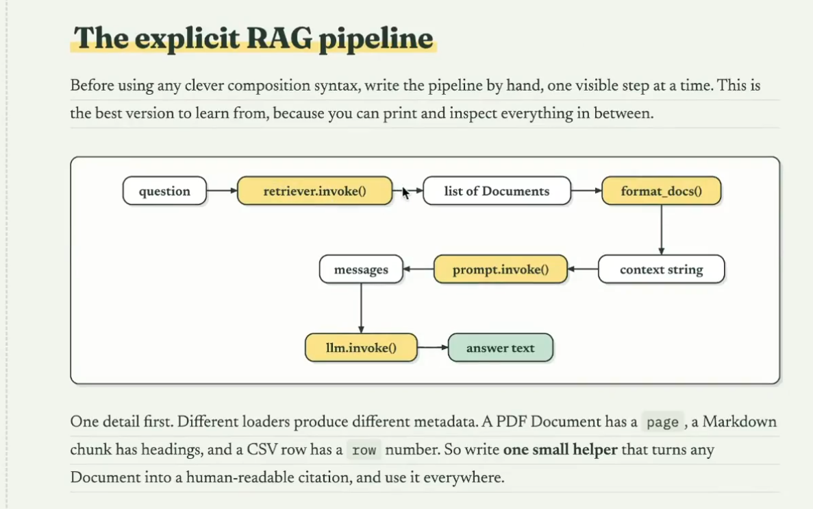

```python
question = "What is the policy on work from home?"

retrieved_docs = retriever.invoke(question)                                   # Step 1: retrieve
context = format_docs(retrieved_docs)                                         # Step 2: format
messages = prompt.invoke({"context": context, "question": question})          # Step 3: build prompt
response = llm.invoke(messages)                                               # Step 4: generate

# Step 1 - Retrieved 4 docs
# Step 2 - Context: 3084 characters
# Step 3 - Prompt messages: 2            (system + human)
# Step 4 - Answer: Zomato's hybrid work policy says: 3 days in office (Tue-Thu)... ₹15,000 WFH setup allowance...
```

**This is the complete RAG loop from Chapter 01, now working on real company documents:** 4 chunks (3,084 characters) went to the LLM instead of the whole handbook, and the answer came back grounded in the actual policy.

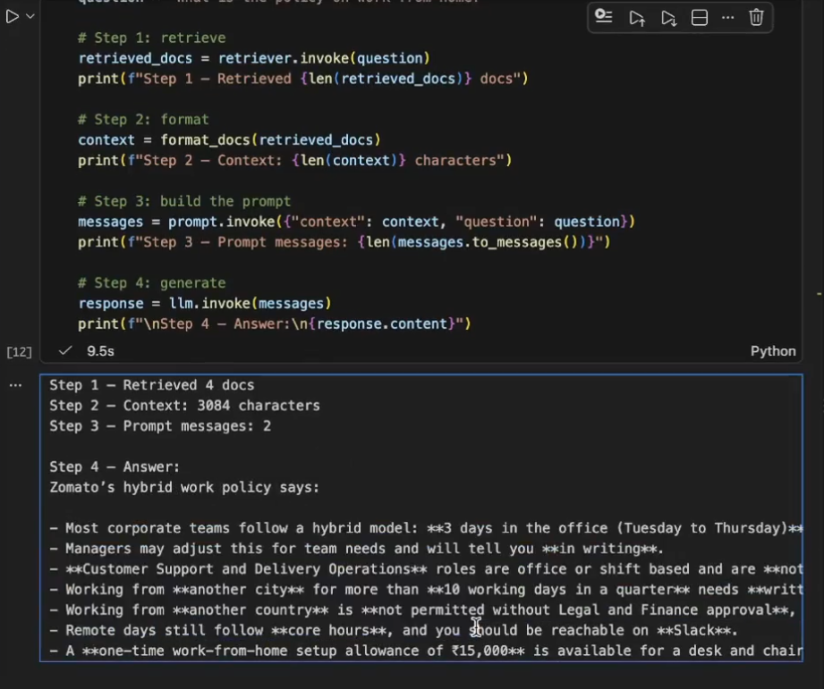

### 13.2 The same pipeline as an LCEL chain

**LCEL = LangChain Expression Language.** Every component (retriever, prompt, LLM, parser) is a **Runnable**, and the **pipe `|`** connects them so **the output of the left becomes the input of the right**, exactly like a Linux shell pipe.

```python
from langchain_core.output_parsers import StrOutputParser
from langchain_core.runnables import RunnablePassthrough

rag_chain = (
    {
        "context":  retriever | format_docs,     # question → Documents → context string
        "question": RunnablePassthrough(),       # question → question, unchanged
    }
    | prompt
    | llm
    | StrOutputParser()                         # AIMessage → plain string
)

print(rag_chain.invoke("How many days of work from home can I have?"))
# "...the hybrid model allows **2 days remote per week** (with **3 days in the office**)..."
```

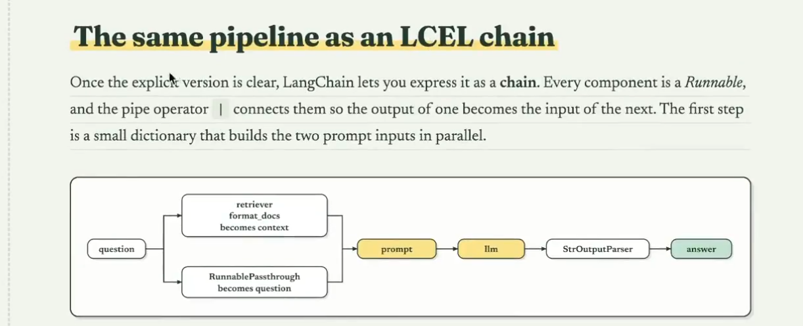

How to read it:

1. The **dictionary at the start** runs **two branches in parallel** on the same question. `retriever | format_docs` builds the **context**, and `RunnablePassthrough()` passes the **question** through untouched.
2. That gives `{"context": ..., "question": ...}`, exactly what the **prompt** template needs.
3. **prompt → llm** produces an `AIMessage`.
4. **`StrOutputParser()`** is the **output parser**: it pulls out just the text, so you get a plain string.

The question even had a typo ("work from **homw**") and still found the right chunks, because embeddings match meaning.

| Explicit version | LCEL version |
|---|---|
| Every step visible, easy to `print` | One expression, short |
| Best for **learning and debugging** | Best for **production**: you get `.invoke`, `.stream`, `.batch` and tracing for free |

> [!TIP]
> **Infra analogy:** `cat access.log | grep 500 | awk '{print $7}' | sort | uniq -c`. Each tool does one job, `|` passes the output along, and you can swap any stage. LCEL is a Unix pipeline for AI steps.

---

## 14. Debugging a RAG pipeline

**When an answer is wrong, don't tweak the prompt at random.** Walk the pipeline **in order** and look at the real data at each stage:

```python
question = "How do I restart the payments service?"

docs = retriever.invoke(question)
print("RETRIEVED")
for i, d in enumerate(docs, start=1):
    print(f"[{i}] {cite(d)}: {d.page_content[:120]!r}")          # 1. right chunks? right files?

context = format_docs(docs)
print("\nCONTEXT LENGTH:", len(context), "characters")           # 2. too short? too long?

messages = prompt.invoke({"context": context, "question": question})
print("\nPROMPT MESSAGES")
for m in messages.to_messages():
    print(f"- {m.type}: {m.content[:100]!r}")                     # 3. did the context reach the prompt?

print("\nANSWER")
print(llm.invoke(messages).content)                               # 4. only now judge the LLM
```

**`cite(d)` helper:** different loaders produce different metadata. A PDF has `page`, a Markdown chunk has headings, and a CSV row has `row`. So write **one small helper** that turns any Document into a readable citation and use it everywhere.

| Stage | Question to ask | Typical fix |
|---|---|---|
| 1. Retrieve | Are the right chunks in the top-k? Was the document even indexed? | Index the missing file, fix chunking, change k, add filters |
| 2. Format | Is the context complete and not truncated? | Adjust chunk size, check `format_docs` |
| 3. Prompt | Did the context and question actually land in the messages? | Fix template placeholders |
| 4. Generate | Given perfect context, is the answer still wrong? | Only now: prompt rules, temperature, a better model |

> [!TIP]
> **Same as troubleshooting a request path:** DNS → load balancer → service → pod logs, one hop at a time. You don't restart the database because the website is slow without checking each hop first.

### 14.1 What we built: "two-step RAG"

Everything in this chapter is **two-step RAG**: **retrieve once, then generate once**, a fixed path. Later in the course: **agents** and **agentic RAG**, where the LLM itself decides *whether* to search, *what* to search, and can search several times. That handles harder questions.

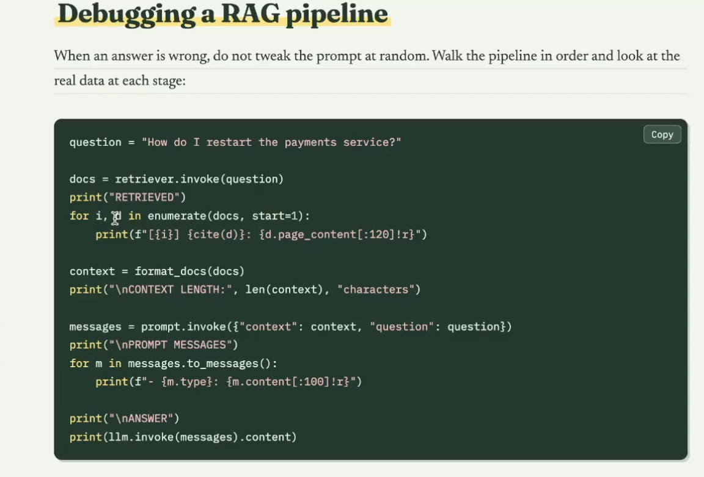

---

## Interview quick answers

1. **"What is quantization in a vector DB?"** Storing vectors at lower precision to save memory: float32 → int8 (4× smaller, 6.1 → 1.5 GB per 1M × 1536) or binary (32×, 0.19 GB). The trade-off is a small accuracy loss. In Qdrant it's `quantization_config=ScalarQuantization(INT8, always_ram=True)` at collection creation.
2. **"What is LangChain?"** An open-source framework that gives each part of an LLM app (loaders, splitters, embeddings, vector stores, chat models, parsers) a standard interface, so providers can be swapped without rewriting the pipeline. It's a toolbox, not RAG itself, not a DB, not a model.
3. **"Name the RAG components in LangChain."** Indexing: document loader → text splitter → embedding model → vector store. Querying: retriever → prompt template → chat model → output parser.
4. **"Why is LangChain split into many packages?"** Install only what you need. `langchain-core` holds the shared interfaces (Document, Runnable, prompts, parsers); integrations like `langchain-qdrant` and `langchain-openai` plug into it.
5. **"What is a LangChain Document?"** `page_content` (text) + `metadata` (dict: source, page, custom keys). Metadata becomes the vector-DB payload, used for filtering and citing sources.
6. **"How do you load a scanned PDF?"** Normal loaders return nothing because there's no text layer. Use OCR: `UnstructuredPDFLoader(strategy="ocr_only")`, which needs Tesseract + Poppler on the OS. It's slow and error-prone, so spot-check, or use a managed parser (Textract, Azure Document Intelligence, LlamaParse).
7. **"PyPDF vs PyMuPDF vs PDFPlumber?"** PyPDF: simple and pure Python. PyMuPDF: fastest with the best reading order, but AGPL. PDFPlumber: precise positions for tables, but slower.
8. **"What is chunk overlap and why use it?"** Neighbouring chunks share some characters (e.g. 120 of 900), so a sentence cut at a boundary still appears whole in one chunk.
9. **"What is a token?"** The unit a model reads and bills: a word or sub-word piece mapped to an integer ID by the model's tokenizer. Counts differ by encoding (r50k / cl100k / o200k). Roughly 4 characters per token.

10. **"How do you avoid duplicate chunks when re-indexing?"** Deterministic IDs: `uuid5(filename + sha1(chunk text))`. The same content gives the same ID, so upsert overwrites instead of duplicating (idempotent, like `kubectl apply`).
11. **"What compliance concerns exist in RAG?"** PII redaction before embedding/storing (names, phones, Aadhaar); excluding ID-document scans; multi-tenancy via a `tenant_id` payload plus a mandatory filter on every search. Remember that vectors live in backups too.
12. **"How does LangChain make embeddings swappable?"** Every embedding class exposes `embed_documents()` / `embed_query()`. Choose OpenAI (hosted) vs HuggingFace/Ollama (local, private) on cost, privacy and quality.
13. **"`from_documents` vs creating the collection yourself?"** `from_documents` is quick (embeds, creates and upserts in one call). In production, create the collection explicitly (size from the model, distance, quantization, payload indexes), then wrap it with `QdrantVectorStore(client=...)`.
14. **"Vector store vs retriever?"** The vector store stores and searches (`add_documents`, `similarity_search`). A retriever wraps the search as a Runnable (`.invoke(q) → Documents`) so it can be plugged into a chain.
15. **"Why temperature 0 for RAG?"** Deterministic, focused answers that stick to the context. Higher values add creativity and drift.
16. **"What is LCEL?"** LangChain Expression Language: Runnables joined with `|`, output → input. A RAG chain is `{context: retriever | format_docs, question: RunnablePassthrough()} | prompt | llm | StrOutputParser()`, and it gets `.invoke/.stream/.batch` for free.
17. **"What does `StrOutputParser` do?"** Turns the LLM's `AIMessage` into a plain string.
18. **"A RAG answer is wrong. How do you debug it?"** Walk the stages in order: retrieved docs (and was the doc even indexed?) → context length → prompt messages → only then the LLM.
19. **"What is two-step vs agentic RAG?"** Two-step: always retrieve once, then generate. Agentic: an LLM agent decides when and what to retrieve, possibly several times.

## What's next
- **Agents** and **agentic RAG** (the LLM decides when and what to retrieve)
- More advanced retrieval: hybrid search, reranking, metadata filters in practice
- Running the indexing job as a proper pipeline (all `knowledge/` folders, not just the handbook)
