# Chapter 03: Production-Grade RAG

*AI track · Chapter 03 · Course: Coding Shuttle, "From SDE to AI Engineering" (Week 3, Class 1) · Started 2026-10-11*

> [!NOTE]
> **This chapter is being written in parts.**
> **Part 1 (done):** a recap of the basic RAG pipeline, why "similar" is not the same as "relevant" (the Zomato refund example), and the **7 places where a basic pipeline breaks**, each with the technique that fixes it.
> **Part 2 (done):** the router idea ("what is 2 + 2?"), the full production architecture (trusted identity → query rewrite → access filter → dense + BM25 → RRF → rerank → dedup → LLM → citations) with a worked A/B/D/L example, Recall@K, establishing a baseline, and **chunking in depth**: fixed-size, recursive, structure-aware, semantic and parent-child (sections 5–7).
> **Part 3 (done):** retrieval = finding candidates. Dense vs sparse on error-code queries (PAY-403, ZM-401), dense vs sparse vectors, BM25 (TF, IDF, length normalisation, k1/b), why we run both, an RRF preview, and the notebook setup (dense + `FastEmbedSparse` BM25) explained line by line (section 8).
> **Part 4 (done):** hybrid search + RRF, **contextual retrieval** (Anthropic: −35% / −49% retrieval failures), parent-child in practice (`ParentDocumentRetriever`, langchain-classic warning), choosing a retrieval mode, and **query intelligence**: query rewriting, faithful vs harmful rewrites, self-query with allowlisted filters, query routing, plus multi-query / HyDE / step-back (sections 9–11).
> ✅ **Class complete.** Reranking moved to the next lecture. A 4-page handwritten synopsis is in `PDF/03-production-grade-rag-synopsis.pdf`.


## Agenda for this class

| # | Topic | Status |
|---|---|---|
| 1 | Fundamentals: shortcomings of traditional RAG | ✅ Part 1 |
| 2 | Chunking (in depth) | ✅ Part 2 |
| 3 | Retrieval techniques | ✅ Part 3 + 4 |
| 4 | Query intelligence | ✅ Part 4 |
| 5 | Reranking | ➡️ moved to the next lecture |

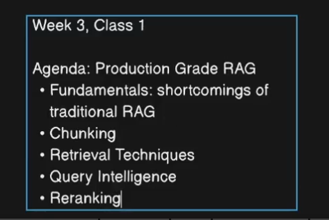

**The bigger roadmap for the next classes:** context handling → security → evaluation → operations.

> [!TIP]
> **The idea of this chapter in one line:** the basic RAG pipeline from Chapters 01–02 works in a demo but **breaks at scale**. We'll walk through each stage of the pipeline and find where it can be improved, so that it becomes **production grade**.

Chunking gets a lot of attention today. We already chunked documents in Chapter 02, but in production RAG chunking is **one of the most important parts**, so we'll go much deeper into it. We'll also come back to retrieval and look at the different retrieval techniques that companies actually use.

---

## 1. Recap: the basic RAG pipeline so far

What we've built in Chapters 01–02 has two halves:

**Indexing (offline, once per document)**

```text
Documents → Parse → Chunk → Embed → store in Qdrant (vector + payload)
```

**Querying (online, every question)**

```text
User query → Query embedding → Vector search → Top-K chunks → Prompt + context → LLM → Answer
```

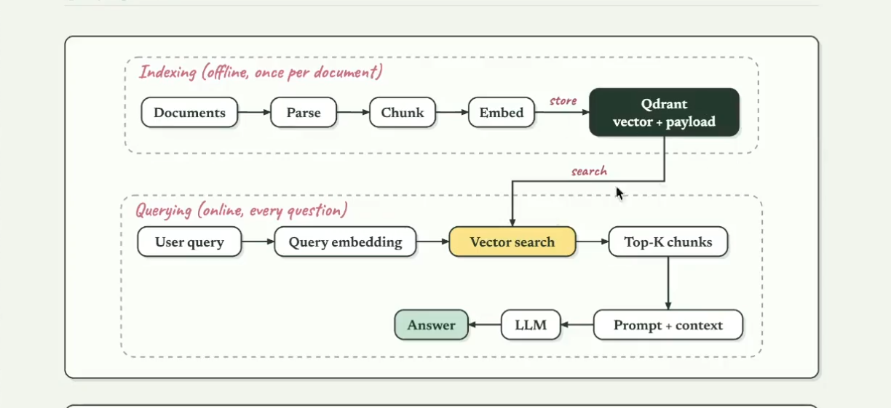

In words: we **load and parse** the documents, **chunk** them, create **vector embeddings**, and **store** them in the vector DB. At question time we embed the query, compare it using a **similarity metric** (cosine, L2, dot product) and a **search strategy**. Most of the time that strategy is **ANN** (Approximate Nearest Neighbour, e.g. HNSW). The top-K chunks go into the prompt as context and the LLM writes the answer.

> [!WARNING]
> This pipeline **sounds good, but it starts breaking at different stages** once you go to scale. Real users, many documents, many tenants and messy questions expose every weak spot.

---

## 2. Similar is not the same as relevant

### 2.1 A simple question, many possible meanings

A user asks: **"Where is my payment stuck?"**

Your knowledge base might have documents about **internal payments**, **vendor payments** and **customer payments**, and "payment" can appear at many stages, each with its own context. A plain vector search may pull back documents that are **similar** (they share the word and the topic) but **not correct** for this user.

> [!IMPORTANT]
> **Something being similar does not mean it is the right answer.** Vector search measures *closeness of meaning*. It doesn't know which document actually answers *this* question.

### 2.2 The Zomato help-desk example

The course uses a fictional **Zomato support knowledge base** (records named `ZH-xxx` = **Z**omato **H**elp desk). A customer writes:

> **Query:** *"My order says delivered, but I never received it. I paid online. Can I get a refund?"*

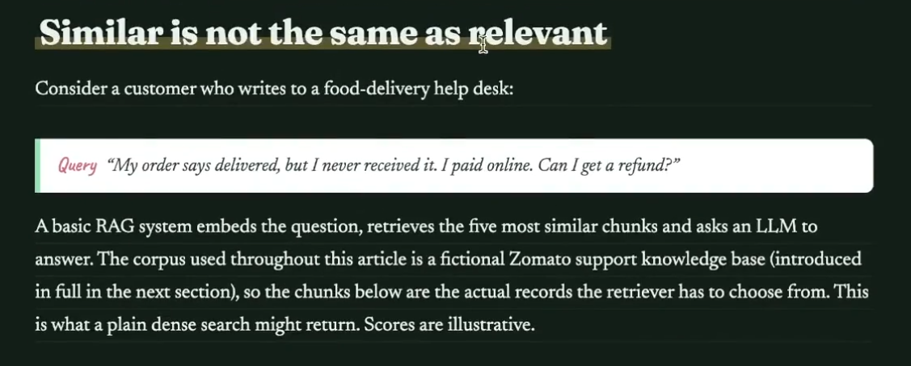

A basic RAG system embeds the question, retrieves the most similar chunks and hands them to the LLM. A plain **dense** (vector-only) search might return this (scores are illustrative):

| Rank | Record | What it says | Why it's wrong (or right) | Score |
|---|---|---|---|---|
| 1 | **ZH-008 Refund status** | "For a refund **already initiated**, check the transaction or refund status in the app." | Mentions refunds and payment, but it's about a refund that **already exists**. Nobody has started one for this customer. | 0.83 |
| 2 | **ZH-006 Restaurant cancellation** | "If a restaurant cancels an order, review the order and payment status…" | Refund and payment words, but it's about a **restaurant cancelling**. Nothing was cancelled here. | 0.79 |
| 3 | **ZH-002 Order marked delivered** ✅ | "If an order is marked delivered but has not arrived, check the delivery instructions and contact the delivery partner… If unresolved, report the issue from the order page." | **The only record that actually matches the situation**, yet it's ranked **third**. | 0.78 |
| 4 | **ZH-010 Payment debited, order failed** | "If money was debited but the order failed, check whether the payment is pending, reversed, or refunded." | Money debited + failed order: a **different situation**. | 0.74 |

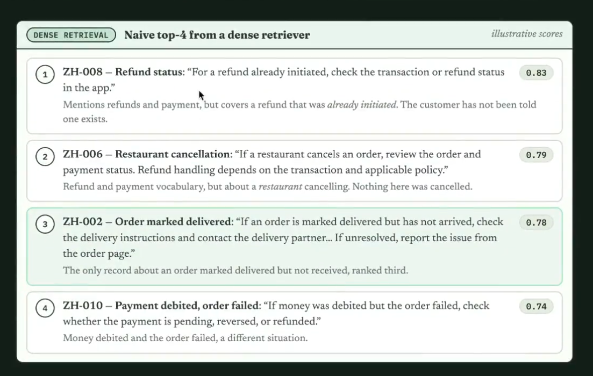

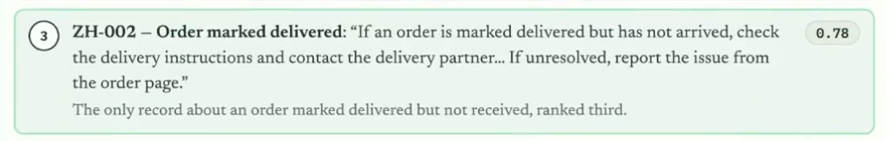

### 2.3 Why rank 3 is a real problem: Top-K = 2

We don't send every retrieved chunk to the LLM. A huge context costs more tokens and makes the LLM more likely to get confused or **hallucinate**. So we keep only the **top K**.

Say **K = 2**: only chunks **1 and 2** go into the context. The correct chunk (rank 3) **never reaches the LLM**, so the LLM confidently answers from the wrong documents (refund status, restaurant cancellation) and gives a **wrong answer**.

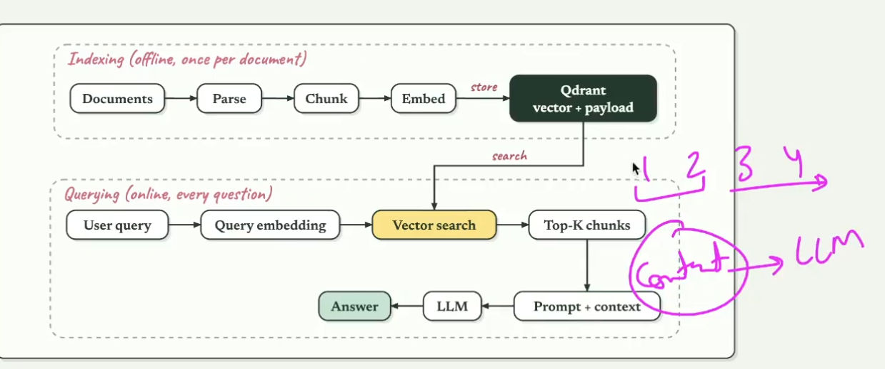

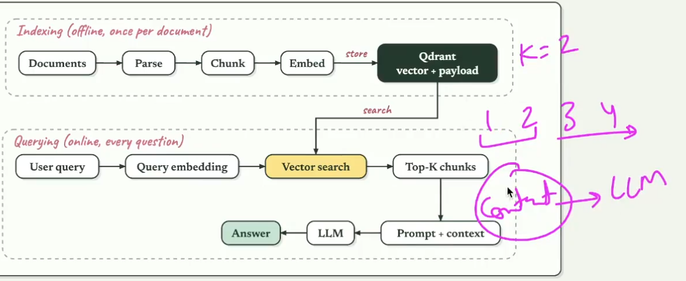

> [!NOTE]
> **For infra people:** it's like a load balancer health check that only looks at "port open". The server *looks* healthy (similar) but the app behind it is broken (not relevant). You need a **deeper check**, and in RAG that's **hybrid search + reranking**, which comes later in this chapter.

---

## 3. Where a basic pipeline breaks: 7 failures

Wrong ranking is only **one** problem. Failures can happen at many layers:

| # | Failure | What the customer sees | Technique that addresses it |
|---|---|---|---|
| 1 | **Similarity mistaken for relevance** | An answer about restaurant cancellations | **Hybrid search, reranking** |
| 2 | **Missing evidence** | "You will definitely receive a refund" | **Grounded prompts, abstention** |
| 3 | **Poor chunking** | A refund timeline without its eligibility condition | **Structure-aware chunking, parent-child retrieval** |
| 4 | **No metadata filter** | A policy for another product or tenant | **Trusted metadata filters** |
| 5 | **No attribution** | An answer nobody can audit | **Citations and validation** |
| 6 | **No evaluation** | A new reranker shipped because one demo looked better | **Labelled evaluation sets** |
| 7 | **No failure handling** | A timeout turned into a fabricated answer | **Timeouts, fallbacks, fail-closed paths** |

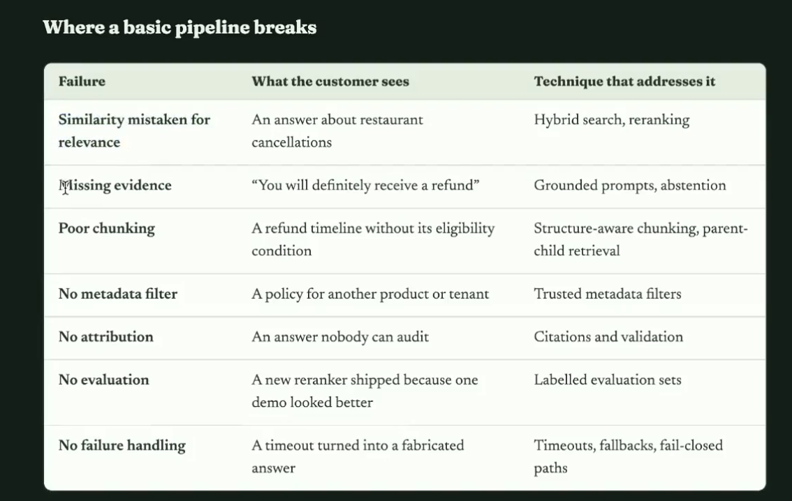

Let's go through each one.

### 3.1 Similarity mistaken for relevance

This is the Zomato case from section 2. The retriever returns chunks that are **close in meaning** but don't answer the question, and the right chunk is pushed out of the top-K.

**Fix:** **hybrid search** (vector search **plus** keyword search, so exact words like "delivered" and "never received" also count) and **reranking** (a second, smarter model re-orders the candidates by true relevance before we cut to top-K). Both are covered later in this chapter.

### 3.2 Missing evidence

The LLM gets the top-2 chunks, and none of them actually says the customer gets a refund. But LLMs are trained to be **helpful**, so it thinks *"why not make the user happy?"* and replies with full confidence:

> ❌ "You will **definitely** receive a refund."

That promise **didn't come from our retrieval pipeline**. The model made it up to please the user.

**Fix:** make the system **grounded**:

- **Grounded prompt:** tell the LLM to answer **only** from the provided context.
- **Abstention:** if the context doesn't contain the answer, the LLM must **say so** instead of guessing, e.g. *"I don't have the relevant information for this. You can talk to our customer support representative."*

> [!TIP]
> **"I don't know" is a valid, safe answer.** In production, a confident wrong answer (a refund promise, a wrong policy) is far worse than an honest "I can't answer that, here's who can."

### 3.3 Poor chunking

Say we have one paragraph of **900 characters** and we blindly cut it every **300 characters**, without thinking about sentences, headings or meaning:

```text
┌──────────────┐
│   300 chars  │  chunk 1  ← "Refunds are processed within 5–7 days…"
├──────────────┤
│   300 chars  │  chunk 2  ← "…only if the order was reported within 24 hours…"
├──────────────┤
│   300 chars  │  chunk 3
└──────────────┘   900 chars total
```

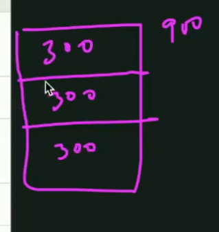

**The drawback:** we **lose context** at every cut. One chunk can get a high relevance score while holding only **half the information**. Example: a **refund timeline without its eligibility condition**. The LLM reads "refunds take 5–7 days" and never sees "only if reported within 24 hours".

**Fixes** (each covered in the chunking section):

| Technique | Idea |
|---|---|
| **Overlap** | Each chunk repeats a bit of the previous one, so a sentence cut at a boundary still appears whole somewhere (we used 900 / 120 in Chapter 02). |
| **Structure-aware chunking** | Split on the document's own structure (headings, sections, list items), not on a character count. |
| **Semantic chunking** | Split where the **meaning** changes. |
| **Parent-child retrieval** | Search on small, precise chunks (children), but send the bigger surrounding section (parent) to the LLM so the full context comes along. |

### 3.4 No metadata filter

Imagine one chatbot platform serving **many tenants (vendors)**, for example **H&M** and **Zomato**:

| Tenant | Refund policy |
|---|---|
| **H&M** | Refund within **30 days** |
| **Zomato** | Refund within **2 hours** |

All documents for both tenants sit in **the same vector store**. A Zomato customer asks about refunds. Without a filter, the search can return **either** policy, and the customer might be told H&M's 30-day rule.

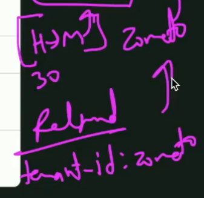

**Fix: trusted metadata filters.** Every chunk carries metadata such as `tenant_id: zomato` (the payload in Qdrant, see Chapter 02 §8.3). When a query comes from Zomato, the search is **filtered first** so it only looks at Zomato's documents:

```python
# Only search Zomato's chunks
retriever = vector_store.as_retriever(
    search_kwargs={"k": 4, "filter": {"tenant_id": "zomato"}}   # exact syntax depends on the vector store
)
```

> [!IMPORTANT]
> **This is a security control, not only a quality one.** Metadata filtering is how you build **multi-tenancy** and make sure one client's data is **never exposed** to another. "Trusted" means the `tenant_id` comes from the **logged-in session on the server**, never from text the user typed. Otherwise someone could ask for another tenant's data.

> [!NOTE]
> **For infra people:** it's the same idea as **Kubernetes namespaces + RBAC**, or a `WHERE tenant_id = ?` clause that the backend always adds. The filter is enforced by the platform, not left to the user.

### 3.5 No attribution

The LLM looks at chunks **C1, C2, C3**. None of them says a refund is possible, but the answer still says "you can ask for a refund". Nobody can check where that came from, so the answer **can't be audited**.

**Fix: citations and validation.**

- Every answer (every paragraph, or even every sentence) must say **which chunk it came from**, e.g. `…report the issue from the order page. [C2]`.
- **Validate** the citations: check that the cited chunk really exists in the retrieved set and really supports the claim. A claim with no citation is a red flag.

```text
Answer: Contact the delivery partner, then report the issue from the order page. [ZH-002]
```

### 3.6 No evaluation

We have a working baseline RAG (embed → retrieve top-K → LLM). Then we decide to "improve" it, for example by adding a new reranker or changing the chunk size, because **one demo looked better**. But we never measure whether the change actually **improved accuracy** or caused a **regression**.

**Fix: labelled evaluation sets.** Build a list of test questions with their known correct results:

| Test query | Expected chunk(s) | Expected answer behaviour |
|---|---|---|
| "Order says delivered but not received, refund?" | ZH-002 | Contact delivery partner → report from order page |
| "Restaurant cancelled my order" | ZH-006 | Check order and payment status |
| "What's H&M's refund window?" (asked as Zomato) | none | Must **abstain**, not leak H&M data |

Run this set **every time** the pipeline changes and compare the scores to the baseline.

> [!NOTE]
> **For infra people:** this is a **regression test suite in CI**. You wouldn't ship a Terraform change without `plan` and tests, so don't ship a RAG change without running the eval set.

### 3.7 No failure handling

A RAG pipeline can fail at **any stage**: chunking/indexing, retrieval (vector DB down or slow), embedding API, or the LLM inference call. If nothing handles it, a **timeout can turn into a fabricated answer**. For example, retrieval times out, the LLM gets an **empty context**, and it answers from its own memory anyway.

**Fix:**

| Technique | Meaning |
|---|---|
| **Timeouts** | Every external call (embedding API, vector DB, LLM) has a time limit. |
| **Fallbacks** | Backup path: a second model or provider, cached answers, keyword search if vector search is down. |
| **Fail-closed paths** | If a required step fails, **refuse safely** ("Sorry, I can't answer right now, please contact support") instead of answering without evidence. |

> [!TIP]
> **Fail closed, not open.** Like a firewall that **denies** traffic when its rules can't load, a RAG system that loses its evidence should **refuse**, not improvise.

---

## 4. The takeaway

Fix the problems at every level (retrieval quality, grounding, chunking, filtering, citations, evaluation and failure handling) and the basic RAG pipeline becomes a **production-grade RAG pipeline**.

```text
Basic RAG                          Production-grade RAG
─────────                          ────────────────────
dense search only           →      hybrid search + reranking
"answer anything"           →      grounded prompt + abstention
fixed 300-char cuts         →      structure-aware / parent-child chunks
search everything           →      trusted tenant/metadata filters
no sources                  →      citations + validation
"demo looked good"          →      labelled evaluation sets
errors = made-up answers    →      timeouts, fallbacks, fail-closed
```

---

## 5. The production-grade RAG architecture (the target)

### 5.1 First question: should RAG answer this at all?

Interesting case: our bot is built for Zomato / H&M questions, but a user asks **"What is 2 + 2?"** or something that makes no sense.

So far our pipeline **always** answers. It goes to the vector store and **will always find *some* "nearest" chunks**, even if the similarity is tiny (0.01, 0.02), because nearest-neighbour search always returns *something*. Then the LLM answers based on junk.

**Fix (covered in an upcoming lecture): a router at the very front.** The router decides:
- should **this query be handled by the RAG pipeline at all**, and
- if yes, **which documents / path** should it use?

> [!NOTE]
> **For infra people:** a router is like an **ingress / API gateway rule**: before a request reaches the backend, decide whether it's even a valid route and which service should handle it. Unknown paths get a 404, not a random backend.

### 5.2 The full pipeline

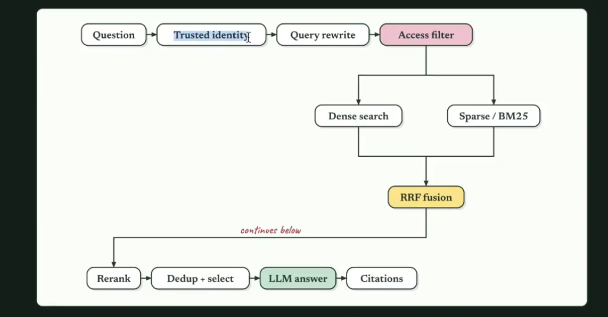

```text
Question → Trusted identity → Query rewrite → Access filter
                                                   │
                                   ┌───────────────┴───────────────┐
                              Dense search                  Sparse / BM25
                                   └───────────────┬───────────────┘
                                               RRF fusion
                                                   │
           Rerank → Dedup + select → LLM answer → Citations
```

| Stage | What it does |
|---|---|
| **Question** | The user's raw question. |
| **Trusted identity** | Check **who** the user is and whether they're **authorized** to ask (authentication + RBAC). Happens before the question touches anything else. |
| **Query rewrite** | Users ask badly: too short, missing context, or too wordy. Rewrite or clarify the query so retrieval finds the right chunks (improves **recall**). Part of **query intelligence**. |
| **Access filter** | The **metadata filter** (Qdrant `must` / `must_not`): which chunks is *this* user allowed to see? E.g. tenant ID, or department-level access: some chunks only for **sales**, some only for **marketing**, some only for **infrastructure**. |
| **Dense search** | The vector (embedding) search we already know. |
| **Sparse / BM25** | **Keyword-based** search that runs **in parallel** with dense search. Catches exact words, IDs and codes that embeddings can blur. |
| **RRF fusion** | **Reciprocal Rank Fusion**: merges the two ranked lists into one. |
| **Rerank** | A smarter model re-orders the merged candidates by real relevance to the question. |
| **Dedup + select** | Remove duplicates and keep only the **top K** for the context. |
| **LLM answer** | Grounded answer from the selected chunks. |
| **Citations** | Each claim points back to its source chunk. |

### 5.3 A quick word on Recall@K


The query-rewrite step exists to improve **recall**: if the right chunks never come back from search, nothing downstream can fix it. In class it was written as **Recall@K = m / K** (m = relevant chunks found in the top K).

> [!WARNING]
> **Careful with the formula in interviews.** Strictly speaking:
> - **Recall@K** = relevant chunks found in the top K ÷ **total relevant chunks that exist** ("did we find all the right ones?")
> - **Precision@K** = relevant chunks found in the top K ÷ **K** ("how much of what we returned is useful?")
>
> So **m / K is Precision@K**. Example: 4 chunks truly answer the question; top-5 contains 3 of them → Recall@5 = 3/4 = 75%, Precision@5 = 3/5 = 60%. (Same definitions as Chapter 01 §17.1.)

### 5.4 Walking an example through dense + sparse → RRF → rerank → top-2

| Step | Result |
|---|---|
| Dense search returns | **A, B, D, L** |
| Sparse / BM25 returns | **B, A, M, L** |
| RRF fusion (merged ranking) | **A, B, L, D** |
| Rerank (true relevance) | **D, A, L, B**: the real answer was in **D**, sitting **last** after fusion |
| Select top K = 2 → LLM | **D, A** → answer + citations |

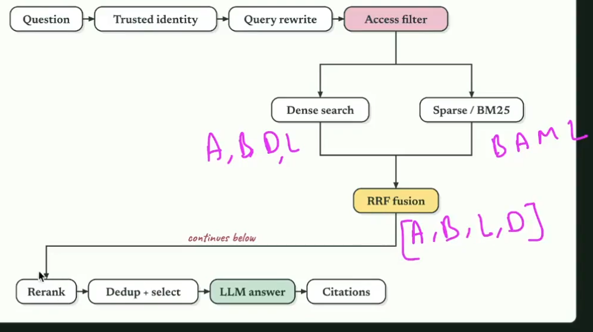

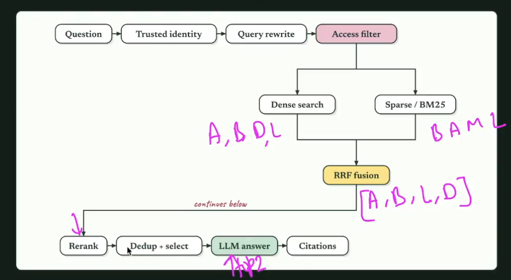

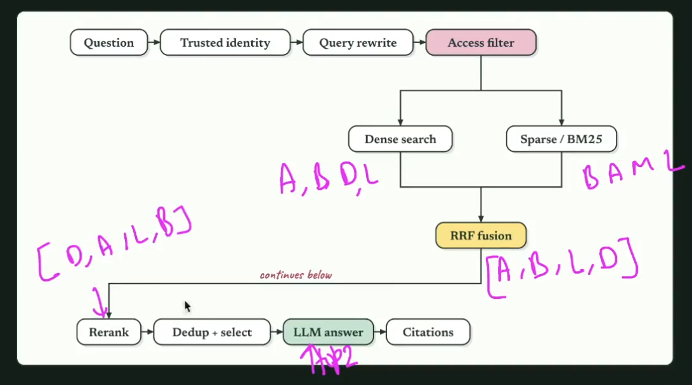

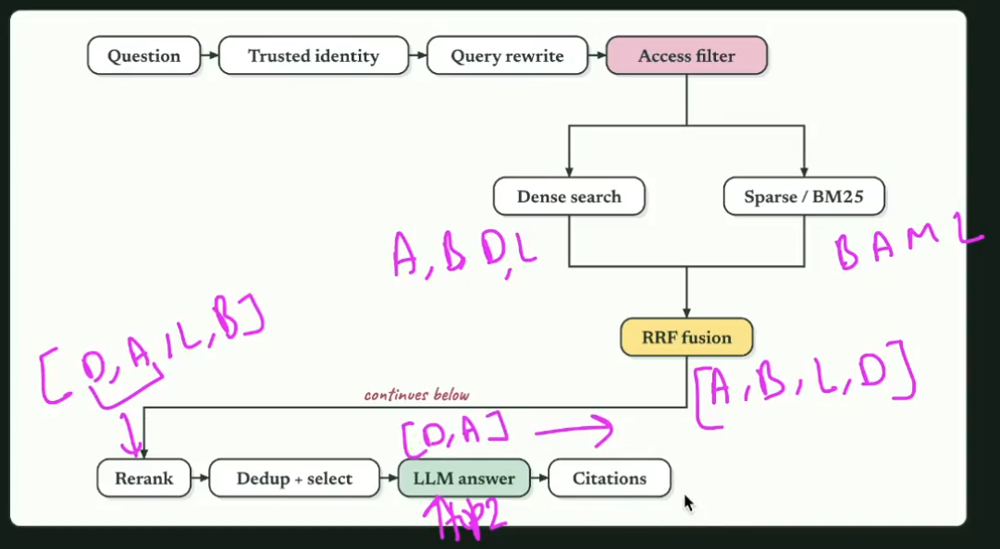

**Why the rerank matters:** without it, K = 2 would send **A, B** and the answer in **D** would be lost, which is the same story as the Zomato example in section 2.

> [!TIP]
> **Sneak peek: how RRF scores** (details come later in the course). Each chunk gets `score = Σ 1 / (k + rank)` over every list it appears in, with `k` usually **60**. Using ranks (not raw scores) means dense and BM25 scores don't need to be on the same scale.
> - A: 1/61 + 1/62 ≈ **0.0325**, B: 1/62 + 1/61 ≈ **0.0325** (tie)
> - L: 1/64 + 1/64 ≈ **0.0313**
> - D: 1/63 ≈ **0.0159** (only in dense), M: 1/63 ≈ **0.0159** (only in sparse)
>
> → **A, B, L, D/M**, which matches the slide. Chunks found by **both** searches rise to the top.

### 5.5 What we've built so far vs what's new

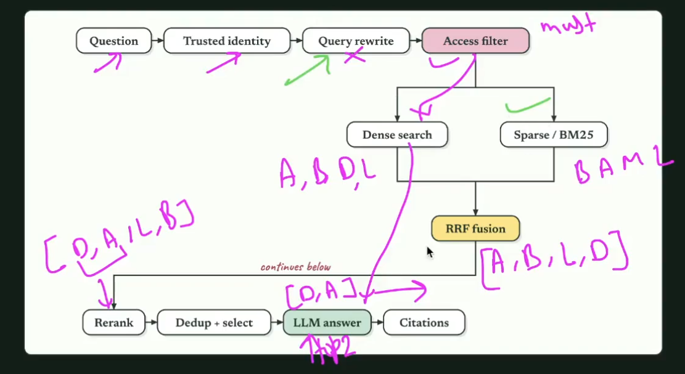

| Already done (Ch 01–02) | Still to learn |
|---|---|
| Question → LLM answer | **Query rewrite** |
| Trusted identity (concept) | **Sparse / BM25** search |
| Access filter: Qdrant filters (`must`, `must_not`) | **RRF fusion** |
| Dense search → LLM answer | **Reranking**, dedup + select, citations |

**The baseline is done.** Now the goal is to improve on it, one stage at a time.

---

## 6. Establish a baseline first

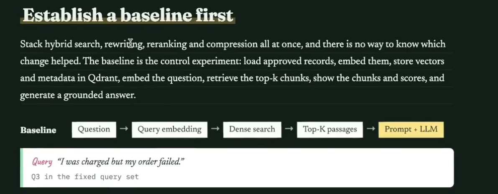

If you add hybrid search, query rewriting, reranking and compression **all at once**, there's no way to know **which change actually helped**. The **baseline is the control experiment**:

```text
Baseline:  Question → Query embedding → Dense search → Top-K passages → Prompt + LLM
```

Load approved records → embed them → store vectors + metadata in Qdrant → embed the question → retrieve top-K → **show the chunks and their scores** → generate a grounded answer.

Then every improvement is measured **against this baseline** on a **fixed query set**. Example: query **Q3**: *"I was charged but my order failed."*

> [!NOTE]
> **For infra people:** it's a **performance baseline before tuning**. You load-test the current setup first, then change one knob at a time (instance size, then cache, then connection pool) and compare. Change five things at once and you can't tell which one fixed or broke it.

---

## 7. Chunking in depth

Chunking is one of the **most important** parts of production RAG. If a fact is split away from its condition, no amount of clever retrieval can bring it back together. We saw splitting with LangChain in Chapter 02; now the four main strategies.

All examples use the same small source with three sections:

```text
Section 1 — Late delivery
If an order is delayed, check the live status and ETA.
If the ETA has passed, contact support from order details.

Section 2 — Payment debited, order failed
If money was debited but the order failed, check whether payment
is pending, reversed or refunded. Raise a support issue if unresolved.

Section 3 — Duplicate payment
If two charges appear for one order, compare transaction references.
Never share full card details or an OTP.
```

### 7.1 Fixed-size chunking

Split by a fixed **character or token budget**, usually with some **overlap** between neighbours. It needs no knowledge of the document layout, so it's **simple, fast and reproducible**, but it **doesn't care** where it cuts: mid-word, mid-sentence, across headings.

With a **120-character window and 20 characters of overlap** (the last 20 characters of one chunk repeat at the start of the next):

| Chunk | Text (↵ = line break) | Problem |
|---|---|---|
| 1 (120) | `Section 1 — Late delivery↵ If an order is delayed, check the live status and ETA.↵ If the ETA has passed, contact support` | Cut before "from order details" |
| 2 (120) | `ed, contact support from order details.↵↵ Section 2 — Payment debited, order failed↵ If money was debited but the order fa` | Starts mid-word ("ed,"), mixes two sections, ends mid-word ("fa") |
| 3 (120) | `ted but the order failed, check whether payment↵ is pending, reversed or refunded. Raise a support issue if unresolved.↵` | The rule's **condition** ("money was debited") is in chunk 2, the **action** is here |
| 4 (120) | `sue if unresolved.↵↵ Section 3 — Duplicate payment↵ If two charges appear for one order, compare transaction references.↵ N` | Mixes sections, ends on a lone "N" |
| 5 (59) | `action references.↵ Never share full card details or an OTP.` | Fragment |

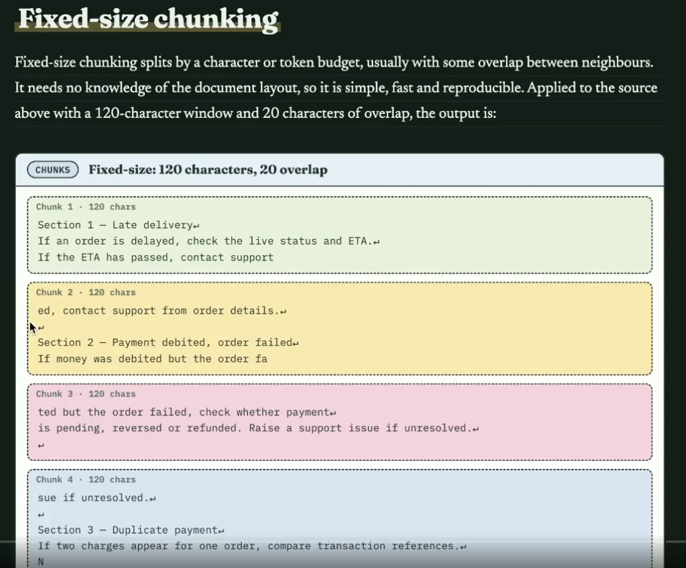

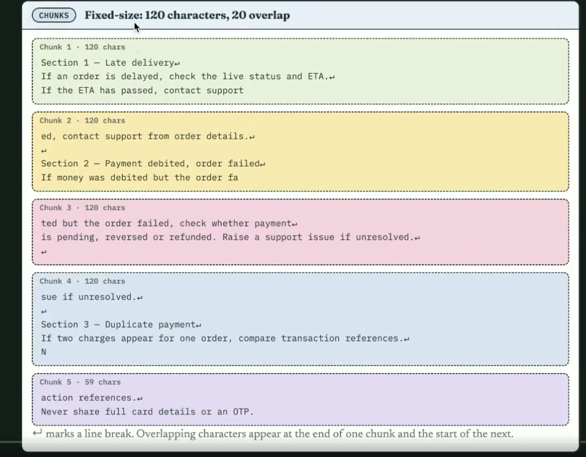

> [!WARNING]
> **Fixed-size chunking is not recommended** for production on its own. Prefer **recursive chunking** (LangChain's `RecursiveCharacterTextSplitter` from Chapter 02): it first splits the text into **paragraphs**, then into **sentences** (on full stops), and only if still too big, on **word boundaries**. Much smarter about where it cuts.

### 7.2 Structure-aware chunking

Cut on **meaningful boundaries first**: document → section → subsection → paragraph (also FAQ items, lists, tables). Only enforce a size limit **where a unit is too large**. Headings like H1/H2 decide the cuts, so **no word or rule gets cut** in half.

Same source, **one chunk per section**:

| Chunk | Text |
|---|---|
| 1 · `[ZH-001 \| Late delivery]` | If an order is delayed, check the live status and ETA. If the ETA has passed, contact support from order details. |
| 2 · `[ZH-010 \| Payment debited, order failed]` | If money was debited but the order failed, check whether payment is pending, reversed or refunded. Raise a support issue if unresolved. |
| 3 · `[ZH-011 \| Duplicate payment]` | If two charges appear for one order, compare transaction references. Never share full card details or an OTP. |

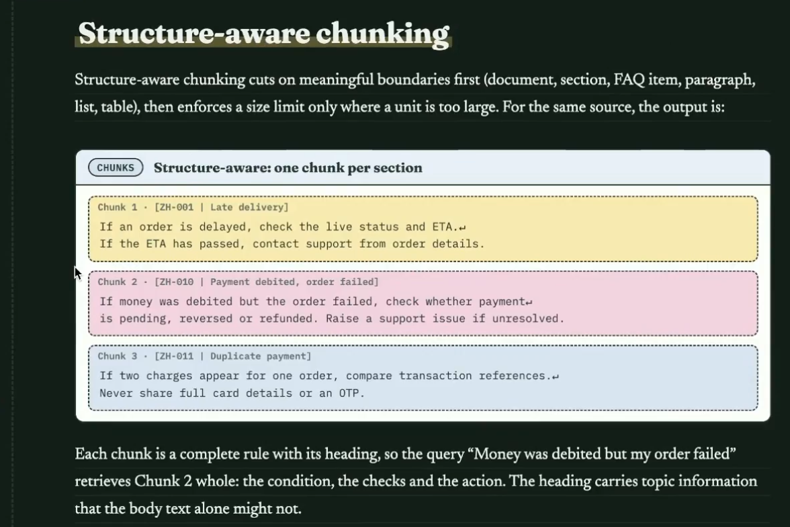

Each chunk is a **complete rule with its heading**, so the query *"Money was debited but my order failed"* retrieves chunk 2 **whole**: the condition, the checks and the action. The heading also carries topic information that the body text alone might not.

```text
Document → Section → Subsection → Paragraph → Token split (last resort)
```

**Metadata should travel with every chunk:** `document_id`, `section_path`, `chunk_id`, `source_version`, `updated_at`, `product`, `locale`, `status`, and the applicable **access scope** (who may see it).

In LangChain you can do this by giving the recursive splitter **your own separators**, from biggest to smallest. You choose which characters to split on:

```python
splitter = RecursiveCharacterTextSplitter(
    chunk_size=800, chunk_overlap=120,
    separators=["\n## ", "\n### ", "\n\n", "\n", ". ", " "],   # H2, H3, paragraph, line, sentence, word
)
```

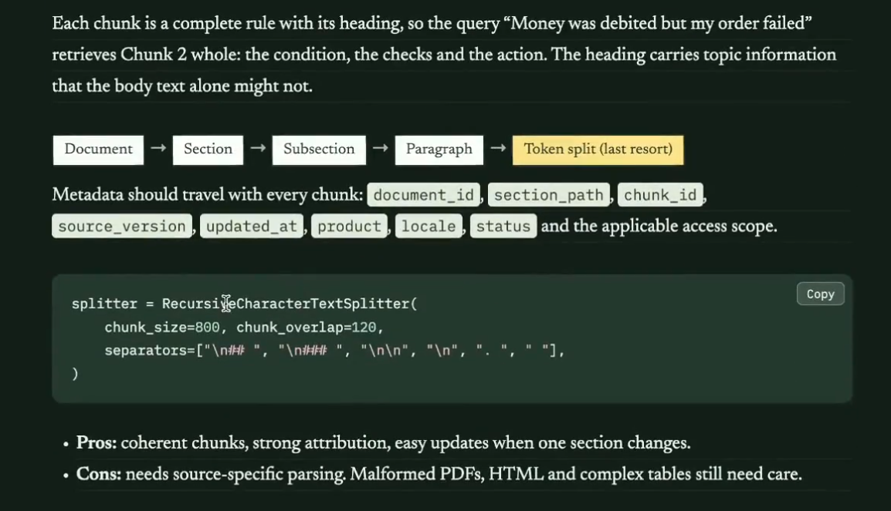

| Pros | Cons |
|---|---|
| Coherent chunks | Needs **source-specific parsing** |
| Strong attribution (chunk = a named section) | Malformed PDFs, HTML and complex tables still need care |
| Easy updates: when one section changes, re-index only that chunk | |

### 7.3 Semantic chunking

Split **where the meaning changes**, not at a character count or a heading. Many companies use it. Useful when a text has **no headings**:

> *The restaurant may cancel an order when it cannot fulfil it. The customer should check the order and payment status. A refund's handling depends on the transaction and applicable policy.*
> *For coupons, the offer may require a minimum order value. Some offers apply only to selected restaurants or payment methods. Expired codes cannot be used.*

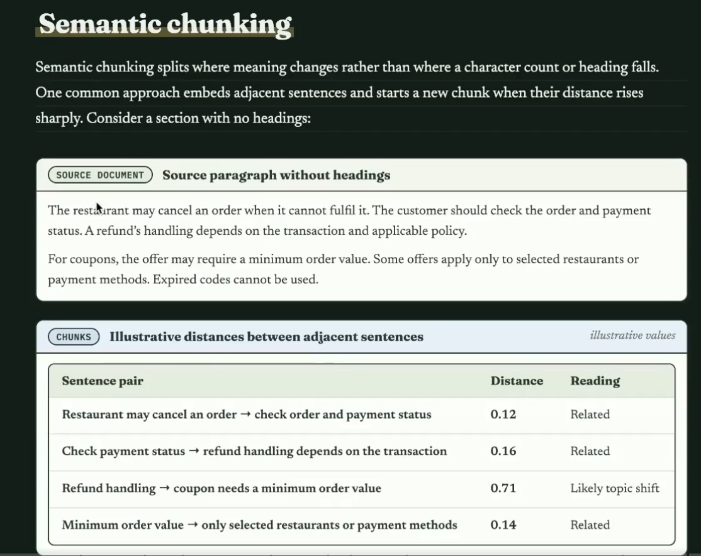

**How it works, step by step** (a paragraph P with lines L1…L5):

1. **Embed each sentence**: L1, L2, L3, L4, L5.
2. Compute the **distance** between each pair of **neighbouring** sentences: L1↔L2, L2↔L3, L3↔L4, L4↔L5.
3. **Small distance = same topic** → keep together. A **sharp jump** = **topic shift** → start a new chunk.

| Sentence pair | Distance | Reading |
|---|---|---|
| L1 → L2: restaurant may cancel → check order and payment status | **0.12** | Related |
| L2 → L3: check payment status → refund handling depends on the transaction | **0.16** | Related |
| L3 → L4: refund handling → coupon needs a minimum order value | **0.71** | **Likely topic shift** ✂️ |
| L4 → L5: minimum order value → only selected restaurants or payment methods | **0.14** | Related |

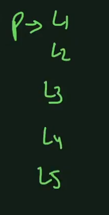

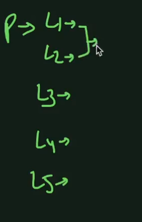

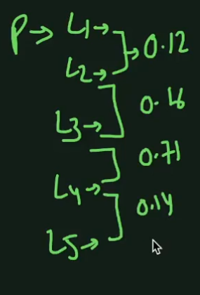

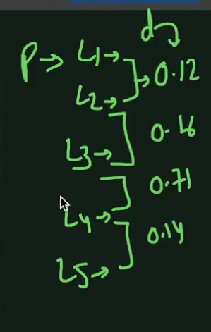

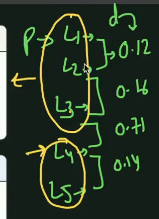

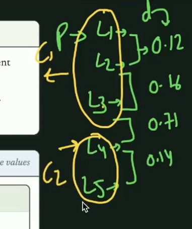

**Result:** **C1 = L1 + L2 + L3** (cancellation and refunds), **C2 = L4 + L5** (coupon eligibility). Each chunk is about **one concept**. A heading-based splitter couldn't do this, because there is no heading.

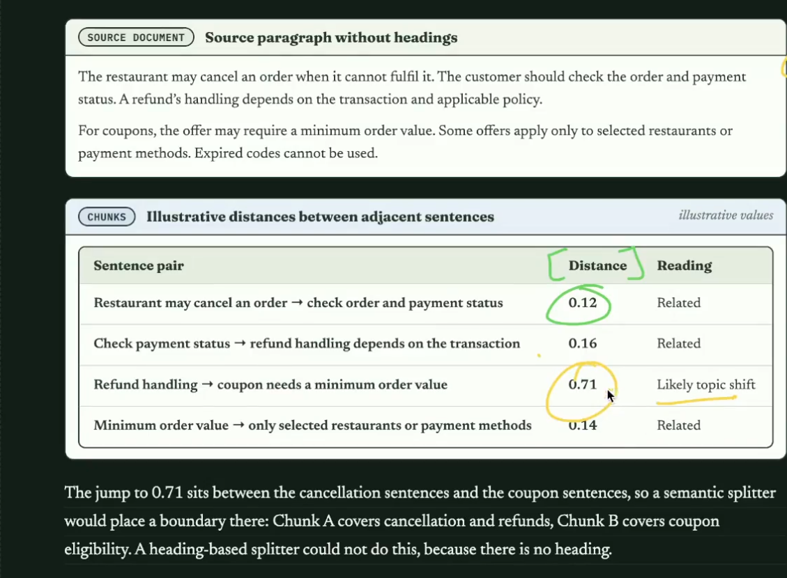

> [!IMPORTANT]
> **These numbers are distances, not similarities.** Small = close in meaning. If you compute **cosine similarity** instead, it's the other way round (high = similar), and **cosine distance = 1 − cosine similarity**. Euclidean (L2) distance works the same way as the table: smaller = closer.

> [!WARNING]
> **Watch out** (from the slide): the distances depend on the **embedding model** and the **distance definition**. **0.71 is not a universal threshold**, and a splitter configured with one fixed number can **over-split or under-split**. Semantic chunking **costs more compute** (an embedding per sentence) and is **harder to debug**. **Adopt it only if evaluation shows an improvement** over simpler splitting.

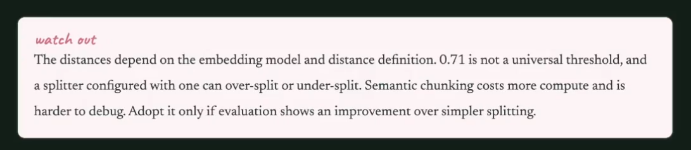

### 7.4 Parent-child retrieval

Take a **bigger chunk (the parent, L)** and split it into **small children: C1, C2, C3**.

- **Store and search the children** in the vector DB. Small chunks are precise, so matching is sharp.
- When a child matches (say **C2**), **return the parent L**, not just C2. The LLM gets the **full surrounding context**.

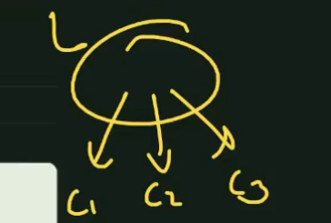

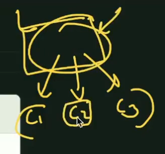

| | Normal chunking | Parent-child |
|---|---|---|
| What's searched | The chunk | The small **child** chunk |
| C2 matches → LLM gets | **C2 only** | The **whole parent L** (C1 + C2 + C3) |
| Good for | Simple docs | Rules where the condition and the action sit in different sentences |

> [!NOTE]
> **For infra people:** it's like **grepping a log for an error line, then opening the whole request trace** around it. The match points you to the right spot; the context around it tells the full story. In LangChain this is the `ParentDocumentRetriever` (children in the vector store, parents in a doc store).

### 7.5 Chunking strategies compared

| Strategy | Splits on | Pros | Cons | Use when |
|---|---|---|---|---|
| **Fixed-size** | N characters/tokens (+ overlap) | Simple, fast, reproducible | Cuts words, rules and sections | Quick prototypes only |
| **Recursive** | Paragraph → sentence → word | Good default, respects text | Doesn't know headings unless told | Plain text, general default |
| **Structure-aware** | Headings, sections, FAQ items, tables | Complete rules, strong citations, easy updates | Needs parsing per source type | Policies, FAQs, wikis, Markdown/HTML |
| **Semantic** | Meaning shifts (embedding distance) | Coherent topics without headings | More compute, threshold tuning, harder to debug | Long unstructured text, **if eval proves it helps** |
| **Parent-child** | Small children for search, big parent for context | Precise match + full context | Two stores, more tokens per answer | Condition and action spread over sentences |

---

## 8. Retrieval: finding candidates (dense vs sparse)

Retrieval's job is to find **candidates**: the shortlist of chunks that *might* answer the question. Two families do it differently: **dense** (meaning) and **sparse** (exact words). The difference shows most clearly in a **technical support knowledge base**, where articles document **error codes** but users describe problems **in their own words**.

### 8.1 The example: an error code query

This section uses a different, **partner-facing** knowledge base (for restaurant partners, not consumers):

> **Query:** *"My Zomato restaurant partner dashboard says **PAY-403**. How do I fix it?"*

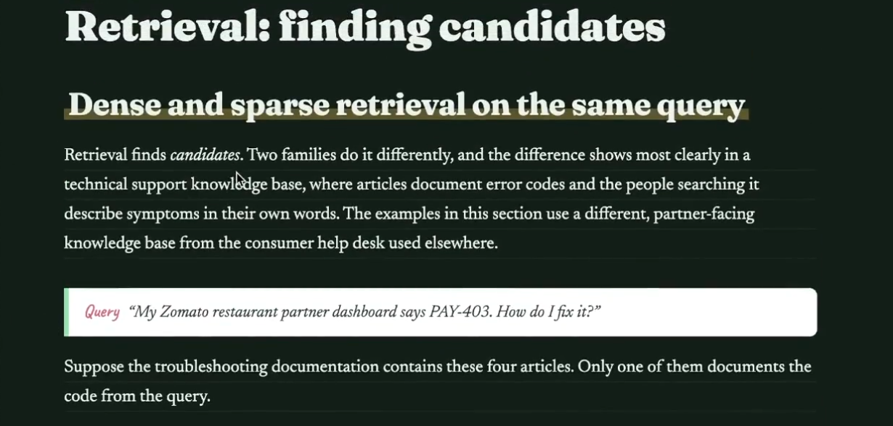

The troubleshooting docs contain four articles. **Only one** documents the code from the query:

| Article | Text |
|---|---|
| **AUTH-012** Partner dashboard access | "If a restaurant partner cannot access a protected dashboard feature, check whether their account has the required permissions and whether their login session is valid." |
| **PAY-021** Payout information unavailable | "If payout information is unavailable, verify the partner's account status and access permissions before investigating the payout service." |
| **ERR-008** Forbidden responses | "A forbidden response usually means the request lacks the required authorization. Check the user's role and permissions." |
| **ERR-403** Error PAY-403 ✅ | "Error **PAY-403**: The payout dashboard request was rejected because the authenticated partner account does not have permission to access the requested resource." |

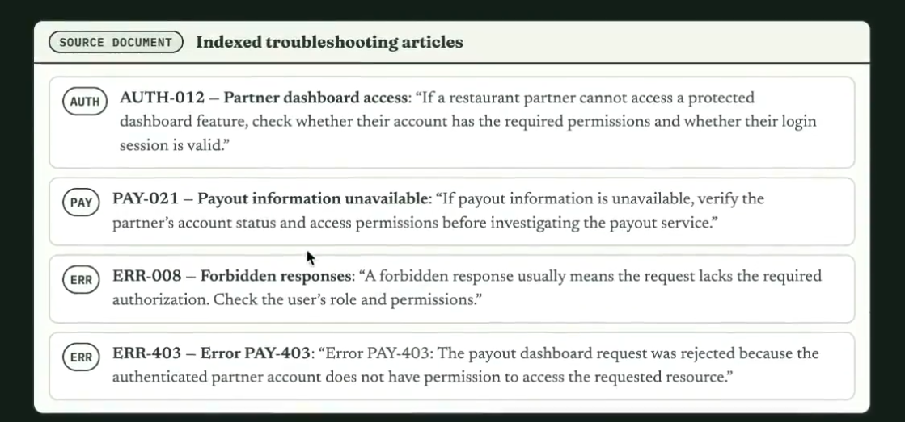

### 8.2 Dense retrieval matches the meaning

| Rank | Article | Why it matched | Cosine similarity |
|---|---|---|---|
| 1 | AUTH-012 Partner dashboard access | Same underlying problem: a partner without permission for a dashboard feature | **0.91** |
| 2 | PAY-021 Payout information unavailable | Payout and access-permission vocabulary | **0.86** |
| 3 | ERR-008 Forbidden responses | "Forbidden" and "authorization" overlap with the idea of a rejected request | **0.79** |
| — | **ERR-403** (the real answer) | **Not in the top 3** | |

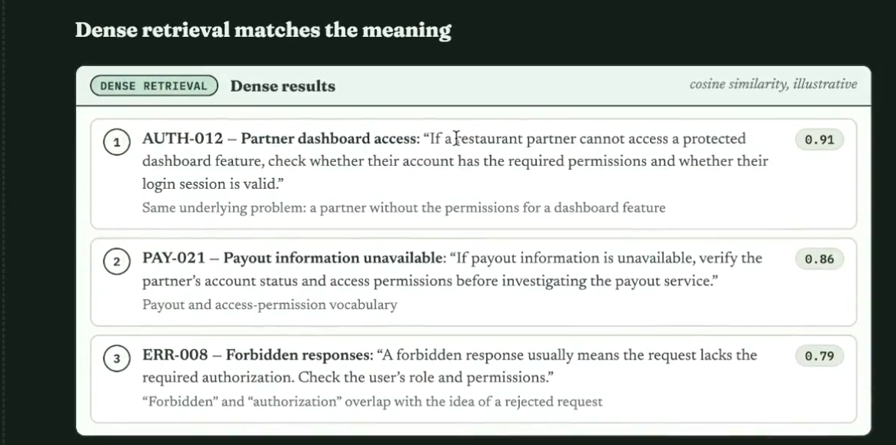

Dense search sees the words "Zomato restaurant partner dashboard" in the query and finds documents about the **same topic**: authorization, permissions, dashboard access. But it **doesn't recognise the precise meaning of `PAY-403`**. A code the embedding model has **rarely or never seen** carries little semantic signal, so the one article that actually documents it (**ERR-403**) **didn't make the top 3**. The LLM would answer from the wrong article.

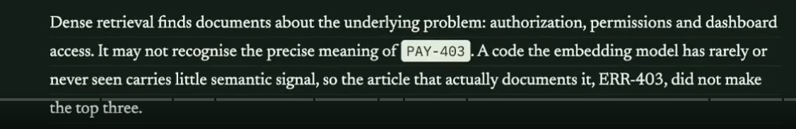

> [!NOTE]
> These scores are **cosine similarity** (higher = more similar), unlike the semantic-chunking table in §7.3, which used **distance** (lower = more similar). Always check which one a number is.

### 8.3 Dense vs sparse vectors

**Why "dense"?** A dense vector has a number in **every slot**:

```text
V1 (dense)  → [0.1, 0.5, 0.7, 0.92, … ]          1536 numbers, none of them zero
V2 (sparse) → [0.1, 0, 0, 0.4, 0, 0, 0.7, … ]    mostly zeros, only a few slots have values
```

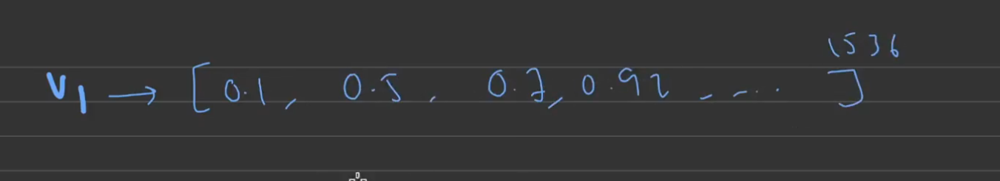

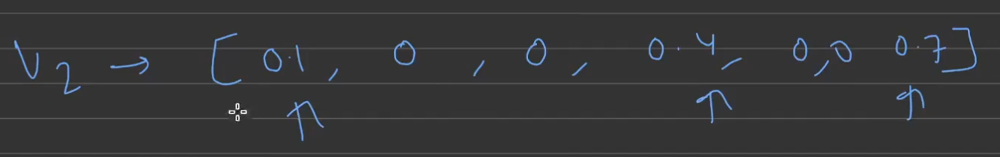

| | **Dense** | **Sparse** |
|---|---|---|
| Width | Fixed, e.g. **1536 floats** for every sentence | **Vocabulary width**, e.g. 50,000 words |
| Filled slots | **Every** slot holds a number | **Almost all zeros**, a handful non-zero |
| What a slot means | Nothing on its own. **Meaning is spread across all of them**; no slot means "refund" or "ZH-009" | **Each non-zero slot *is* a word**: "refund" isn't encoded, the word **is** the coordinate |
| Matches | Two sentences with **no words in common** still land close if they **mean** the same thing | Sentences sharing **no words** share no non-zero positions, so they can **never** match |
| Cost | A 1536-float array for every chunk + an ANN index | Store **only the non-zero pairs**, so it's cheap despite the huge width |
| Motto | **Dense vectors store meaning, not words** | **Sparse vectors store words, not meaning** |

Example: for the sentence "refund not received for order ZH-009", the sparse vector has `1` in the slots for **refund, received, order, ZH-009** and `0` everywhere else (the, a, not… and 49,990+ other words).

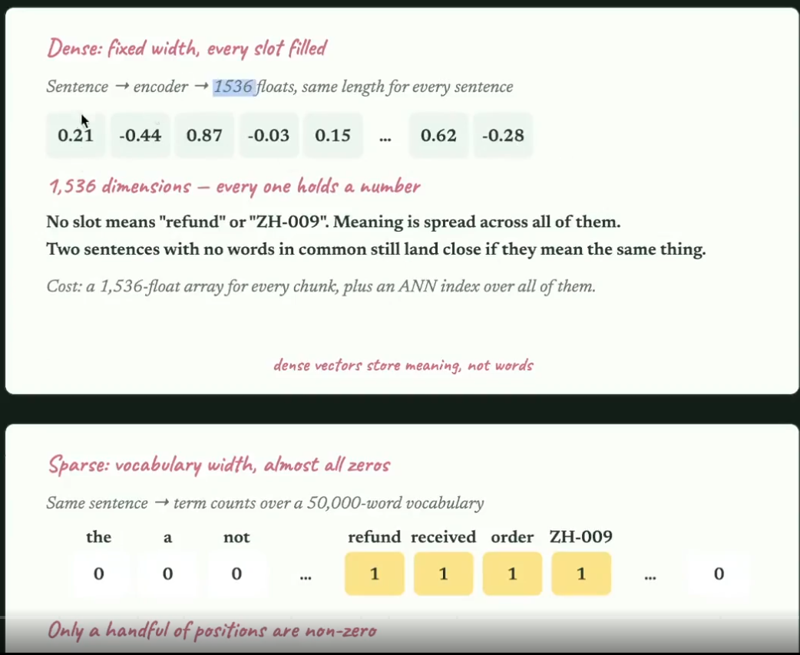

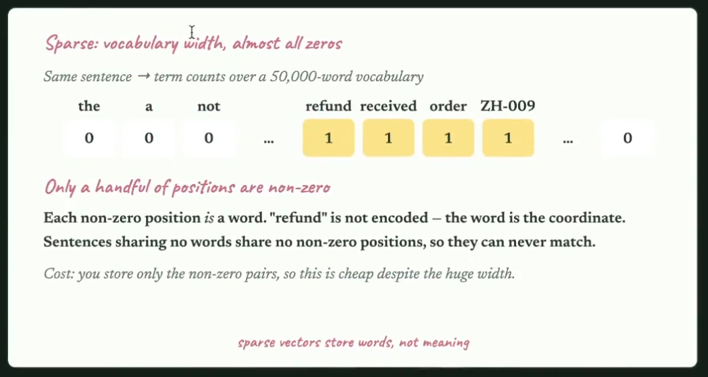

> [!TIP]
> **Analogy.** **Dense** = describing a person by a feeling ("tall, friendly, sporty"): you can find similar people even if they're described in other words. **Sparse** = searching by **employee ID**: it's exact or nothing. `PAY-403` is an employee ID, so you need the exact-match search.

### 8.4 Sparse retrieval with BM25

Sparse retrieval searches for the **exact words**. It doesn't care about meaning; it checks **where the query's words actually exist**, and the chunks that contain them **rank higher**. The classic algorithm is **BM25** (Best Match 25).

**How a document gets indexed:**

```text
Document "Refund not received"
  → Tokenization:     refund, not, received
  → Term statistics:  tf (term frequency), df (document frequency), doc length
  → Inverted index:   term → postings list (which docs contain it)
  → No dense embedding needed at any step
```

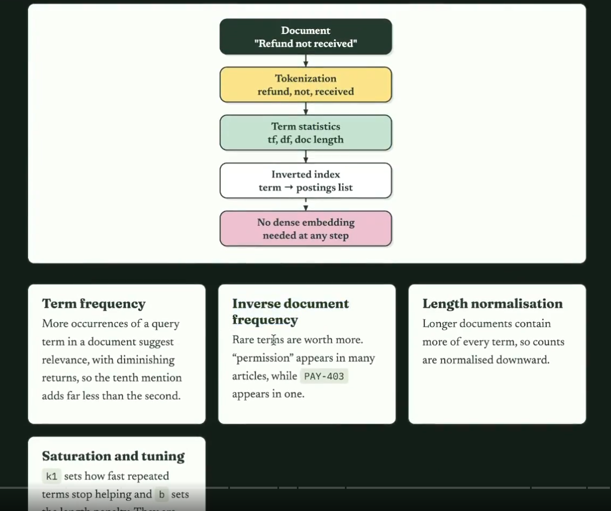

**The four ideas behind the BM25 score** (no need to know the maths):

| Idea | Meaning |
|---|---|
| **Term frequency (TF)** | More occurrences of a query word in a document suggest relevance, **with diminishing returns**: the 10th mention adds far less than the 2nd. |
| **Inverse document frequency (IDF)** | **Rare words are worth more.** "permission" appears in many articles, so it's weak evidence. `PAY-403` appears in **one**, so it's strong evidence. |
| **Length normalisation** | Longer documents contain more of every word, so their counts are **scaled down**. A long and a short paragraph are judged fairly. |
| **Saturation and tuning** | Two knobs: `k1` sets **how fast repeated words stop helping**, and `b` sets **how strong the length penalty** is (common defaults are about k1 = 1.2–2.0, b = 0.75). |

> [!NOTE]
> **For infra people:** BM25 + an inverted index is how **Elasticsearch / OpenSearch** and log tools search. When you search logs for `ERR_CONNECTION_REFUSED` or a request ID, you want **exact keyword match**, not "something similar". An **inverted index** is like the **index at the back of a book**: word → list of pages.

### 8.5 Same query, two lists: why we run both

> **Query:** *"error **ZM-401** coupon"*. It's short and mostly an error code.

| Rank | **Dense list** (meaning) | **Sparse / BM25 list** (exact words) |
|---|---|---|
| 1 | ZH-012 Coupon not applied | **ZH-013 Coupon code error** ✅ *(contains "error ZM-401")* |
| 2 | **ZH-013 Coupon code error** ✅ | ZH-010 Payment debited, order failed |
| 3 | ZH-010 Payment debited, order failed | ZH-012 Coupon not applied |
| 4 | ZH-009 Refund not received | ZH-011 Duplicate payment |
| 5 | ZH-006 Restaurant cancellation | ZH-018 Restaurant unavailable |

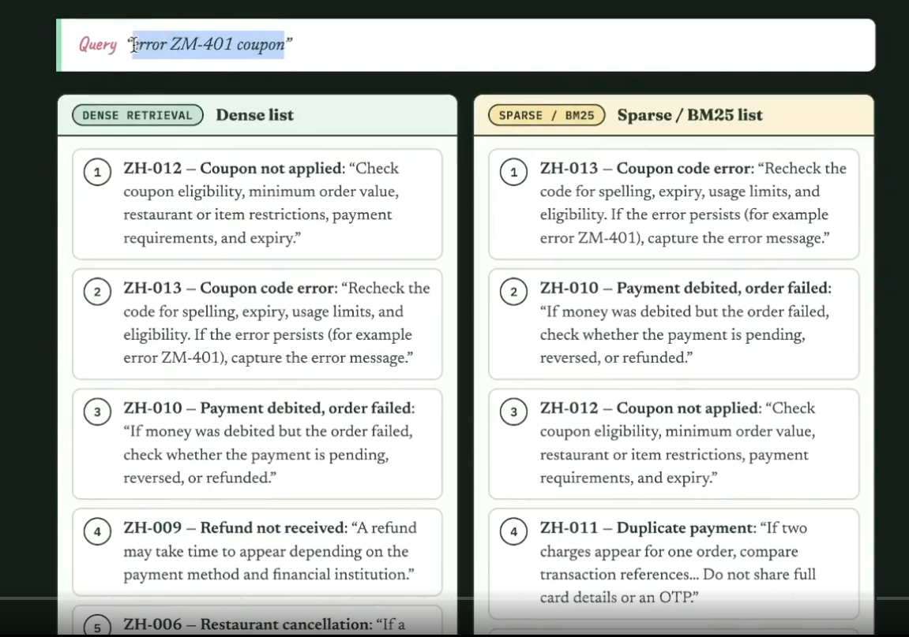

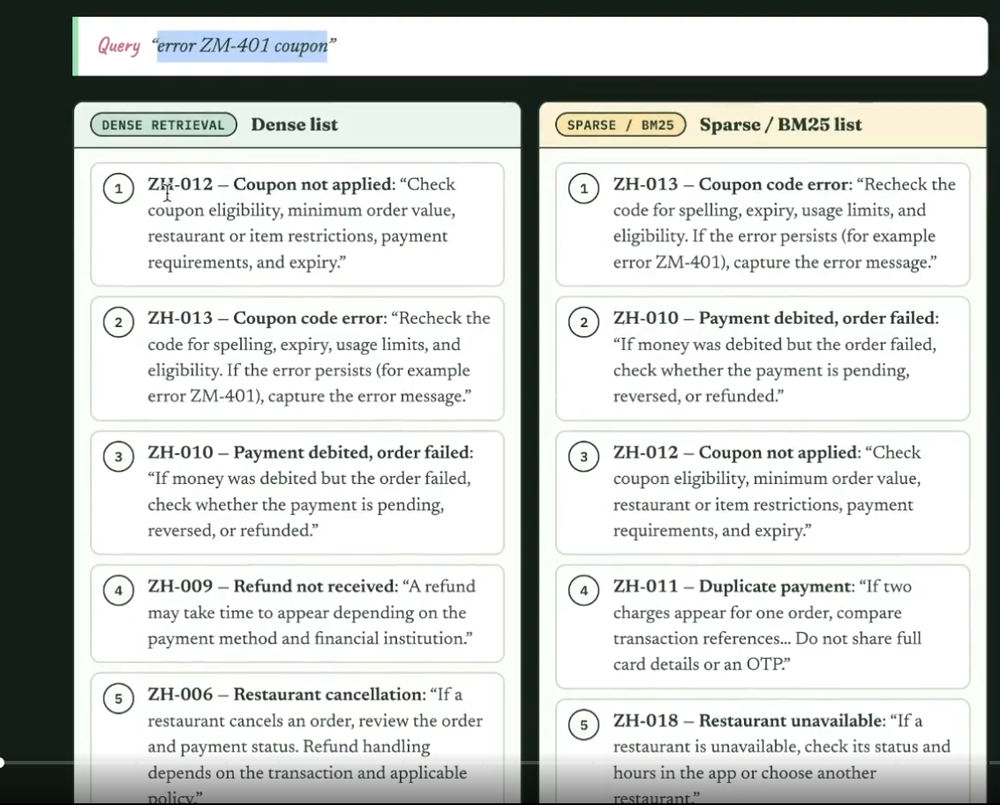

- **Dense** goes by meaning: "coupon" + "error" → coupon articles first. The article with the exact code **ZM-401** is only **second**.
- **Sparse/BM25** goes by words: the rare token **ZM-401** exists in only one article, so **ZH-013 is first**.
- Dense **loses some relevance on exact codes and IDs**; sparse **doesn't**. But sparse fails when the user uses **different words** than the document (synonyms, paraphrases), and that's where dense wins.

> [!IMPORTANT]
> **That's why production systems run both** (dense + sparse in parallel, called **hybrid search**) and then merge the two lists. If your users type **error codes, order IDs, SKUs or product names**, sparse retrieval is not optional.

| Use… | When the query has… |
|---|---|
| **Dense** | Natural language, synonyms, paraphrases ("my money hasn't come back") |
| **Sparse / BM25** | Exact codes, IDs, names, rare terms (`PAY-403`, `ZM-401`, `ZH-009`) |
| **Both (hybrid)** | Real users, who mix both, so this is the production default |

### 8.6 Merging the lists: Reciprocal Rank Fusion (preview)

You **can't just add the scores**. A cosine similarity of **0.77** and a BM25 score of **12.4** live on **unrelated scales**, so their sum means nothing. **RRF ignores the scores and fuses the ranks:**

```text
RRF(d) = Σ over ranked lists r of  1 / (k + rank_r(d))

rank_r(d) : position of document d in list r (1 = best)
k         : smoothing constant (60 is a common default)
```

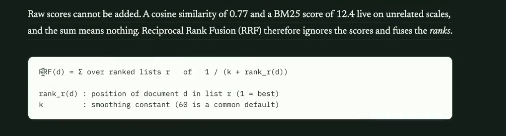

Applied to the ZM-401 lists above (k = 60):

| Chunk | Dense rank | Sparse rank | RRF score | Final |
|---|---|---|---|---|
| **ZH-013** Coupon code error | 2 | 1 | 1/62 + 1/61 ≈ **0.0325** | **1** ✅ |
| ZH-012 Coupon not applied | 1 | 3 | 1/61 + 1/63 ≈ 0.0323 | 2 |
| ZH-010 Payment debited | 3 | 2 | 1/63 + 1/62 ≈ 0.0320 | 3 |
| ZH-009 / ZH-011 | 4 / — | — / 4 | 1/64 ≈ 0.0156 | 4 (tie) |
| ZH-006 / ZH-018 | 5 / — | — / 5 | 1/65 ≈ 0.0154 | 6 (tie) |

The right article ends up **first** because **both** retrievers ranked it near the top. (Hybrid search and RRF get their own section in the next part.)

### 8.7 Hands-on setup (notebook)

A new folder in the project for this chapter: `src/ai_engg_rag/4_production_rag_1/main.ipynb`, next to `1_call_llm`, `2_learn_rag_basics` and `3_langchain_rag`.

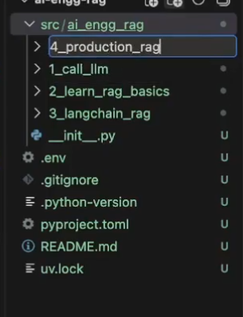

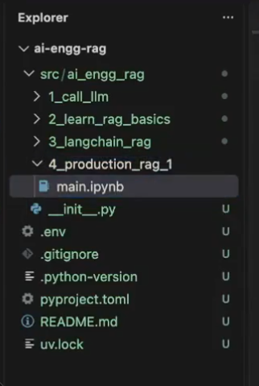

The class code was long. These two setup cells are what matters, explained line by line:

**Cell 1: API key and model**

```python
import os
from getpass import getpass

if not os.getenv("OPENROUTER_API_KEY"):                       # key not in the environment / .env?
    os.environ["OPENROUTER_API_KEY"] = getpass("OpenRouter API key (input hidden): ")   # ask for it, hidden like a password prompt

os.environ.setdefault("OPENROUTER_MODEL", "deepseek/deepseek-v4.1-flash")   # default chat model if none set
print("OpenRouter model:", os.environ["OPENROUTER_MODEL"])
# → OpenRouter model: deepseek/deepseek-v4.1-flash
```

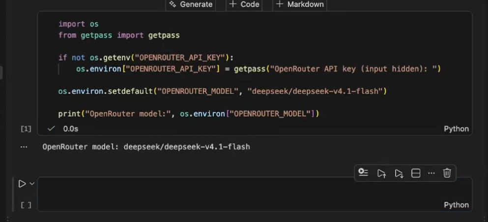

**Cell 2: connect to Qdrant and create both embedders**

```python
client = QdrantClient(url=QDRANT_URL, timeout=30)          # connect to the Qdrant server (30 s timeout = failure handling!)
print("Existing collections:", [c.name for c in client.get_collections().collections])

dense_embeddings = OpenAIEmbeddings(                       # DENSE: meaning → 1536 floats
    model="openai/text-embedding-3-small",
    openai_api_base="https://openrouter.ai/api/v1",
    api_key=os.environ["OPENROUTER_API_KEY"],
)
sparse_embeddings = FastEmbedSparse(model_name="Qdrant/bm25")   # SPARSE: words → BM25 sparse vector, runs locally
llm = ChatOpenRouter(model=OPENROUTER_MODEL, temperature=0, max_tokens=900, max_retries=2)

DENSE_DIM = len(dense_embeddings.embed_query("refund status for a cancelled order"))
sparse_sample = sparse_embeddings.embed_query("refund status FAQ")
print("Dense dimensions:", DENSE_DIM)                                       # → 1536
print("Sparse non-zero terms for a 3-word query:", len(sparse_sample.indices))  # → only a few
```

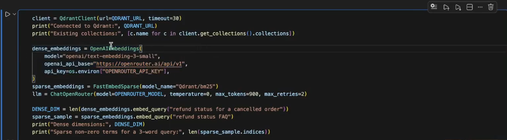

| Line | What it means in plain words |
|---|---|
| `QdrantClient(url=…, timeout=30)` | Connect to the vector DB; give up after 30 s instead of hanging |
| `OpenAIEmbeddings(text-embedding-3-small)` | The **dense** embedder, called through OpenRouter: every chunk → 1536 numbers |
| `FastEmbedSparse("Qdrant/bm25")` | The **sparse** embedder: every chunk → a BM25 word vector. FastEmbed runs **on your machine**, no API call |
| `ChatOpenRouter(temperature=0, max_tokens=900, max_retries=2)` | The LLM: deterministic, answer capped at 900 tokens, **retry twice** on errors (failure handling again) |
| `len(embed_query(...))` | Sanity check: the dense vector length (1536) is the **collection size** we must create in Qdrant |
| `len(sparse_sample.indices)` | Sanity check: a 3-word query has only ~3 non-zero slots, which shows it really is **sparse** |

> [!NOTE]
> **What comes next in code:** a Qdrant collection that stores **both** vectors for each chunk (a named dense vector + a named sparse vector), so one query can run dense and sparse search together and fuse them. That's hybrid search, in the next part.

---

## 9. Hybrid search, contextual retrieval and parent-child

### 9.1 Hybrid search + Reciprocal Rank Fusion

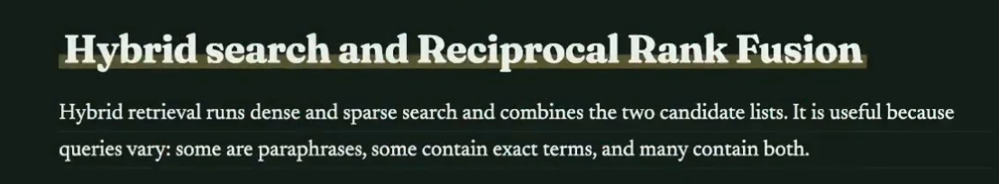

**Hybrid retrieval** runs **dense** search (semantic, meaning) and **sparse** search (lexical, exact words) and **combines the two candidate lists**. It helps because real queries vary: some are **paraphrases**, some contain **exact terms**, and many contain **both**.

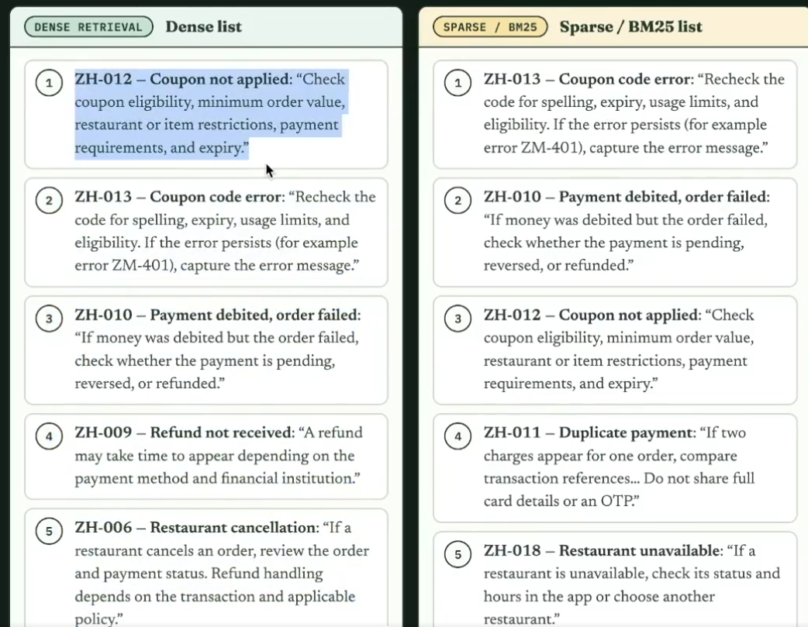

The lists are merged with **RRF**, which fuses **ranks, not scores** (full worked example in §8.6: ZH-013 comes out #1 because both retrievers ranked it high):

```text
RRF(d) = Σ over ranked lists r of  1 / (k + rank_r(d))      k = 60 (common default)
```


### 9.2 Contextual retrieval (the Anthropic technique)

Even with structure-aware or semantic chunking, a chunk can be **correct yet meaningless on its own**. Suppose one handbook sentence is stored as its own chunk:

| Raw chunk | Problem |
|---|---|
| *"It may take longer depending on the payment method."* | What is **"it"**? A refund, a coupon, a reversal? The embedding has **nothing to anchor it**. |

**Contextual retrieval** uses an LLM to **prepend a short description of where the chunk came from** **before** it's embedded and stored:

> *"Source: Zomato support handbook › Payments › Refund not received. This section explains how long an already-initiated refund takes to appear in the customer's account. **Chunk:** It may take longer depending on the payment method."*


```text
raw chunk ──► LLM ("describe where this chunk sits in the document") ──► context + chunk ──► embed + BM25 ──► vector DB
```

**Query:** *"will my money come back, it's been 5 days"*

| Rank | Raw chunks (dense) | Context-enriched chunks (hybrid / RRF) |
|---|---|---|
| 1 | ZH-008 Refund status (0.74), refund-status words | **ZH-009 chunk + context** ✅ (**0.83**): "refund", "account" and "appear" now sit in the chunk |
| 2 | ZH-010 Payment debited, order failed (0.72), payment words | ZH-008 Refund status (0.75), still related |
| 3 | **ZH-009 chunk** (0.70): the fragment has **no topic words** to match | ZH-010 Payment debited, order failed |


**Anthropic's published results** ([anthropic.com/engineering/contextual-retrieval](https://www.anthropic.com/engineering/contextual-retrieval)), measured as the **top-20 retrieval failure rate**:

| Setup | Failure rate | Improvement |
|---|---|---|
| Embeddings only | 5.7% | baseline |
| Embeddings + BM25 | 5.0% | |
| **Contextual** embeddings | 3.7% | **−35%** |
| Contextual embeddings + **contextual BM25** | 2.9% | **−49%** |


Their conclusions: embeddings + BM25 beats embeddings alone; passing the **top-20** chunks beats top-10 or top-5; **adding context to chunks improves retrieval a lot**; **reranking beats no reranking**; and **all these benefits stack**.


> [!WARNING]
> **No technique is a guarantee. It's trial and error, measured.** Contextual retrieval means **one LLM call per chunk at indexing time**, which can **cost a lot of money** on a big corpus. Use your **evaluation set** to decide whether it actually helps your data (prompt caching makes it cheaper; Anthropic's post covers that).

> [!NOTE]
> **For infra people:** it's like adding **labels/tags to every log line** (`service=payments, env=prod`) at ingest time. The raw line "timeout after 30s" means nothing alone; with its labels it becomes searchable and understandable. It costs a little at ingest and saves a lot at query time.

### 9.3 Parent-child retrieval in practice

Recap of §7.4: **small chunks match precisely, a bigger section is better for answering**. Search the small **child** chunks, return the **parent** section that contains the match.

Example parent **"Payment troubleshooting"** with three children:

| Child | Text |
|---|---|
| ZH-010 Payment debited, order failed | "If money was debited but the order failed, check whether the payment is pending, reversed, or refunded. Raise an issue through support if the transaction remains unresolved." |
| ZH-011 Duplicate payment | "If two charges appear for one order, compare transaction references and raise a payment issue with both references. **Do not share full card details or an OTP.**" |
| ZH-009 Refund not received | "A refund may take time to appear depending on the payment method and financial institution. Check the stated refund status or timeline before raising a follow-up." |


**Query:** *"Money was taken but no order was created."*

| Child-only retrieval | Parent-child retrieval |
|---|---|
| Child ZH-010 matches (0.86). The model receives **about 27 words**. | Search **still hits the precise child** (ZH-010, 0.86), but the **whole parent (about 84 words)** is returned. |
| | It also brings the **"never share an OTP"** caveat from the neighbouring child, which matters when a payment issue is being raised. |


**In LangChain: `ParentDocumentRetriever`**

```python
from langchain_classic.retrievers import ParentDocumentRetriever
from langchain_core.stores import InMemoryStore

child_store = demo_store("demo_children", [])          # empty hybrid collection (holds the CHILD vectors)

parent_child = ParentDocumentRetriever(
    vectorstore=child_store,                            # children are embedded + searched here
    docstore=InMemoryStore(),                           # parents are kept here, looked up by ID
    child_splitter=RecursiveCharacterTextSplitter(chunk_size=300, chunk_overlap=30),
    parent_splitter=RecursiveCharacterTextSplitter(chunk_size=1000, chunk_overlap=0),
    search_kwargs={"k": 4},
)
parent_child.add_documents(wiki_by_name["payments_runbook.md"] + wiki_by_name["onboarding.md"])

query = "Which command do I run to roll back the payments deployment?"
child_hit  = child_store.similarity_search(query, k=4)[0]   # what plain search would return (small)
parent_hit = parent_child.invoke(query)[0]                  # what parent-child returns (the big section)
```


In plain words: documents are first cut into **parents of ~1,000 characters**, and each parent into **children of ~300 characters** (so roughly **3 children per parent**). Children go into the vector store, parents into a simple key-value store. A search matches a child, then hands back its parent.

> [!WARNING]
> **Watch out** (from the slide): `ParentDocumentRetriever`, `MultiVectorRetriever` and `SelfQueryRetriever` live in **`langchain-classic`**, which gets **security fixes only until December 2026**. Learn the **pattern**, but for a new long-lived service prefer **an adapter you own** or verify a maintained alternative first. The instructor also called parent-child "not that much recommended": try it, measure it.


### 9.4 Choosing a retrieval mode

| Situation | Start with | Example from this corpus |
|---|---|---|
| Paraphrased natural-language questions | **Dense** retrieval | "I paid, but nothing was placed" → Payment debited, order failed |
| Exact error codes, order IDs, rare names | **Sparse** retrieval | "error ZM-401" → Coupon code error |
| Natural language **plus** exact terms | **Hybrid** retrieval | "error ZM-401 coupon not working" |
| Strict product, tenant or locale scope | **Metadata filters** + a retriever | Consumer coupon policy, not "Coupon not applied (enterprise)" |
| Queries with **no answer** in the corpus | **Thresholds and abstention** | "Does Zomato sell laptop insurance?" |
| Many near-duplicates among candidates | **Reranking** after retrieval | Payment-status records that all look alike |


> [!TIP]
> This table is a **guideline, not a rule**. The real answer always comes from **trial and error measured on your evaluation set**.

---

## 10. Query intelligence

So far we've worked on the **chunk** side (chunking, contextual retrieval, parent-child). Now we work on the **query** side. Remember: production RAG can fail at many levels, and each one needs handling. Some people call this area "prompt engineering for retrieval".

### 10.1 Query rewriting

Follow-up messages **depend on the conversation**:

> **Customer:** My order is late.
> **Assistant:** Please check the latest ETA in the order details.
> **Customer:** **What if it has already passed?**


The last message has **no searchable intent on its own**: what is "it"? What "passed"? Send it to retrieval as-is and you get weird results. A **rewrite model** uses the chat history to **resolve the reference** and produce a **standalone query**. It **should not answer**, and it **should not add facts**.

| Original: *"What if it has already passed?"* (dense) | Rewritten: *"What should I do if the estimated arrival time for my Zomato order has already passed?"* (hybrid) |
|---|---|
| 1. ZH-007 Customer cancellation (0.52): "What if…" phrasing drifts toward conditional policies | 1. **ZH-001 Late delivery** ✅ (**0.86**): "ETA" and "estimate has passed" now match directly |
| 2. ZH-009 Refund not received (0.49): timing language | 2. ZH-007 Customer cancellation (0.61), loosely related |
| 3. ZH-016 Address update (0.47): "once underway…" wording | 3. ZH-020 Support escalation (0.58), loosely related |


### 10.2 A rewrite must not rewrite away details

| User message | ✅ Faithful rewrite | ❌ Harmful rewrite |
|---|---|---|
| "order **ZM-123** failed after payment was debited" | "order ZM-123 failed after payment was debited; what to check" | "payment failed, will I get a refund?" **Drops the identifier and adds a refund promise.** |
| "Where can I see the arrival time?" | **Left unchanged**: already a clear standalone query | A longer paraphrase that **loses the word "arrival"** |


> [!IMPORTANT]
> Compare retrieval and answer quality for **original vs rewritten** queries on the **evaluation set**. Rewriting can **hurt exact identifiers** and make clear questions **less precise**. **The rewritten query is a proposal from a model, not a trusted input.**

**In code:**

```python
from pydantic import BaseModel, Field
from langchain_core.prompts import ChatPromptTemplate

class SearchQuery(BaseModel):                      # the shape the LLM MUST return
    query: str = Field(min_length=3, max_length=400)

rewrite_prompt = ChatPromptTemplate.from_messages([
    ("system", "Rewrite the latest user message as a standalone search query. "
               "Use history only to resolve references. Do not answer or invent facts."),
    ("human", "Conversation history:\n{history}\nLatest message: {question}"),
])
rewrite_chain = rewrite_prompt | llm.with_structured_output(SearchQuery)

rewrite = rewrite_chain.invoke({"history": history, "question": question})
retrieval_query = rewrite.query
candidates = retriever.invoke(retrieval_query)
# Final answer generation still receives the ORIGINAL question.
```


| Piece | Plain meaning |
|---|---|
| `SearchQuery(BaseModel)` | A **schema**: the output must be one string between 3 and 400 characters. Like a JSON schema validating an API response. |
| `with_structured_output(SearchQuery)` | Forces the LLM to return exactly that shape, not chatty text |
| System prompt | "Rewrite only; don't answer, don't invent." |
| Last comment | The rewrite is used **only for searching**. The final answer is generated against the user's **original** words. |

### 10.3 Self-query and structured filters

Some questions contain **structure** that a vector search ignores. **Self-query** turns the question into a **semantic query + filters** over fields the application allows.

> **Query:** *"Show me the current English policy for coupon issues in the consumer app."*

The model **proposes** (untrusted):

```json
{"semantic_query": "coupon issues", "topic": "offers", "product": "consumer-app",
 "locale": "en-IN", "status": "published", "tenant_id": "partner-x"}
```

| Proposed field | Allowlisted? | Decision |
|---|---|---|
| `topic = offers` | yes | **Accepted**, added to the filter |
| `product = consumer-app` | yes, and permitted for this session | **Accepted** |
| `locale = en-IN` | yes | **Accepted** |
| `status = published` | mandatory anyway | **Set by the server** regardless of the model |
| `tenant_id = partner-x` | **no: never model-controlled** | **Rejected.** Tenant comes from **authentication**. |


> [!IMPORTANT]
> **Security rule:** the LLM may *suggest* filters, but only **allowlisted** fields are accepted, and **security fields (tenant, role) always come from the authenticated session**. Otherwise a user could type "tenant partner-x" and read another company's data. This is the "trusted metadata filter" from §3.4 in action.

### 10.4 Query routing

Not every question belongs in a document retriever. **Before any retrieval**, a **router** decides which system can actually answer (this is the router from §5.1):

| User question | Route | Why |
|---|---|---|
| "Why didn't my coupon work?" | **Policy RAG** | Answered by ZH-012 Coupon not applied |
| "Explain the cancellation policy." | **Policy RAG** | Answered by ZH-007 Customer cancellation |
| "What is the live status of order ZM-123?" | **Authenticated order-status API** | No article can know the **current state of one order**, however well it's retrieved |
| "How many orders failed yesterday?" | **Approved analytics query** | An **aggregate over many records** is not a document lookup |
| "Cancel my order now." | **Action workflow** with authorisation and confirmation | A **state change**, not a question |


**In the notebook**, the router picks which **area** of the knowledge base to search:

```python
router_prompt = ChatPromptTemplate.from_messages([
    ("system",
     "Choose where to search. Areas: faq (customer, partner and enterprise help-center answers), "
     "policies (employee handbook, expenses, travel), wiki (engineering onboarding, payments runbook, holiday calendar), "
     "catalog (enterprise plans and prices). "
     'Return JSON only: {{"area": "<one area or all>"}}.'),
    ("human", "{question}"),
])
router_chain = router_prompt | llm | JsonOutputParser()

def route_area(question: str) -> str | None:
    area = router_chain.invoke({"question": question}).get("area")
    return area if area in ALLOWED_AREAS else None     # None = search every area

for question in ("How do I roll back a payments deployment?", "What does the Business plan cost per employee?", ...):
    area = route_area(question)
    top = hybrid_store.similarity_search(question, k=1, filter=validated_filter(TENANT_ID, area=area))[0]
    print(f"{question:<50} -> area={area!s:<8} top hit: {top.metadata['citation_id']}")
```


In plain words: the LLM reads the question and answers with JSON like `{"area": "wiki"}`. The code **checks the answer against an allowlist** (`ALLOWED_AREAS`). If the LLM says something unexpected, it falls back to searching **all** areas. The area becomes a **metadata filter**, while `TENANT_ID` still comes from the server via `validated_filter`.

> [!NOTE]
> **For infra people:** routing = **ingress path rules**. `/orders/*` → order-service API, `/reports/*` → analytics, `/docs/*` → the RAG service. You don't send a "cancel my order" POST to the documentation server.

### 10.5 Other query-intelligence techniques (named in class)

| Technique | Idea in one line |
|---|---|
| **Query rewriting** | Turn a vague or follow-up message into one clear standalone query (above) |
| **Multi-query** | Generate several versions of the question, retrieve for each, and merge the results (e.g. with RRF) |
| **HyDE** (Hypothetical Document Embeddings) | Ask the LLM to write a **hypothetical answer**, then search with *that* text, since answers look more like documents than questions do |
| **Step-back prompting** | Ask a more **general** question first ("what is the refund policy?") to fetch background, then answer the specific one |

*(The one-line explanations of multi-query, HyDE and step-back are my summaries; the class only named them.)*

---

## 11. End of class: what's next

Today covered fundamentals → chunking → retrieval → query intelligence. **Reranking moves to the next lecture.** Then: context handling, security, evaluation and operations.

---

## Interview quick answers

1. **"Why does a basic RAG pipeline fail in production?"** It treats similarity as relevance, answers without evidence, chunks blindly, doesn't filter by tenant, doesn't cite sources, isn't evaluated and doesn't handle failures. Each one has a known fix.
2. **"Similar vs relevant: what's the difference?"** Vector search finds chunks *close in meaning* (shared words and topic). Relevant means the chunk *actually answers this question*. In the Zomato example the only correct record (ZH-002) ranked 3rd, so with K = 2 the LLM never saw it.
3. **"How do you fix wrong ranking?"** Hybrid search (dense + keyword) to find better candidates, then a reranker to re-order them by true relevance before cutting to top-K.
4. **"How do you stop the LLM making up answers?"** A grounded prompt (answer only from the context) plus abstention ("I don't have that information") when the evidence is missing.
5. **"What's wrong with fixed-size chunking?"** Cuts split context. A chunk can score high while holding half the facts (a refund timeline without its eligibility rule). Use overlap, structure-aware or semantic chunking, and parent-child retrieval.
6. **"How do you do multi-tenancy in RAG?"** Store `tenant_id` as metadata on every chunk and always apply a **trusted** filter (taken from the authenticated session, never from user text) on every search. It's a security control.
7. **"Why citations?"** So every claim can be traced to a source chunk and audited. Validate that the cited chunks exist and support the claim.
8. **"How do you know a RAG change is an improvement?"** Run a labelled evaluation set (queries → expected chunks/answers) before and after, and catch regressions. Never ship on one good demo.
9. **"What does fail-closed mean in RAG?"** If retrieval, embedding or the LLM call fails or times out, return a safe refusal or fallback instead of letting the LLM answer without evidence.
10. **"Draw a production RAG pipeline."** Question → trusted identity (auth/RBAC) → query rewrite → access filter (metadata) → dense + sparse/BM25 in parallel → RRF fusion → rerank → dedup + select top-K → LLM answer → citations. A router in front decides whether RAG should answer at all.
11. **"What happens if a user asks something unrelated, like 2 + 2?"** Vector search always returns *some* nearest chunks, even with a tiny score, so a naive bot answers from junk. A router (plus a minimum score threshold and abstention) sends off-topic queries elsewhere or declines.
12. **"What is RRF?"** Reciprocal Rank Fusion merges ranked lists (dense + BM25) using `Σ 1/(k + rank)`, k ≈ 60. It uses ranks, not raw scores, so different scoring scales don't matter; chunks found by both searches rise.
13. **"Why rerank after fusion?"** Fusion finds good candidates but the order can still be wrong (the answer was in D, ranked 4th). A reranker re-orders by true relevance so the right chunk survives the top-K cut.
14. **"Recall@K vs Precision@K?"** Recall@K = relevant found in top K ÷ all relevant that exist. Precision@K = relevant found in top K ÷ K.
15. **"Why build a baseline first?"** It's the control experiment. Add one improvement at a time and measure it on a fixed query set; otherwise you can't tell which change helped or hurt.
16. **"Compare chunking strategies."** Fixed-size: simple but cuts rules mid-word. Recursive: paragraph → sentence → word, a good default. Structure-aware: one chunk per section/FAQ item, complete rules with headings and strong citations. Semantic: split where embedding distance between neighbouring sentences jumps; more compute, use only if eval proves it. Parent-child: search small children, return the big parent.
17. **"How does semantic chunking work?"** Embed each sentence, compute the distance between neighbours, start a new chunk where the distance jumps (e.g. 0.12, 0.16, **0.71**, 0.14 → cut at 0.71). The threshold depends on the model; there's no universal value.
18. **"What metadata should a chunk carry?"** document_id, section_path, chunk_id, source_version, updated_at, product, locale, status and access scope (tenant / role), for filtering, citations, updates and security.
19. **"Dense vs sparse retrieval?"** Dense = embedding of meaning, 1536 floats, every slot filled; matches paraphrases with no shared words. Sparse = vocabulary-wide vector, mostly zeros, each non-zero slot is a word; exact keyword match (BM25). Dense stores meaning, sparse stores words.
20. **"Why does dense search miss error codes like PAY-403?"** The embedding model has rarely or never seen the code, so it carries little semantic signal. Dense ranks topic-similar docs (permissions, dashboard) above the one doc that names the code.
21. **"Explain BM25 simply."** Keyword scoring over an inverted index: term frequency (with diminishing returns), inverse document frequency (rare words count more), length normalisation; tuned by k1 (saturation) and b (length penalty). No embeddings needed.
22. **"Why hybrid search?"** Real users mix natural language and exact codes or IDs. Dense covers paraphrases, sparse covers exact terms. Run both in parallel and fuse with RRF.
23. **"Why not just add dense and BM25 scores?"** They're on unrelated scales (cosine 0.77 vs BM25 12.4). RRF uses ranks instead: `Σ 1/(k + rank)`, k = 60.
24. **"What is contextual retrieval?"** Before embedding, an LLM prepends a short description of where each chunk sits in its document ("Zomato handbook › Payments › Refund not received…"), so fragments like "It may take longer…" become findable. Anthropic: −35% top-20 failures, −49% combined with contextual BM25. Cost: one LLM call per chunk at indexing time.
25. **"When would you use parent-child retrieval?"** When the precise match is small but the answer needs its surroundings (e.g. the "never share an OTP" caveat in a neighbouring child). Children (~300 chars) are searched, parents (~1000 chars) are returned. Note: LangChain's helper is in langchain-classic (security fixes only until Dec 2026).
26. **"What is query rewriting and its risk?"** Turning follow-ups like "what if it has already passed?" into a standalone query using chat history. Risk: dropping identifiers (ZM-123) or adding facts (a refund promise). Treat the rewrite as an untrusted proposal, use it only for retrieval, answer against the original question, and evaluate original vs rewritten.
27. **"What is self-query?"** The LLM extracts a semantic query + metadata filters from the question. Only allowlisted fields are accepted; security fields like tenant_id always come from authentication, never from the model.
28. **"What is query routing?"** Deciding before retrieval which system answers: policy RAG, a live order-status API, an analytics query, or an action workflow. Documents can't know live state, aggregates or perform actions.
29. **"Name other query-intelligence techniques."** Multi-query (several phrasings, merged results), HyDE (search with a hypothetical answer), step-back prompting (ask a broader question first).

## What's next
- **Reranking** (moved from this class): cross-encoders, re-ordering the fused candidates
- Context handling (dedup, compression, top-K selection)
- Security, evaluation and operations of production RAG
