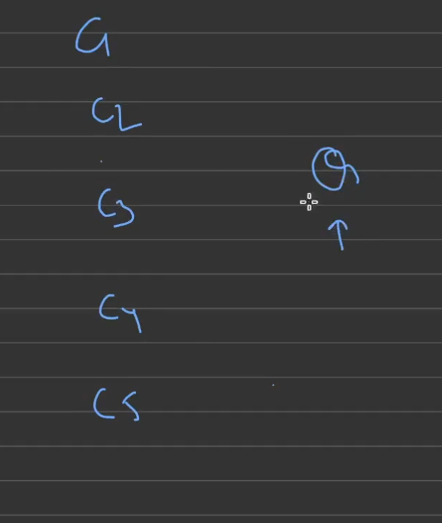
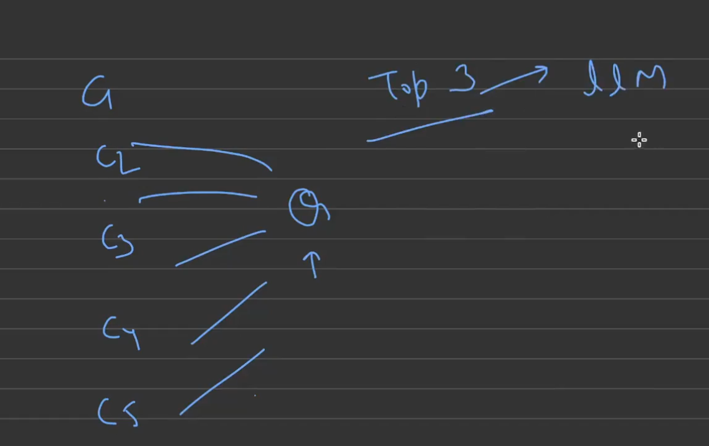
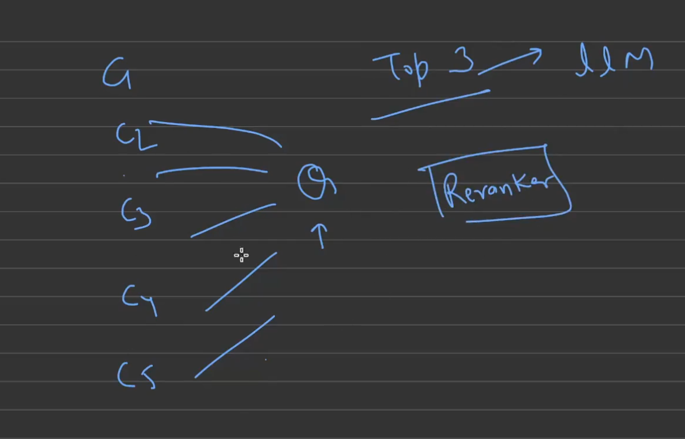
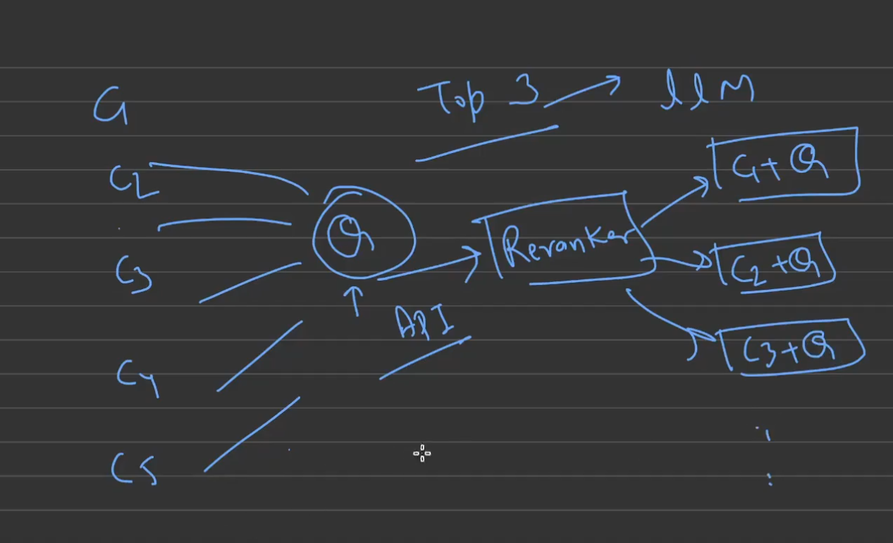
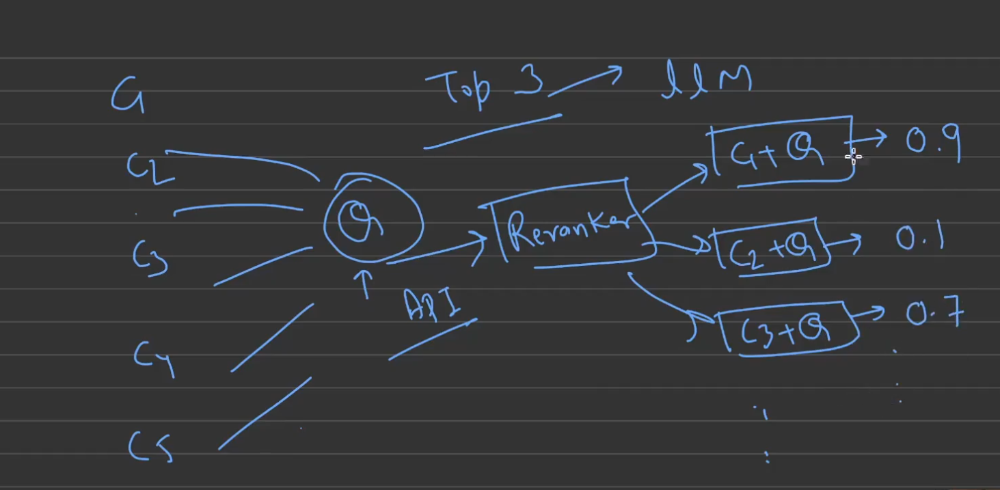
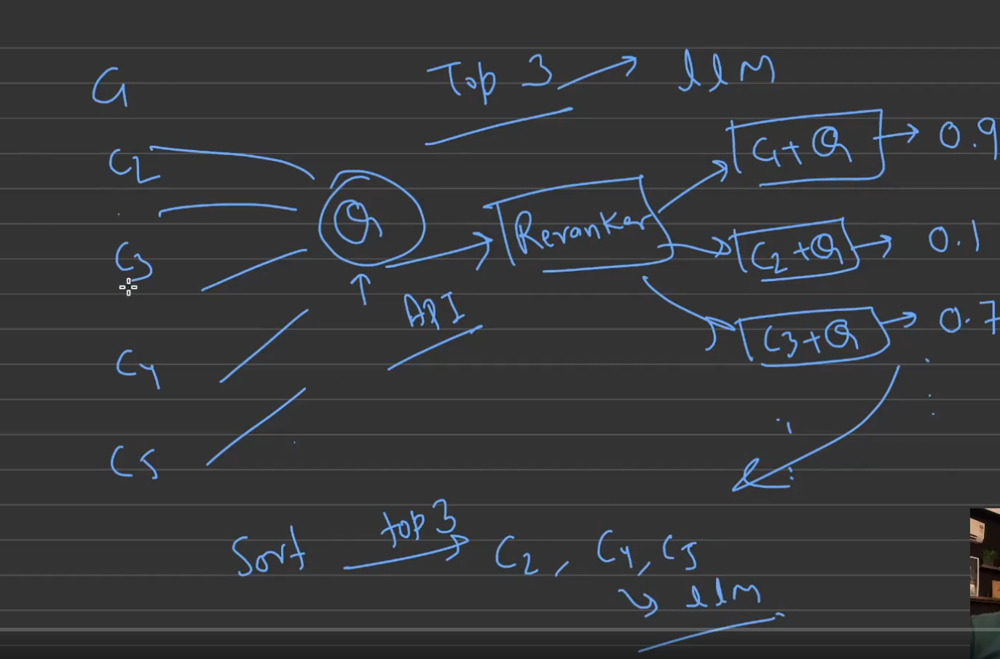
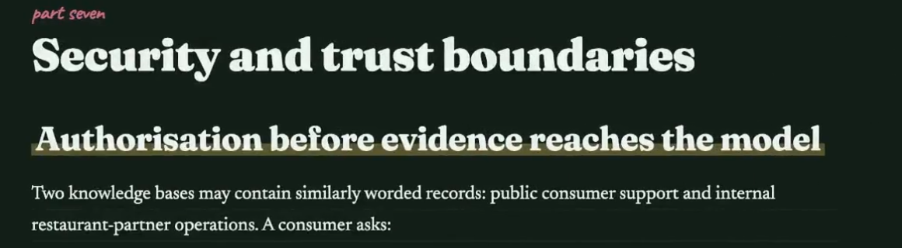

# Chapter 04: Reranking, Security & Evaluation

*AI track · Chapter 04 · Course: Coding Shuttle, "From SDE to AI Engineering" (Week 3, Class 2) · 2026-10-12*

> [!NOTE]
> **The last RAG lecture.** It finishes the production pipeline from Chapter 03: **reranking** (the step that was moved from the last class), **security** (authorisation before evidence reaches the model) and **evaluation** (proving every change with numbers).
> Sections marked **"Beyond the class"** are standard industry practice I added so these notes work as a complete reference. They weren't covered in the lecture itself.
> The chapter ends with a **RAG track wrap-up** (section 5) that ties Chapters 01–04 together.
> ✅ **Complete.** A 4-page handwritten synopsis is in `PDF/04-reranking-security-evaluation-synopsis.pdf`.

## Agenda for this class

| # | Topic | Status |
|---|---|---|
| 1 | Reranking (cross-encoders, Voyage AI) | ✅ |
| 2 | Security and trust boundaries | ✅ |
| 3 | Evaluation | ✅ |

---

## 1. Reranking

### 1.1 Where it sits

Recap from Chapter 03: hybrid search (dense + BM25) → **RRF fusion** gives a good **candidate list**, but the **order** can still be wrong. In the Ch 03 example, RRF gave **A, B, L, D**, yet the real answer was in **D**. With K = 2, D would never reach the LLM.

```text
… → Dense + BM25 → RRF fusion → [ RERANK ] → Dedup + select top-K → LLM → Citations
```

The reranker's job: **look at every candidate together with the question, score how well it actually answers it, and re-order**, so the best chunks survive the top-K cut.

### 1.2 How it works, step by step

Say retrieval returned **5 chunks: C1, C2, C3, C4, C5** for query **Q**, and we want only the **top 3** for the LLM.



How do we know **which 3**? Their retrieval order isn't reliable (similar ≠ relevant).



That's where the **reranker** comes in.



1. **One API call:** send the **query + all the chunks** to the reranker.
2. The reranker **pairs** each chunk with the query, **in parallel**: `(C1 + Q)`, `(C2 + Q)`, `(C3 + Q)`, …



3. Each pair gets a **relevance score**. If C1 is really talking about what the query asks, it gets a high score (**0.9**). If C2 talks about something else, it gets a low one (**0.1**). C3 is fairly relevant (**0.7**), and so on.



4. **Sort** by score, keep the **top 3**, and send **only those** to the LLM.



```text
Q + [C1, C2, C3, C4, C5] ──► reranker ──► C1: 0.90 · C3: 0.70 · C5: 0.55 · C4: 0.30 · C2: 0.10
                                                 └──────── top 3 ────────┘ ──► LLM
```

*(On the whiteboard the final top 3 was written as "C2, C4, C5" just to show the idea. With the scores drawn, C1 (0.9) and C3 (0.7) would of course make the cut and C2 (0.1) wouldn't. The rule is simply: **sort by reranker score, take the top K**.)*

> [!NOTE]
> **For infra people:** retrieval is the **cheap first-pass filter** (like a load balancer's quick TCP health check over hundreds of nodes). The reranker is the **expensive deep check** (a full HTTP probe that actually exercises the app), but you run it only on the **shortlist**. Cheap and wide first, accurate and narrow second.

### 1.3 Why a reranker is more accurate: cross-encoder vs bi-encoder

Reranker models are called **cross-encoders**. Their specialised job is to re-rank.

| | **Bi-encoder** (the embedding model we've used so far) | **Cross-encoder** (the reranker) |
|---|---|---|
| How it reads | Encodes the query and each chunk **separately** into vectors, then compares the vectors (cosine) | Reads the **query and the chunk together** as one input and outputs one relevance score |
| Precompute? | ✅ Chunk vectors are computed **once** at indexing time | ❌ Nothing can be precomputed; it runs **at query time, per pair** |
| Speed | Very fast, works over **millions** of chunks (ANN) | Slower, so used only on the **top 20–100** candidates |
| Accuracy | Good at "same topic" | Much better at "**does this chunk actually answer this question?**" |

*(Beyond the class: the bi-encoder vs cross-encoder comparison is the standard explanation of why rerankers work.)*

> [!TIP]
> **Analogy.** A bi-encoder is like **matching CVs to a job by keywords and tags**: fast, done for thousands of CVs. A cross-encoder is like **the interview**: you put the candidate and the job description in the same room and judge the fit directly. Too slow for everyone, perfect for the shortlist.

### 1.4 Reranker models

The class uses **Voyage AI** rerankers (Voyage AI is now part of **MongoDB**). Other options exist: **Cohere Rerank**, open-source **BGE-reranker** and **Jina reranker** (can be self-hosted), or using an LLM as a reranker.

**Illustrative code** (beyond the class; the hands-on code wasn't shared in class, and model names change, so check the provider's docs):

```python
import voyageai

vo = voyageai.Client()   # reads VOYAGE_API_KEY from the environment

docs = [c.page_content for c in candidates]           # e.g. the 20 chunks after RRF fusion
result = vo.rerank(query=question, documents=docs, model="rerank-2.5", top_k=3)

for r in result.results:                              # already sorted, best first
    print(r.index, round(r.relevance_score, 3), r.document[:80])

top_chunks = [candidates[r.index] for r in result.results]   # → only these go to the LLM
```

| Line | Plain meaning |
|---|---|
| `vo.rerank(query, documents, top_k=3)` | One API call: the question + all candidate texts in, the best 3 out |
| `r.relevance_score` | The 0–1 score for that (chunk + query) pair |
| `r.index` | Which of the original candidates it was, so we keep its metadata and citation ID |

### 1.5 Practical rules

| Rule | Why |
|---|---|
| **Retrieve wide, rerank narrow.** e.g. retrieve 20–50, rerank, keep 3–5 | The reranker can only promote what retrieval found |
| Rerank **after** filters and fusion | Never rerank chunks the user isn't allowed to see |
| Add a **timeout + fallback** | If the rerank API fails, fall back to the RRF order (Ch 03 failure handling) |
| Consider a **minimum score** | If even the best chunk scores low, **abstain** instead of answering |
| **Measure it** on the eval set | Anthropic's finding (Ch 03): reranking beats no reranking, but prove it on your data |

> [!WARNING]
> **Cost and latency:** every query now makes an extra API call that scores N pairs. Keep N reasonable and watch p95 latency. It's the same trade-off as adding any synchronous dependency to a request path.

---

## 2. Security and trust boundaries



### 2.1 The core rule: authorisation before evidence reaches the model

Two knowledge bases may contain **similarly worded records**: **public consumer support** and **internal restaurant-partner operations**. If a consumer asks a question and the search runs over both, a **similar-looking internal record** can be retrieved and quoted to the consumer. That's a data leak.

> [!IMPORTANT]
> **The LLM is not a security boundary.** Once a chunk is in the prompt, assume the user can see it. "Please don't reveal internal data" in a prompt is **not** access control. The only safe design is to make sure **unauthorised chunks never reach the prompt**.

### 2.2 Security is built on metadata filtering

The instructor's main point: **build a deterministic system with metadata filtering.**

- Every chunk carries **access metadata**: `tenant_id`, `audience` (consumer / partner / internal), `role` or team (sales, marketing, infra), `status` (published / draft).
- Every search applies a **mandatory filter** built **on the server** from the **authenticated user's identity and role**. A user only ever searches the chunks they're **privileged** to see.
- It's **deterministic**: the filter is plain code (`must` / `must_not` in Qdrant), not an LLM decision. Same user, same rights, every time.

```python
# Built on the server from the login session, never from the question text
access_filter = models.Filter(must=[
    models.FieldCondition(key="tenant_id", match=models.MatchValue(value=session.tenant_id)),
    models.FieldCondition(key="audience",  match=models.MatchAny(any=session.allowed_audiences)),  # e.g. ["consumer"]
    models.FieldCondition(key="status",    match=models.MatchValue(value="published")),
])
hits = client.query_points("support_kb", query=qvec, query_filter=access_filter, limit=20)
```

> [!NOTE]
> **For infra people:** this is **RBAC + namespaces**, enforced by the API server, not by the pod. The user's identity → their role → which "namespaces" of the knowledge base they can read. Like IAM policies: **deny by default**, allow only what the role grants.

### 2.3 The trust boundaries in the pipeline (recap + beyond the class)

| Boundary | Untrusted thing | Control |
|---|---|---|
| **User → system** | Who the user claims to be | **Trusted identity** from authentication (Ch 03 §5.2) |
| **Question → filters** | Tenant or role typed in the question, or proposed by self-query | **Allowlist**; security fields only from the session (Ch 03 §10.3) |
| **Query rewrite** | The rewritten query | Treat it as an untrusted proposal; keep IDs (Ch 03 §10.2) |
| **Retrieval → prompt** | Chunks the user may not see | **Mandatory metadata filter before search** (§2.2) |
| **Documents → LLM** | **Prompt injection hidden in documents** ("ignore previous instructions and…") | Treat retrieved text as **data, not instructions**; delimit it in the prompt; review sources at indexing *(beyond the class)* |
| **Indexing** | PII and secrets in source files | Redact PII, exclude ID scans, scan for secrets before embedding (Ch 02 §8.2) |
| **LLM → user** | The answer itself | Grounding, citations validated against retrieved IDs, no internal IDs or data in the output |
| **Actions** | "Cancel my order" | Route to an **action workflow** with authorisation and confirmation, never let RAG perform it (Ch 03 §10.4) |
| **Logs** | Prompts and answers in logs | Mask PII in logs; logs inherit the data's sensitivity *(beyond the class)* |

---

## 3. Evaluation

### 3.1 Why it matters

For a **reliable** LLM system, evaluation is essential. Building the pipeline is step one. After that come **lots of enhancements** (chunking, hybrid, reranking, rewriting), and each one must be **measured** against the baseline (Ch 03 §6). We evaluate the RAG pipeline on **different kinds of metrics**.

> [!NOTE]
> **For infra people:** evaluation is **monitoring + regression testing for answer quality**. Like SLOs: define what "good" means, measure it on every release, and block the release if it regresses.

### 3.2 The two halves to evaluate *(beyond the class)*

A RAG answer can go wrong in **retrieval** (the right chunk wasn't found) or in **generation** (the chunk was found but the LLM answered badly). Measure both separately, or you won't know which to fix.

**Retrieval metrics** (needs a labelled set: question → which chunk IDs are relevant)

| Metric | Question it answers | Example |
|---|---|---|
| **Recall@K** | Of all relevant chunks, how many are in the top K? | 3 of 4 found → 75% |
| **Precision@K** | Of the K returned, how many are relevant? | 3 of 5 → 60% |
| **Hit rate@K** | Is *at least one* relevant chunk in the top K? | yes/no, averaged over queries |
| **MRR** (Mean Reciprocal Rank) | How high is the first relevant chunk? | rank 1 → 1.0, rank 3 → 0.33 |
| **nDCG** | Are the most relevant chunks near the top? | Rewards good ordering, which is what rerankers improve |

**Generation metrics** (often scored by an **LLM-as-judge**, e.g. with frameworks like **RAGAS**)

| Metric | Question it answers |
|---|---|
| **Faithfulness / groundedness** | Is every claim in the answer supported by the retrieved context? (catches hallucination) |
| **Answer relevance** | Does the answer actually address the question? |
| **Context precision** | Is the retrieved context mostly useful, or full of noise? |
| **Context recall** | Does the context contain everything needed for the reference answer? |
| **Citation accuracy** | Do the cited chunk IDs exist and support the claims? |
| **Correct abstention** | For unanswerable questions ("laptop insurance?"), does it say "I don't know"? |

**Operational metrics:** latency (p50/p95 per stage), cost per query (tokens, rerank calls), error and timeout rate, fallback rate.

### 3.3 How to run it *(beyond the class)*

1. **Build a golden set:** 50–200 real-looking questions, each with relevant chunk IDs and a reference answer. Include **error codes**, **follow-ups**, **other-tenant traps** and **unanswerable** questions.
2. **Run the baseline** and record every metric.
3. **Change one thing** (e.g. add the reranker) and re-run.
4. **Compare**, keep the change only if it improves the target metric without breaking the others (watch latency and cost too).
5. **Automate it in CI** so every pipeline change runs the eval; **sample production traffic** for ongoing checks and user feedback (👍/👎).

```text
golden set ──► pipeline vN ──► metrics ──► compare with vN-1 ──► ship / don't ship
```

---

## 4. The complete production RAG checklist

Everything from Chapters 03–04 that you need to take care of when building a RAG pipeline:

| Stage | Must-have |
|---|---|
| **Indexing** | Parse well (OCR for scans) · structure-aware chunks · rich metadata (tenant, audience, version, status) · stable IDs · PII redaction · optional contextual retrieval |
| **Before retrieval** | Router (RAG vs API vs analytics vs action) · trusted identity · query rewrite (faithful) · server-built access filter |
| **Retrieval** | Hybrid: dense + BM25 · RRF fusion · retrieve wide (20–50) |
| **Reranking** | Cross-encoder rerank → top 3–5 · minimum score → abstain · timeout + fallback to RRF order |
| **Generation** | Grounded prompt · temperature 0 · citations · abstain when evidence is missing · original question for the answer |
| **Security** | Authorisation before evidence reaches the model · allowlisted filters · documents treated as data · masked logs |
| **Evaluation** | Golden set · retrieval + generation + ops metrics · one change at a time · CI regression gate |
| **Operations** | Timeouts, retries, fallbacks, fail closed · monitor latency, cost, errors |

---

## 5. RAG track wrap-up: Chapters 01 → 04 in one picture

```text
                              ┌──────────── INDEXING (offline, per document) ────────────┐
 Ch01-02  Documents → Loader/OCR → Chunk (structure-aware, Ch03) → [+ context, Ch03]
                → Embed dense + sparse (Ch01, Ch03) → Qdrant (vectors + payload metadata, Ch01-02)
                              └──────────────────────────────────────────────────────────┘

                              ┌──────────── QUERYING (online, every question) ───────────┐
 Ch03     Question → Router → Trusted identity → Query rewrite → Access filter
 Ch03     → Dense search + BM25 → RRF fusion
 Ch04     → Rerank (cross-encoder) → top-K
 Ch02-03  → Grounded prompt → LLM (temp 0) → Answer + citations / abstain
                              └──────────────────────────────────────────────────────────┘
 Ch03-04  Around everything: security (metadata RBAC) · evaluation (golden set) · failure handling
```

| Chapter | What it gave you |
|---|---|
| **01: RAG fundamentals** | Why RAG, embeddings, similarity metrics, vector DBs, Qdrant, ANN/HNSW |
| **02: RAG with LangChain** | Loaders, splitters, embeddings, QdrantVectorStore, retrievers, prompts, LCEL |
| **03: Production-grade RAG** | 7 failure modes, chunking strategies, dense vs sparse, BM25, hybrid + RRF, contextual retrieval, parent-child, query intelligence |
| **04: Reranking, security, evaluation** | Cross-encoder reranking, authorisation before evidence, metrics and the evaluation loop |

---

## Interview quick answers

1. **"What is reranking and why use it?"** After retrieval (and RRF), a reranker scores each (query, chunk) pair for true relevance, then we sort and keep the top K. Retrieval finds candidates fast; reranking orders them accurately, so the right chunk survives the top-K cut.
2. **"Bi-encoder vs cross-encoder?"** Bi-encoder: query and chunk embedded separately, compared by cosine; chunk vectors precomputed, fast over millions. Cross-encoder: reads query + chunk together, outputs a score; more accurate but per-pair at query time, so it's used only on a shortlist.
3. **"How many chunks do you rerank?"** Retrieve wide (20–50), rerank, keep 3–5. The reranker can only promote what retrieval found.
4. **"Which rerankers do you know?"** Voyage AI (MongoDB), Cohere Rerank, open-source BGE / Jina rerankers (self-hostable), or an LLM as a judge.
5. **"What if the reranker API is down?"** Timeout and fall back to the RRF order; log it; optionally abstain if confidence is low.
6. **"How do you secure a RAG system?"** Authorisation before evidence reaches the model: chunks carry access metadata, and the server builds a mandatory filter from the authenticated identity and role. The LLM is not a security boundary. Plus allowlisted self-query fields, PII redaction, documents treated as data (prompt-injection defence), masked logs, and actions routed to authorised workflows.
7. **"Why not just tell the LLM not to reveal internal data?"** Prompts aren't access control and can be bypassed. If an unauthorised chunk is in the context, assume it can leak. Filter before retrieval, deterministically.
8. **"How do you evaluate RAG?"** Separately: retrieval (Recall@K, Precision@K, hit rate, MRR, nDCG on a labelled set) and generation (faithfulness, answer relevance, context precision/recall, citation accuracy, correct abstention, often via LLM-as-judge / RAGAS), plus latency, cost and errors. Golden set, one change at a time, CI regression gate.
9. **"What is faithfulness?"** Whether every claim in the answer is supported by the retrieved context. It's the main hallucination metric.
10. **"Walk me through a production RAG pipeline end to end."** Index: parse → structure-aware chunks with metadata → (contextualise) → dense + sparse embeddings → Qdrant. Query: router → identity → rewrite → access filter → dense + BM25 → RRF → rerank → top-K → grounded LLM with citations or abstain. Around it: security, evaluation, timeouts/fallbacks.

## What's next
- The RAG track is complete. Next in the course: likely **agents / agentic RAG** (the LLM decides when and what to retrieve)
- Hands-on idea: build a 30-question golden set for the Zomato KB and measure baseline → hybrid → + rerank
