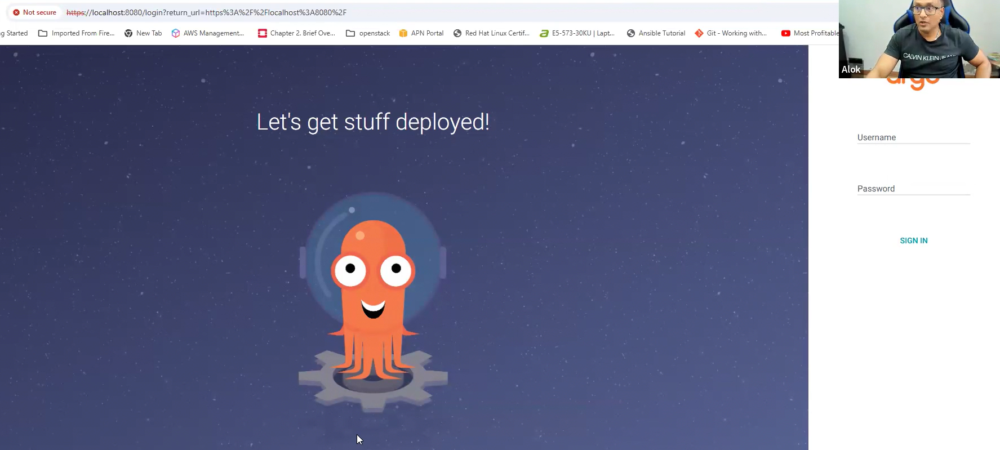
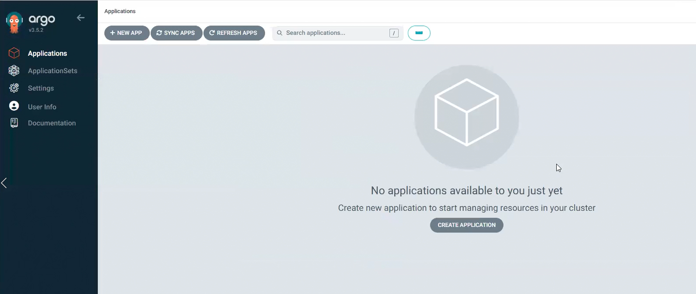

# Topic: Argo CD Components & Architecture

*(Your notes, cleaned up from dictation + screenshots — Lecture 1)*

## The 7 core components
1. **Argo CD Server (API Server)**
2. **Application Controller**
3. **ApplicationSet Controller**
4. **Repository Server**
5. **Dex** (optional, SSO)
6. **Redis**
7. **Notification Controller**

**The flow, one sentence:** you interact via the UI/CLI/API → the request hits the **Argo CD
Server (API Server)** → the API server delegates the real work out to the other components
(repo server clones Git + renders YAML, application controller reconciles desired vs. live state,
Dex handles SSO auth, Redis caches, notification controller sends alerts).

> **Mental model:** think of the Argo CD API Server the same way you think of the Kubernetes
> `kube-apiserver` — it's the single front door everything talks through; it doesn't do the heavy
> lifting itself, it authenticates/authorizes and hands work off to specialized components behind it.

## 1. Argo CD Server (API Server) — the front door
Exposes the Argo CD REST APIs — **three interfaces**:
- A **gRPC API** (used by the Argo CD CLI)
- **HTTP/HTTPS endpoints** for the web UI and integrations
- The **web UI itself**, served as static files

**What it actually does:**
- Handles **authentication and authorization** — validates JWT tokens, checks RBAC policies,
  decides whether the caller has a valid credential/permission to talk to the cluster.
- Accepts GitOps operations: Sync, Rollback, App Creation.
- **Does NOT do the heavy lifting itself** — it delegates syncing/manifest generation to other
  components. All communication from UI/CLI lands on the API server first, then gets relayed
  internally.
- Also handles application lifecycle management.

### Internal architecture — 3 operational tiers
```
INGRESS / CLIENTS (Web UI / CLI / CI-CD Pipelines)
        |
ARGO CD SERVER
  1. ENTRYPOINTS         — gRPC Server | gRPC Gateway/REST
  2. MIDDLEWARE/INTERCEPTORS — Authentication | RBAC Engine | Audit Logs
  3. SERVICE HANDLERS    — Application | Cluster/Repo | Webhook Fwd
        |
BACKEND COOPERATORS — Dex/OIDC | Redis Cache | Etcd Engine
```

**Network Interfaces & Dual-Protocol Engine:**
- **gRPC Server Engine** — handled via standard HTTP/2 streams; takes traffic from the Argo CD CLI
  and programmatic pipeline workers.
- **gRPC-Gateway Engine** — translates inbound JSON/REST calls over HTTP/1.1 directly into
  structural gRPC protocol formats inside the runtime process. This is what lets the
  Angular/React-based web UI talk to the same underlying API using plain browser web requests,
  without needing a unique protocol proxy for the browser.

**Interceptors & Security Middleware:**
- **Authentication Handler** — intercepts inbound headers to process JWTs; if SSO is active, it
  coordinates session signatures downstream with Dex or an external OIDC broker.
- **RBAC Enforcement Engine** — validates the payload's claims against custom access-security
  manifests declared via the cluster's global `argocd-rbac-cm` ConfigMap, deciding if the user is
  authorized to do the requested action.

## 2. Application Controller — the reconciliation core
The **core** component of Argo CD, and itself a Kubernetes controller. Its key roles: **deploy and
continuously monitor** the Applications it created, comparing their **live state** against the
**desired state in Git**.

- A **stateful, multi-threaded, Go-based** Kubernetes controller running a **continuous
  reconciliation loop**.
- Sole responsibility: compare live cluster state vs. target state defined in your Git repos, and
  eliminate any **configuration drift**.

### Internal flow
```
1. INBOUND STATE WATCHERS
   Git/Repo Cache Tracker (via Repo Server/Redis)   |   K8s Cluster Watchers (live state via Informers)
                              |
2. RECONCILIATION & QUEUEING
   Workqueue (Rate-Limited)
                              |
3. PROCESSORS
   Worker Pool (Parallel Threads)
   - Generates structural diff strings between Git vs Live K8s state
   - Evaluates health status (Healthy, Progressing, Degraded)
                              |
4. ACTION ENFORCEMENT
   Sync / Reconciliation Engine
   - Status: OutOfSync -> [Auto-Sync Enabled?] -> Auto-Remediation
                              |
   TARGET K8S CLUSTERS (applies patches, updates, deletions)
```
If drift is detected, it takes action **according to configuration** (manual approval vs.
auto-sync — see Sync Strategies below).

## 3. ApplicationSet Controller
Generates Applications (from the diagram: "Generates apps"). Useful when you need to template out
many similar Argo CD `Application` objects (e.g. one per cluster, one per environment) rather than
hand-writing each one.

## 4. Repository Server — the manifest-generation engine
The **internal utility engine** of Argo CD. Functions as a **stateless manifest generation
service** — a middleman between your Git/Helm repositories and the Application Controller.

**3 key tasks:**
1. **Cloning repositories** — pulls source code from Git.
2. **Generating manifests** — runs `helm template`, `kustomize build`, or plain manifest rendering.
3. **Caching results** — stores generated manifests so it doesn't regenerate them on every request.

**Polling:** the repo server polls Git **every 3 minutes by default** to check for new changes —
you can also configure a **webhook** for near-instant detection instead of waiting on the poll.

## 5. Dex Server (optional) — SSO / identity proxy
An **optional, bundled identity service processor** acting as an **OIDC (OpenID Connect) identity
provider proxy**. Lets users log into the Argo CD UI/CLI using external enterprise identity
providers (GitHub, Google, Okta, Microsoft Entra ID/Azure AD, or other OIDC/SAML providers)
**without Argo CD needing to natively implement each unique auth protocol itself**.

Packaged by default as its own Kubernetes Deployment inside a standard Argo CD install.
**Architectural components:**
- **In-Memory / Shared Storage** — Dex relies on a lightweight SQL database or Kubernetes CRDs as
  its backing store for temporary state, sign-in sessions, and keys.
- **Connectors Engine** — the core configuration layer; houses pluggable "connector" modules
  customized per provider (e.g. `github` connector, `saml` connector, `oidc` connector).
- **Token Signer Engine** — once an external provider successfully authenticates a user, this
  module generates a cryptographically signed JWT that Argo CD can inherently trust.

> Only needed when you're integrating with Active Directory / Azure AD / an external identity
> provider — otherwise it's not required.

## 6. Redis — the performance cache (not a data store of record)
`argocd-redis` is an **internal, in-memory cache**. It does **NOT store any persistent cluster
configuration or application state** — that lives entirely in Git and Kubernetes CRDs. Redis is
purely a performance accelerator so Argo CD doesn't overload external Git providers or crash under
heavy API workloads.

**Core jobs:**
- **Manifest Caching** — generating K8s YAML from Helm/Kustomize is CPU- and time-intensive; Redis
  caches the compiled manifests. If a commit hash hasn't changed, Argo CD pulls the YAML directly
  from Redis in milliseconds instead of recalculating it.
- **Git Revision Checking** — caches recent commit SHAs, tags, and branch tracking data to speed up
  application status checks.
- **OIDC/Dex Session State** — caches temporary OAuth/OIDC state data, SSO tokens, and auth sessions
  handled by the API server or Dex.
- **API Rate-Limit Protection** — serving repetitive queries and reconciliation loops directly from
  memory stops Argo CD from hitting API rate limits on platforms like GitHub/GitLab.

## 7. Notification Controller
A dedicated microservice that continuously watches your Application states and dispatches
real-time alerts to external channels (Slack, Microsoft Teams, Email, Telegram, Webhooks) when
specific deployment events occur.

```
Application Controller --(Updates Status)--> ArgoCD Application CRD
                                                  ^
                              Notifications Controller --(Watches)-- 
                                       |
                                  (Evaluates Trigger)
                                       v
                        External Integrations (Slack, Teams, Webhooks)
```

## Managing multiple clusters with Argo CD
GitOps becomes powerful once scaled across environments — dev, staging, production. Argo CD works
as a **central control plane** that can manage multiple Kubernetes clusters at once.

- **In-cluster management** — Argo CD runs inside the same cluster it manages.
- **External cluster management** — Argo CD connects to other Kubernetes clusters outside its own
  (across clouds/regions).

Many teams deploy Argo CD in a secure staging/management cluster and connect it **externally** to
production, development, and QA clusters.

## Sync Strategies
- **Manual** — requires intervention: click "Sync" in the Argo CD UI, or approve the change via a
  CI/CD pipeline.
- **Automatic** — Argo CD applies Git changes instantly. Simplifies testing during development by
  letting frequent changes propagate without manual steps.
- **Selective** — you decide per-app/per-project which apps auto-sync and which need manual
  approval. Common pattern: lower environments (dev/test) → auto-sync; higher environments
  (pre-prod/prod) → require human review and approval.

## Argo CD Installation Types

### Vanilla vs. Enterprise distributions
| Feature | Vanilla ArgoCD | Red Hat OpenShift GitOps | Akamai/Akuity Enterprise |
|---|---|---|---|
| Core Engine | Pure upstream ArgoCD | Pure upstream ArgoCD | Pure upstream ArgoCD |
| Installation | Manual YAML/Helm | OpenShift Operator Hub | Managed SaaS control plane |
| Authentication | Dex/Manual OIDC | Integrated with OpenShift OAuth | Enhanced multi-tenant SSO |
| Management | You manage infrastructure | Red Hat manages cluster platform | Akuity manages instances (SaaS) |
| Support | Community Slack/GitHub Issues | Enterprise SLA by Red Hat | Enterprise SLA by Akuity (built by Argo creators) |

All three run the same upstream Argo CD core — the difference is entirely in packaging,
install/auth ergonomics, and who operates it.

### Two topology patterns for vanilla Argo CD
- **Hub-and-Spoke (recommended)** — install vanilla Argo CD on one centralized management
  cluster; from that single dashboard, register external OpenShift/Rancher/any downstream clusters
  via secure network endpoints. Argo CD deploys workloads remotely. From Argo CD's own perspective,
  every target — OpenShift, EKS, Rancher, anything — is treated identically as "just a Kubernetes
  cluster" it talks to.
- **In-Cluster App (Local)** — deploy a fully separate vanilla Argo CD instance directly inside a
  specific OpenShift project or a Rancher-managed cluster to handle only that cluster's local
  workloads.

### Scope: cluster-wide vs. namespaced
By **default**, Argo CD has the authority to control resources across the **entire** Kubernetes
cluster — the preferred option when Argo CD is run by cluster administrators. The alternative is
**"namespaced" mode**: deploy Argo CD within a specific namespace and restrict it to only manage
resources within specific namespaces.

## Installing Argo CD (manifest-based, in-cluster)

```bash
kubectl create namespace argocd
kubectl apply -n argocd --server-side --force-conflicts \
  -f https://raw.githubusercontent.com/argoproj/argo-cd/stable/manifests/install.yaml
```

Verify all 6 components came up:
```bash
kubectl -n argocd get deploy
# NAME                                READY   UP-TO-DATE   AVAILABLE   AGE
# argocd-applicationset-controller   1/1     1            1           2m38s
# argocd-dex-server                  1/1     1            1           2m38s
# argocd-notifications-controller    1/1     1            1           2m38s
# argocd-redis                       1/1     1            1           2m38s
# argocd-repo-server                 1/1     1            1           2m38s
# argocd-server                      1/1     1            1           2m38s

kubectl -n argocd get pods
# argocd-application-controller-0                 1/1   Running   0   2m45s   <- StatefulSet (note the "-0")
# argocd-applicationset-controller-...             1/1   Running   0   2m50s
# argocd-dex-server-...                            1/1   Running   0   2m50s
# argocd-notifications-controller-...              1/1   Running   0   2m49s
# argocd-redis-...                                 1/1   Running   0   2m48s
# argocd-repo-server-...                           1/1   Running   0   2m47s
# argocd-server-...                                1/1   Running   0   2m46s

kubectl -n argocd get svc
# argocd-applicationset-controller   ClusterIP   ...   7000/TCP,8080/TCP
# argocd-dex-server                  ClusterIP   ...   5556/TCP,5557/TCP,5558/TCP
# argocd-metrics                     ClusterIP   ...   8082/TCP
# argocd-notifications-controller-metrics ClusterIP ... 9001/TCP
# argocd-redis                       ClusterIP   ...   6379/TCP
# argocd-repo-server                 ClusterIP   ...   8081/TCP,8084/TCP
# argocd-server                      ClusterIP   ...   80/TCP,443/TCP
# argocd-server-metrics               ClusterIP   ...   8083/TCP
```
Note: `argocd-application-controller-0` is a **StatefulSet** pod (the `-0` suffix) — consistent
with it being the stateful reconciliation core described above; everything else is a regular
Deployment.

## Accessing the Argo CD UI from your local laptop (through a gateway/jump host)
Since `argocd-server` is only a `ClusterIP` internally, reaching it from your own laptop through a
jump host takes an SSH tunnel **plus** a `kubectl port-forward` on the far side:

```bash
# Step 1 — from your laptop, SSH-tunnel local port 8080 to the gateway server
ssh -L 8080:127.0.0.1:8080 alok@192.168.121.130

# Step 2 — from inside that gateway server, port-forward the Argo CD service itself
kubectl port-forward svc/argocd-server -n argocd 8080:443
```
Now `https://localhost:8080` on your laptop reaches the Argo CD login screen.

### Getting the initial admin password
```bash
kubectl -n argocd get secrets
# argocd-initial-admin-secret   Opaque   1   7m1s
# argocd-notifications-secret   Opaque   0   9m20s
# argocd-redis                  Opaque   1   7m5s
# argocd-secret                 Opaque   5   9m20s

kubectl -n argocd get secrets argocd-initial-admin-secret -o yaml
# data:
#   password: Yzk2b3ZTQk04Q0pqWGhGNg==

echo Yzk2b3ZTQk04Q0pqWGhGNg== | base64 -d
# c96ovSBM8CJjXhF6
```
Username is always `admin`; password is base64-decoded from `argocd-initial-admin-secret`.



Log in — the Applications dashboard shows "No applications available to you just yet" on a fresh
install, which is expected:



## Installing the Argo CD CLI
```bash
# 1. Download the latest binary
curl -sSL -o argocd-linux-amd64 https://github.com/argoproj/argo-cd/releases/latest/download/argocd-linux-amd64
# 2. Install with executable permissions to system path
sudo install -m 555 argocd-linux-amd64 /usr/local/bin/argocd
# 3. Clean up the downloaded installer file
rm argocd-linux-amd64
# 4. Verify
argocd version --client
```
The CLI (`argocd`) gives full control over GitOps workflows from the terminal — useful for
automation and for anyone who prefers CLI over the web UI. At this point (end of lecture 1) the CLI
is installed but **not yet authenticated/logged in** against the cluster — that's next.

## What I practiced
- Installed Argo CD into its own namespace via the official manifest URL and confirmed all 6
  Deployments + the 1 StatefulSet pod came up healthy.
- Retrieved and base64-decoded the initial admin secret to log into the UI for the first time.
- Reached the UI from a laptop through a gateway host using a chained SSH tunnel +
  `kubectl port-forward`.
- Installed the `argocd` CLI binary and verified it with `argocd version --client`.

---
*Merged into the master reference notes:
[`../../argocd-master-notes.md`](../../argocd-master-notes.md) — new "1. Argo CD Components &
Architecture" section.*
