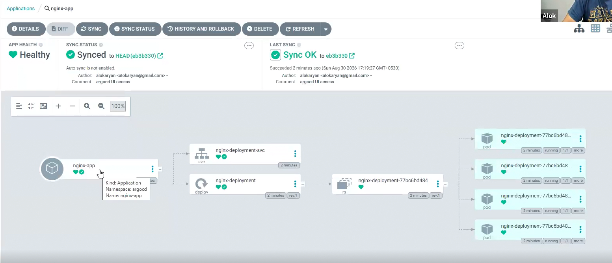
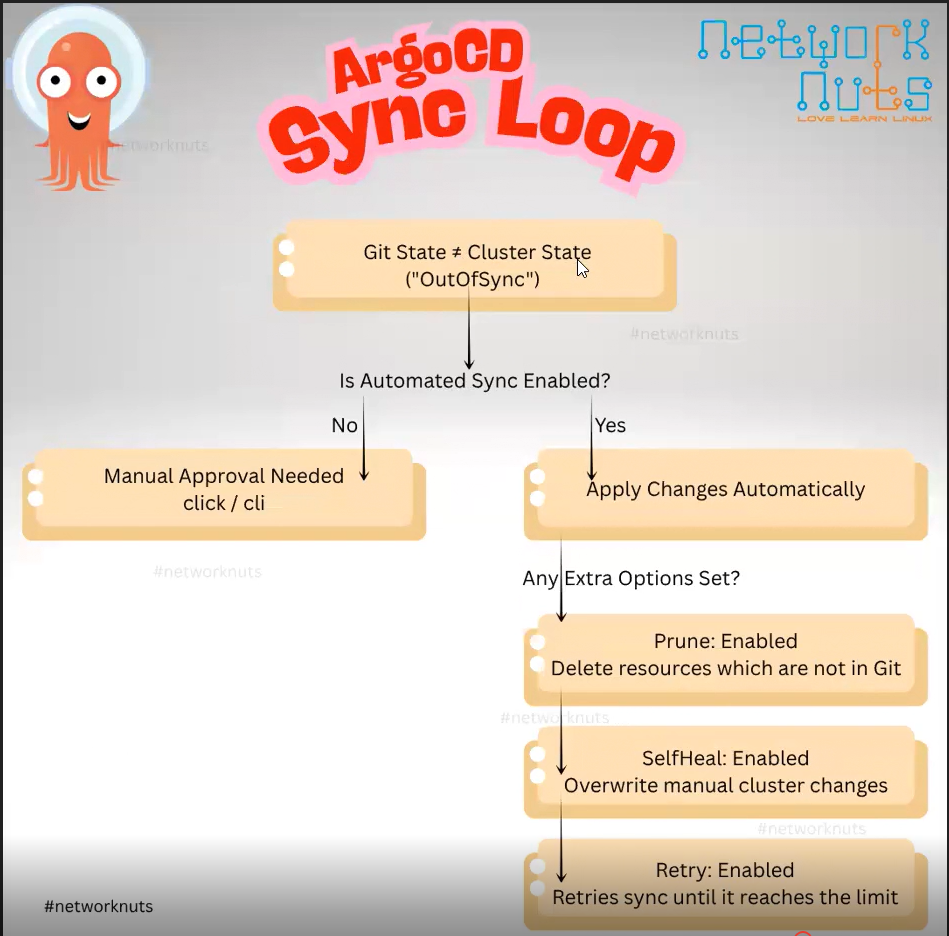
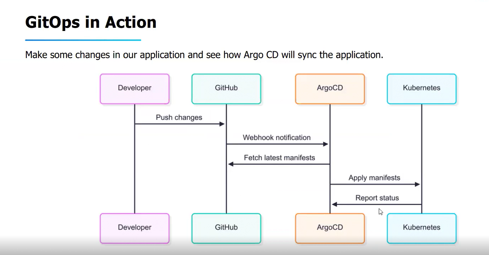
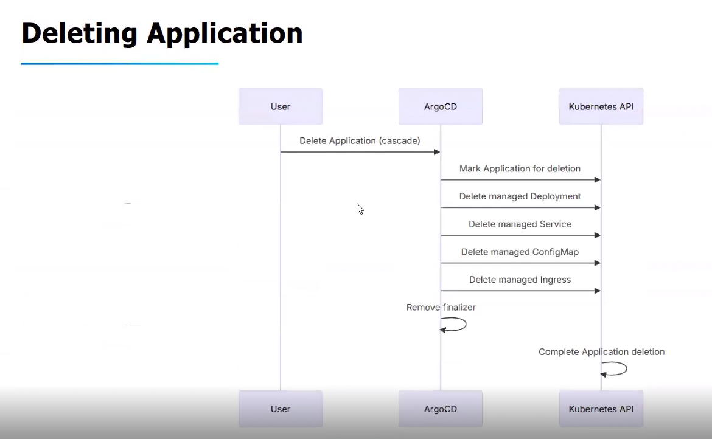

# Topic: First GitOps Application

*(Your notes, cleaned up from dictation — Chapter 2, no screenshots this session)*

## The GitOps idea, concretely
A GitOps application takes **everything from Git** — every YAML/manifest that creates an object
must live in a Git repo, not be applied ad hoc. Whatever we did manually while learning core
Kubernetes/CKA (writing YAML files and running `kubectl create -f`) now gets a rule added on top:
**those files must be committed to Git first**, and Argo CD is what pulls them from Git and applies
them to the cluster on our behalf.

We'll start with one simple nginx application, then make it more complex later — a Deployment
first, then a Service.

## Every Argo CD application needs exactly 3 things
1. **Source of truth (Git)** — where Argo CD pulls the object files from.
2. **Target (cluster/namespace)** — where those objects get applied.
3. **Sync policy** — whether a Git change reflects into the cluster **manually** (you click Sync)
   or **automatically** (Argo CD applies it the moment it detects drift).

Once the application is created with these three things configured, Argo CD continuously keeps a
**sync between Git and the Kubernetes cluster/namespace** — this is the whole GitOps loop.

## Step 1 — Connect the Git repository
`Settings → Repositories → Connect Repo`
- **Connection method:** HTTPS (also supports SSH)
- **Type:** git
- **Name:** a label for this repo connection (e.g. `first-app`)
- **Project:** keep `default` for now (Projects are covered later)
- **Repository URL:** the Git URL where the manifest files live
- **Credentials:** not needed for a public repo; a private repo requires username/password (or a
  token) here

Once connected, Argo CD shows the connection as **Successful**.

## Step 2 — Create the Application
`Applications → New App`
- **Application Name:** e.g. `nginx-app`
- **Project:** `default` (again, revisited later)
- **Sync Policy:** `Manual` (chosen for this first app) vs. `Automatic`
  - Manual = you click "Sync" yourself whenever you want Git changes applied
  - Automatic = Argo CD applies Git changes as soon as it detects them
- **Source:**
  - the Git repository connected in Step 1
  - **Revision:** the branch (e.g. `HEAD`/`master`)
  - **Path:** the folder inside the repo holding this app's manifests (e.g. `chapter4`)
- **Destination:**
  - **Cluster URL:** since Argo CD is installed in-cluster here, the destination is the cluster
    Argo CD itself runs in (its own local/in-cluster URL)
  - **Namespace:** `default` in this case (a dedicated namespace could be used instead)
- Click **Create**.

## What happens right after creation
The new app shows **`Missing`** and **`OutOfSync`** — and this is expected, not an error:
- `OutOfSync` — Argo CD has compared Git (desired) vs. the cluster (live) and found the objects
  described in Git don't exist yet in the cluster.
- `Missing` — the actual K8s objects (Deployment, etc.) haven't been created yet.

**Why:** Sync Policy was set to **Manual**, so Argo CD deliberately does **not** apply anything on
its own — it waits for an explicit Sync action.

## Step 3 — Manually sync
Click **Sync** in the UI. Argo CD then:
1. Moves to **`Progressing`** — it's in the process of creating the resources/objects defined in
   the Git-sourced YAML.
2. Settles at **`Synced`** (and `Healthy`) once the objects exist and match Git.

### Verifying on the actual cluster
```bash
kubectl get deploy
# the nginx deployment now appears here — created BY Argo CD, sourced FROM Git
```
Clicking into the application in the UI shows the full resource tree/details for everything it
created and is now tracking:



## Deleting an application
There are **two deletion modes** — **foreground** and **background** cascade deletion — which
control the order/manner in which Argo CD tears down the underlying Kubernetes objects when you
delete the Application itself. *(Mechanics of exactly how each mode behaves — noted as a topic to
cover in more depth later; for now, know that deleting the Argo CD Application does start deleting
the resources it created in the cluster, and the mode you pick changes how that teardown happens.)*

## Part 2 — Deploying the Same App via the Argo CD CLI

So far we deployed through the GUI. The CLI was already installed back in Chapter 1 — now we
authenticate it and use it to create the exact same kind of application imperatively.

### Exposing Argo CD so the CLI can reach it
`argocd-server` is a `ClusterIP` by default. From the bastion/gateway host, expose it as a
`NodePort` so the CLI (running on that same host) can hit `NodeIP:PORT`:
```bash
kubectl -n argocd get deploy      # confirm all 6 components are up first

kubectl -n argocd expose deployment argocd-server \
  --name argocd-server-np --type=NodePort
# service/argocd-server-np exposed

kubectl -n argocd get svc
# argocd-server-np   NodePort   10.96.102.186   <none>   8080:31530/TCP,8083:32517/TCP
#                                                              ^^^^^ this is the port to hit
```

### Getting the admin password and logging in via CLI
```bash
argocd admin initial-password -n argocd
# kzFS1lfzgwAVJdty
# This password must be only used for first time login. We strongly recommend you update
# the password using `argocd account update-password`.

argocd login 10.0.0.101:31530 --username admin --password kzFS1lfzgwAVJdty
# WARNING: server is not configured with TLS. Proceed (y/n)? y
# 'admin:login' logged in successfully
# Context '10.0.0.101:31530' updated
```
Same command family (`argocd account update-password`) is how you'd rotate off that initial
password afterward, as the CLI itself recommends.

### Basic CLI checks, then creating an app imperatively
```bash
argocd cluster list
# SERVER                        NAME         VERSION   STATUS       PROJECT
# https://kubernetes.default.svc in-cluster   v1.35.8   Successful

argocd app list
# NAME  CLUSTER  NAMESPACE  PROJECT  STATUS  HEALTH  SYNCPOLICY  ...   (empty at first)

argocd app create nginx-demo \
  --repo https://github.com/networknuts/argocd.git \
  --path ch-04 \
  --dest-server https://kubernetes.default.svc \
  --dest-namespace default
```
This is the **imperative** way of creating an application — same 3 required pieces (repo/path,
destination server+namespace) as the UI form, just as CLI flags instead of form fields.

Refreshing the UI shows the new app created there too — same underlying `Application` object,
created via a different interface. Checking status via CLI:
```bash
argocd app get nginx-demo
# Sync Status:  OutOfSync from  (eb3b330)
# Health Status: Missing
#   GROUP  KIND        NAMESPACE  NAME               STATUS     HEALTH
#   apps   Service     default    nginx-deployment-svc OutOfSync Missing
#   apps   Deployment  default    nginx-deployment     OutOfSync Missing

argocd app sync nginx-demo
# ...Service default nginx-deployment-svc  Synced  Healthy
# ...Deployment default nginx-deployment    Synced  Healthy
```
Same `Missing`/`OutOfSync` → `Synced`/`Healthy` lifecycle as the UI path — the mechanics underneath
an Argo CD Application don't change based on which interface created it.

> **Downside of the imperative CLI approach:** after some time you won't remember exactly what
> flags/values you used to create a given app — there's no file to refer back to. That's *not*
> the ideal way to manage applications long-term.

## Part 3 — The Declarative Way: an `Application` YAML

When Argo CD itself is installed, it registers a **custom resource** called `Application` — so you
can define an Application the same declarative way you'd define any other Kubernetes object, and
keep that file in Git like everything else.

```yaml
apiVersion: argoproj.io/v1alpha1
kind: Application
metadata:
  name: webapp
  namespace: argocd            # the namespace where Argo CD itself is installed
spec:
  project: default             # default project provided by Argo CD
  source:
    repoURL: 'https://github.com/networknuts/argocd.git'   # your Git repo URL
    targetRevision: HEAD        # Git branch, tag, or commit hash
    path: ch-04                 # path within the repo containing the YAML files
  destination:
    server: 'https://kubernetes.default.svc'   # target cluster URL (local cluster)
    namespace: dev               # target namespace where resources will be deployed
  syncPolicy:
    automated:                  # enables automated sync and self-healing
      prune: true                # deletes resources from K8s if removed from Git
      selfHeal: true              # overwrites manual changes made directly in the cluster
```

```bash
kubectl apply -f my-argo-app.yaml
# application.argoproj.io/webapp created
```
This is exactly the same `kubectl apply -f` workflow used for any other Kubernetes object —
**no separate Argo CD login/authentication needed for this path**, because you're talking to the
Kubernetes API directly (which already trusts your kubeconfig), not the Argo CD API server. The
UI then shows both apps side by side, `nginx-demo` (created via CLI, manual sync) and `webapp`
(created declaratively, automated sync) — both `Healthy`/`Synced`.

### 3 ways to create an Application — and the auth difference that matters
| Method | Needs Argo CD username/password? | Style |
|---|---|---|
| Web UI | Yes | Imperative (click-driven) |
| `argocd` CLI | Yes (must `argocd login` first) | Imperative (command-driven) |
| `kubectl apply -f <Application-yaml>` | **No** | Declarative |

The `kubectl` path skips Argo CD auth entirely because the `Application` kind is just another
Kubernetes custom resource at that point — your existing cluster access (kubeconfig) is all that's
required, the same as creating any Deployment/Service/ConfigMap.

## Part 4 — The Argo CD Sync Loop, End to End



1. **Git State ≠ Cluster State** → status becomes `OutOfSync`.
2. **Is Automated Sync enabled?**
   - **No** → Manual approval needed (click Sync in UI, or `argocd app sync` via CLI).
   - **Yes** → Argo CD applies changes automatically.
3. If automated, any extra options set take effect:
   - **Prune: Enabled** → deletes resources that exist in the cluster but are no longer in Git.
   - **SelfHeal: Enabled** → overwrites manual changes made directly in the cluster (so `kubectl
     edit` on an Argo-CD-managed object gets reverted back to match Git).
   - **Retry: Enabled** → retries a failed sync until it hits its retry limit.

### GitOps in Action — the full picture with a webhook



Developer pushes changes → GitHub sends a **webhook notification** to Argo CD (instead of, or in
addition to, the default polling) → Argo CD fetches the latest manifests → applies them to
Kubernetes → Kubernetes reports status back up through Argo CD.

## Part 5 — Troubleshooting Common Issues
| Symptom | Commands to investigate |
|---|---|
| App stuck in `Progressing` | `argocd app get <app>`, `kubectl describe deployment <name>` — look for typos in manifests or image pull issues |
| Sync failures | `argocd app get <app>`, `kubectl logs -n argocd deployment/argocd-application-controller` |
| `OutOfSync` status, unclear why | `argocd app diff <app>` — compares Git vs. cluster state directly |
| Want a fresh comparison | `argocd app get <app> --refresh` |

## Part 6 — Deleting an Application, in Full

Deleting an Argo CD application sounds simple, but getting it wrong can either wipe out production
workloads or leave orphaned resources cluttering the cluster. Two independent choices are involved:

### Choice 1 — Cascade vs. Non-cascade
- **Cascade delete** — Argo CD deletes the Application **and** every Kubernetes resource it
  manages (Deployments, Services, ConfigMaps, etc.).
- **Non-cascade delete** — Argo CD deletes only the Application resource itself, **leaving the
  managed Kubernetes resources running** in the cluster.

This behavior is controlled by a **finalizer** on the Application object:
```yaml
apiVersion: argoproj.io/v1alpha1
kind: Application
metadata:
  name: webapp
  namespace: argocd
  finalizers:
    - resources-finalizer.argocd.argoproj.io   # <-- this line enables CASCADE delete
spec:
  # ...
```
**No finalizer line = the default = non-cascade** (only the Application object is deleted; the
Deployments/Services it created stay running).

### Choice 2 — Foreground vs. Background (only meaningful for cascade delete)
| Mode | Behavior | Command |
|---|---|---|
| **Foreground** (default) | Argo CD uses standard Kubernetes garbage-collection logic. The root Application enters `Terminating` and **will not disappear** until every single managed resource (Deployments, Pods, Services) has been successfully deleted. Safer — ensures complete cleanup before the parent object goes away. | `argocd app delete APPNAME --cascade --propagation-policy foreground` |
| **Background** | The Application object is deleted **instantly**; the Kubernetes garbage collector then cleans up orphaned resources asynchronously behind the scenes. Faster, but carries a small risk that resource dependencies can stall in the background with no clear visibility in the Argo CD dashboard. **Not recommended** as a default choice. | `argocd app delete APPNAME --cascade --propagation-policy background` |

### How cascade delete actually works, step by step
1. Argo CD receives the delete request.
2. It checks for the `resources-finalizer.argocd.argoproj.io` finalizer on the Application.
3. If present, Argo CD identifies every resource it tracks for that application.
4. Argo CD deletes each managed resource from the cluster.
5. Once all resources are deleted (or deletion is initiated), Argo CD removes the finalizer.
6. Kubernetes then completes deletion of the Application resource itself.



### ⚠️ The PVC caveat
**Cascade delete will remove PersistentVolumeClaims if they are tracked/managed by Argo CD** — your
persistent data is genuinely at risk here. Before deleting, check:
```bash
argocd app resources app-name | grep PersistentVolumeClaim
```
If real data lives in a PVC that Argo CD manages, confirm you actually want it gone before running
a cascade delete.

## What I practiced
- Connected a public Git repo to Argo CD via HTTPS in Settings → Repositories, confirmed
  "Successful" connection status.
- Created a new Application (`nginx-app`/`nginx-demo`) with Manual sync policy via both the UI and
  the `argocd` CLI, pointing at a specific branch + path in that repo, targeting the in-cluster
  destination and `default` namespace.
- Observed and understood the `Missing` / `OutOfSync` status immediately after creation as the
  expected result of a Manual sync policy — not a failure — via both interfaces.
- Clicked/ran Sync, watched the app move `Progressing` → `Synced`, and confirmed the resulting
  Deployment with `kubectl get deploy` directly on the cluster.
- Exposed `argocd-server` as a NodePort from the bastion host, retrieved the initial admin
  password via `argocd admin initial-password`, and logged the CLI in against that NodePort.
- Wrote a declarative `Application` YAML with `syncPolicy.automated` (prune + selfHeal) and
  `kubectl apply -f`'d it directly — confirmed it needed no separate Argo CD login, unlike the UI
  and CLI paths.
- Walked the Sync Loop decision tree end to end: OutOfSync → auto-sync check → prune/selfHeal/retry.
- Practiced the troubleshooting command set (`app get`, `app diff`, `app get --refresh`,
  `kubectl logs` on the application controller).
- Understood — but flagged as something to actually test hands-on next — the cascade/non-cascade
  and foreground/background delete distinctions, including the PVC-deletion risk.

---
*Merged into the master reference notes: [`../../argocd-master-notes.md`](../../argocd-master-notes.md)
— new "2. First GitOps Application" section.*
