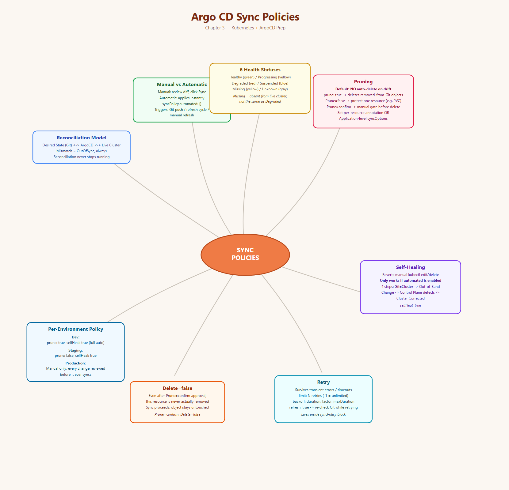
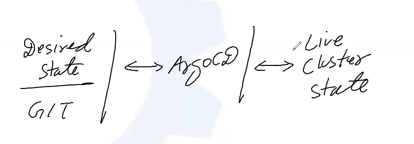
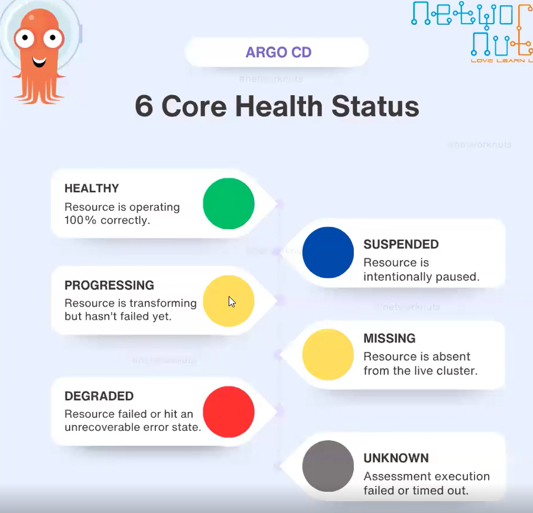
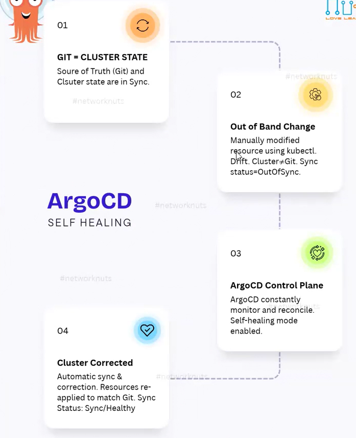

# Topic: Argo CD Sync Policies

*(Your notes, cleaned up from dictation + screenshots — Chapter 3)*

## Quick recall: mind map



## The 3-way relationship behind every sync


Argo CD continuously **reconciles** between Git (desired state) and the live cluster (current
state). A **sync policy** is simply: *how does Argo CD behave once Git changes — does it push that
change into the live cluster automatically, or does it wait for a human?*

## Creating an app manually via UI, and watching the reconciliation
Example app: name `webapp`, project `default`, **Sync Policy: Manual**, **Prune Propagation
Policy: foreground** (already covered — foreground vs. background from the deletion chapter).
Source = the connected Git repo, revision `HEAD`, path `ch-04`. Destination = the Kubernetes
cluster, namespace `default`.

The moment you click **Create**:
1. Argo CD goes to the Git repository.
2. Checks the branch + path you specified (`ch-04`).
3. Reads the object files there — this becomes the **desired state**.
4. Compares desired state vs. what's actually running in the cluster.
5. If they don't match → **OutOfSync**.

Because Sync Policy was Manual, it **stays** OutOfSync until you explicitly click **Sync** — then
it synchronizes desired state with current state.

## Argo CD Health Status — the 6 core states



| Status | Color | Meaning |
|---|---|---|
| **Healthy** | Green | Resource is operating 100% correctly |
| **Progressing** | Yellow | Resource is transforming but hasn't failed yet |
| **Degraded** | Red | Resource failed or hit an unrecoverable error state |
| **Suspended** | Blue | Resource is intentionally paused |
| **Missing** | Yellow | Resource is absent from the live cluster |
| **Unknown** | Gray | Assessment execution failed or timed out |

## Manual vs. Automatic — when to use which
- **Manual:** you can check the **diff** first and decide whether you actually want those changes
  applied — full human control before anything touches the cluster.
- **Automatic:** Argo CD applies Git changes on its own, no click needed.
- **Rule of thumb:** Automatic is mostly used in **dev** environments where quick iteration matters
  more than review. **Production keeps Manual** — you review everything, then deploy deliberately.

## Setting sync policy declaratively (via the Application YAML)
```yaml
spec:
  syncPolicy:
    automated: {}      # curly braces = "automated with all default behavior"
```
Same thing via CLI: `argocd app set APP-NAME --sync-policy automated`

**Basic automation triggers a sync when:**
- Git repository changes occur.
- Argo CD's refresh cycle detects drift.
- A manual refresh happens.

## Pruning — deleting resources that were removed from Git
**Critical default to remember:** when automated sync is enabled, **by default Argo CD will NOT
delete resources** just because it detects they're no longer defined in Git. Enabling `prune` is a
separate, deliberate opt-in:
```yaml
syncPolicy:
  automated:
    prune: true   # deletes resources from K8s if removed from Git
```
Pruning automatically removes: resources deleted from Git, orphaned Kubernetes objects, and
resources no longer managed.

### Protecting a specific resource from being pruned
Common example: **PVCs**. You don't want automated pruning to ever accidentally delete a volume
holding real data. Protect it at the resource level via an annotation:
```yaml
apiVersion: v1
kind: PersistentVolumeClaim
metadata:
  name: myclaim
  namespace: prod
  annotations:
    # Protects this specific PVC from being deleted during auto-sync
    argocd.argoproj.io/sync-options: Prune=false
spec:
  accessModes: [ReadWriteOnce]
  volumeMode: Filesystem
  resources: { requests: { storage: 8Gi } }
  storageClassName: slow
```

### Pruning with confirmation
Resources like Namespaces/PVCs/PVs are critical and **shouldn't be pruned without confirmation**.
Set `Prune=confirm` instead of `Prune=false` to require a manual approval click before that
specific resource actually gets deleted:
```yaml
annotations:
  # argocd.argoproj.io/sync-options: Prune=false
  argocd.argoproj.io/sync-options: Prune=confirm
```
When this is set, the app's Sync Status shows **"Syncing... waiting for pruning confirmation of
/ConfigMap/web-v1"** (or whatever the resource is) until you go confirm it in the UI.

**Two places you can set this:**
1. On a **specific resource's** own YAML (annotation, as above) — scoped to just that one object.
2. As a **default at the Application level**, inside `syncOptions`:
```yaml
syncPolicy:
  automated:
    prune: true
    selfHeal: true
  syncOptions:
    - Prune=confirm
```

## Self-Healing
**Self-healing automatically reverts unauthorized or manual changes made directly to the live
cluster.** If a user modifies a live resource (e.g. via `kubectl edit` or `kubectl delete`), Argo CD
detects the configuration drift and immediately overwrites it back to match the desired state in
Git. **Self-healing only functions when `spec.syncPolicy.automated` is enabled.**

```yaml
spec:
  syncPolicy:
    automated:
      prune: true      # deletes resources from K8s if removed from Git
      selfHeal: true    # overwrites manual changes made directly in the cluster
```

**Demonstrated:** delete a ConfigMap (`kubectl -n red delete cm web-v1`) that Argo CD manages under
a self-healing Application. `kubectl -n red get cm` confirms it's gone. Within moments, the app
shows `OutOfSync` (yellow marker — "present in Git, but someone deleted it from the cluster") and
then **Argo CD recreates it automatically** — no human action required.



### The 4-step Self-Healing loop
1. **Git = Cluster State** — source of truth (Git) and cluster state are in sync.
2. **Out-of-Band Change** — someone manually modifies a resource using `kubectl`; drift occurs,
   Cluster ≠ Git, Sync status becomes `OutOfSync`.
3. **Argo CD Control Plane** — Argo CD constantly monitors and reconciles; self-healing mode is
   enabled.
4. **Cluster Corrected** — automatic sync and correction; resources are re-applied to match Git.
   Sync Status returns to `Synced`/`Healthy`.

## Retry
Configure automatic retries for failed sync operations to survive transient cluster errors,
network hiccups, or temporary API timeouts without breaking your GitOps pipeline:
```yaml
syncPolicy:
  automated:
    prune: true
    selfHeal: true
  retry:
    limit: 5           # number of retries before giving up (-1 for unlimited)
    backoff:
      duration: 5s       # initial wait time before the first retry
      factor: 2           # multiplier applied to duration after each failure
      maxDuration: 3m      # the maximum allowable wait time between retries
      refresh: true         # optional: forces a Git refresh on new commits while retrying
```

## Preventing resource deletion outright — `Delete=false`
Even after a `Prune=confirm` confirmation, you might want a specific resource to **never actually
be deleted** — sync should proceed, but this one object stays untouched:
```yaml
annotations:
  # Protects this specific PVC from being deleted during auto-sync
  # argocd.argoproj.io/sync-options: Prune=false
  argocd.argoproj.io/sync-options: Prune=confirm, Delete=false
```
This can be set on a specific resource's own file, or as a default at the Application level.

## Putting it all together — a full advanced `syncPolicy` block
```yaml
syncPolicy:
  ### CORE SYNC POLICY
  automated:              # enables automated sync and self-healing
    prune: true             # deletes resources from K8s if removed from Git
    selfHeal: true            # overwrites manual changes made directly in the cluster
  retry:
    limit: 5
    backoff:
      duration: 5s
      factor: 2
      maxDuration: 3m
    refresh: true
  ### SYNC OPTIONS
  syncOptions:
    - Prune=confirm
    - Delete=confirm
    - CreateNamespace=true
```

## Choosing the right policy per environment
| Environment | Recommended `syncPolicy` | Why |
|---|---|---|
| **Development** | `automated: { prune: true, selfHeal: true }` — full automation | Rapid iteration matters more than review overhead |
| **Staging** | `automated: { prune: false, selfHeal: true }` — automation with **manual pruning** | Catch what would be deleted before it actually happens |
| **Production** | Manual sync policy (no `automated` block), reviewed diffs before every sync | Every change is deliberately reviewed; no surprise deletions or auto-applies |

## What I practiced
- Created an app manually (Manual sync, foreground prune propagation) and walked through the exact
  reconciliation sequence: Git fetch → read desired state at the given path → compare to cluster →
  land on `OutOfSync` until manually synced.
- Read the 6 Argo CD health-status colors and what each actually means (not just "green=good").
- Set `syncPolicy.automated: {}` declaratively and via `argocd app set --sync-policy automated`.
- Confirmed the critical default: automated sync alone does **not** prune by default — had to
  explicitly enable `prune: true` and watched deleted-from-Git resources actually get removed only
  after that.
- Protected a PVC-style resource from pruning via `Prune=false`, then tried `Prune=confirm` and
  watched the app sit in "waiting for pruning confirmation" until manually approved.
- Demonstrated self-healing directly: deleted a ConfigMap Argo CD manages, watched it go
  `OutOfSync`, then get automatically recreated with `selfHeal: true` enabled.
- Configured `retry` with `limit`/`backoff` settings for resilience against transient failures.
- Used `Delete=false` alongside `Prune=confirm` to allow confirmation flow without ever actually
  permitting deletion of a specific protected resource.

---
*Merged into the master reference notes: [`../../argocd-master-notes.md`](../../argocd-master-notes.md)
— new "3. Sync Policies" section.*
