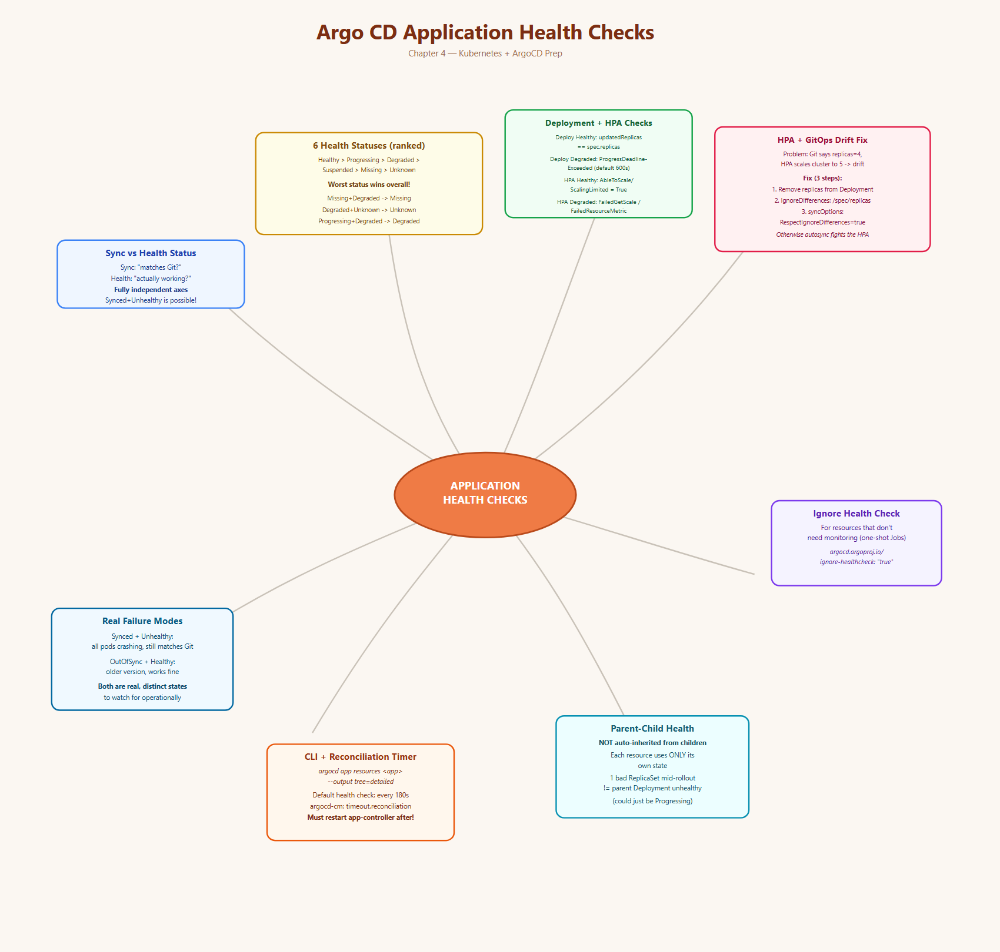
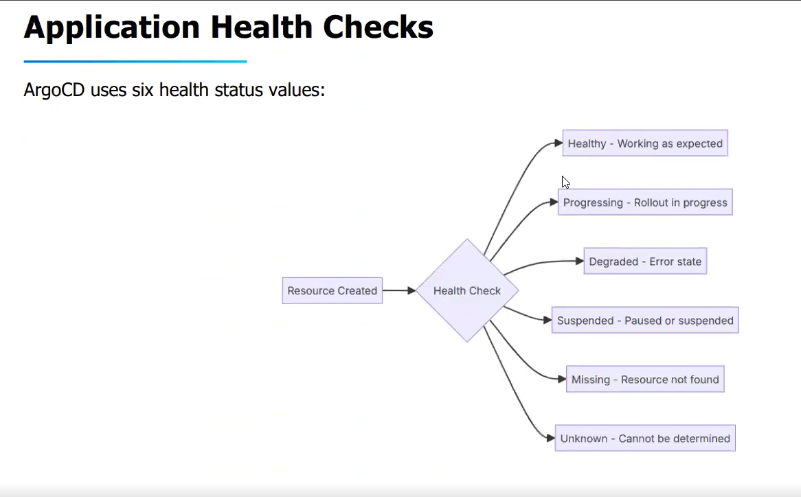
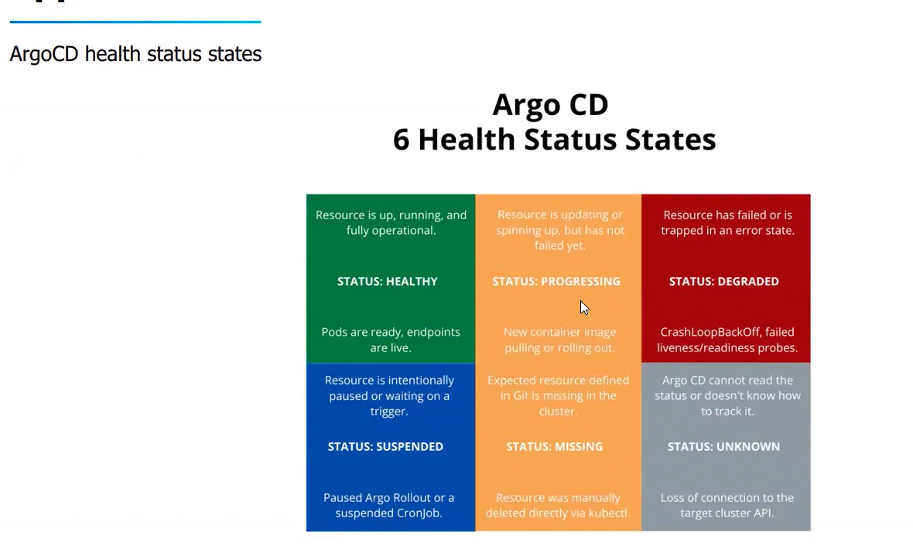
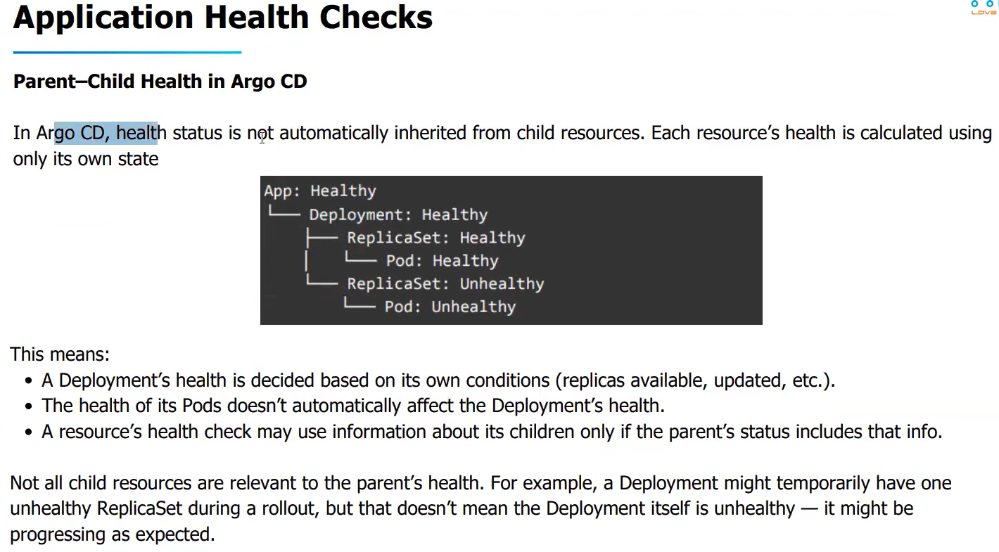

# Topic: Argo CD Application Health Checks

*(Your notes, cleaned up from dictation + screenshots — Chapter 4)*

## Quick recall: mind map



## Sync Status vs. Health Status — the distinction that matters most
- **Sync Status** answers: *"Does the cluster match my Git repo?"*
- **Health Status** answers: *"Is the live code actually working?"*

These are **completely independent** of each other, and understanding the difference is critical
for operating GitOps workflows:
- An app can be **perfectly Synced but Unhealthy** — all Pods are crashing, even though what's
  running is exactly what Git says should be running.
- An app can be **OutOfSync but Healthy** — running an older version that works perfectly fine,
  just not the latest Git commit.

Infra/deployment matching Git is one axis; whether the *application code itself* actually works is
a completely different axis. A pod can be crash-looping even though everything Argo CD "deployed"
matches Git exactly.

## The 6 Argo CD Health Status values





| Status | Meaning |
|---|---|
| **Healthy** | Working/operating as expected |
| **Progressing** | Rollout in progress |
| **Degraded** | Error state |
| **Suspended** | Paused or suspended |
| **Missing** | Resource not found |
| **Unknown** | Cannot be determined |

## The worst-case aggregation rule (important, non-obvious)
**The lower a status appears in this list, the worse it is.** If an application has multiple
resources each with their own status, the **lowest one in the list becomes the app's overall
health** — one bad resource is enough to drag the whole application's reported health down.

Ranking from best (top) to worst (bottom): **Healthy → Progressing → Degraded → Suspended →
Missing → Unknown**.

Worked examples from the list:
- `Missing` + `Degraded` → app health = **Missing** (Missing is lower in the list than Degraded).
- `Degraded` + `Unknown` → app health = **Unknown** (Unknown is the lowest of all).
- `Progressing` + `Degraded` → app health = **Degraded**.

This way, even if only *one* resource is in a very bad state, the application reflects that
worst-case status rather than hiding it behind other healthy resources.

## Built-in health checks for specific Kubernetes types

### Deployment health check
Argo CD evaluates Deployments by checking **replica status**:
- **Healthy when:**
  - `status.updatedReplicas` equals `spec.replicas`
  - `status.availableReplicas` equals `status.updatedReplicas`
  - No old ReplicaSets have running pods
  - The Deployment's generation matches the observed generation
- **Progressing when:**
  - Replicas are being updated (rolling update in progress)
  - New pods are starting but not yet available
  - The rollout has not exceeded `progressDeadlineSeconds`
- **Degraded when:**
  - The Deployment condition has reason `ProgressDeadlineExceeded` — which Kubernetes sets when the
    Deployment exceeds `progressDeadlineSeconds` (defaults to **600 seconds**)

### HorizontalPodAutoscaler (HPA) health check
- **Healthy when:** the HPA has an `AbleToScale` or `ScalingLimited` condition with status `True`.
- **Progressing when:** Argo CD is waiting for autoscaling conditions.
- **Degraded when:** the HPA condition has `AbleToScale` with reason `FailedGetScale` or
  `FailedUpdateScale`, or `ScalingActive` with reason `FailedGetResourceMetric` or
  `InvalidSelector`.

## ⚠️ The special case: Deployment + HPA together (replica-count drift)
**The problem, concretely:** a Deployment YAML sets `replicas: 4`. An HPA is also configured on
that same Deployment (e.g. scale up when CPU > 80%). CPU spikes, the HPA controller kicks in and
scales the Deployment to 5 pods. Now:
- **Git (source of truth) says:** replicas = 4
- **Live cluster says:** replicas = 5 (HPA's doing)
- **Mismatch** — Argo CD would normally see this as drift from the desired state.

**The fix — don't fight the HPA, tell Argo CD to ignore that one field:**
1. **Remove `replicas` entirely from the Deployment's YAML/object spec** when it's backed by an
   HPA. Let the HPA own scaling via its own `minReplicas`/`maxReplicas` instead.
```yaml
apiVersion: autoscaling/v2
kind: HorizontalPodAutoscaler
metadata:
  name: argolab-hpa
  namespace: production
spec:
  scaleTargetRef:
    apiVersion: apps/v1
    kind: Deployment
    name: argolab
  minReplicas: 2
  maxReplicas: 10
  metrics:
    - type: Resource
      resource:
        name: cpu
        target: { type: Utilization }
```
```yaml
# In the Deployment itself:
spec:
  # IMPORTANT: 'replicas' is completely removed.
  # This prevents GitOps drift detection from triggering on scale events.
  selector:
    matchLabels: { app: argoapp }
  template:
    metadata: { labels: { app: argoapp } }
    spec:
      containers:
        - name: boxone
          image: nginx:1.27
          ports: [{ containerPort: 80 }]
          resources: { limits: { cpu: 200m } }
```
2. **Tell the Argo CD Application to ignore that field explicitly**, via `ignoreDifferences`:
```yaml
spec:
  ignoreDifferences:   # Ignore the dynamic replica count managed by the cluster's HPA controller
    - group: apps
      kind: Deployment
      jsonPointers:
        - /spec/replicas
```
3. **Make sure automated syncs actually respect that ignore rule**, via `syncOptions`:
```yaml
syncPolicy:
  automated:
    prune: true
    selfHeal: true
  syncOptions:
    - CreateNamespace=true
    - RespectIgnoreDifferences=true   # IMP: tells Argo CD not to overwrite ignored fields during automated syncs
```
Without `RespectIgnoreDifferences=true`, an automated sync could still stomp the HPA's live replica
count back down to whatever (or nothing) is in Git, fighting the autoscaler.

## Ignoring health checks entirely for a resource
Some resources genuinely don't need ongoing health monitoring — a classic example: a one-shot
`Job` that runs once and exits. Exclude it from health evaluation with an annotation:
```yaml
apiVersion: batch/v1
kind: Job
metadata:
  name: sample
  annotations:
    argocd.argoproj.io/ignore-healthcheck: "true"
spec:
  template:
    spec:
      containers:
        - name: pi
          image: perl:5.34.0
          command: ["perl", "-Mbignum=bpi", "-wle", "print bpi(2000)"]
      restartPolicy: Never
  backoffLimit: 4
```

## Parent–child health — NOT automatically inherited
**In Argo CD, health status is not automatically inherited from child resources.** Each resource's
health is calculated using **only its own state**:


What this means in practice:
- A Deployment's health is decided based on **its own conditions** (replicas available, updated,
  etc.) — not by directly inheriting from its Pods.
- The health of its Pods doesn't automatically affect the Deployment's reported health.
- A resource's health check may use information *about* its children only if the parent's own
  status object happens to surface that info (e.g. a Deployment's `status.availableReplicas` is
  itself derived from Pod state, so it flows in indirectly — but it's not "if any child is
  unhealthy, mark the parent unhealthy" blindly).
- Not every child resource is relevant to the parent's health: a Deployment might temporarily have
  one unhealthy ReplicaSet mid-rollout, but that doesn't automatically make the Deployment itself
  unhealthy — it may correctly be `Progressing` instead.

## Checking status via CLI
```bash
argocd app resources newapp --output tree=detailed
# GROUP  KIND        NAMESPACE  NAME                          ORPHANED  AGE  HEALTH   REASON
#        ConfigMap   red        web-v1                        No        23h
#        Service     red        nginx-deployment-svc          No        24h  Healthy
# apps   Deployment  red        nginx-deployment              No        24h  Healthy
# apps   ReplicaSet  red        nginx-deployment-77bc6bd484   No        24h  Healthy
#        Pod         red        nginx-deployment-77bc6bd484-25lwg  No   24h  Healthy
#        ... (one row per pod)
```
> Note the correct flag syntax is `--output tree=detailed` (an `=`, not a space or hyphen) — easy
> typo to make.

Real example against an HPA-backed deployment:
```bash
argocd app resources argolab-production --output tree=detailed
# GROUP        KIND                   NAMESPACE   NAME              ORPHANED  AGE  HEALTH   REASON
# apps         Deployment             production  argolab           No        11m  Healthy
# apps         ReplicaSet             production  argolab-7b9867486 No        11m  Healthy
#              Pod                    production  argolab-...-rt285 No       10m  Healthy
#              Pod                    production  argolab-...-w75qx No       11m  Healthy
# autoscaling  HorizontalPodAutoscaler production argolab-hpa       No        11m  Healthy  recommended size matches current size
```

## The reconciliation timer (how often health gets re-checked)
Argo CD evaluates the health of all resources inside an application on its periodic background
check. **By default, this happens every 180 seconds (3 minutes).**

To make Argo CD re-evaluate/refresh health faster or slower, change `timeout.reconciliation` in the
`argocd-cm` ConfigMap:
```bash
kubectl -n argocd edit cm argocd-cm
```
```yaml
data:
  timeout.reconciliation: "60s"
```
```bash
# save and exit, then:
kubectl -n argocd rollout restart statefulset argocd-application-controller
```
**The controller restart step is not optional** — editing the ConfigMap alone doesn't pick up the
new interval until the Application Controller (itself a StatefulSet, as covered in Chapter 1) is
restarted.

## What I practiced
- Created an app that was both Synced and Healthy, and reasoned through what would make it
  "Synced but Unhealthy" or "OutOfSync but Healthy" as two genuinely different failure/non-failure
  modes.
- Walked all 6 health statuses and, more importantly, memorized the **worst-case-wins ranking**
  (Healthy > Progressing > Degraded > Suspended > Missing > Unknown) rather than treating them as
  an unordered set.
- Read the exact Deployment and HPA health-check conditions Argo CD checks under the hood
  (replica counts, generations, condition reasons like `ProgressDeadlineExceeded`,
  `FailedGetScale`).
- Understood and built the fix for the classic HPA-vs-GitOps replica drift problem: remove
  `replicas` from the Deployment, add `ignoreDifferences` on `/spec/replicas`, and set
  `RespectIgnoreDifferences=true` so automated sync doesn't fight the autoscaler.
- Excluded a one-shot Job from health evaluation via `argocd.argoproj.io/ignore-healthcheck: "true"`.
- Confirmed health is calculated per-resource, not inherited top-down, using
  `argocd app resources <app> --output tree=detailed`.
- Changed the global reconciliation interval via `argocd-cm`'s `timeout.reconciliation` and
  restarted the `argocd-application-controller` StatefulSet to apply it.

---
*Merged into the master reference notes: [`../../argocd-master-notes.md`](../../argocd-master-notes.md)
— new "4. Application Health Checks" section.*
