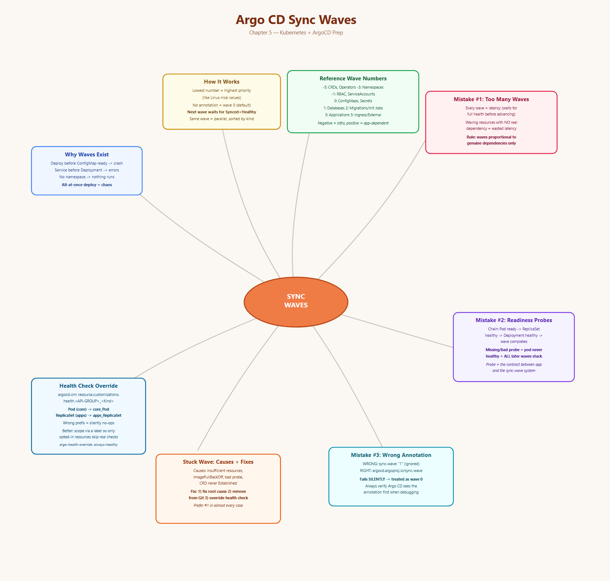
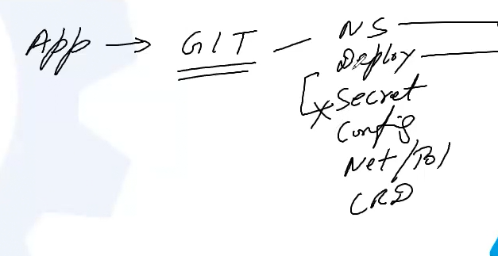
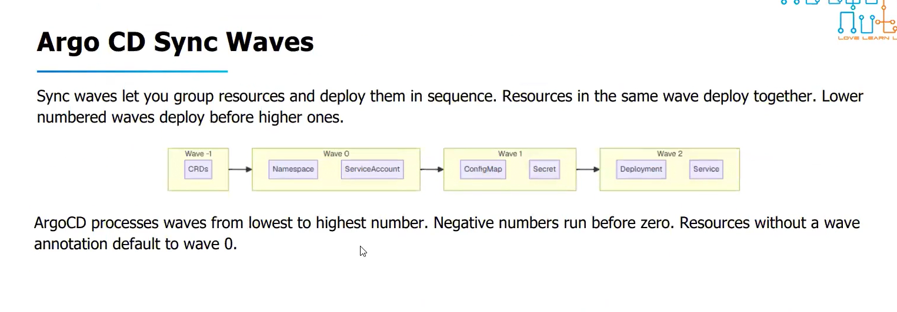
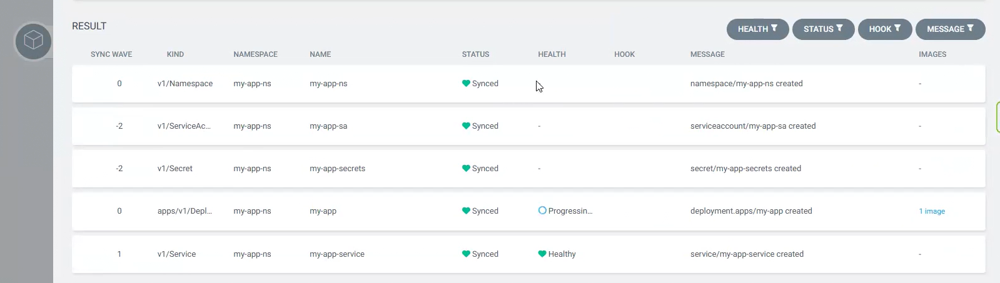

# Topic: Argo CD Sync Waves

*(Your notes, cleaned up from dictation + screenshots — Chapter 5)*

## Quick recall: mind map





## The problem this solves
All our application object files live in Git — namespace, deployment, secrets, config files,
network policies, CRDs, everything. Kubernetes itself doesn't inherently care what order things
show up in — but **applications have implicit ordering requirements** even if Kubernetes doesn't
enforce them.

**House-building analogy:** you don't build the roof before the foundation. Foundation → pillars →
walls → roof, in that order, or the whole thing doesn't stand. An application deployed via GitOps
has the exact same implicit-layering problem: Deployment, ConfigMap, Secret, NetworkPolicy, HPA —
all need to exist in the right order relative to each other, or things fail in predictable ways:
- Deployment starts, but its ConfigMap doesn't exist yet → **pod crashes** (can't find its config).
- Service is created, but the Deployment it targets doesn't exist yet → errors until the workload
  catches up.
- Pods can't run at all if their **namespace doesn't exist yet**.

**If Argo CD applies everything simultaneously (the default, with no sync waves), this is exactly
the chaos that results.** Sync waves exist to solve this: they let you define the **Kubernetes
object deployment sequence** explicitly.

## How sync waves actually work
Argo CD sync waves define **numbered waves**. **The lowest number = highest priority** (deployed
first) — same mental model as Linux `nice` values for process priority: lower number, higher
priority.

- You assign a wave number to a resource via annotation.
- **If no wave number is given, the resource defaults to wave `0`.**
- Argo CD deploys wave **-5 → -1 → 0 → 1 → 2 → 3 ...** in strict numerical order, lowest first.
- **Argo CD will not start the next wave until every resource in the current wave is both Synced
  AND Healthy.** This is what actually enforces the ordering — it's not just "apply in this
  sequence," it's "wait for real health before proceeding."
- Resources **within the same wave number** deploy together/in parallel (sorted by kind, then
  alphabetically by name as a tiebreaker — e.g. Namespaces before Services before Deployments).



## Worked example — assigning waves to a real app
Resources needed: CRD, Namespace, ServiceAccount, ConfigMap, Secret, Deployment, Service.

| Wave | Resources | Why |
|---|---|---|
| **-1** | CRD | Most fundamental — nothing else can exist without it |
| **0** | Namespace, ServiceAccount | Can be created in parallel, no dependency between them |
| **1** | ConfigMap, Secret | Configuration layer, needed before workloads start |
| **2** | Deployment, Service | Application layer — depends on everything above existing first |

```yaml
apiVersion: v1
kind: Namespace
metadata:
  name: my-app-ns
  labels: { area: my-app-ns }
  annotations:
    argocd.argoproj.io/sync-wave: "-5"
---
apiVersion: v1
kind: ServiceAccount
metadata:
  name: my-app-sa
  namespace: my-app-ns
  annotations:
    argocd.argoproj.io/sync-wave: "-2"
---
apiVersion: v1
kind: Secret
metadata:
  name: my-app-secrets
  namespace: my-app-ns
  annotations:
    argocd.argoproj.io/sync-wave: "-2"
```

Confirmed live in the UI's sync result view — the `SYNC WAVE` column showed exactly this order:
`ServiceAccount` (-2) and `Secret` (-2) together, then `Namespace` (0), `Deployment` (0), then
`Service` (1) last — each row's `HEALTH` column had to clear before the next wave proceeded.



## General ordering convention
All foundational/infrastructure resources get **negative** wave numbers; everything else scales up
from there:

| Wave range | Purpose |
|---|---|
| -5 to -1 | Infrastructure (namespaces, CRDs) |
| 0 to 2 | Configuration (configs, secrets) |
| 3 to 5 | Applications (deployments, services) |
| 6+ | External resources (ingress, monitoring) |

**A more granular reference table** (from the source material):

| Wave | Purpose |
|---|---|
| -5 | CRDs, Operators |
| -3 | Namespaces |
| -1 | RBAC, ServiceAccounts |
| 0 | ConfigMaps, Secrets |
| 1 | Databases, Caches |
| 2 | Migrations, Init Jobs |
| 3 | Applications |
| 5 | Ingress, External Services |

## Checking sync wave status
```bash
# Show the current operation details, including resources being synced
argocd app get networknuts-app --show-operation

# List resources in the application (with their wave numbers)
argocd app resources networknuts-app --output tree=detailed
```

## ⚠️ Common Mistake #1 — Too many waves
Argo CD **waits for a wave to be fully healthy before starting the next one** — every wave adds
real latency to the sync. Teams that add a sync-wave annotation to *every* resource "just in case"
end up with ten-wave configurations where waves 3, 4, and 5 contain resources that have **no actual
dependency** between them. That's pure wasted latency for no ordering benefit.

**Rule: keep the number of waves proportional to the number of genuine dependencies.** Don't wave
things that don't actually need to wait on each other — Kubernetes can already handle plenty of
this itself without Argo CD manually staging it.

## ⚠️ Common Mistake #2 — Missing or incorrect readiness probes
Sync waves depend entirely on Argo CD's **health assessment** to know when it's safe to proceed:
- A Deployment is healthy when all desired replicas are ready.
- A Pod is healthy when all its containers are running *and the readiness probe passes*.

**The trace-through:** Deployment creates ReplicaSet, ReplicaSet creates Pod. Deployment is healthy
only if ReplicaSet is healthy, which is healthy only if the Pod is healthy, which is healthy only
if its containers pass readiness. **If the readiness probe is missing or misconfigured, the pod
never reports healthy — so the Deployment never reports healthy — so the entire wave never
completes — so every subsequent wave stays blocked indefinitely**, even though the actual
application might genuinely be fine.

> **The readiness probe is the contract between your application and the sync wave system.** If it
> doesn't accurately reflect real application readiness, the next wave starts too early (probe too
> lenient) or never starts at all (probe too strict/broken).

## Sync Waves vs. Kubernetes Probes — how they relate
- **Kubernetes probes** check whether a *container* is running and ready.
- **Argo CD sync waves** control the *order* in which resources are deployed.
- **Together:** a sync wave only finishes once its deployed resources actually pass their health
  checks (which are themselves driven by probe results) — Argo CD uses sync waves (via the
  `argocd.argoproj.io/sync-wave` annotation) to decide when to apply a manifest; wave 0 deploys
  before wave 1, and Argo CD will not move to wave 1 until all of wave 0's resources reach `Healthy`.

## ⚠️ Common Mistake #3 — The wrong annotation key (silent failure)
**The first step in debugging any sync-wave problem: confirm Argo CD actually sees your
annotation.** A "typo" in the annotation *key* means Argo CD silently treats the resource as
wave `0` — no error, no warning, it just doesn't do what you asked.
```yaml
# WRONG - missing the full annotation key, Argo CD ignores this entirely
metadata:
  annotations:
    sync-wave: "1"

# CORRECT
metadata:
  annotations:
    argocd.argoproj.io/sync-wave: "1"
```

## Other reasons a sync wave gets stuck
Argo CD syncs **wave by wave** and refuses to advance until every resource in the current wave is
fully Synced *and* Healthy. Common causes of a stuck wave:
- **Insufficient resources** — the pod can't be scheduled (not enough CPU/memory in the cluster);
  the Deployment stays in `Progressing` forever.
- **ImagePullBackOff** — the container image doesn't exist or credentials are wrong; the Deployment
  never becomes healthy.
- **Readiness probe failure** — the pod starts, but the readiness probe never passes; Kubernetes
  reports the pod as not-ready, and Argo CD reports the Deployment as stuck `Progressing`.
- **CRD not becoming `Established`** — if a CRD has schema validation errors, it might get created
  but never reach the `Established` condition; the wave containing that CRD stays stuck.

### Fixing a stuck sync wave — 3 options
1. **Fix the stuck resource** (right answer in most cases) — figure out *why* the resource is
   unhealthy and fix that root cause.
2. **Remove the stuck resource from the application** — if it's optional, remove it from the Git
   repository and sync again; Argo CD will prune it and the wave can complete.
3. **Override the health check for that resource type** — configure Argo CD to treat certain
   resource types as always-healthy via a custom health check in the Argo CD ConfigMap.

## Overriding health checks via `argocd-cm` (when Argo CD shouldn't gate on a resource's real health)
```bash
kubectl -n argocd get cm
# argocd-cm  argocd-cmd-params-cm  argocd-gpg-keys-cm  argocd-notifications-cm
# argocd-rbac-cm  argocd-ssh-known-hosts-cm  argocd-tls-certs-cm  kube-root-ca.crt

kubectl edit configmap argocd-cm -n argocd
```

**Force a specific core resource type (e.g. Pod) to always report Healthy:**
```yaml
kind: ConfigMap
metadata:
  name: argocd-cm
  namespace: argocd
data:
  # Example for a core Pod resource treated as always healthy
  resource.customizations.health.core_Pod: |
    hs = {}
    hs.status = "Healthy"
    hs.message = "Forced to be always healthy"
    return hs
```

### ⚠️ Why `core_Pod` but `apps_ReplicaSet`? — the API group prefix matters
The customization key format is `resource.customizations.health.<API-GROUP>_<Kind>`. The API group
comes straight from `kubectl api-resources`:
```bash
kubectl api-resources
# NAME          SHORTNAMES  APIVERSION  NAMESPACED  KIND
# pods          po          v1          true        Pod          <- core API group -> "core_Pod"
# replicasets   rs          apps/v1     true         ReplicaSet   <- "apps" API group -> "apps_ReplicaSet"
```
`Pod` is in the **core** API group (bare `v1`, no group prefix) → `core_Pod`. `ReplicaSet` is in
the **apps** API group (`apps/v1`) → `apps_ReplicaSet`. Get this prefix wrong and the override
silently does nothing — same failure mode as the wrong annotation key above.

### A smarter override — only force-healthy resources that opt in via a label
Rather than blanket-forcing an entire resource *kind* to always-healthy (risky — you lose real
signal for every instance of that kind, everywhere), scope it to only resources carrying a specific
label:
```yaml
resource.customizations.health.apps_ReplicaSet: |
  -- Check if the specific label exists on the ReplicaSet
  if obj.metadata.labels ~= nil and obj.metadata.labels["argo-health-override"] == "always-healthy" then
    hs.status = "Healthy"
    hs.message = "Forced to Healthy via application-specific label override"
    return hs
  end

  -- Fallback to standard ArgoCD ReplicaSet health logic if label is missing
  if obj.status ~= nil and obj.status.replicas ~= nil then
    if obj.spec.replicas == obj.status.readyReplicas then
      hs.status = "Healthy"
      hs.message = "ReplicaSet is healthy"
      return hs
    end
  end
  hs.status = "Progressing"
  hs.message = "Waiting for replicas to be ready"
  return hs
```
Then on the actual resource:
```yaml
apiVersion: apps/v1
kind: ReplicaSet
metadata:
  name: my-replicaset
  labels:
    argo-health-override: "always-healthy"   # triggers the custom Lua condition above
spec:
  replicas: 3
  # ... rest of spec
```
This way, only ReplicaSets explicitly opting in via that label skip real health evaluation — every
other ReplicaSet in the cluster still gets genuine health checking.

## Reconciliation interval, revisited
The same `argocd-cm` ConfigMap is also where you'd change the Argo CD ↔ Git reconciliation
interval (default 3 minutes) — covered in the previous chapter (`timeout.reconciliation`).

## What I practiced
- Built a real multi-resource app (CRD/Namespace/ServiceAccount/ConfigMap/Secret/Deployment/Service)
  with explicit `argocd.argoproj.io/sync-wave` annotations and watched the UI's sync result table
  confirm resources landed in the exact wave order assigned.
- Deliberately used the wrong annotation key (`sync-wave` instead of the fully-qualified
  `argocd.argoproj.io/sync-wave`) and confirmed Argo CD silently treated that resource as wave 0
  with no error.
- Reasoned through the full health-dependency chain (Deployment→ReplicaSet→Pod→container
  readiness) that makes a missing/broken readiness probe block an entire wave indefinitely.
- Used `argocd app get <app> --show-operation` and `argocd app resources <app> --output
  tree=detailed` to inspect wave/sync status from the CLI.
- Overrode health checks in `argocd-cm` for a core resource type (`core_Pod`) and understood why
  the key had to be `core_Pod` vs. `apps_ReplicaSet` based on each Kind's actual API group.
- Wrote a scoped Lua health-check override that only forces "Healthy" for resources carrying a
  specific label (`argo-health-override: always-healthy`), rather than blanket-overriding an entire
  Kind everywhere.

---
*Merged into the master reference notes: [`../../argocd-master-notes.md`](../../argocd-master-notes.md)
— new "5. Sync Waves" section.*
