# Chapter 01: Git Fundamentals

*Git track · Chapter 01 · Course: Git Masterclass (Complete Git & GitHub Tutorial), Part 1 · 2026-10-13*

> [!NOTE]
> **What this chapter covers:** why Git exists, what Git is, installing it, `git init` and the `.git` folder, the Git architecture (working directory → staging area → local repository → remote), what a commit is, the first hands-on workflow (`status`, `add`, `rm --cached`, `restore`, `commit`, `log`), `git config` and its scopes, commit-message conventions, and `.gitignore`.
> **A full command reference is in section 10.**
> **Next chapter:** Git branches.

## Agenda for Part 1 of the course

| # | Topic | Status |
|---|---|---|
| 1 | Why & what of Git | ✅ this chapter |
| 2 | Demo: core Git commands (init, status, add, commit) | ✅ this chapter |
| 3 | Git architecture: core constructs | ✅ this chapter |
| 4 | Ignoring files using `.gitignore` (+ demo) | ✅ this chapter |
| 5 | Git branches | ⏳ next |
| 6 | Git merge (fast-forward, 3-way, conflicts) | ⏳ |
| 7 | Undoing commits: reset vs revert | ⏳ |

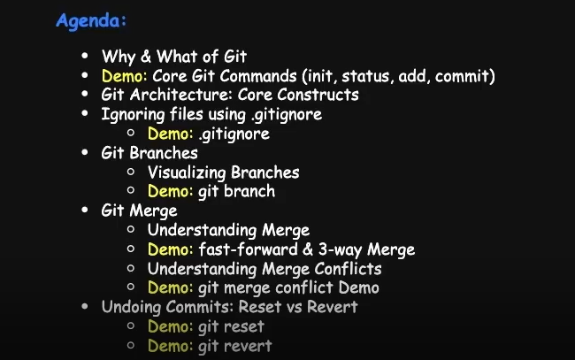

---

## 1. Why Git exists

Git was created by **Linus Torvalds in 2005** (the creator of Linux). Before Git, when **many people worked on the same project**, adding and merging everyone's code was very hard:

- Teams frequently **overwrote each other's work**
- There was **no reliable history** of code changes
- **Rolling back** broken changes was difficult
- **Collaboration** across engineers became difficult

Linus built Git to solve exactly these problems.

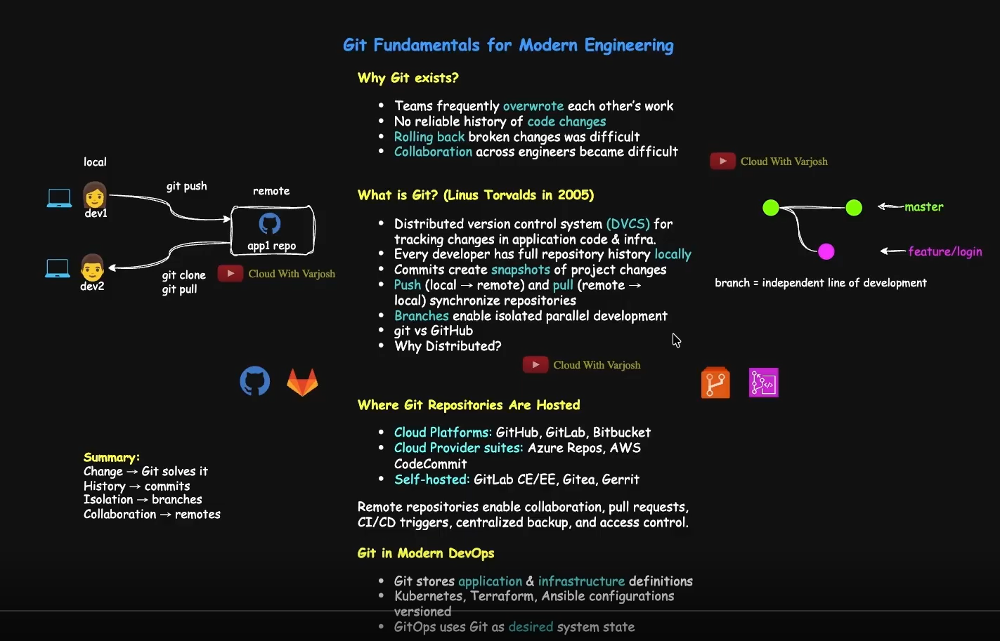

## 2. What Git is

Git is a **Distributed Version Control System (DVCS)** for tracking changes in **application code and infrastructure** (Terraform, Kubernetes YAML, Ansible…).

| Idea | Meaning |
|---|---|
| **Distributed** | Every developer has the **full repository history locally**, not just the latest files. You can work, commit and see history offline. |
| **Commits** | Create **snapshots** of project changes |
| **Push / pull** | **Push** = local → remote, **pull** = remote → local. This is how repositories synchronise. |
| **Branches** | Enable **isolated, parallel development**. A branch = an independent line of development (e.g. `master` and `feature/login`). |

**Summary from the slide:**

```text
Change        → Git solves it
History       → commits
Isolation     → branches
Collaboration → remotes
```

**Typical team flow:** dev1 does `git push` to the remote **app1 repo** (on GitHub); dev2 does `git clone` (first time) or `git pull` (afterwards) to get those changes.

### 2.1 Git vs GitHub

| Git | GitHub (and similar) |
|---|---|
| The **tool**, installed on your machine | A **hosting platform** for Git repositories |
| Tracks history, commits, branches **locally** | Adds the **remote** copy plus pull requests, CI/CD triggers, backup, access control, a web UI |
| Works without internet | Needs internet |

### 2.2 Where Git repositories are hosted

| Type | Examples |
|---|---|
| **Cloud platforms** | GitHub, GitLab, Bitbucket |
| **Cloud provider suites** | Azure Repos, AWS CodeCommit |
| **Self-hosted** | GitLab CE/EE, Gitea, Gerrit |

Remote repositories enable **collaboration, pull requests, CI/CD triggers, centralised backup and access control**.

### 2.3 Git in modern DevOps

- Git stores **application** and **infrastructure** definitions
- **Kubernetes, Terraform, Ansible** configurations are versioned in Git
- **GitOps** uses Git as the **desired system state** (exactly what ArgoCD does: it syncs the cluster to what's in Git)

> [!NOTE]
> **For infra people:** you've already been using Git indirectly. Terraform modules sourced from GitHub, ArgoCD watching a repo, Helm charts in a repo: all of it is Git underneath.

---

## 3. Installing Git

Download or install instructions are at **[git-scm.com](https://git-scm.com/install/linux)** (Windows, macOS, Linux, build from source). On Ubuntu/Debian, use the package manager:

```bash
apt update
apt install git
git -v              # or: git --version
# git version 2.43.0
```

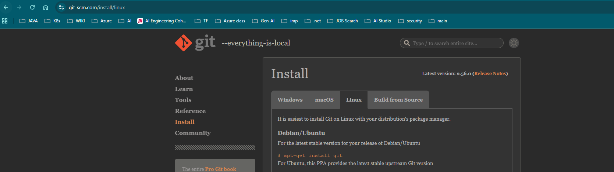

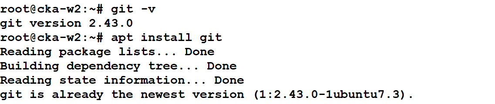

---

## 4. Creating a repository: `git init`

Create a normal folder and ask Git about it:

```bash
mkdir project-files
cd project-files
git status
# fatal: not a git repository (or any of the parent directories): .git
```

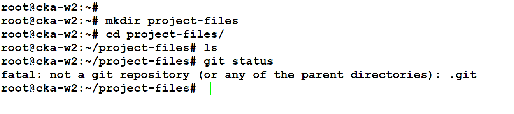

The error appears because **Git has not been asked to manage this folder yet**. Notice it mentions **`.git`**: that's the folder Git looks for.

**Turn the folder into a Git repository:**

```bash
git init
# hint: Using 'master' as the name for the initial branch. ...
# Initialized empty Git repository in /root/project-files/.git/
```

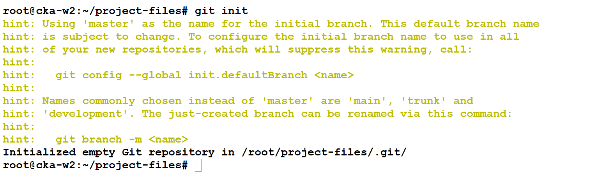

Git also prints a **hint**: the default branch name is `master`, which you can change:

```bash
git config --global init.defaultBranch main   # default name for all NEW repos
git branch -m main                            # rename the current branch
git branch --show-current                     # → master
```


> [!TIP]
> Most teams now use **`main`** instead of `master` (GitHub's default). Other names you'll see: `trunk`, `development`.

### 4.1 The `.git` folder: the brain of the repository

`git init` creates a **hidden `.git` folder**. Everything Git knows (staging area, commits, branches, config) lives inside it. **Delete `.git` and the folder becomes a normal folder again, with all history gone.**

```bash
ls -ltrha
# drwxr-xr-x 7 root root 4.0K Oct 13 06:25 .git
tree .git
```

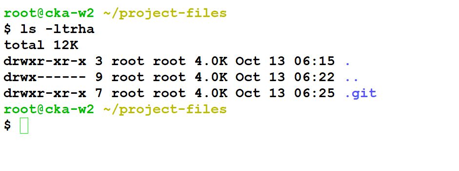

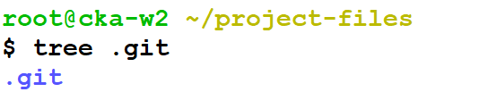

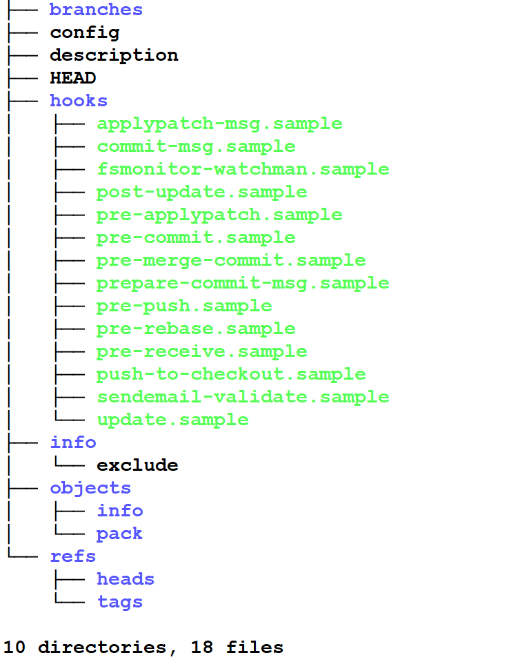

| Item in `.git` | What it is (quick peek; covered in depth later) |
|---|---|
| `HEAD` | Points to the branch you're currently on |
| `config` | This repo's settings (`--local` config) |
| `objects/` | The database: every file version, folder and commit is stored here |
| `refs/heads/`, `refs/tags/` | Branches and tags (pointers to commits) |
| `hooks/` | Sample scripts that can run on events (`pre-commit`, `pre-push`…) |
| `info/exclude` | A private, un-shared ignore list for this repo only |
| `description`, `branches/` | Legacy / rarely used |

> [!NOTE]
> The instructor's advice: don't worry about every file in `.git` yet. The jargon makes more sense as we progress.

---

## 5. Git architecture: the core constructs

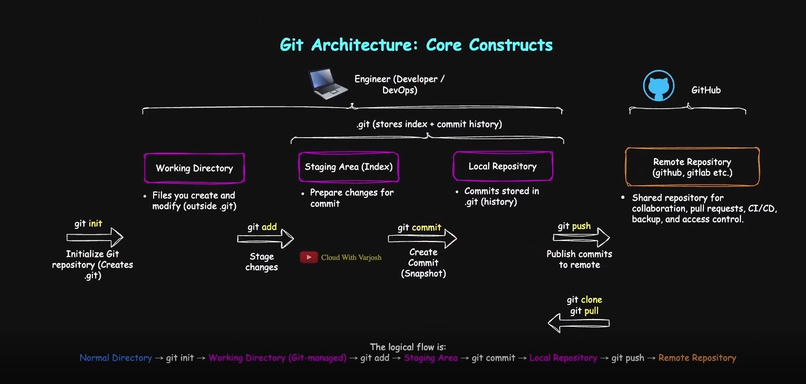

```text
 ┌──────────────────── Engineer's laptop ──────────────────────┐        ┌──── GitHub ────┐
 │                         ┌──────── managed by .git ────────┐ │        │                │
 │  Working Directory  ──► │ Staging Area (Index) ──► Local  │ │ ─────► │    Remote      │
 │  (files you create      │ (prepare changes     Repository │ │  push  │   Repository   │
 │   and modify)  git add  │  for commit) git commit (history)│ │ ◄───── │                │
 │                         └─────────────────────────────────┘ │ clone/ │                │
 └─────────────────────────────────────────────────────────────┘  pull  └────────────────┘
```

| Construct | Where | What it is | Command to move forward |
|---|---|---|---|
| **Working directory** | Your laptop (outside `.git`) | The files you create and modify | `git add` → staging |
| **Staging area (index)** | Inside `.git` | The list of changes **prepared** for the next commit | `git commit` → local repo |
| **Local repository** | Inside `.git` | Commits stored as **history** | `git push` → remote |
| **Remote repository** | GitHub, GitLab… | A **shared** repository for collaboration, PRs, CI/CD, backup, access control | `git clone` / `git pull` → back to local |

**The logical flow:**

```text
Normal directory → git init → Working directory (Git-managed) → git add → Staging area
→ git commit → Local repository → git push → Remote repository
```

### 5.1 Why have a staging area at all?

The staging area gives you **precision and control**. Say you've changed **10 files**, but today's piece of work is really only about **2 of them**. You `git add` just those 2 and commit them as **one clean, meaningful change**. The other 8 stay in the working directory for a later commit.

> [!NOTE]
> **For infra people:** the staging area is like a **change request**. You can edit many things on the server, but you only include the specific, reviewed items in this CR. `git commit` = the CR gets approved and recorded in the change log.

---

## 6. What is a commit?

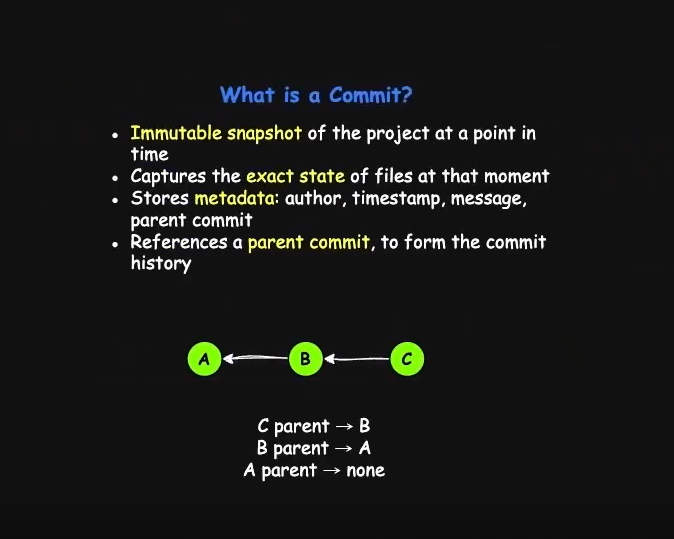

A commit is:

- An **immutable snapshot** of the project at a point in time
- It captures the **exact state of the files** at that moment
- It stores **metadata**: author, timestamp, message, **parent commit**
- It **references its parent commit**, which forms the commit history

```text
A ◄── B ◄── C          C's parent → B
                       B's parent → A
                       A's parent → none (the first, "root" commit)
```

### 6.1 Immutable: what it really means

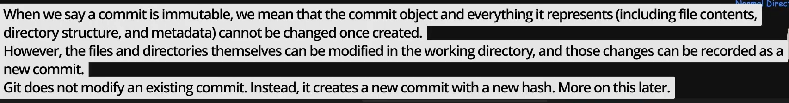

- The commit object and **everything it represents** (file contents, directory structure, metadata) **cannot be changed once created**.
- But the files themselves **can** be modified in the working directory, and those changes are recorded as a **new commit**.
- Git **never modifies an existing commit**. It creates a **new commit with a new hash**. (More on this later, e.g. with rebase and amend.)

Every commit has a unique ID, the **commit hash** (SHA-1, 40 hex characters), e.g. `255d82feada282ef095ccab1a9f1aec1b30d3273`. Usually only the first 7 characters are shown: `255d82f`.

> [!NOTE]
> **For infra people:** a commit is like an **AMI or EBS snapshot**. Once taken it never changes; you take a new one. The hash is like a **container image digest** (`sha256:…`): the same content always gives the same ID, so you can trust that it hasn't been altered.

---

## 7. Hands-on: the first commit, step by step

### 7.1 Empty repository

```bash
git log
# fatal: your current branch 'master' does not have any commits yet
git status
# On branch master
# No commits yet
# nothing to commit (create/copy files and use "git add" to track)
```

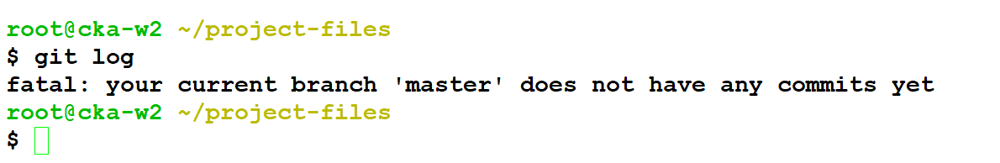

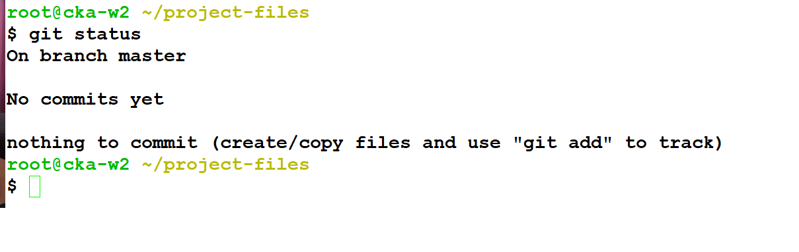

### 7.2 Create a file → untracked

```bash
touch file1.txt
git status
# Untracked files:
#   (use "git add <file>..." to include in what will be committed)
#         file1.txt            ← shown in RED
```

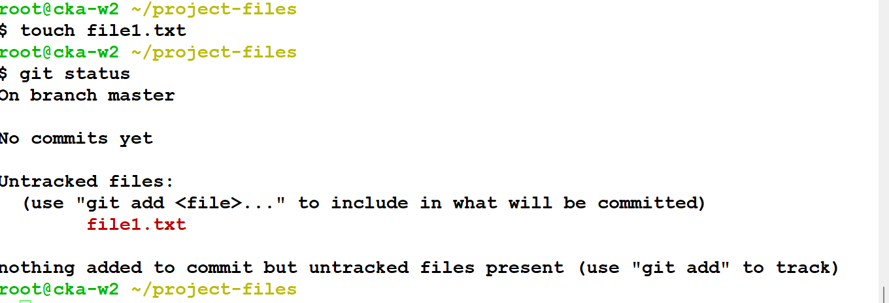

**Untracked** means the file exists in the working directory but **Git isn't watching it yet**. Git starts tracking it once you `git add` it.

### 7.3 Stage it → `git add`

```bash
git add file1.txt        # one file
git add .                # everything in the current directory ("." = current folder)
git status
# Changes to be committed:
#   (use "git rm --cached <file>..." to unstage)
#         new file:   file1.txt     ← shown in GREEN
```

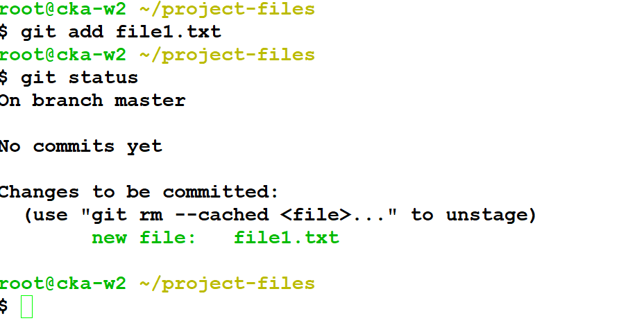

### 7.4 Changed your mind? Unstage → `git rm --cached`

```bash
git rm --cached file1.txt
# rm 'file1.txt'
git status
# Untracked files: file1.txt    ← back in the working directory only
```

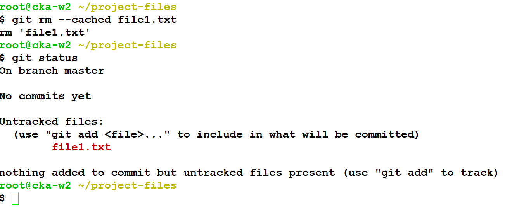

`--cached` means "remove it from the **staging area (index)** only". **The file itself is NOT deleted** from your folder. (For a file that's already been committed before, `git restore --staged <file>` is the usual way to unstage.)

### 7.5 Edit a staged file → "modified"

The file was staged while **empty**. Now we change it in the working directory:

```bash
cat file1.txt                         # (empty)
echo "God Is great" >> file1.txt
cat file1.txt                         # God Is great
git status
# Changes to be committed:
#         new file:   file1.txt       ← the EMPTY version that was staged
# Changes not staged for commit:
#   (use "git add <file>..." to update what will be committed)
#   (use "git restore <file>..." to discard changes in working directory)
#         modified:   file1.txt       ← the new line, not staged yet
```

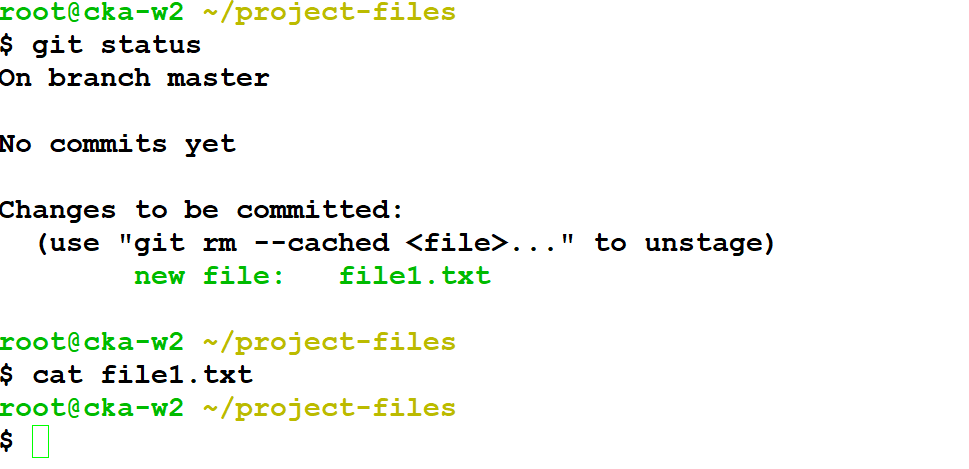

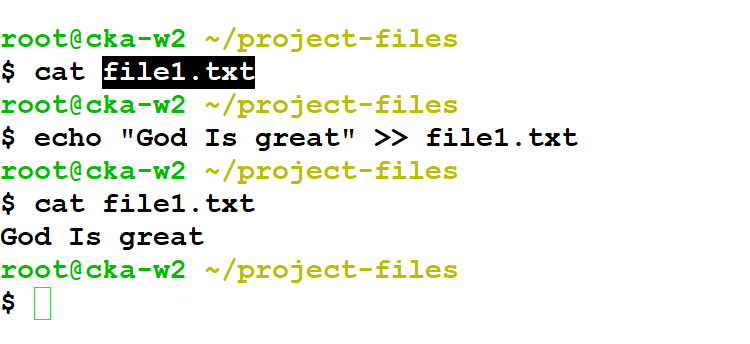

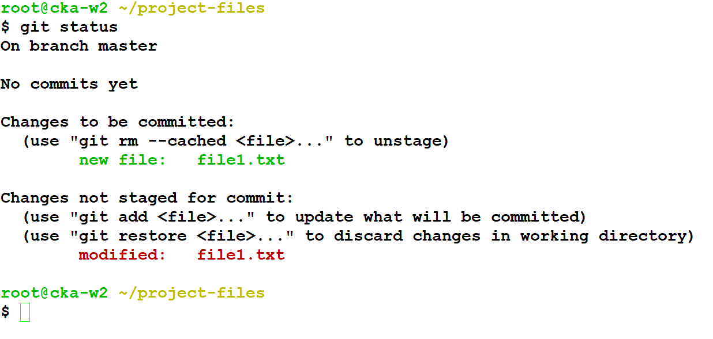

> [!IMPORTANT]
> **The same file can appear twice in `git status`.** The staging area holds a **snapshot taken at the moment of `git add`**. Later edits are **not** included automatically; you must `git add` again.

### 7.6 Two choices for the new change

| You want to… | Command | Result |
|---|---|---|
| **Keep** the edit | `git add file1.txt` | Staging area updated with "God Is great" |
| **Throw away** the edit | `git restore file1.txt` | Working file goes back to the staged version (empty again) |

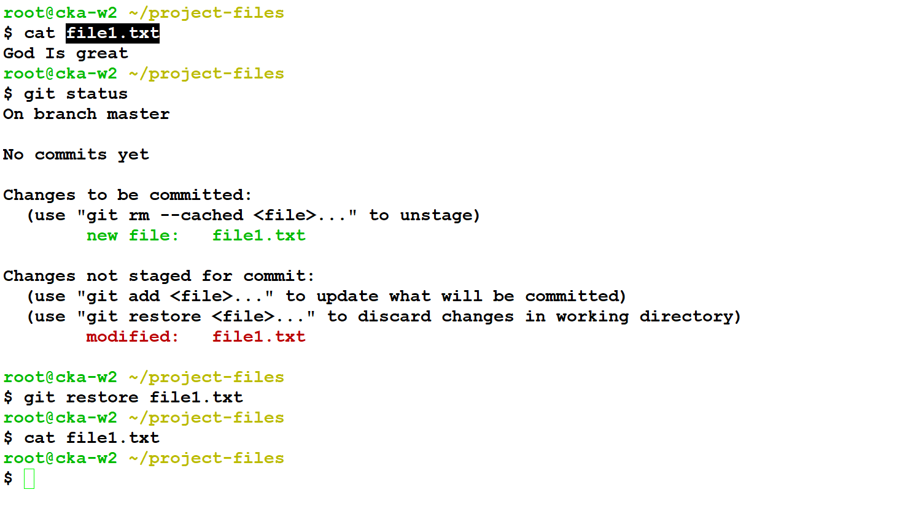

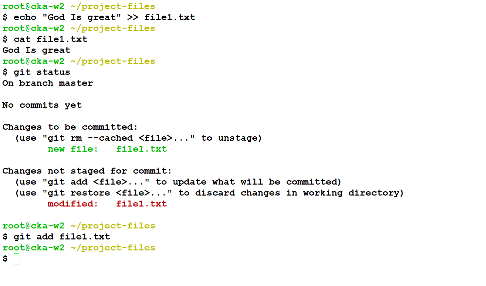

> [!WARNING]
> `git restore <file>` **permanently discards** uncommitted edits in the working directory. There's no undo for that, so check first with `git diff`.

### 7.7 Commit → "Author identity unknown"

```bash
git commit -m "inital commit: add file1.txt" .
# Author identity unknown
# *** Please tell me who you are.
#   git config --global user.email "you@example.com"
#   git config --global user.name "Your Name"
# fatal: unable to auto-detect email address (got 'root@cka-w2.(none)')
```

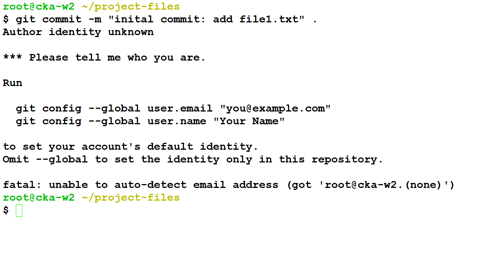

`-m` = **message**. Every commit records **who** made it, so Git needs your name and email first:

```bash
git config --global user.name vishal
git config --global user.email vishalbhilare@test.com
```


Now the commit works:

```bash
git commit -m "inital commit: add file1.txt" .
# [master (root-commit) 255d82f] inital commit: add file1.txt
#  1 file changed, 1 insertion(+)
#  create mode 100644 file1.txt
```

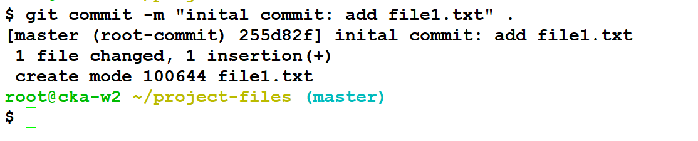

| Output part | Meaning |
|---|---|
| `master` | The branch the commit went to |
| `root-commit` | The very first commit (it has **no parent**) |
| `255d82f` | Short commit hash |
| `1 file changed, 1 insertion(+)` | One line added |
| `create mode 100644` | New file with normal (non-executable) permissions |

### 7.8 See the history → `git log`

```bash
git log
# commit 255d82feada282ef095ccab1a9f1aec1b30d3273 (HEAD -> master)
# Author: vishal <vishalbhilare@test.com>
# Date:   Tue Oct 13 07:49:28 2026 +0000
#
#     inital commit: add file1.txt
```

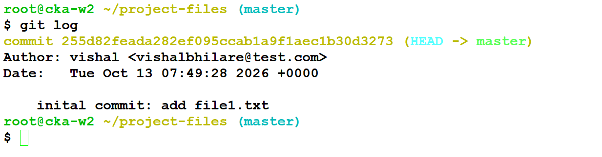

`HEAD -> master` means: **you are here**. HEAD points to the `master` branch, which points to this commit.

### 7.9 The whole flow again with a second file

```bash
touch file2.txt
git add file2.txt
git commit -m "Addition : Add file2.txt"
# [master 930b564] Addition : Add file2.txt
git log                     # newest first: 930b564, then 255d82f
git log --oneline
# 930b564 (HEAD -> master) Addition : Add file2.txt
# 255d82f inital commit: add file1.txt
```

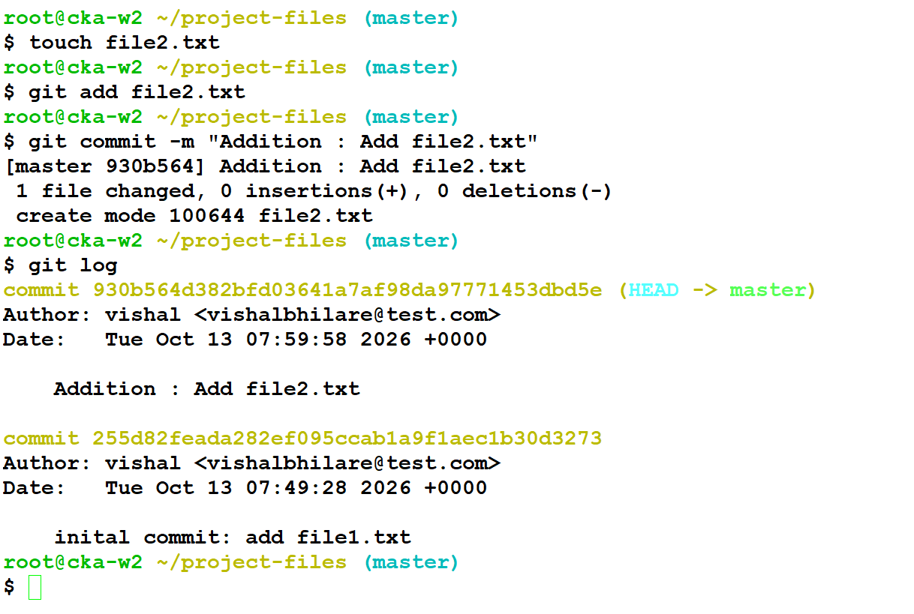

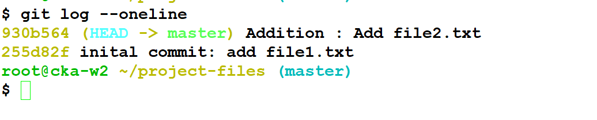

`--oneline` shows each commit on one line with the **first 7 characters** of its hash. Commit `930b564`'s parent is `255d82f`, exactly the A ◄── B chain from section 6.

---

## 8. `git config`: who you are and where it's stored

### 8.1 Scopes

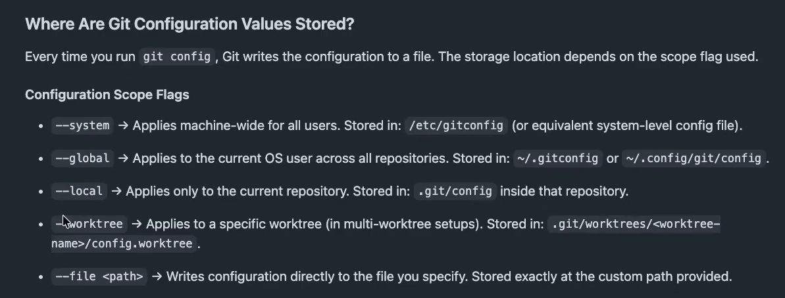

| Flag | Applies to | Stored in |
|---|---|---|
| `--system` | Every user on the machine | `/etc/gitconfig` |
| `--global` | The current OS user, **all** their repositories | `~/.gitconfig` (or `~/.config/git/config`) |
| `--local` *(default)* | **Only this repository** | `.git/config` inside the repo |
| `--worktree` | One specific worktree (multi-worktree setups) | `.git/worktrees/<name>/config.worktree` |
| `--file <path>` | Whatever you choose | Exactly that file |

**Precedence:** the most specific wins: **local > global > system**. Example: a global work email, but a local personal email for one hobby repo.

```bash
cat ~/.gitconfig
# [user]
#         name = vishal
#         email = vishalbhilare@test.com
git config --list --show-origin     # every setting + which file it came from
```

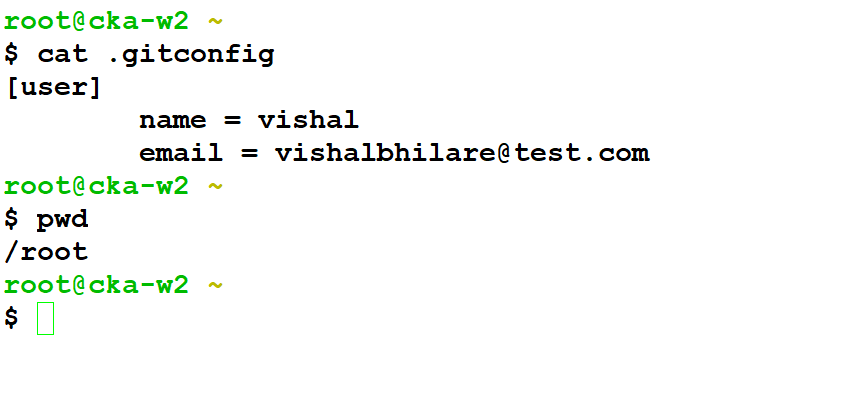

> [!NOTE]
> **For infra people:** this is the same layering as **kubeconfig contexts** or **Terraform variable precedence**: system defaults, overridden per user, overridden per project.

### 8.2 Writing good commit messages (Conventional Commits)

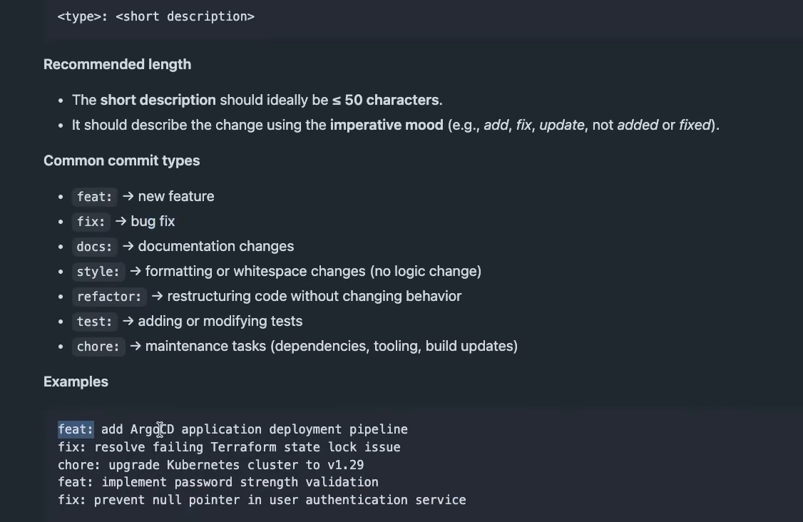

Format: `<type>: <short description>`

- The short description should be **≤ 50 characters**.
- Use the **imperative mood**: *add, fix, update*, not *added* or *fixed* (read it as "this commit will… add X").

| Type | Use for |
|---|---|
| `feat:` | A new feature |
| `fix:` | A bug fix |
| `docs:` | Documentation changes |
| `style:` | Formatting or whitespace (no logic change) |
| `refactor:` | Restructuring code without changing behaviour |
| `test:` | Adding or modifying tests |
| `chore:` | Maintenance (dependencies, tooling, build updates) |

```text
feat: add ArgoCD application deployment pipeline
fix: resolve failing Terraform state lock issue
chore: upgrade Kubernetes cluster to v1.29
feat: implement password strength validation
fix: prevent null pointer in user authentication service
```

> [!TIP]
> A meaningful message lets anyone (including you in six months) understand **what changed and why** just from `git log --oneline`. Many CI tools also use these prefixes to generate changelogs and version numbers.

---

## 9. Ignoring files with `.gitignore`

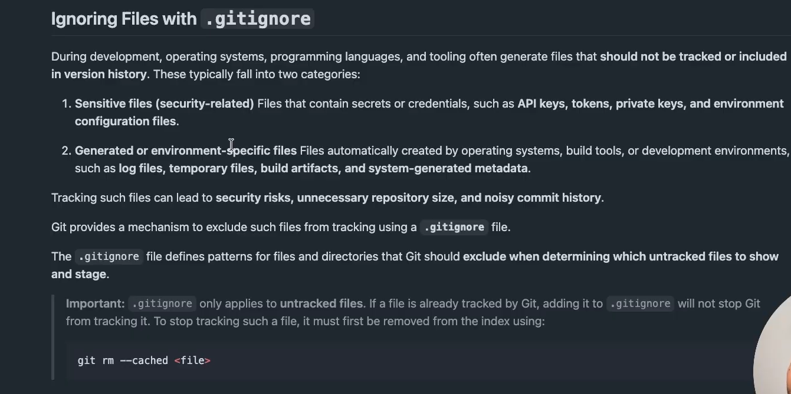

During development, operating systems, languages and tools create files that **should not be tracked**. Two categories:

1. **Sensitive files (security):** API keys, tokens, private keys, environment config (`.env`).
2. **Generated or environment-specific files:** log files, temporary files, build artifacts, system metadata (`.DS_Store`, `node_modules/`, `__pycache__/`, `.terraform/`).

Tracking them causes **security risks** (secrets on GitHub), **bigger repositories** and **noisy commit history**.

### 9.1 Demo

```bash
touch my.log my.key
git status
# Untracked files: my.key  my.log
```

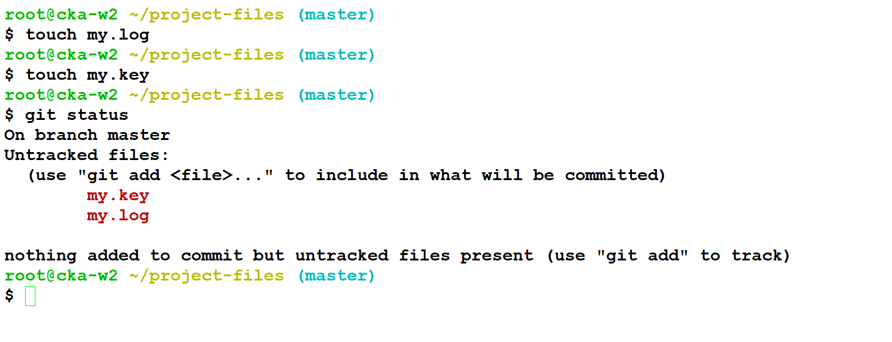

Create a `.gitignore` in the repo root:

```bash
vim .gitignore
cat .gitignore
# *.log
# *.key
```

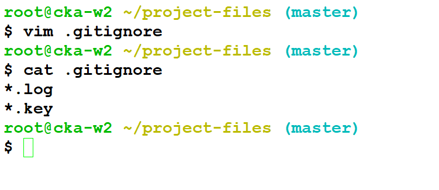

`*.log` means "any file ending in `.log`". Now:

```bash
git status
# Untracked files:
#         .gitignore          ← my.log and my.key are gone from the list
```

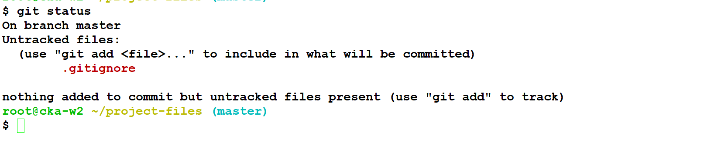

**Interesting:** `.gitignore` itself shows up as untracked. In production you **commit and push `.gitignore`**, so every developer on the project gets the same ignore rules.

### 9.2 Common patterns *(beyond the class)*

| Pattern | Ignores |
|---|---|
| `*.log` | All `.log` files, anywhere |
| `build/` | The whole `build` folder |
| `/secret.txt` | Only `secret.txt` in the repo root |
| `.env` | The environment file with secrets |
| `!important.log` | **Exception**: keep this one even though `*.log` is ignored |
| `# comment` | A comment line |

### 9.3 Important: `.gitignore` only affects untracked files

> [!IMPORTANT]
> If a file is **already tracked** (it was added or committed earlier), adding it to `.gitignore` **won't stop Git tracking it**. First remove it from the index, then commit:
> ```bash
> git rm --cached <file>
> git commit -m "chore: stop tracking <file>"
> ```
> And if a secret was **already pushed**, `.gitignore` won't help: **rotate the secret**, because it's still in the history.

### 9.4 Don't write it from scratch: generators

Every language and tool has a standard ignore list. Use a generator such as **[gitignore.io](https://www.toptal.com/developers/gitignore)** (Toptal): type your stack (Python, Java, Terraform, VisualStudioCode…) and click **Create**. GitHub also offers templates when you create a repo ([github/gitignore](https://github.com/github/gitignore)).

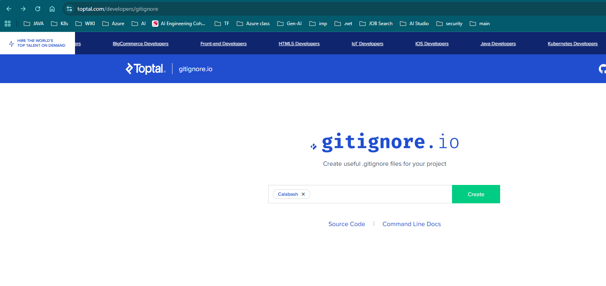

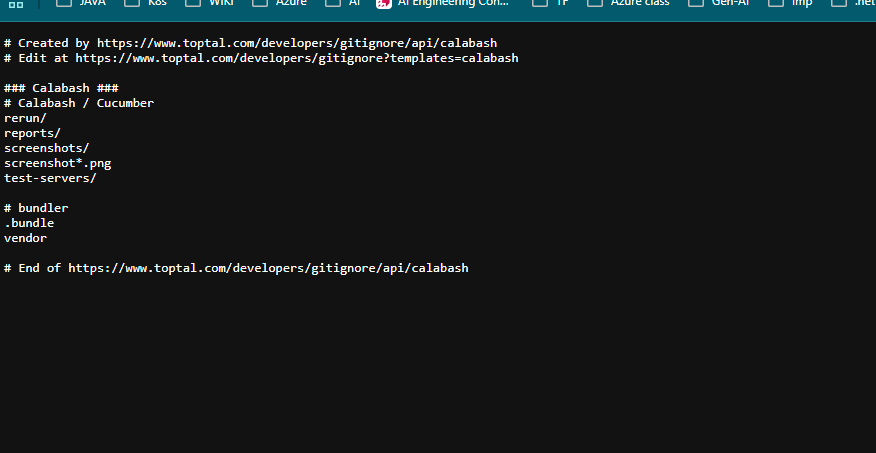

---

## 10. Command reference (everything from this chapter)

### Setup

| Command | Purpose | Example |
|---|---|---|
| `git -v` / `git --version` | Check Git is installed, and which version | `git --version` → `git version 2.43.0` |
| `git config --global user.name "<name>"` | Set your name for all repos | `git config --global user.name "Vishal Bhilare"` |
| `git config --global user.email "<email>"` | Set your email for all repos | `git config --global user.email "me@example.com"` |
| `git config user.email "<email>"` | Set the email for **this repo only** (`--local`) | for a personal repo |
| `git config --global init.defaultBranch main` | Default branch name for new repos | |
| `git config --list --show-origin` | Show all settings and their source file | |

### Create and inspect

| Command | Purpose | Example |
|---|---|---|
| `git init` | Turn the current folder into a Git repo (creates `.git`) | `mkdir app && cd app && git init` |
| `git status` | **What's going on?** Untracked, staged and modified files. Run it often! | `git status` |
| `git branch --show-current` | Which branch am I on? | → `master` |
| `git branch -m <new>` | Rename the current branch | `git branch -m main` |
| `git log` | Full commit history (hash, author, date, message), newest first | `git log` |
| `git log --oneline` | Compact history: short hash + message | `git log --oneline` |
| `git diff` *(beyond the class)* | What changed in the working dir vs staging | `git diff file1.txt` |
| `git diff --staged` *(beyond the class)* | What's staged vs the last commit | `git diff --staged` |

### Move changes through the stages

| Command | Purpose | Moves from → to |
|---|---|---|
| `git add <file>` | Stage one file | working dir → staging |
| `git add .` | Stage everything in the current folder | working dir → staging |
| `git rm --cached <file>` | Unstage / stop tracking; **keeps the file on disk** | staging → working dir (untracked) |
| `git restore --staged <file>` *(beyond the class)* | Unstage changes of an already-committed file | staging → working dir |
| `git restore <file>` | **Discard** working-dir edits (back to the staged/committed version) ⚠️ | throws away edits |
| `git commit -m "<message>"` | Save staged changes as a new commit | staging → local repo |
| `git commit -m "<msg>" <file or .>` | Commit the given tracked path(s) directly | |
| `git push` *(next module)* | Publish commits | local repo → remote |
| `git clone` / `git pull` *(next module)* | Get a repo / get new commits | remote → local |

### Ignore

| Command / file | Purpose |
|---|---|
| `.gitignore` | Patterns of files Git should never show as untracked or stage |
| `git rm --cached <file>` | Needed if the file was already tracked before you ignored it |
| `git check-ignore -v <file>` *(beyond the class)* | Which `.gitignore` rule is ignoring this file? |

### `git status` colours cheat sheet

| What you see | Meaning | Next step |
|---|---|---|
| 🔴 **Untracked files** | New file, Git isn't watching it | `git add` |
| 🟢 **Changes to be committed** | Staged, ready | `git commit` |
| 🔴 **Changes not staged for commit / modified** | Edited after the last add/commit | `git add` (keep) or `git restore` (discard) |
| **nothing to commit, working tree clean** | Everything is committed | 🎉 |

---

## Interview quick answers

1. **"What is Git?"** A distributed version control system (Linus Torvalds, 2005) that tracks changes to code and infrastructure files as commits. Every clone has the full history locally.
2. **"Why distributed?"** Every developer has the full repo and history, so you can work and commit offline, there's no single point of failure, and any clone can act as a backup.
3. **"Git vs GitHub?"** Git is the version-control tool on your machine. GitHub (GitLab, Bitbucket, Azure Repos…) hosts remote repositories and adds PRs, CI/CD, access control and a UI.
4. **"Explain the Git architecture."** Working directory → (`git add`) → staging area/index → (`git commit`) → local repository → (`git push`) → remote. The staging area and local repo live in `.git`.
5. **"Why is there a staging area?"** Precision: choose exactly which changes go into a commit, so commits stay small and meaningful even if many files are modified.
6. **"What is a commit?"** An immutable snapshot of the project with metadata (author, timestamp, message, parent). Commits chain via parent pointers; each has a SHA-1 hash. Changes always create a new commit, never edit an old one.
7. **"What is HEAD?"** A pointer to where you are, normally the current branch, which points to its latest commit (`HEAD -> master`).
8. **"`git rm --cached` vs `git rm`?"** `--cached` removes the file only from the index (unstage / stop tracking) and keeps it on disk. Plain `git rm` deletes it from both.
9. **"`git restore` vs `git restore --staged`?"** `restore <file>` discards working-dir changes. `restore --staged <file>` unstages but keeps the edits.
10. **"Where is Git config stored?"** system `/etc/gitconfig`, global `~/.gitconfig`, local `.git/config`. Local overrides global overrides system.
11. **"I added a file to .gitignore but Git still tracks it. Why?"** `.gitignore` only affects untracked files. Run `git rm --cached <file>` and commit. If it was a pushed secret, rotate it.
12. **"Good commit message?"** Conventional Commits: `type: short imperative description` (≤ 50 chars), e.g. `fix: resolve failing Terraform state lock issue`.

## What's next
- **Git branches:** visualising branches, `git branch`, switching
- **Git merge:** fast-forward vs 3-way merge, merge conflicts
- **Undoing commits:** `git reset` vs `git revert`
