# Chapter 02: Git Branches & Merge

*Git track · Chapter 02 · Course: Git Masterclass (Complete Git & GitHub Tutorial), Part 1 · 2026-10-13*

> [!NOTE]
> **What this chapter covers:** why we create branches, what a branch really is (a pointer), naming conventions, atomic development, visualising branches, HEAD, the branch commands (`branch`, `checkout`, `checkout -b`, `branch -d`), branching from an older commit, and **merging**: fast-forward vs three-way merge, branch divergence, `reflog`, `git show` and `log --graph`.
> **A full command reference is in section 9.**
> **Next:** merge conflicts, what they are and how to resolve them.

---

## 1. Why create a branch?

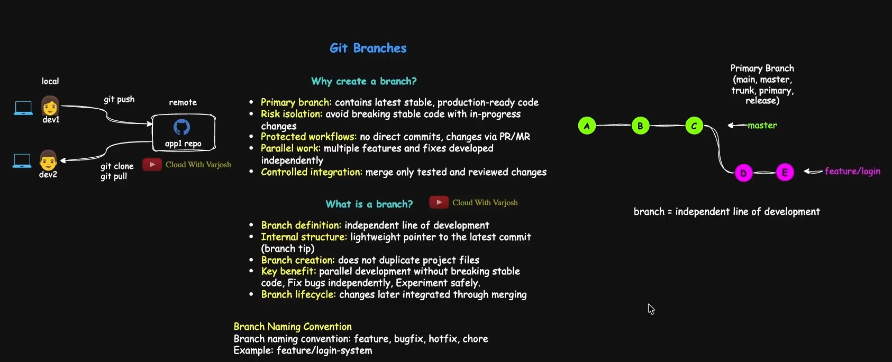

In production there is always a **primary branch**, plus short-lived branches for each piece of work. Common names for the primary branch: **`main`**, `trunk`, `primary`, `release` (and `master`, the old Git default).

> [!NOTE]
> The instructor's point: you'll rarely see `master` in new production repos. Most teams and GitHub now use **`main`**. (`master` isn't technically deprecated in Git, but `main` is the modern convention.) We use `master` in the demos only because it's Git's default.

Whenever you **develop a feature, fix a bug or change anything**, you create a **new branch**. Why:

| Reason | Meaning |
|---|---|
| **Primary branch stays releasable** | It contains the **latest stable, production-ready code**. You never want half-finished work in it. |
| **Risk isolation** | In-progress changes can't break stable code |
| **Protected workflows** | **No direct commits or pushes to the primary branch.** Changes arrive only via **PR / MR** |
| **Parallel work** | Many features and fixes are developed independently, at the same time |
| **Controlled integration** | Merge **only tested and reviewed** changes |

### 1.1 The production workflow (PR / MR)

```text
developer ──► push to feature/login ──► CI/CD runs tests, deploys to dev ──► works?
                                                                           │
          ┌──────────── no: fix and push again ◄───────────────────────────┤
          │                                                                │ yes
          ▼                                                                ▼
     (same branch)                          raise a PR / MR ──► senior reviews ──► approved?
                                                                   │ no → fix, push, re-review
                                                                   ▼ yes
                                                    merge feature/login → main
```

- **PR** (Pull Request) on GitHub = **MR** (Merge Request) on GitLab: **the same thing**.
- The primary branch is **protected**: `git push` straight to `main` is **disallowed**.
- If tests fail or the reviewer finds a problem, the developer fixes it on the **same feature branch** and the PR gets reviewed again.

> [!NOTE]
> **For infra people:** a protected main branch + PR is a **change-approval board for code**. Nobody edits production directly; changes go through a reviewed, tested request. It's the same reason prod servers are changed only via a pipeline.

## 2. What is a branch?

| Point | Meaning |
|---|---|
| **Definition** | An **independent line of development** |
| **Internal structure** | A **lightweight pointer to the latest commit** (the **branch tip**) |
| **Creation** | **Does not duplicate project files.** It's just a new pointer, so it's instant and cheap |
| **Key benefit** | Parallel development without breaking stable code; fix bugs independently; experiment safely |
| **Lifecycle** | Changes are later **integrated through merging** |

*(Beyond the class: you can see this yourself. `cat .git/refs/heads/master` prints a single commit hash. That's all a branch is: a 41-byte file holding the hash of its tip.)*

> [!TIP]
> **Analogy:** a branch is like a **bookmark** in a book, not a photocopy of the book. Creating ten branches costs almost nothing.

## 3. Branch naming conventions

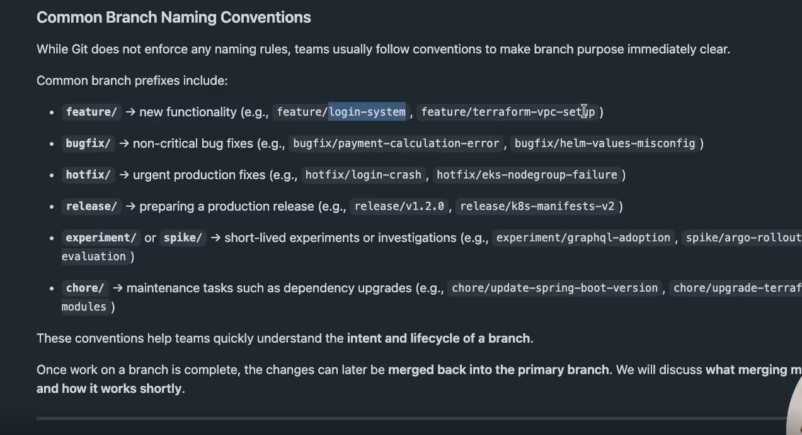

Git doesn't enforce names, but teams use **prefixes** so a branch's purpose is obvious:

| Prefix | For | Examples |
|---|---|---|
| `feature/` | New functionality | `feature/login-system`, `feature/terraform-vpc-setup` |
| `bugfix/` | Non-critical bug fixes | `bugfix/payment-calculation-error`, `bugfix/helm-values-misconfig` |
| `hotfix/` | **Urgent production** fixes | `hotfix/login-crash`, `hotfix/eks-nodegroup-failure` |
| `release/` | Preparing a production release | `release/v1.2.0`, `release/k8s-manifests-v2` |
| `experiment/` or `spike/` | Short-lived experiments or investigations | `experiment/graphql-adoption`, `spike/argo-rollouts-evaluation` |
| `chore/` | Maintenance, dependency upgrades | `chore/update-spring-boot-version`, `chore/upgrade-terraform-modules` |

These conventions make the **intent and lifecycle** of a branch clear. Once the work is done, the branch is **merged back** into the primary branch.

## 4. Atomic development

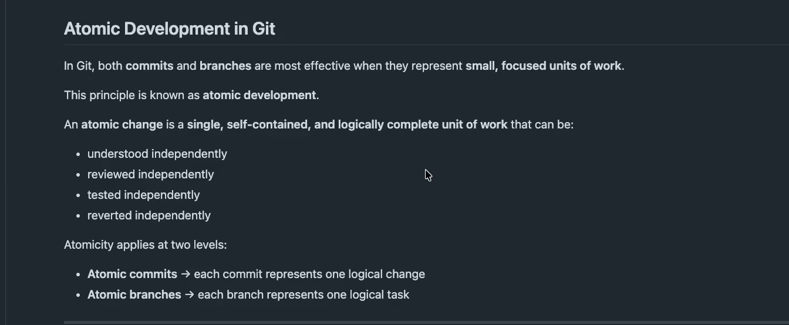

Commits and branches work best when they are **small, focused units of work**. This is **atomic development**. An **atomic change** is a single, self-contained, logically complete unit of work that can be **understood, reviewed, tested and reverted independently**.

Atomicity applies at two levels:

- **Atomic commits:** each commit = **one logical change**. Don't mix several changes in one commit; if something breaks, you won't know which change caused it.
- **Atomic branches:** each branch = **one logical task**. A `feature/login` branch contains only the login feature. Don't fix unrelated bugs or apply hotfixes in it.


> [!IMPORTANT]
> **One branch, one purpose. One commit, one logical change.** Atomic changes make debugging, review and safe rollback much easier.

---

## 5. Visualising branches

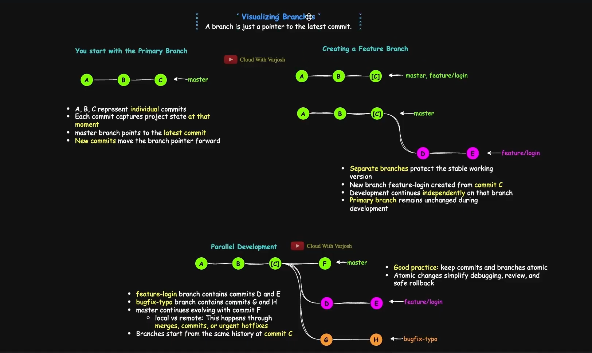

### 5.1 You start with the primary branch

```text
A ── B ── C   ◄── master
```

- A, B, C are individual **commits**. Each one captures the project state at that moment. (Simple example: A adds "My name is Vishal", B adds "He lives in India", C adds "He is a DevOps engineer". In real life, A might add 10 files, B 20, C 5.)
- `master` **points to the latest commit** (C), called the **branch tip**.
- A **new commit moves the pointer forward**: add D and `master` points to D.

### 5.2 Creating a feature branch

```text
A ── B ── [C]   ◄── master, feature/login        (just created: both point to C)

A ── B ── [C]   ◄── master
            └── D ── E   ◄── feature/login       (after 2 commits on the feature branch)
```

- A new branch starts **where it was created from**. Usually that's the latest commit (C), but you can create it from any commit (e.g. from B, then its tip starts at B).
- Each new commit on `feature/login` moves **only that branch's** pointer: C → D → E.
- **`master` stays unchanged** while you work on the feature branch.
- `[C]` in brackets marks the **common ancestor**: the commit both branches share.

### 5.3 Parallel development

```text
A ── B ── [C] ── F            ◄── master
            ├── D ── E        ◄── feature/login
            └── G ── H        ◄── bugfix-typo
```

- `feature/login` has D, E. `bugfix-typo` has G, H. Both started from the **same history at C**.
- `master` keeps evolving (commit F, e.g. from another merge or an urgent hotfix).
- **Good practice:** keep commits and branches atomic.

---

## 6. HEAD and the branch commands (hands-on)

### 6.1 Set up: three commits on master

```bash
git init
echo "application initialized" > app.txt
git add app.txt
git commit -m "chore: initialize application"          # 0e3ffcd (root-commit)

echo "updated aplication header styling" >> app.txt
git commit -m "style: improve application header styling"
# Changes not staged for commit: modified: app.txt
# no changes added to commit (use "git add" and/or "git commit -a")   ← forgot git add!
git add .
git commit -m "style: improve application header styling"   # fcaef20

echo "Added footer section to application" >> app.txt
git add .
git commit -m "feat: add footer section"                # 9aaeab0
git log --oneline
# 9aaeab0 (HEAD -> master) feat: add footer section
# fcaef20 style: improve application header styling
# 0e3ffcd chore: initialize application
```

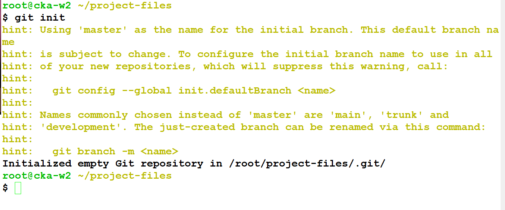

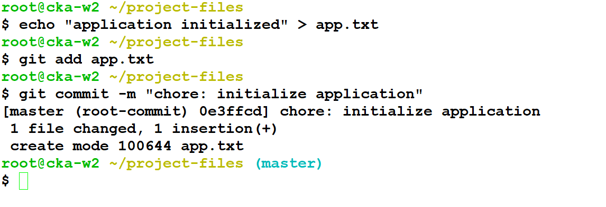

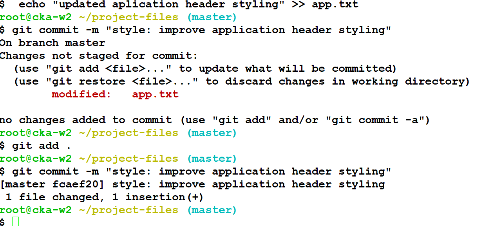

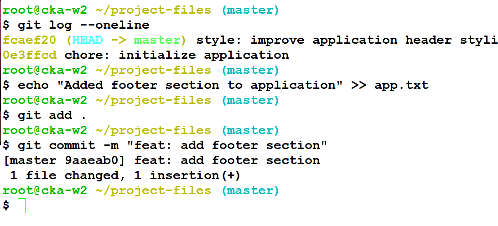

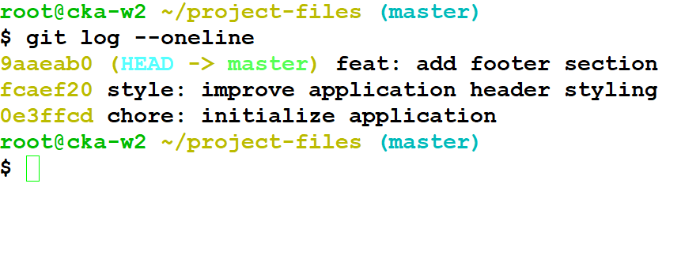

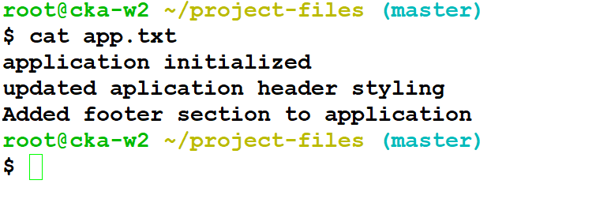

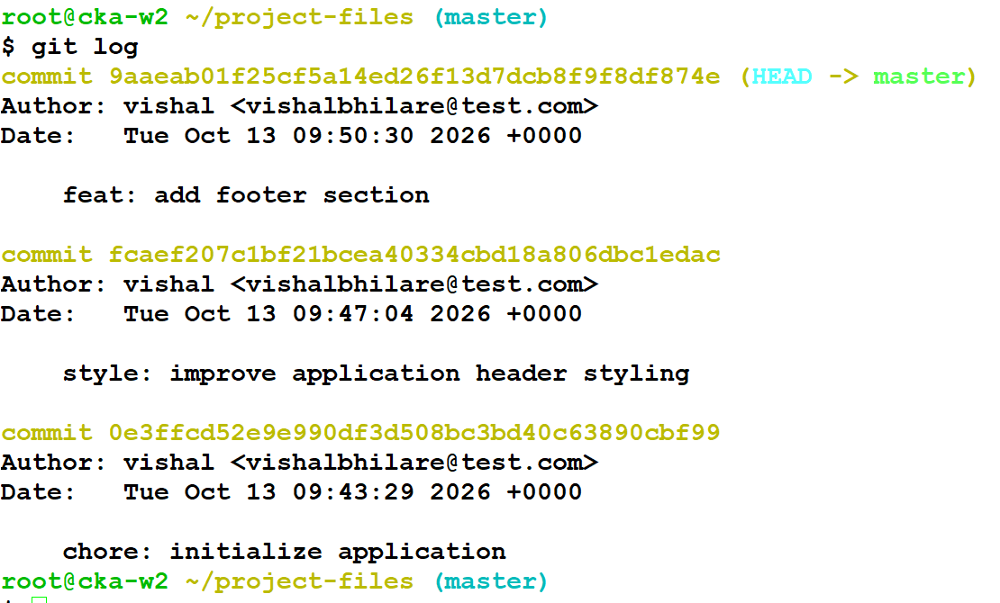

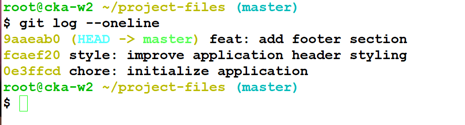

> [!TIP]
> **Lesson from the demo:** `git commit` only commits what's **staged**. Editing a file and committing without `git add` gives "no changes added to commit". (`git commit -a` stages already-tracked modified files automatically.)

### 6.2 What is HEAD?

**HEAD points to the currently checked-out branch** (which points to its latest commit). `HEAD -> master` = "you are on master". There's also a special state called **detached HEAD** (HEAD pointing directly at a commit, not a branch), covered later. About 99% of the time, HEAD points to a branch.

### 6.3 Create and switch: `git branch` + `git checkout`

```bash
git branch feature/login          # create (you stay on master)
git checkout feature/login        # switch → Switched to branch 'feature/login'
git branch                        # list; * marks the current branch
# * feature/login
#   master
```

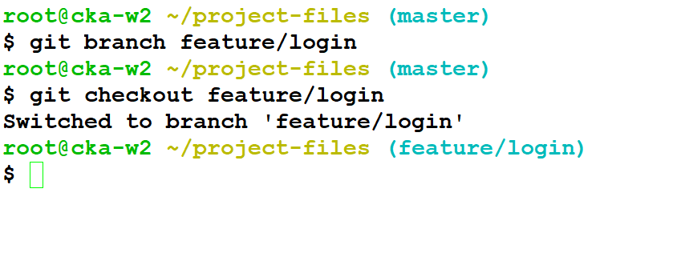

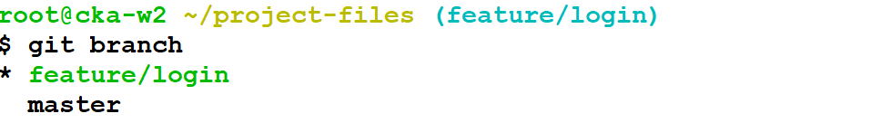

### 6.4 Delete a branch: `git branch -d` (and its catch)

```bash
git branch -d feature/login       # while ON feature/login
# error: cannot delete branch 'feature/login' used by worktree at '/root/project-files'
git checkout master
git branch -d feature/login
# Deleted branch feature/login (was 9aaeab0).
```

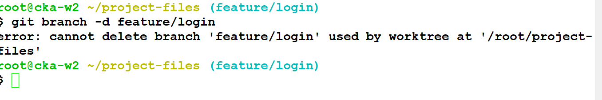

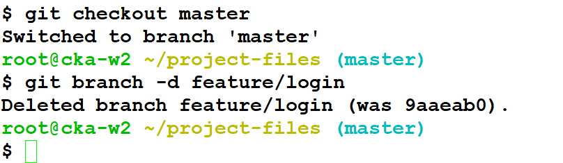

> [!IMPORTANT]
> **You can't delete the branch you're currently on.** Switch away first. Also: `-d` refuses to delete a branch with **unmerged** commits (a safety net); `-D` forces it.

### 6.5 Create and switch in one command: `git checkout -b`

```bash
git checkout -b feature/login
# Switched to a new branch 'feature/login'
git log --oneline
# 9aaeab0 (HEAD -> feature/login, master) feat: add footer section
```

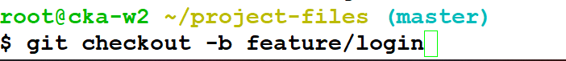

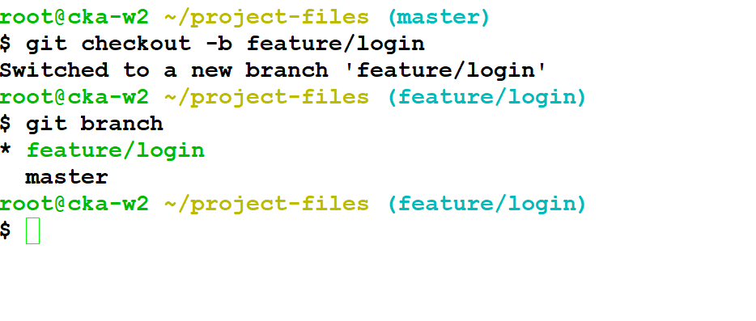

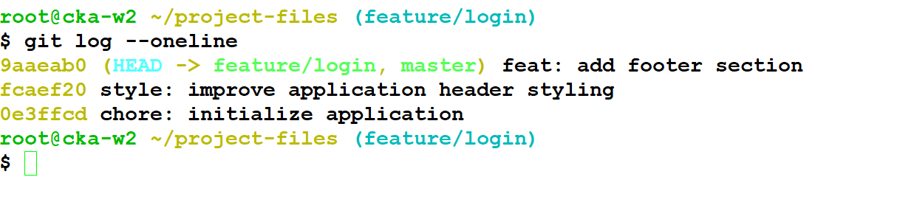

Both branches point to the **same commit** (9aaeab0). Only HEAD moves when you switch:

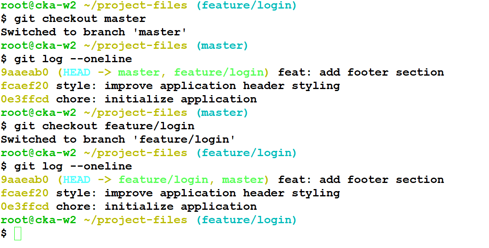

*(Beyond the class: modern Git also has `git switch <branch>` and `git switch -c <branch>`, which do the same as `checkout` / `checkout -b` with a clearer name. `checkout` is still everywhere, so learn both.)*

### 6.6 Branches are independent lines of development

`feature/login` can see `app.txt` because it was created from master's history, which already contained it.

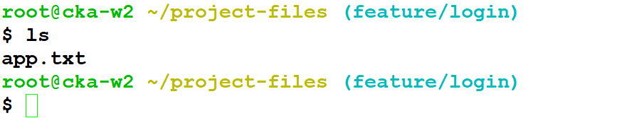

Commit something on the feature branch:

```bash
echo "Login feature implementation started" > login .txt     # ⚠ typo: the space creates a file named "login"
git add .
git commit -m "feat: implement login functionality"          # 13b779a
git log --oneline
# 13b779a (HEAD -> feature/login) feat: implement login functionality
# 9aaeab0 (master) feat: add footer section
```

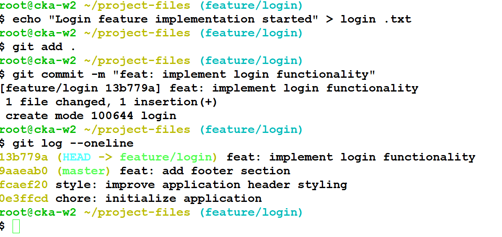

> [!NOTE]
> **A small shell gotcha in the demo:** `> login .txt` (with a space) made the shell write to a file called **`login`**, and `.txt` became part of the echoed text: "Login feature implementation started .txt". Harmless, but a good reminder that the shell parses the command before Git ever sees it.

Now switch branches and compare:

```bash
ls                    # on feature/login → app.txt  login
git checkout master
ls                    # on master        → app.txt          (master knows nothing about "login")
```

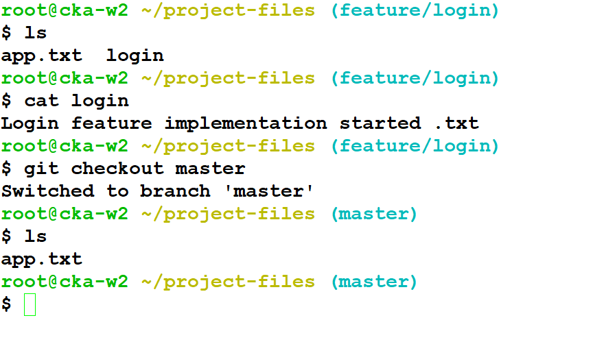

`feature/login` points to the new commit; `master` still points to where the branch was created. **Master doesn't know about the new file until we merge.**

> [!TIP]
> When you `checkout` a branch, Git **rewrites your working directory** to match that branch's tip. Files appear and disappear. Nothing is lost; it's all in the commits.

---

## 7. Git merge

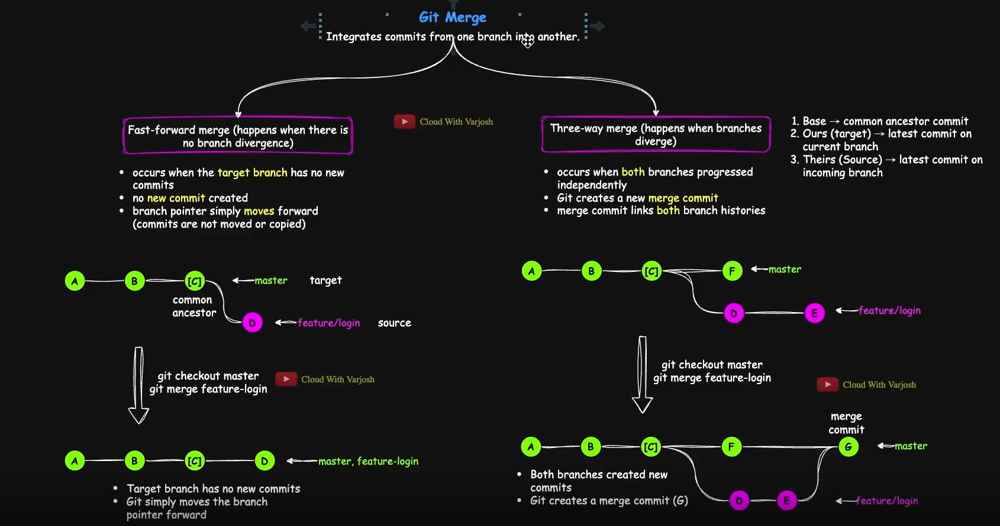

**`git merge` integrates commits from one branch into another.** You run it **from the target branch** (the one receiving the changes):

```bash
git checkout master            # target ("ours")
git merge feature/login        # source ("theirs")
```

Git has several merge strategies (`ort`, `recursive`, `octopus`, `subtree`, `ours`…), but **99.99% of the time** you'll see one of two outcomes: **fast-forward** or **three-way merge**.

### 7.1 Branch divergence

**Branch divergence** = **both** branches got **new commits after their common ancestor**.

- The **common ancestor** (shown in square brackets, `[C]`) is the latest commit shared by both branches.
- Not diverged → fast-forward possible. Diverged → three-way merge.

### 7.2 Fast-forward merge (no divergence)

```text
Before:  A ── B ── [C]   ◄── master        (target: no new commits since C)
                     └── D   ◄── feature/login   (source)

git checkout master && git merge feature/login

After:   A ── B ── [C] ── D   ◄── master, feature/login
```

- Happens when the **target branch has no new commits** since the common ancestor.
- **No new commit is created.**
- Git just **moves the branch pointer forward**. Commits are **not moved or copied**.

**Demo:**

```bash
git checkout master
git merge feature/login
# Updating 9aaeab0..13b779a
# Fast-forward
#  login | 1 +
git log --oneline
# 13b779a (HEAD -> master, feature/login) feat: implement login functionality
```

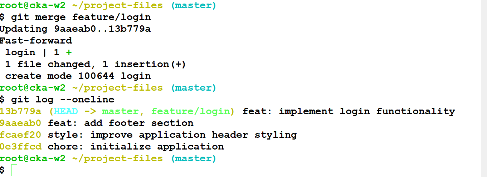

**How do you know a merge happened?** `git log` shows **commits**, and a fast-forward creates **no commit**, so the log looks as if master always had it. Use **`git reflog`**: it records **every move of HEAD** (commits, checkouts, merges):

```bash
git reflog
# 13b779a (HEAD -> master, feature/login) HEAD@{0}: merge feature/login: Fast-forward
# 9aaeab0 HEAD@{1}: checkout: moving from feature/login to master
# 13b779a HEAD@{2}: commit: feat: implement login functionality
# ...
# 0e3ffcd HEAD@{10}: commit (initial): chore: initialize application
```

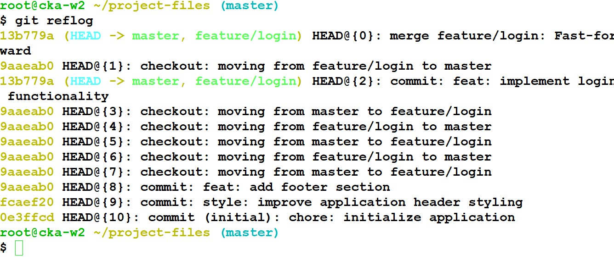

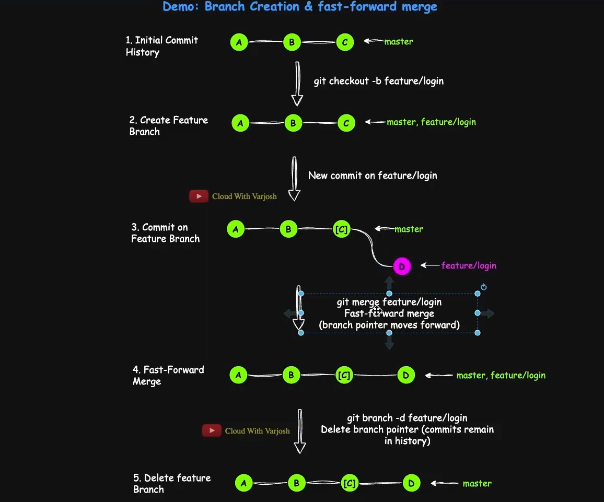

After merging, the feature branch can be deleted with `git branch -d feature/login`. **Deleting a branch only deletes the pointer; the commits stay in history.**

> [!TIP]
> **`git reflog` is your safety net** *(beyond the class)*: deleted a branch or reset by mistake? The commit hashes are still in the reflog (for ~90 days by default) and you can recreate a branch from them.

### 7.3 Creating a branch from an older commit

You can start a branch from **any commit**, not only the tip:

```bash
git checkout -b bugfix/typo 0e3ffcd       # start from the FIRST commit
git log --oneline
# 0e3ffcd (HEAD -> bugfix/typo) chore: initialize application
ls; cat app.txt
# app.txt   →  application initialized   (only the first line: later commits aren't in this branch)
```

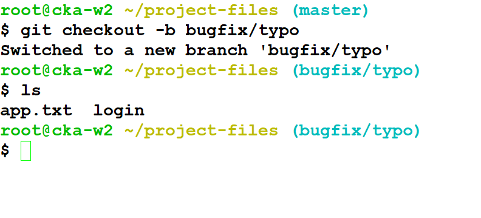

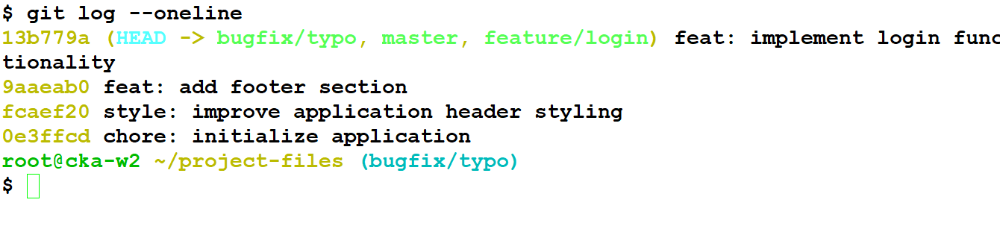

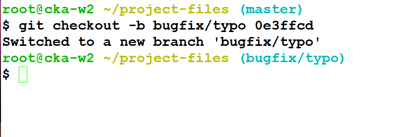

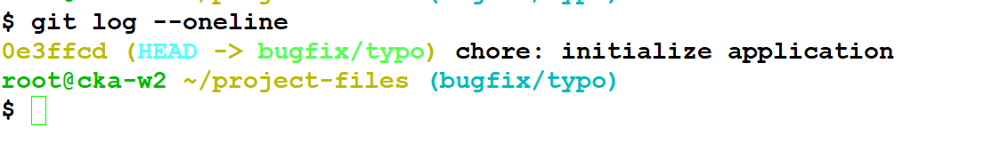

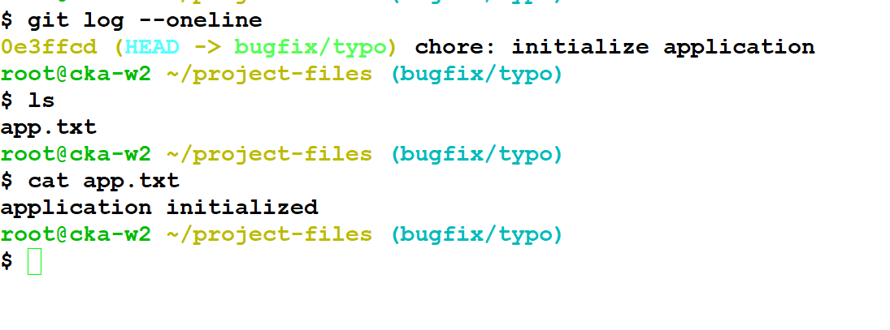

For the next demo the branch was deleted and recreated **from master's tip**:

```bash
git checkout master
git branch -d bugfix/typo              # Deleted branch bugfix/typo (was 0e3ffcd)
git checkout -b bugfix/typo            # now starts at 13b779a
```

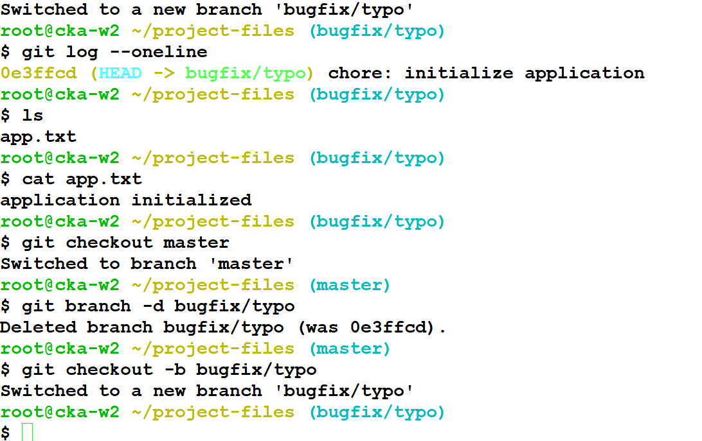

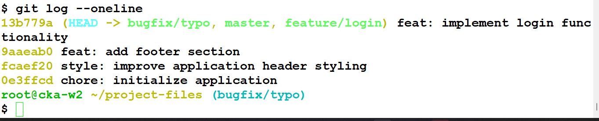

> [!NOTE]
> **Real-world use:** a `hotfix/` branch is often created from the **commit or tag currently running in production** (e.g. `git checkout -b hotfix/login-crash v1.2.0`), not from the latest main, which may contain unreleased work.

### 7.4 Three-way merge (diverged branches)

```text
Before:  A ── B ── C ── [D] ── F   ◄── master          (new commit F)
                          └── E    ◄── bugfix/typo     (new commit E)

git checkout master && git merge bugfix/typo

After:   A ── B ── C ── [D] ── F ── G   ◄── master     (G = merge commit, 2 parents: F and E)
                          └── E ──┘     ◄── bugfix/typo
```

- Happens when **both branches progressed independently**.
- Git creates a **new merge commit**, which **links both branch histories** (it has **two parents**).
- It's called "three-way" because Git compares **three** commits:

| # | Name | Commit |
|---|---|---|
| 1 | **Base** | The **common ancestor** |
| 2 | **Ours** (target) | Latest commit on the **current** branch (master) |
| 3 | **Theirs** (source) | Latest commit on the **incoming** branch (bugfix/typo) |

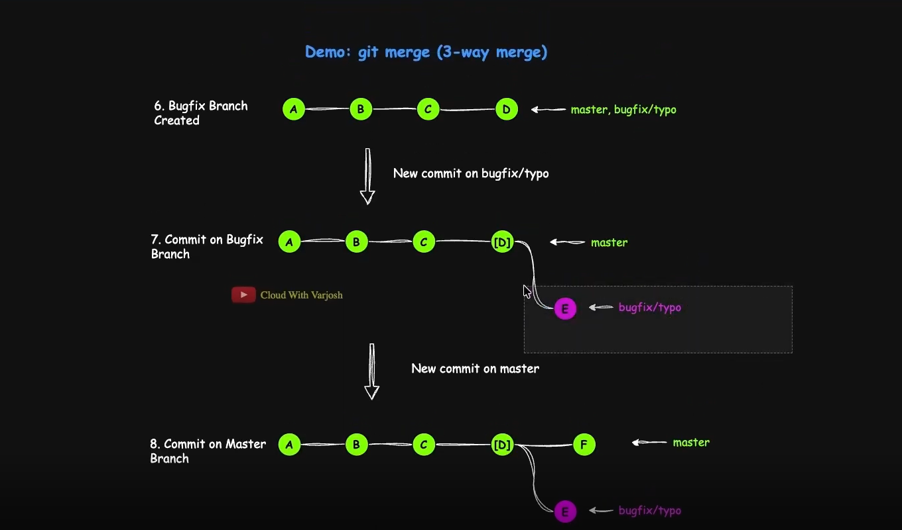

**Demo:**

```bash
# 1. commit on the bugfix branch
echo "corrected typo in footer" > bufix.txt
git add . && git commit -m "fix: correct footer typo"          # 3fc7beb

# 2. meanwhile, a commit on master → now they've diverged
git checkout master
echo "Improved footer spacing" > layout.txt
git add . && git commit -m "style: improve footer spacing"     # d40c83f
```

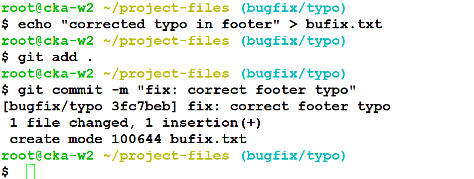

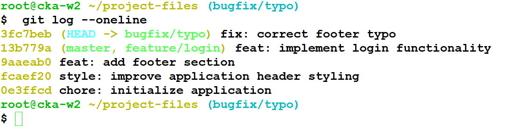

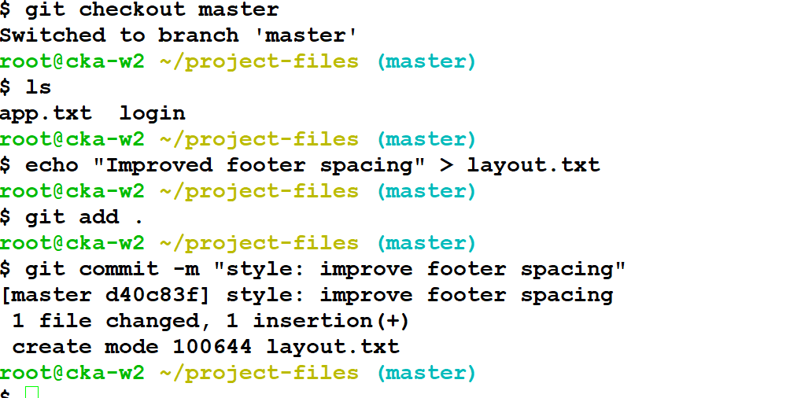

```bash
ls          # master:      app.txt layout.txt login
git checkout bugfix/typo
ls          # bugfix/typo: app.txt bufix.txt login       ← each branch has its own new file
git log --oneline --all      # --all = show every branch, not just the current one
```

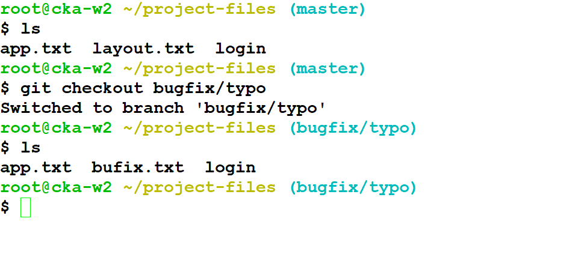

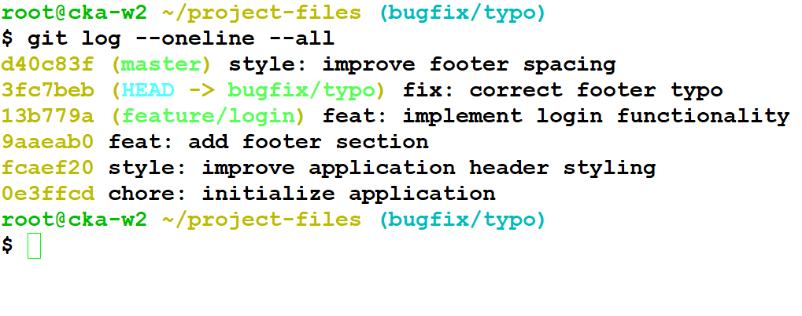

```bash
git checkout master
git merge bugfix/typo -m "merge branch bugfix/typo"
# Merge made by the 'ort' strategy.
#  bufix.txt | 1 +
ls          # app.txt bufix.txt layout.txt login      ← master now has both
git log --oneline
# b18b077 (HEAD -> master) merge branch bugfix/typo    ← the new merge commit
# d40c83f style: improve footer spacing
# 3fc7beb (bugfix/typo) fix: correct footer typo
```

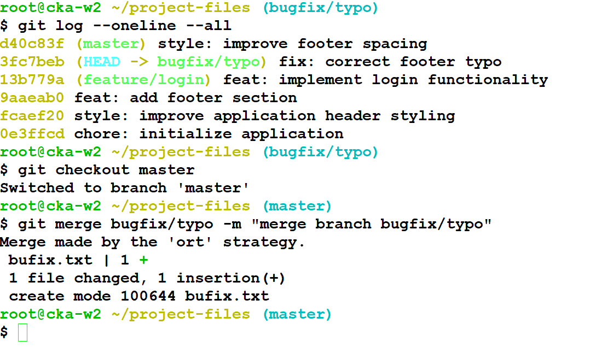

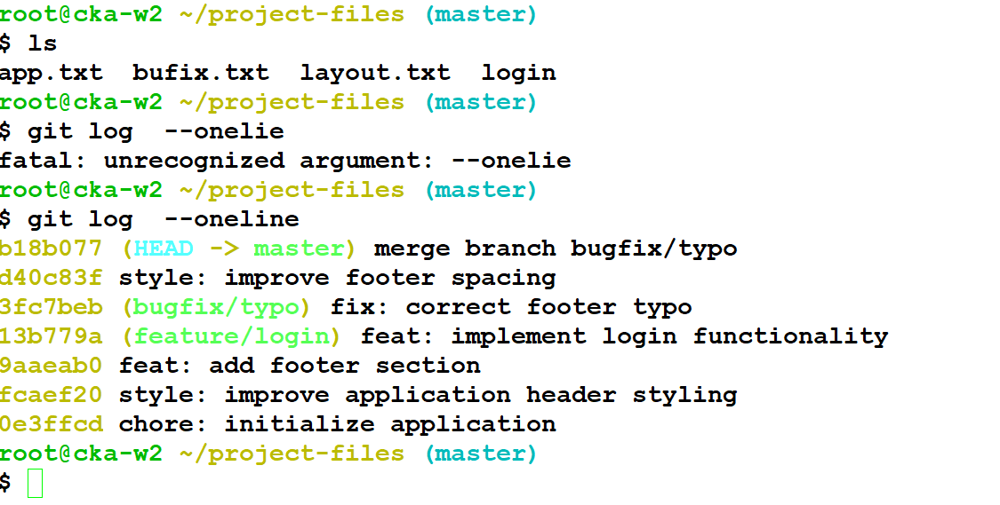

- `-m` gives the merge commit its message (otherwise Git opens an editor).
- **`ort`** is Git's default merge strategy (since Git 2.34; it replaced `recursive`).

### 7.5 Inspecting the merge: `git show` and `--graph`

```bash
git show b18b077
# commit b18b077… (HEAD -> master)
# Merge: d40c83f 3fc7beb          ← TWO parents = it's a merge commit
# Author: vishal <vishalbhilare@test.com>
#     merge branch bugfix/typo

git log --oneline --graph
# *   b18b077 (HEAD -> master) merge branch bugfix/typo
# |\
# | * 3fc7beb (bugfix/typo) fix: correct footer typo
# * | d40c83f style: improve footer spacing
# |/
# * 13b779a (feature/login) feat: implement login functionality
# * 9aaeab0 feat: add footer section
```

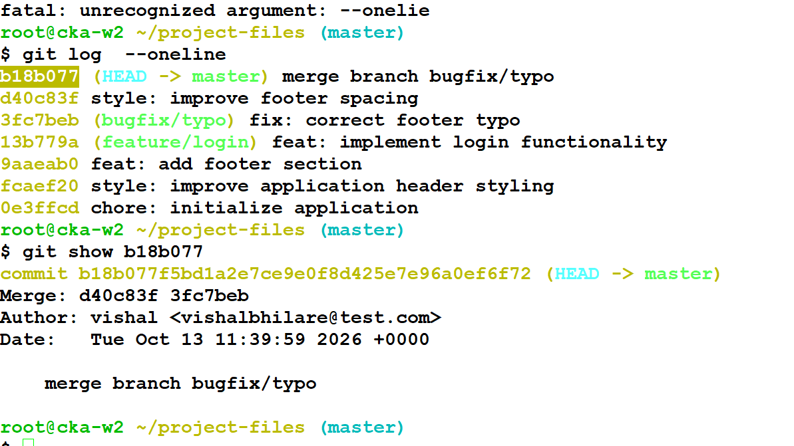

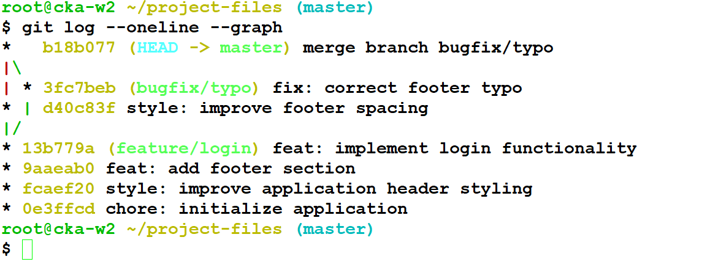

`--graph` draws the history: the two lines split after `13b779a` (the common ancestor) and join again at the merge commit `b18b077`.

### 7.6 Fast-forward vs three-way at a glance

| | **Fast-forward** | **Three-way** |
|---|---|---|
| When | Target has **no new commits** (no divergence) | **Both** branches have new commits (diverged) |
| New commit? | ❌ No, the pointer just moves | ✅ Yes, a **merge commit** with 2 parents |
| History shape | Straight line | A fork and a join |
| Visible in `git log` | No merge entry (use `reflog`) | Yes, the merge commit |
| Git output | `Fast-forward` | `Merge made by the 'ort' strategy.` |

*(Beyond the class: `git merge --no-ff <branch>` forces a merge commit even when fast-forward is possible. Some teams want every feature to show up as a merge in history. `git merge --ff-only` refuses to merge unless it can fast-forward.)*

---

## 8. Putting it together

```text
git checkout -b feature/x       # 1. isolate the work (atomic branch)
...edit... git add . ; git commit -m "feat: ..."   # 2. atomic commits
git checkout main               # 3. go to the target
git merge feature/x             # 4. fast-forward or 3-way
git branch -d feature/x         # 5. clean up the pointer (commits stay)
```

In production, steps 3–4 happen **through a PR/MR on GitHub/GitLab** after review and CI, not on your laptop. (Covered in Part 2 of the course.)

---

## 9. Command reference (this chapter)

### Branches

| Command | Purpose | Example |
|---|---|---|
| `git branch` | List local branches (`*` = current) | `git branch` |
| `git branch <name>` | Create a branch at the current commit (don't switch) | `git branch feature/login` |
| `git checkout <name>` | Switch to a branch (rewrites the working dir) | `git checkout master` |
| `git checkout -b <name>` | **Create + switch** in one step | `git checkout -b feature/login` |
| `git checkout -b <name> <commit>` | Create a branch from a specific commit | `git checkout -b bugfix/typo 0e3ffcd` |
| `git switch <name>` / `git switch -c <name>` *(beyond the class)* | Modern switch / create + switch | `git switch -c feature/login` |
| `git branch -d <name>` | Delete a **merged** branch (not the current one) | `git branch -d feature/login` |
| `git branch -D <name>` *(beyond the class)* | **Force**-delete, even if unmerged ⚠️ | `git branch -D spike/test` |
| `git branch -m <new>` | Rename the current branch | `git branch -m main` |
| `git branch --show-current` | Print the current branch | → `feature/login` |

### Merge

| Command | Purpose | Example |
|---|---|---|
| `git merge <branch>` | Merge `<branch>` into the **current** branch | `git checkout master && git merge feature/login` |
| `git merge <branch> -m "<msg>"` | Merge with a message for the merge commit | `git merge bugfix/typo -m "merge branch bugfix/typo"` |
| `git merge --no-ff <branch>` *(beyond the class)* | Always create a merge commit | |
| `git merge --ff-only <branch>` *(beyond the class)* | Merge only if a fast-forward is possible | |

### Inspect history

| Command | Purpose |
|---|---|
| `git log --oneline` | Compact history of the current branch |
| `git log --oneline --all` | History of **all** branches |
| `git log --oneline --graph` | ASCII graph of branches and merges (add `--all` for every branch) |
| `git show <commit>` | Details of one commit (for merges: `Merge: <parent1> <parent2>`) |
| `git reflog` | Every move of HEAD: commits, checkouts, merges. Shows fast-forwards; recovers "lost" commits |
| `git commit -a -m "<msg>"` *(beyond the class)* | Stage all **tracked** modified files and commit |

---

## Interview quick answers

1. **"What is a branch in Git?"** A lightweight movable pointer to a commit (the branch tip), i.e. an independent line of development. Creating one copies no files; it's just a reference in `.git/refs/heads/`.
2. **"Why use branches?"** Keep the primary branch releasable, isolate risk, allow parallel work, and integrate only reviewed and tested changes via PR/MR.
3. **"PR vs MR?"** The same thing: Pull Request (GitHub, Bitbucket) = Merge Request (GitLab). A request to merge a branch, with review and CI checks.
4. **"What is a protected branch?"** A branch (usually main) where direct pushes are blocked; changes must come through an approved PR with passing checks.
5. **"What is HEAD?"** A pointer to the currently checked-out branch (and through it, the current commit). Detached HEAD = pointing directly at a commit.
6. **"Fast-forward vs three-way merge?"** Fast-forward: the target has no new commits, so the pointer just moves and no commit is created. Three-way: both branches diverged, so Git compares base + ours + theirs and creates a merge commit with two parents.
7. **"What is a common ancestor / branch divergence?"** The latest commit shared by both branches. Divergence = both branches have new commits after it.
8. **"How do you see a fast-forward merge if no commit is created?"** `git reflog` (it logs every HEAD movement, e.g. `merge feature/login: Fast-forward`).
9. **"How do you identify a merge commit?"** `git show <hash>` shows `Merge: <parent1> <parent2>`; `git log --graph` shows the join.
10. **"Can you delete the branch you're on?"** No. Switch first. `-d` also refuses unmerged branches; `-D` forces it. Deleting a branch deletes the pointer, not the commits.
11. **"What is atomic development?"** One branch = one purpose, one commit = one logical change, so each can be understood, reviewed, tested and reverted independently.
12. **"Branch naming conventions?"** `feature/`, `bugfix/`, `hotfix/`, `release/`, `experiment/` or `spike/`, `chore/`, e.g. `hotfix/eks-nodegroup-failure`.
13. **"Default merge strategy?"** `ort` (Git ≥ 2.34; it replaced `recursive`). Others: octopus (many branches), subtree, ours.

## What's next
- **Merge conflicts:** what they are, why they happen, how to resolve them (demo)
- **Undoing commits:** `git reset` vs `git revert`
