# Chapter 03: Merge Conflicts & Undoing Commits (Reset vs Revert)

*Git track · Chapter 03 · Course: Git Masterclass (Complete Git & GitHub Tutorial), Part 1 · 2026-10-13*

> [!NOTE]
> **What this chapter covers:** why merge conflicts happen, a full conflict demo (green vs blue footer), reading conflict markers, resolving and committing, renaming `master` → `main`, and **undoing commits**: `git reset` (soft / mixed / hard) vs `git revert`, with a mixed-reset demo and recovery via `reflog`.
> **A full command reference is in section 6.** This completes **Part 1** of the course.
> **Next:** Part 2: Git in production (remote repositories, fetch/pull, pull requests, stash).

---

## 1. Why a merge conflict occurs

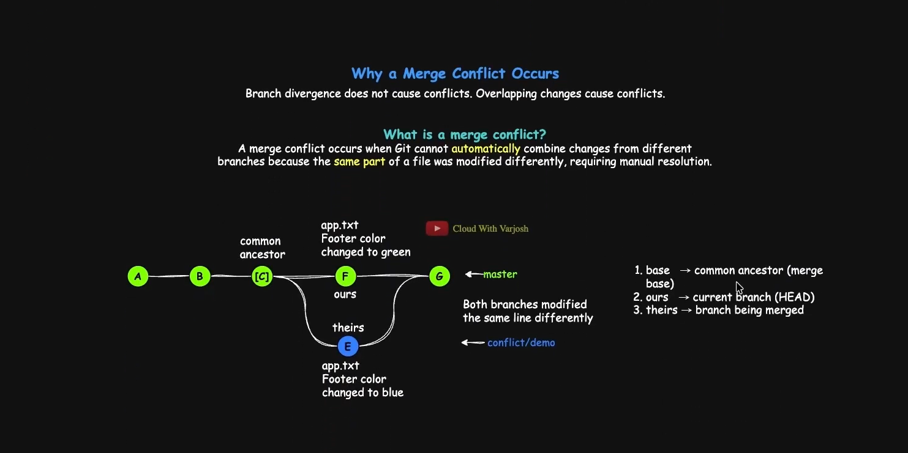

> [!IMPORTANT]
> **Branch divergence does NOT cause conflicts. Overlapping changes cause conflicts.**

A **merge conflict** happens when Git **cannot automatically combine** changes from different branches because the **same part of a file** was modified **differently** in each. Git can't guess which version is right, so it stops and asks a human. **Manual resolution is required.**

Recall the three commits a three-way merge compares (Ch 02 §7.4):

| Name | Commit | In the demo |
|---|---|---|
| **Base** | Common ancestor (merge base) | `b18b077` |
| **Ours** | Current branch (**HEAD**) | `master`: "footer color changed to **green**" |
| **Theirs** | The branch being merged | `conflict/demo`: "footer color changed to **blue**" |

- If only one side changed a line → Git takes that change automatically.
- If both sides changed **different** lines/files → Git combines them automatically (like the bugfix/typo merge in Ch 02).
- If both sides changed **the same line differently** → **conflict**.

> [!NOTE]
> **For infra people:** like two engineers editing the same Terraform variable in two PRs, one sets `instance_type = "t3.medium"`, the other `"t3.large"`. No tool can know which is correct; someone has to decide.

---

## 2. Conflict demo

### 2.1 Set up two branches that change the same line

```bash
git log --oneline                 # master at b18b077 (merge branch bugfix/typo)
git checkout -b conflict/demo
cat app.txt
# application initialized
# updated aplication header styling
# Added footer section to application

echo "footer color changed to blue" >> app.txt          # line 4 on conflict/demo
git add app.txt
git commit -m "style: change footer color to blue"       # 272dbc9
```

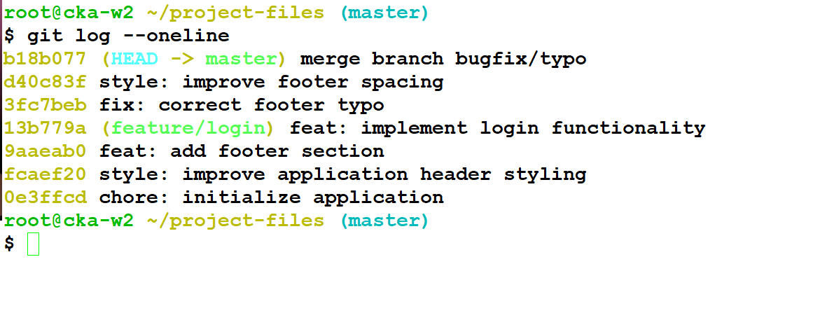

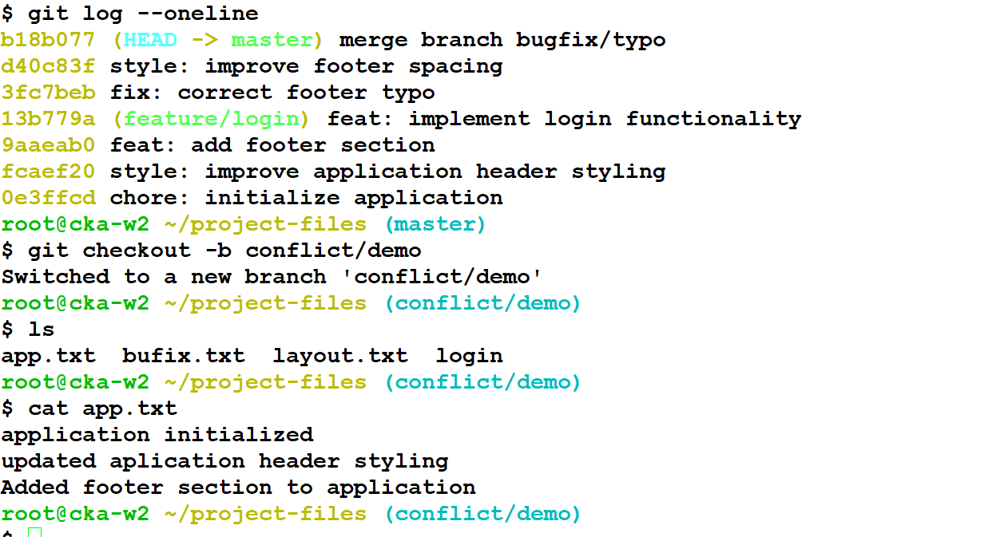

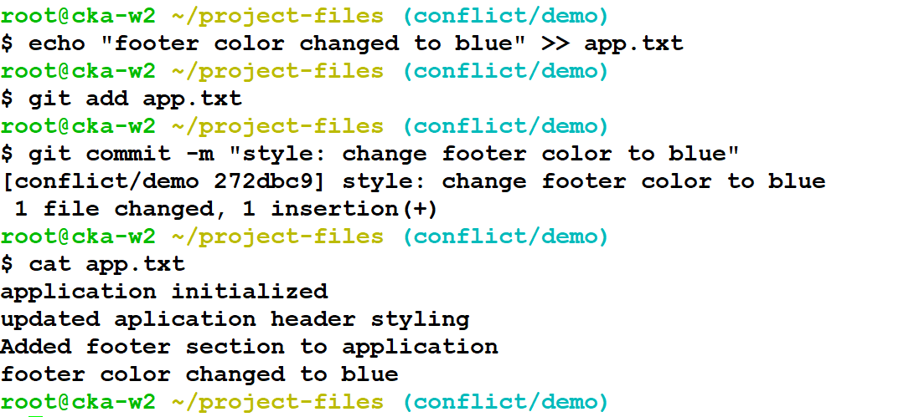

```bash
git checkout master
echo "footer color changed to green" >> app.txt         # line 4 on master
git add app.txt
git commit -m "style: change footer colour to green"     # 7900065
```

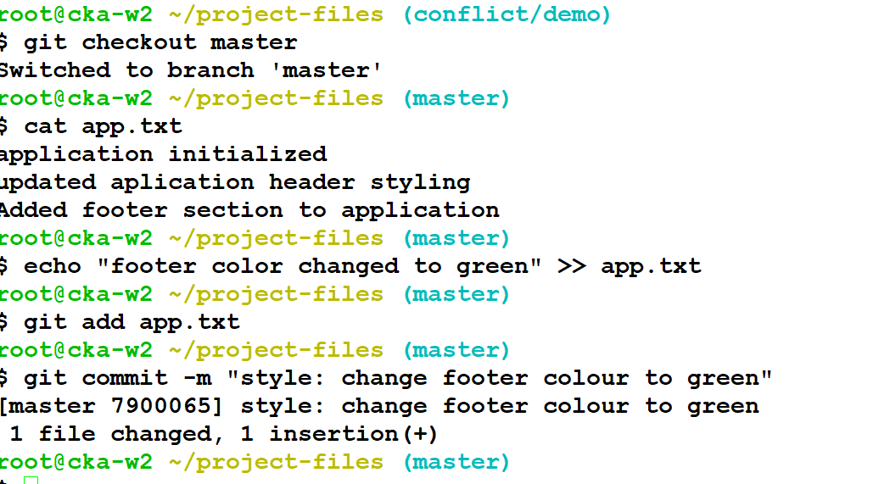

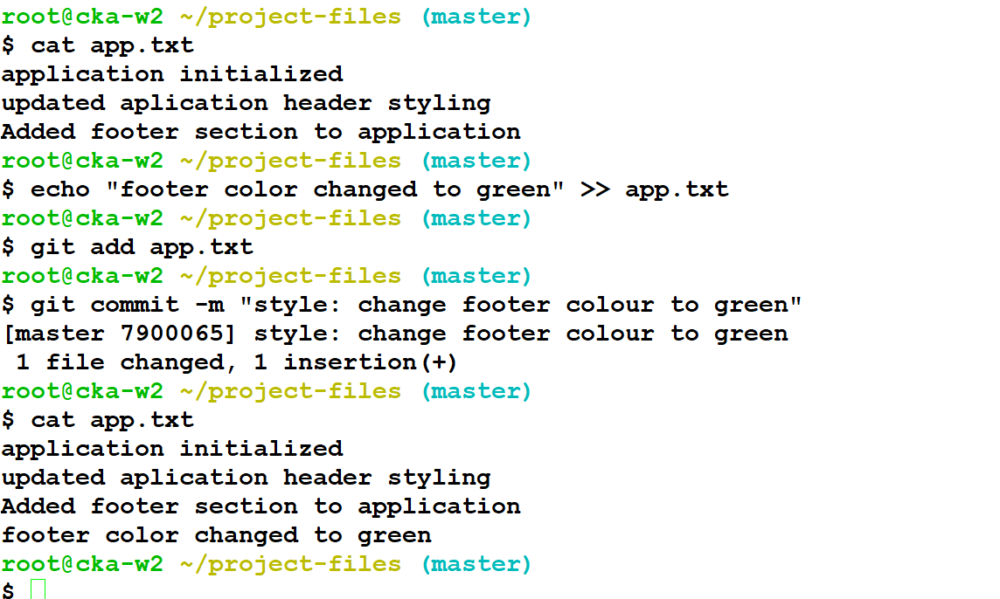

Both branches added a **different line 4** after the same base, so it's an overlapping change.

### 2.2 Merge → CONFLICT

```bash
git merge conflict/demo
# Auto-merging app.txt
# CONFLICT (content): Merge conflict in app.txt
# Automatic merge failed; fix conflicts and then commit the result.
```

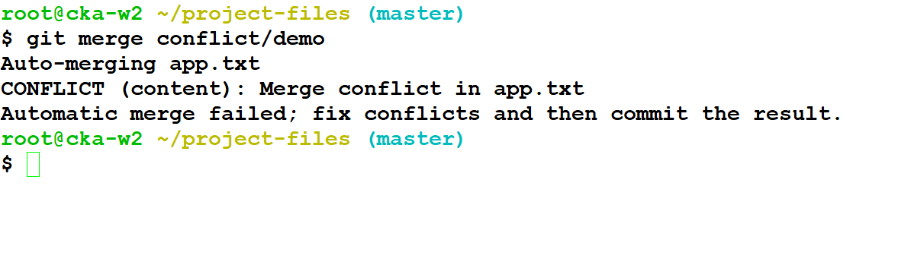

The merge is **paused**. Git writes **both versions** into the file with **conflict markers**:

```text
application initialized
updated aplication header styling
Added footer section to application
<<<<<<< HEAD
footer color changed to green          ← OURS   (master, current branch)
=======
footer color changed to blue           ← THEIRS (conflict/demo, incoming)
>>>>>>> conflict/demo
```

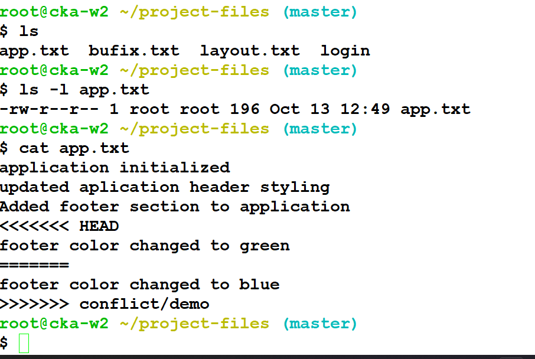

| Marker | Meaning |
|---|---|
| `<<<<<<< HEAD` | Start of **our** version (current branch) |
| `=======` | Divider |
| `>>>>>>> conflict/demo` | End of **their** version (incoming branch) |

### 2.3 Resolve → add → commit

1. **Open the file and decide** the final content: keep green, keep blue, keep both, or write something new.
2. **Delete all three marker lines.**
3. `git add <file>`: this tells Git "this file is resolved".
4. `git commit`: finishes the merge (Git pre-fills the message `Merge branch 'conflict/demo'`).

```bash
vim app.txt                 # e.g. keep "footer color changed to blue", remove the markers
git status                  # shows "both modified: app.txt" while unresolved (beyond the class)
git add app.txt
git commit
# [master 09ba6f9] Merge branch 'conflict/demo'
git commit -m "resolve conflict"
# nothing to commit, working tree clean      ← the merge commit already happened
```

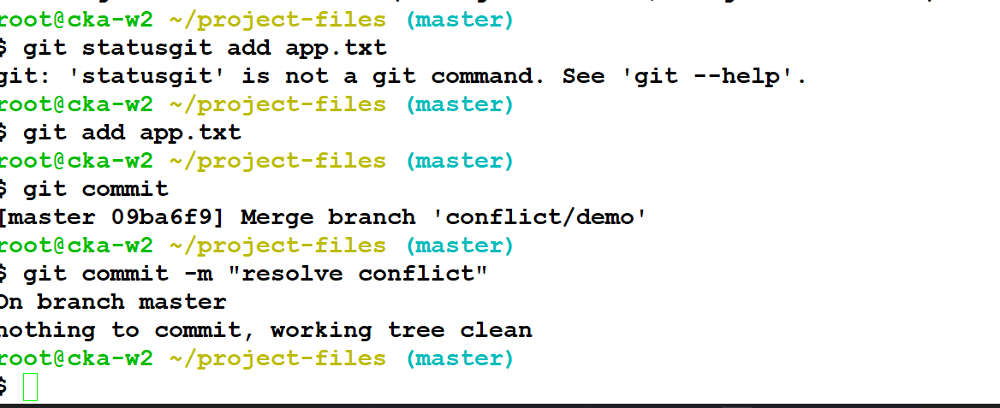

> [!WARNING]
> **Always remove the markers before `git add`.** Git does **not** check the content: if you `git add` a file that still contains `<<<<<<<` / `=======` / `>>>>>>>`, those lines get committed and break the app/config. Check with `grep -n '<<<<<<<\|>>>>>>>' app.txt` *(beyond the class)*. (In the demo screenshot the resolution edit isn't shown, so double-check your own run.)

> [!NOTE]
> Small demo slips: `git statusgit add app.txt` (two commands run together → "statusgit is not a git command"), and the extra `git commit -m "resolve conflict"` after the merge was already committed → "nothing to commit". Harmless.

### 2.4 The result

```bash
git log --oneline --graph
# *   09ba6f9 (HEAD -> master) Merge branch 'conflict/demo'
# |\
# | * 272dbc9 (conflict/demo) style: change footer color to blue
# * | 7900065 style: change footer colour to green
# |/
# *   b18b077 merge branch bugfix/typo
```

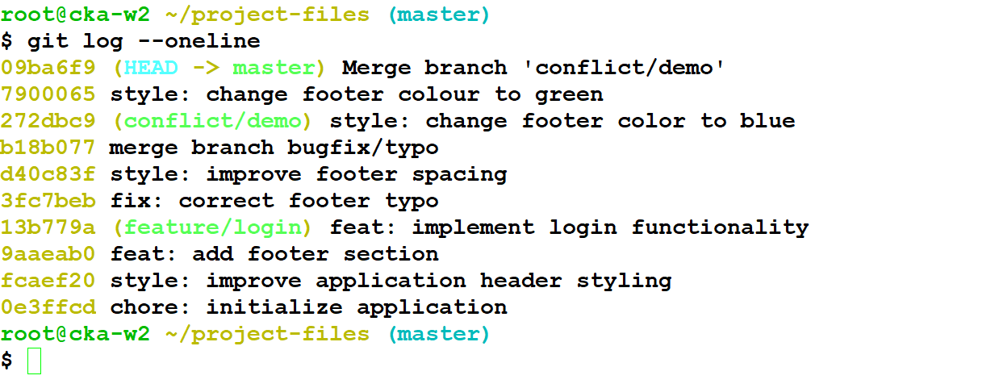

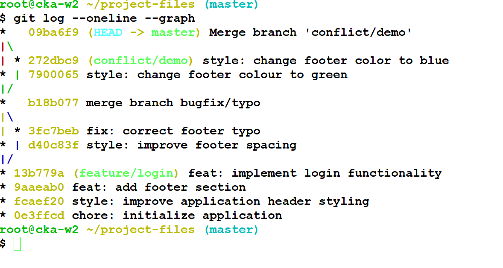

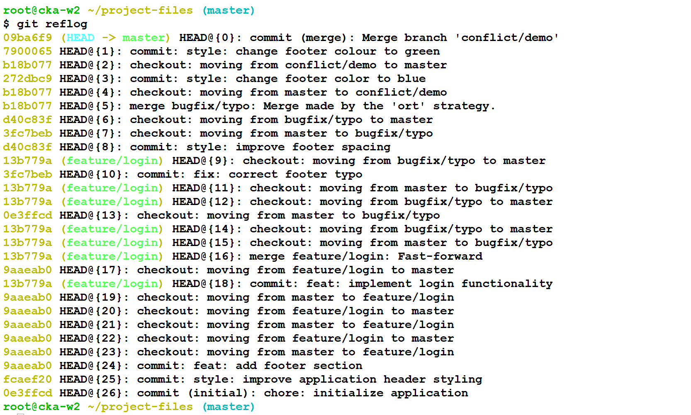

### 2.5 Useful conflict commands *(beyond the class)*

| Command | Use |
|---|---|
| `git merge --abort` | Panic button: cancel the merge and go back to the state before it |
| `git diff` | Show the conflicting hunks |
| `git checkout --ours <file>` / `--theirs <file>` | Take one side's whole version of the file, then `git add` |
| `git mergetool` | Open a visual merge tool (VS Code has "Accept Current / Incoming / Both" buttons) |

**Avoiding conflicts:** small atomic branches, merge `main` into your branch often, short-lived branches, and agreeing who owns which files.

---

## 3. Renaming a branch: `master` → `main`

```bash
git branch -m master main      # git branch -m <old> <new>   (or just -m <new> for the current branch)
```

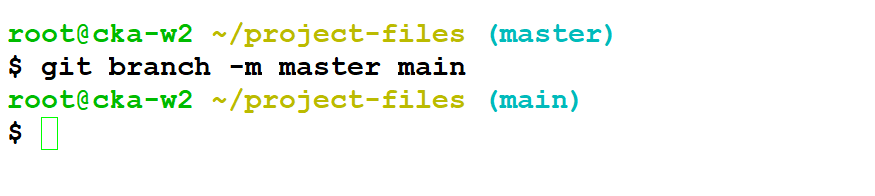

From here on the course uses **`main`**, the modern convention.

---

## 4. Undoing commits: reset vs revert

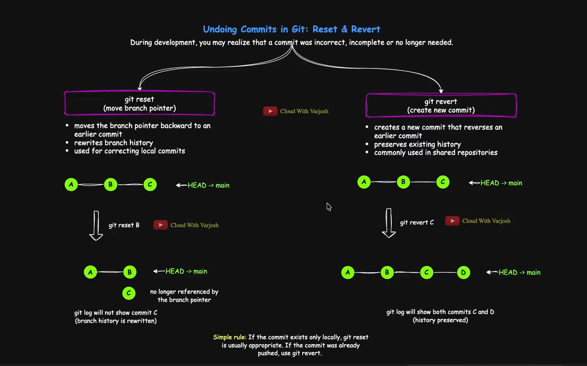

We're human, so sometimes a commit is **incorrect, incomplete or no longer needed**. Git has two ways to undo:

| | **`git reset`** (move the branch pointer) | **`git revert`** (create a new commit) |
|---|---|---|
| What it does | Moves the branch pointer **backward** to an earlier commit | Creates a **new commit that reverses** an earlier commit |
| History | **Rewrites** branch history | **Preserves** existing history |
| Used for | Correcting **local** commits | **Shared** repositories (already pushed) |
| Example | `A─B─C` → `git reset B` → `A─B` (C is no longer referenced by the branch) | `A─B─C` → `git revert C` → `A─B─C─D` (D undoes C) |
| `git log` afterwards | **No C** | **C and D** both visible |

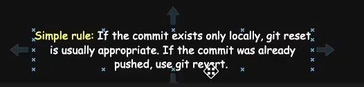

> [!IMPORTANT]
> **Simple rule:** if the commit exists **only locally**, `git reset` is usually appropriate. If the commit was **already pushed**, use **`git revert`**.
> Why: reset rewrites history. If teammates already pulled commit C, removing it from your branch makes histories disagree and forces a force-push. Revert just adds a new commit everyone can pull normally.

> [!NOTE]
> **For infra people:** `reset` = rolling back a VM to a snapshot as if the change never happened, fine on your own dev box. `revert` = applying a new, documented **rollback change** in prod, so the audit trail shows both the bad change and its fix.

### 4.1 Reset demo (mixed, the default)

Fresh repo, three commits:

```bash
echo "farture A" > app.txt;  git add .; git commit -m "feat: add feature A"   # 434db70 (root)
echo "farture B" >> app.txt; git add .; git commit -m "feat: add feature B"   # d516faa
echo "farture c" >> app.txt; git add .; git commit -m "feat: add feature c"   # 522bf5f
git log --oneline
# 522bf5f (HEAD -> master) feat: add feature c
# d516faa feat: add feature B
# 434db70 feat: add feature A
```

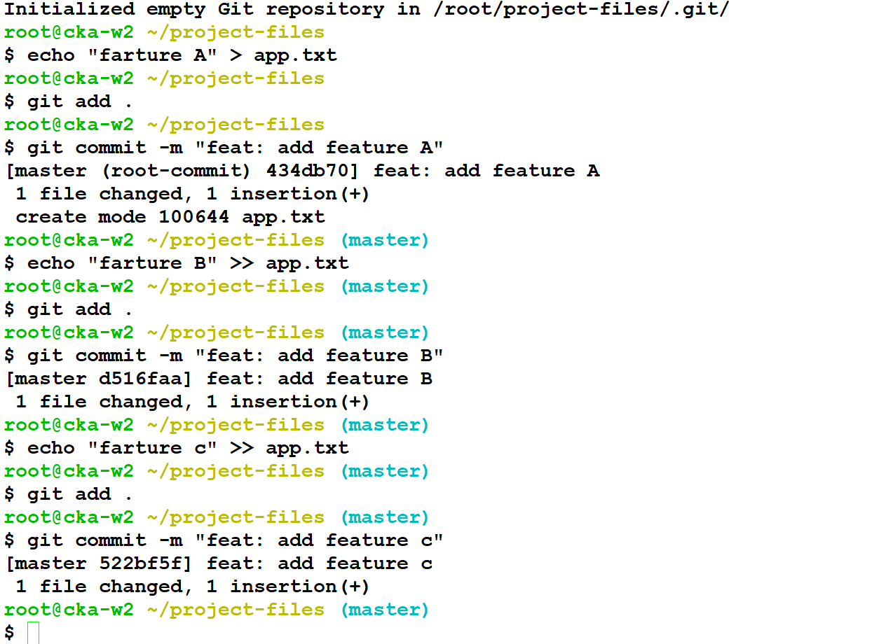

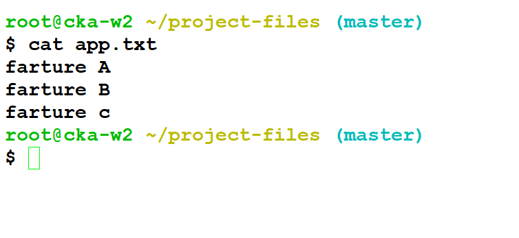

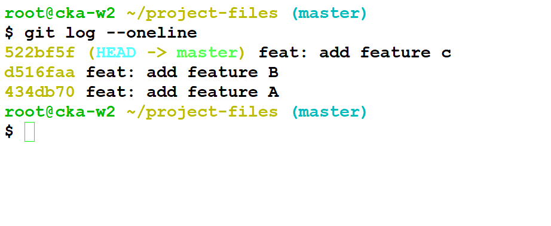

Say commit **c** was a mistake. Reset to B:

```bash
git reset d516faa
# Unstaged changes after reset:
# M       app.txt
git log --oneline
# d516faa (HEAD -> master) feat: add feature B
# 434db70 feat: add feature A                    ← commit c is gone from the branch
git status
# modified: app.txt                              ← but its CHANGE is still in the file, unstaged
```

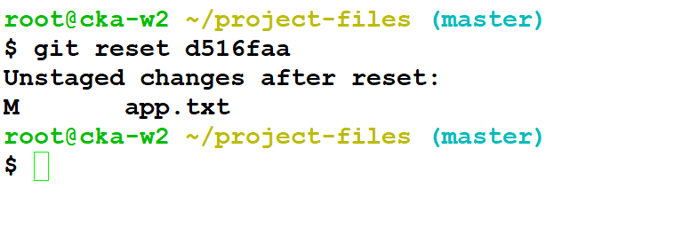

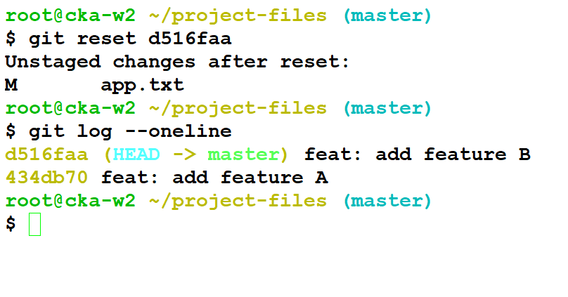

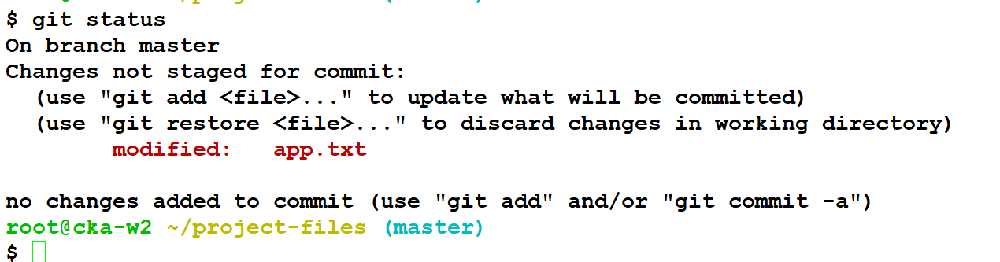

This is a **mixed reset** (the default): the commit is removed from the branch, but **its changes stay in your working directory**, so you can fix them and recommit:

```bash
vim app.txt          # farture c added few more changes
git add app.txt
git commit -m "feat: made few changes"      # 7b015bd
git log --oneline
# 7b015bd (HEAD -> master) feat: made few changes
# d516faa feat: add feature B
# 434db70 feat: add feature A
```

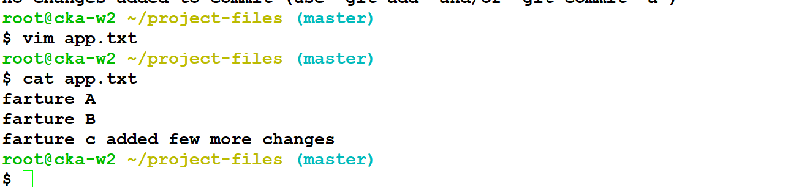

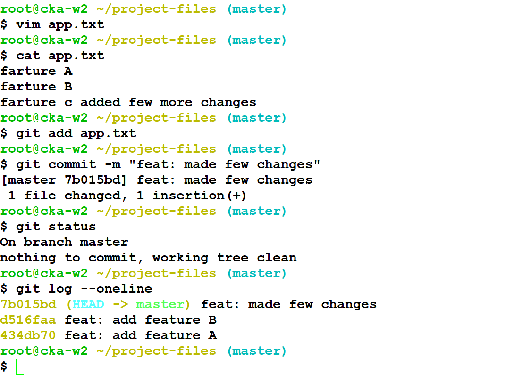

**Was commit c deleted?** No. `git reflog` still shows it:

```bash
git reflog
# 7b015bd HEAD@{0}: commit: feat: made few changes
# d516faa HEAD@{1}: reset: moving to d516faa
# 522bf5f HEAD@{2}: commit: feat: add feature c        ← still here, recoverable
```

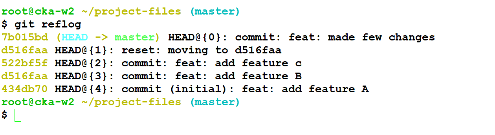

### 4.2 The three types of reset

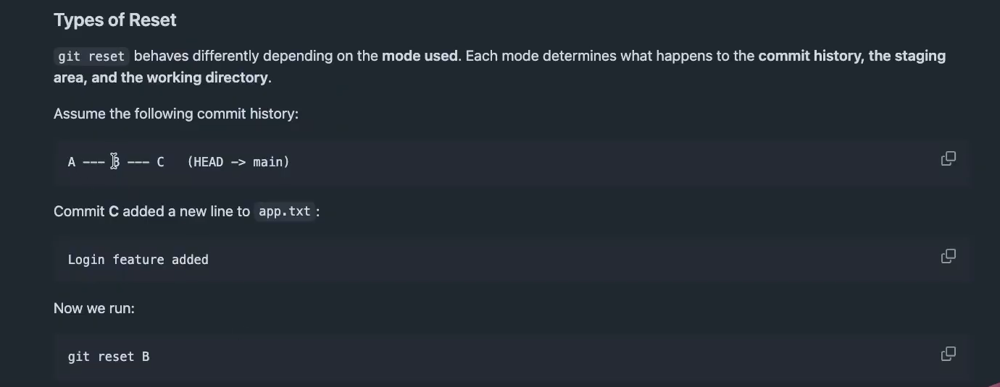

History `A ─── B ─── C (HEAD -> main)`, commit C added the line "Login feature added". Run `git reset <mode> B`:

| Reset type | What happens | Example (`app.txt`) | Typical next action |
|---|---|---|---|
| `--soft` | Branch moves back; **changes remain staged** | C is gone from history, but "Login feature added" is still **staged** | **Recommit immediately**, e.g. with a corrected commit message |
| `--mixed` **(default)** | Branch moves back; **changes become unstaged** | C is gone, the line remains as an **unstaged** change | Edit if needed → `git add` → commit again *(our demo)* |
| `--hard` ⚠️ | Branch moves back; **changes are removed from the working directory** | C is gone **and** the line is removed from `app.txt` | Start fresh → make changes → stage → commit |

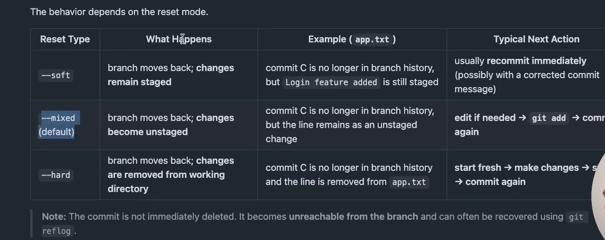

```text
              branch pointer   staging area   working directory
--soft             moved          kept             kept
--mixed            moved          reset            kept
--hard             moved          reset            RESET (edits lost)
```

> [!NOTE]
> **The commit is not immediately deleted.** It becomes **unreachable from the branch** and can usually be recovered with `git reflog` (`git reset --hard 522bf5f` or `git branch rescue 522bf5f`) until Git garbage-collects it (~90 days by default).

> [!WARNING]
> `--hard` throws away **uncommitted** edits in your working directory. Those were never committed, so **reflog cannot bring them back**. Run `git status` / `git stash` first.

**When to use which:**
- Wrong commit **message** or forgot a file → `--soft` (or `git commit --amend`, *beyond the class*).
- Want to **rework** the last commit(s) → `--mixed` (default).
- Want to **completely throw away** local commits → `--hard`.

### 4.3 `git revert` (the safe undo for shared history)

The class covered revert in concept (the demo is planned with the production/remote module):

```bash
git revert <commit>          # creates a NEW commit that applies the opposite of <commit>
# opens an editor with: Revert "feat: add feature c"
git revert --no-edit <commit>   # beyond the class: accept the default message
```

```text
A ── B ── C ── D        D = "Revert C"; C stays in history, its effect is undone
```

- Safe after `git push`: nobody's history is rewritten; teammates just pull D.
- Can conflict just like a merge if later commits touched the same lines → resolve the same way (§2.3), then `git revert --continue`.

---

## 5. Part 1 recap

```text
init → add → commit → branch → merge (FF / 3-way) → conflicts → reset / revert
```

| Situation | Command |
|---|---|
| Same line changed on two branches | Resolve markers → `git add` → `git commit` (or `git merge --abort`) |
| Undo a **local** commit, keep the work | `git reset <commit>` (mixed) |
| Fix the last commit's message | `git reset --soft HEAD~1` + recommit, or `git commit --amend` |
| Throw away local commits entirely | `git reset --hard <commit>` ⚠️ |
| Undo a **pushed** commit | `git revert <commit>` |
| "I lost a commit!" | `git reflog` → `git branch rescue <hash>` |

---

## 6. Command reference (this chapter)

| Command | Purpose | Example |
|---|---|---|
| `git merge <branch>` | Merge; may stop with `CONFLICT` | `git merge conflict/demo` |
| `git status` | Shows conflicted files (`both modified`) during a merge | |
| *(edit file)* | Remove `<<<<<<<`, `=======`, `>>>>>>>` and keep the right content | `vim app.txt` |
| `git add <file>` | Mark a conflict as resolved | `git add app.txt` |
| `git commit` | Complete the merge (default message `Merge branch '…'`) | |
| `git merge --abort` *(beyond)* | Cancel the merge, restore the pre-merge state | |
| `git checkout --ours/--theirs <file>` *(beyond)* | Take one side wholesale | `git checkout --theirs app.txt` |
| `git branch -m <old> <new>` | Rename a branch | `git branch -m master main` |
| `git reset <commit>` | **Mixed** (default): move branch back, changes unstaged | `git reset d516faa` |
| `git reset --soft <commit>` | Move branch back, changes stay **staged** | `git reset --soft HEAD~1` |
| `git reset --hard <commit>` ⚠️ | Move branch back, **discard** changes | `git reset --hard d516faa` |
| `HEAD~1`, `HEAD~2` *(beyond)* | "1 / 2 commits before HEAD" (no hash needed) | `git reset HEAD~1` |
| `git revert <commit>` | New commit that undoes `<commit>`; safe for pushed history | `git revert 522bf5f` |
| `git commit --amend` *(beyond)* | Replace the last (local) commit, e.g. fix its message | `git commit --amend -m "fix: …"` |
| `git reflog` | Find "lost" commits after reset | `git reflog` |

---

## Interview quick answers

1. **"When does a merge conflict happen?"** When both branches changed the **same part of the same file** differently since the merge base. Divergence alone doesn't cause conflicts; overlapping changes do.
2. **"How do you resolve a conflict?"** Open the file, choose the final content between `<<<<<<< HEAD` (ours) / `=======` / `>>>>>>> branch` (theirs), delete the markers, `git add`, then `git commit`. Or `git merge --abort` to cancel.
3. **"What are ours and theirs?"** Ours = current branch (HEAD, the target); theirs = the branch being merged in; base = their common ancestor.
4. **"Reset vs revert?"** Reset moves the branch pointer back and rewrites history, for local commits. Revert adds a new commit that undoes an old one and preserves history, for pushed or shared commits.
5. **"Soft vs mixed vs hard reset?"** All move the branch back. Soft keeps changes staged; mixed (default) keeps them unstaged; hard discards them from the working directory.
6. **"Is a reset commit gone forever?"** No. It's unreachable from the branch but still in `git reflog` (until garbage collection), so you can recover it with `git branch <name> <hash>`. Uncommitted work lost by `--hard` is not recoverable.
7. **"Why not reset a pushed commit?"** Others already have it; rewriting history forces a force-push and breaks their clones. Use `git revert`.
8. **"How do you rename master to main?"** `git branch -m master main` (plus updating the remote default branch on GitHub, covered later).
9. **"How do you reduce merge conflicts?"** Small, short-lived atomic branches; merge or rebase from main frequently; clear file ownership; communicate.

## What's next
- **Part 2 (production Git):** remote repositories (types, authentication), `git fetch` vs `git pull`, pull requests and the production PR workflow, `git stash`, and the `git revert` demo on pushed history.
