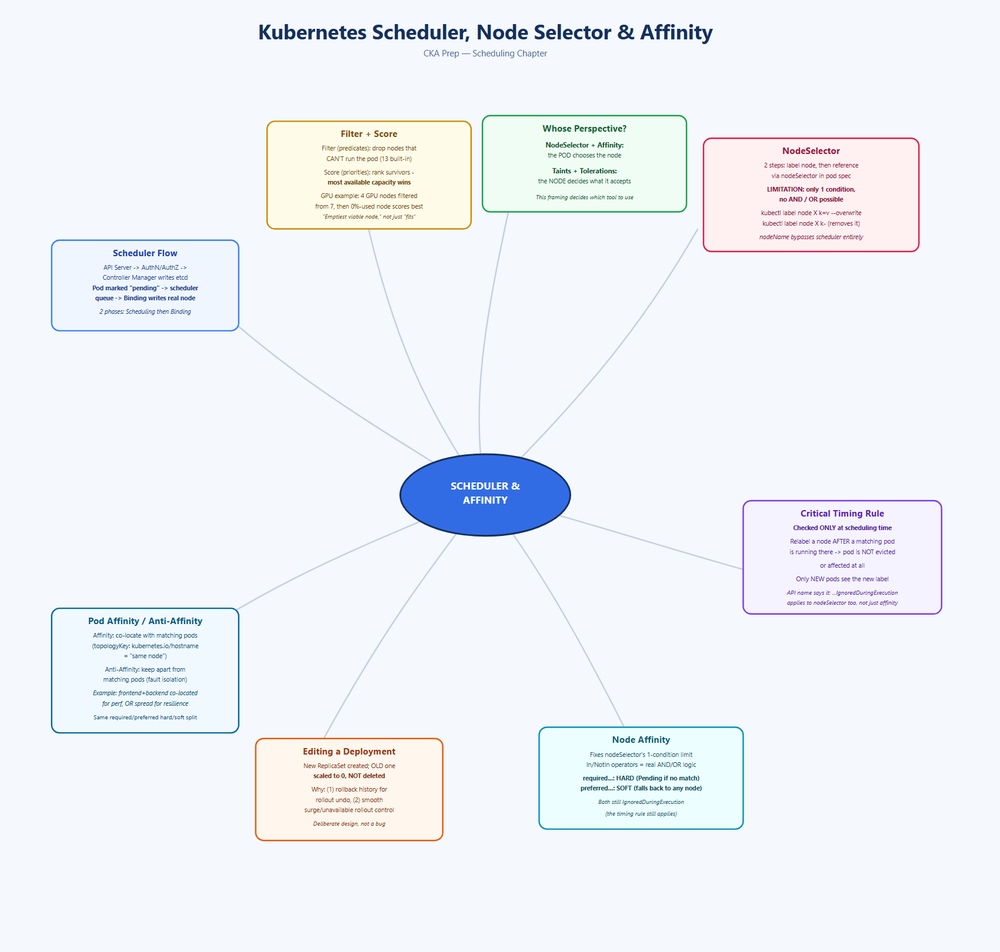
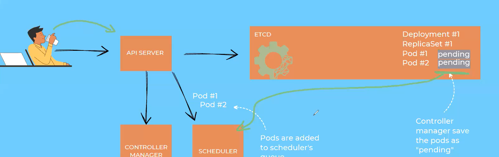
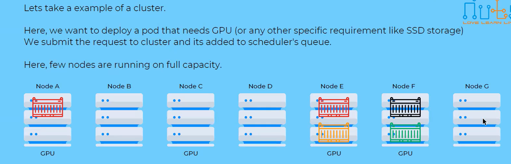
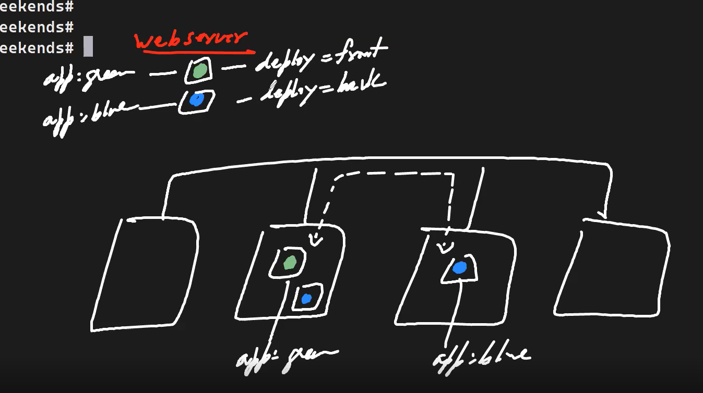

# Topic: Kubernetes Scheduler, Node Selector, Affinity & Anti-Affinity

*(Your notes, cleaned up from dictation + screenshots — this one is core Kubernetes, not ArgoCD)*

## Quick recall: mind map



## The 3 ways to influence scheduling
In Kubernetes, there are three mechanisms to influence where pods land:
1. **Node Selector**
2. **(Node) Affinity / Anti-Affinity**, and **Pod Affinity / Anti-Affinity**
3. **Taints and Tolerations**

Before learning how to *influence* scheduling, first understand how scheduling actually works
without any influence at all.



## How the scheduler works, end to end

### Step 1 — request lands, gets stored as "pending"
```
User (Alok) --submits deployment--> API Server --> Controller Manager --writes--> ETCD
```
- User runs `kubectl create -f deploy-abc.yaml`.
- Request hits the **API Server** — it checks **AuthN/AuthZ** (authentication + authorization)
  first; if valid, the request proceeds.
- The **Controller Manager** creates the Deployment → ReplicaSet → Pod object entries in **ETCD**.
- At this point, the Pods are marked **"pending"** in ETCD — they exist as objects, but aren't
  assigned to any node yet.
- Any pod in the `pending` state is added to the **scheduler's queue**, ready to be assigned.

### Step 2 — the scheduler processes each pending pod in 2 phases
1. **Scheduling Phase** — *"what node should I choose?"* This is where the real decision-making
   happens.
2. **Binding Phase** — *"write to the database (etcd) that this pod belongs to that node."* Once a
   node is chosen, this phase updates the pod's entry in ETCD — instead of `pending`, it now shows
   the actual node name (e.g. `node1`, `node2`).

## Inside the Scheduling Phase: Filtering + Scoring
The Scheduling Phase itself has 2 sub-steps:
1. **Filtering** (aka **predicates**) — remove nodes that flat-out *cannot* run this pod.
2. **Scoring** (aka **priorities**) — rank the *remaining* nodes from best to worst, and pick the
   winner.



### Worked example — deploying a GPU-requiring pod
Cluster: Node A, B, C, D, E, F, G. Nodes A, C, E, F have GPUs. Node A is 50% GPU-utilized, Node C is
0% utilized (fully free), Nodes E and F are 100% utilized (fully occupied).

**#1 — Filter phase:** the scheduler discards every node that doesn't have a GPU at all — Nodes B,
D, and G are eliminated immediately, regardless of anything else about them.

**#2 — Score phase:** among the remaining GPU nodes (A, C, E, F), the scheduler scores by
*available* capacity — fully-utilized nodes score lower. Node A: 50% available. Node C: 100%
available. Nodes E, F: 0% available. **Node C wins** — it has the most resources still available
after accounting for what's already running there.

**The general rule: scoring favors the node with the most resources available *after* the new pod
would run there** — i.e. it looks for the emptiest viable node, not just "any node that fits."

### The default filter phase has 13 built-in predicates
Some common ones: `PodFitsHostPorts`, `PodFitsHost`, `PodFitsResources`, `PodMatchNodeSelector`,
`NoVolumeZoneConflict`, `NoDiskConflict`, `MaxCSIVolumeCount`, `CheckNodeMemPressure`,
`CheckNodePIDPressure`, `CheckNodeDiskPressure`, `CheckNodeCondition`, `PodToleratesNodeTaints`,
`CheckVolumeBinding`. Two worth calling out specifically: `NodeUnScheduleable` (no pod lands on
this node) and `VolumeBinding` (can this node actually bind the requested volume).

**Yes, we can further customize/influence this**, via: `nodeSelector`, `NodeAffinity`,
`Pod Affinity`/`Anti-Affinity`, `Taints and Toleration`, `Topology Constraints`, `Scheduler
Profiles` (scheduler policies available from v1.25+ to customize how filters/predicates assign
nodes to pods).

## Node Selector & Affinity are Pod's perspective; Taints/Tolerations are the Node's perspective
This is the single most important framing to remember:
- **NodeSelector and (Node) Affinity** are declared **on the Pod** — the Pod is choosing which node
  it wants to run on.
- **Taints and Tolerations** are declared **on the Node** — the Node is deciding which pods it's
  willing to accept (covered in more depth separately).

## Node Selector — the simplest mechanism
**2-step process:**
1. **Label the node** (a hardware label or a management/organizational label).
2. **Tell the pod to use that label** via `nodeSelector` in its spec.

### Worked example — hardware labels
| Node | CPU (key: `cpu`) | Disk (key: `disk`) |
|---|---|---|
| A | i7 | sata |
| B | i5 | ssd |
| C | xeon | ssd |
| D | amd | sata |

**Critical convention:** the **key** must stay consistent across your whole cluster (always `cpu`,
never `cpu` on one node and `processor` on another) — only the **value** varies per node.

### Worked example — management labels
| Node | Environment |
|---|---|
| A | prod |
| B | dev |
| C | prod |
| D | test |

### Using it in a Deployment
```yaml
spec:
  template:
    spec:
      nodeSelector:
        cpu: i7
```
The request reaches the API server, which understands this Pod must be scheduled only on a node
labeled `cpu: i7`.

### ⚠️ The critical limitation of nodeSelector
**You cannot express multiple conditions with `nodeSelector`** — no AND, no OR. You get exactly one
key-value match. If two nodes both satisfy that one condition (e.g. two nodes both have
`cpu: i7`), the scheduler falls back to **scoring** to pick between them (the one with more
available resources wins) — filtering alone doesn't fully decide it.

### Managing node labels — the actual commands
```bash
kubectl describe node nodeone
# every node ships with some default labels already, e.g.:
# beta.kubernetes.io/arch=amd64
# beta.kubernetes.io/os=linux
# kubernetes.io/arch=amd64
# kubernetes.io/hostname=nodeone
# kubernetes.io/os=linux

# Add labels
kubectl label node nodeone cpu=i7
kubectl label node nodeone mem=large
kubectl label node nodeone disk=sata
kubectl label node nodeone env=prod

# Change an EXISTING label's value - requires --overwrite or it's rejected
kubectl label node nodeone cpu=i7 --overwrite

# Remove a label entirely - trailing dash after the key, no value
kubectl label node nodeone cpu-
# node/nodeone unlabeled

# See labels as columns across all nodes
kubectl get nodes -L cpu -L disk -L mem -L env
```

### Verifying which node a pod landed on
```bash
kubectl create -f mydep.yaml
kubectl get deploy
kubectl get rs
kubectl get pods -o wide     # shows NODE column directly

kubectl describe pod <pod-name> | grep -A2 "Node-Selectors"
# Node-Selectors:  disk=ssd
```

## Editing a running Deployment — what actually happens to the ReplicaSet
```bash
kubectl edit deployment webapp
```
**Key behavior:** editing a Deployment creates a **brand-new ReplicaSet** to roll out the change —
but the **old ReplicaSet is scaled down to 0 replicas, not deleted**. The object itself persists.

```bash
kubectl get rs
# webapp-788497d9bd   2   2   0   2m43s   <- old RS, about to be scaled down
# webapp-cbf87bdf5    1   1   0   4s      <- new RS, rolling in
# ...moments later...
kubectl get rs
# webapp-788497d9bd   0   0   0   4m42s   <- scaled to 0, but the RS object is still there
# webapp-cbf87bdf5    2   2   2   31s     <- fully rolled in and healthy
```
**This is a deliberate Kubernetes design choice, not a bug**, serving 2 purposes:
1. **Rollback history management** — old ReplicaSets are kept (up to a revision history limit) so
   `kubectl rollout undo` has something to roll back to.
2. **Rollout flow control** — Kubernetes can manage the transition between old and new smoothly
   (e.g. surge/unavailable settings) by scaling one down while scaling the other up, rather than an
   abrupt swap.

## Scheduling directly by hostname/IP — bypassing the scheduler entirely
It's not mandatory to schedule via labels. You can pin a Pod directly to a node using `nodeName`:
```yaml
apiVersion: v1
kind: Pod
metadata:
  name: nnappone
  namespace: learning
  labels: { app: nnappone }
spec:
  nodeName: nodeone.example.com   # this will assign pod to specific node
  containers:
    - name: networknuts-app
      image: lovelearnlinux/webserver:v1
      resources:
        limits: { memory: "500Mi" }
        requests: { memory: "300Mi" }
```
**Important consequence:** when you set `nodeName` directly, **the scheduler is completely bypassed**
— there's no filtering, no scoring, nothing. The pod is assigned to that exact node unconditionally.
`kubectl describe pod` on such a pod shows `Node-Selectors: <none>` — confirming no
selector-based decision was ever made; it went straight there.

## The drawback of nodeSelector → why Affinity/Anti-Affinity exist
NodeSelector's core limitation (no AND/OR, single condition only) is exactly what **Affinity** and
**Anti-Affinity** solve. With affinity rules you *can* express multiple conditions (AND/OR/NOT-style
logic via `matchExpressions` operators like `In`, `NotIn`, etc.) — something plain `nodeSelector`
can never do.

### What "affinity" and "anti-affinity" mean, conceptually
- **Affinity** = "you like/love something" — attract toward a node or pod matching a condition.
- **Anti-Affinity** = "you dislike/hate something" — repel away from a node or pod matching a
  condition.
- Both come in **2 flavors each**: you can express affinity/anti-affinity **toward nodes** (Node
  Affinity/Anti-Affinity) or **toward other pods** (Pod Affinity/Anti-Affinity).

## ⚠️ Critical timing rule: affinity/nodeSelector is only checked AT SCHEDULING TIME
This applies to `nodeSelector` too, not just affinity. **Worked example:**
- Node A: `disk=ssd`, Node B: `disk=sata`, Node C: `disk=ssd`.
- A Deployment's pod spec says `nodeSelector: { disk: sata }` → pod lands on **Node B**.
- Some time later, you relabel Node B to `disk=ssd`.
- **Nothing happens to the already-running pod.** It keeps running on Node B, completely
  unaffected — Kubernetes does **not** re-evaluate or evict already-scheduled pods when labels
  change.
- **Only newly-created pods** from that point on would be affected by the new label — the check
  happens once, at scheduling time, never again during the pod's lifetime.

## Node Affinity

**2-step process** (same shape as nodeSelector): (1) label the node, (2) reference that label via
an affinity rule in the Deployment/Pod YAML — but now with real logical operators available.

```yaml
affinity:
  nodeAffinity:
    requiredDuringSchedulingIgnoredDuringExecution:   # HARD rule
      nodeSelectorTerms:
        - matchExpressions:
            - key: size
              operator: In
              values: [large, medium]
```
```yaml
affinity:
  nodeAffinity:
    requiredDuringSchedulingIgnoredDuringExecution:
      nodeSelectorTerms:
        - matchExpressions:
            - key: mem
              operator: In
              values: [heavy, large]
```

**Required vs. Preferred:**
- **`requiredDuringSchedulingIgnoredDuringExecution`** — a **hard** rule. If no node matches, the
  pod stays `Pending`.
- **`preferredDuringSchedulingIgnoredDuringExecution`** — a **soft** rule. The scheduler tries to
  honor it, but if no node matches, it falls back to scheduling the pod anywhere else that's valid
  rather than leaving it unscheduled. (Example: prefer a node labeled `mem=heavy`, but if none
  exists, still schedule on a node labeled `mem=large` rather than blocking entirely.)

The `IgnoredDuringExecution` part of both keywords is the same timing rule from above, made
explicit in the API name itself: the condition is checked when scheduling happens, and *ignored*
(not re-checked) during the pod's actual execution/lifetime.

## Pod Affinity & Anti-Affinity



**Why this exists — a concrete scenario:** a `webserver` application has a `frontend` deployment
(labeled `app: green`, `deploy: front`) and a `backend` deployment (labeled `app: blue`,
`deploy: back`). Left alone, the scheduler could easily place `frontend` pods on Node B and
`backend` pods on Node C — technically fine, but:
- Cross-node traffic between frontend and backend now goes over the **network**, adding latency.
- If they land on the **same** node instead, they can benefit from shared local resources (lower
  latency, effectively closer proximity) — better performance for tightly-coupled components.

**Pod Affinity** solves exactly this: *"run my pod on whatever node is already running pods
matching this label — I don't need to know which node that is in advance, just that they're
together."*

```yaml
affinity:
  podAffinity:
    requiredDuringSchedulingIgnoredDuringExecution:
      - labelSelector:
          matchExpressions:
            - key: app
              operator: In
              values: [nnappone]
        topologyKey: "kubernetes.io/hostname"
```
`topologyKey: kubernetes.io/hostname` is what actually means "same node" — it groups by hostname,
so "affinity" here specifically means co-locating on the identical physical/VM node.

**Pod Anti-Affinity** is the mirror case: *"don't run my pod on any node that's already running
pods matching this label."* Concrete use: you deliberately do **not** want the `green` (frontend)
pod on the same node as the `blue` (backend) pod — maybe for fault isolation, so a single node
failure can't take out both tiers of the same application at once. With anti-affinity configured,
`green` and `blue` get scheduled onto different nodes even though nothing else in the cluster would
have separated them.

## What I practiced
- Traced a full deployment request end-to-end: API server → AuthN/AuthZ → Controller Manager
  writes to etcd → pod marked `pending` → added to scheduler queue → Scheduling phase (filter +
  score) → Binding phase (etcd updated with the real node name).
- Worked a GPU-node filtering/scoring example by hand, confirming the scheduler picks the node
  with the *most remaining capacity* among viable candidates, not just any viable one.
- Labeled/relabeled/removed labels on real nodes (`kubectl label node ... key=value`,
  `--overwrite`, and the trailing-dash removal syntax) and confirmed changes via
  `kubectl get nodes -L <key>`.
- Deployed a pod with `nodeSelector` and confirmed via `kubectl describe pod` which selector
  actually applied.
- Edited a running Deployment and watched a new ReplicaSet roll in while the old one scaled to 0
  but stayed as an object — confirmed via `kubectl get rs` before and after.
- Deployed a pod using `nodeName` directly and confirmed via `describe pod` that `Node-Selectors`
  showed `<none>` — proof the scheduler was fully bypassed.
- Demonstrated the "checked only at scheduling time" rule directly: relabeled a node hosting an
  already-running nodeSelector-matched pod, and confirmed the pod was completely unaffected.
- Wrote both `required` (hard) and `preferred` (soft) node affinity rules with `In` operator
  `matchExpressions`, and reasoned through what happens when zero nodes match each case.
- Wrote a `podAffinity` rule with `topologyKey: kubernetes.io/hostname` to force pod co-location,
  and reasoned through the mirror-image `podAntiAffinity` case for deliberately spreading two
  related pods across different nodes.

---
*Merged into the master reference notes: [`../k8s-master-notes.md`](../k8s-master-notes.md) §6
(Scheduling & Autoscaling) — new "Scheduler Internals, Node Selector, Node/Pod Affinity" addendum.*
