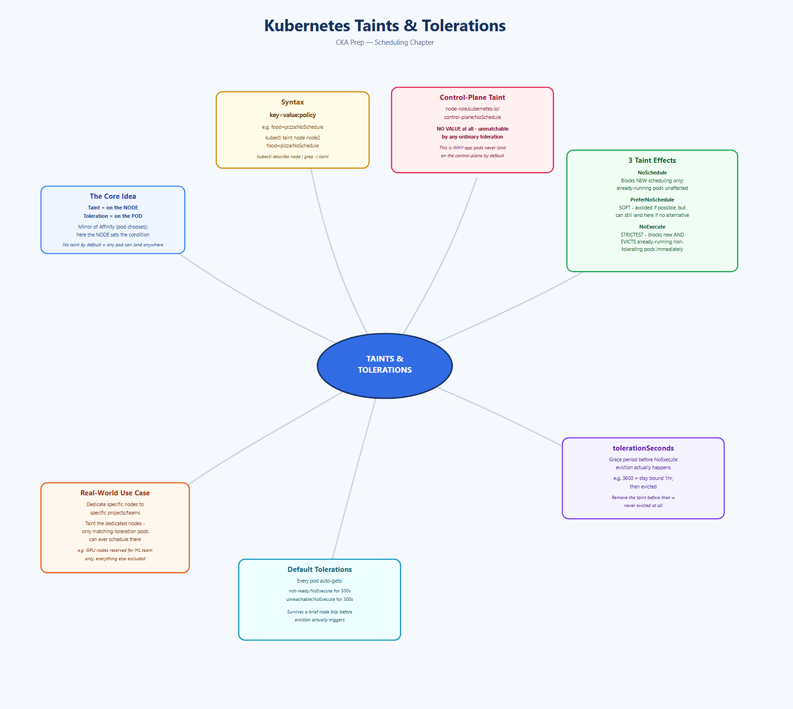
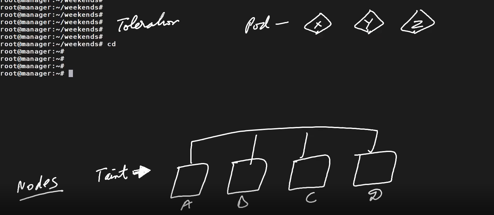
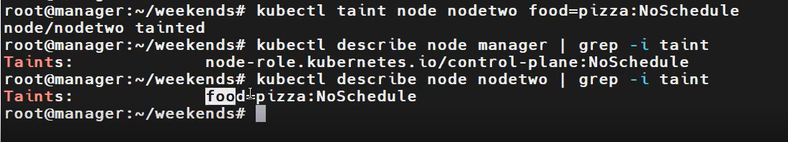
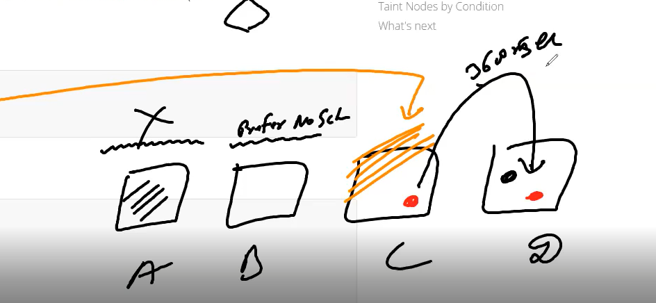

# Topic: Kubernetes Taints and Tolerations

*(Your notes, cleaned up from dictation + screenshots)*

## Quick recall: mind map



## The core idea: nodes reject pods by default rule, not accept them
Taints and Tolerations mean: **nodes accept only certain kinds of pods.**

- **Taint is always applied to a NODE.**
- **Toleration is always applied to a POD.**

This is the mirror image of Node Affinity/NodeSelector (which are the *pod's* perspective, the pod
choosing a node) — here, the **node** is the one setting the condition, and a pod must explicitly
"agree" to it via a toleration to be allowed on.

**Literal meaning as a memory aid:** "taint" literally means a bad smell/contamination. **By
default, no worker node has any taint** — which is exactly why, by default, any pod can be
scheduled onto any worker node. A taint is what a node uses to actively repel pods that don't
explicitly tolerate it.



## Worked example — one taint, one condition
Cluster: worker nodes A, B, C, D. Pods X, Y, Z want to be deployed.

Suppose Node D is configured with a taint: *"I will only run pods that like pizza."*
- When pods X, Y, Z are considered for Node D, Node D effectively asks each one: *"do you like
  pizza?"*
- If a pod **doesn't** carry the matching toleration, it will **not** run on Node D — it gets
  scheduled on A, B, or C instead (nodes without that restriction).
- If a pod **does** carry a toleration for that exact condition, it's allowed to run on D too.

**Second example, same idea:** Node D's condition is *"do you wake up at 5 AM?"* Among X, Y, Z,
only pod Y has a toleration saying "yes, I can wake up at 5 AM." **Only pod Y** can be scheduled
onto Node D — X and Z cannot, because they never declared that toleration.

## Worked example — multiple nodes, multiple taints
- Node A: taint = `red`
- Node B: taint = `blue`
- Node C: taint = `red`
- Node D: taint = `blue`
- Pods X, Y, Z, W want to run somewhere.

**No pod can run on any of these nodes by default** — each must fulfill the specific condition
that node was tainted with. Now suppose:
- Pods X and Y carry a toleration for `blue` → they can run on **Node B or Node D**.
- Pods Z and W carry a toleration for `red` → they can run on **Node A or Node C**.

This is the real-world pattern for **dedicating certain nodes to certain projects/workloads**:
taint the dedicated nodes, and only pods carrying the matching toleration can land there —
everything else is automatically kept off.

## Defining a taint — the syntax
```
taint = key=value:policy
```
Example: `food=pizza:NoSchedule` — key `food`, value `pizza`, policy `NoSchedule`. Meaning: "I will
only run pods that like pizza; any pod that doesn't will not be scheduled here."



### Command to taint a node
```bash
kubectl taint node node2 food=pizza:NoSchedule
# node/node2 tainted

kubectl describe node node2 | grep -i taint
# Taints:   food=pizza:NoSchedule
```

## ⚠️ The manager (control-plane) node's taint — a special case worth understanding
```bash
kubectl describe node manager | grep -i taint
# Taints:   node-role.kubernetes.io/control-plane:NoSchedule
```
Compare this to the `key=value:policy` syntax above — the manager's taint has **no value** at all
(`node-role.kubernetes.io/control-plane` with nothing after the `=`, straight to `:NoSchedule`).
This means the taint condition itself is effectively "undefined"/unmatchable by any normal pod
toleration — **no ordinary pod can ever fulfill it**, which is exactly why regular application
pods never get scheduled onto the control-plane node by default. This is the built-in mechanism
that keeps your cluster's brain free from running arbitrary workloads.

## Adding a toleration to a Pod
```yaml
apiVersion: v1
kind: Pod
metadata:
  name: myapp1
  labels: { app: myapp }
spec:
  containers:
    - name: ngnix-container
      image: nginx
  tolerations:
    - key: "color"
      operator: "Equal"
      value: "pink"
      effect: "NoSchedule"
```
For this pod to actually land on a specific tainted node, the toleration's `key`/`value`/`effect`
must exactly match the taint that node was given.

## Taint effects — 3 policies, different strictness
| Effect | Meaning |
|---|---|
| **NoSchedule** | Hard rule for *new* scheduling — a pod without a matching toleration will never be scheduled here. Pods already running (from before the taint existed) are unaffected. |
| **PreferNoSchedule** | A **soft** limit. The scheduler tries to avoid placing non-tolerating pods here, but if there's genuinely nowhere else to run, it *can* still land here anyway. |
| **NoExecute** | The strictest. Not only blocks new scheduling — it actively **evicts pods already running** on the node if they don't have a matching toleration, the moment the taint is applied. |



### NoExecute in action — the eviction scenario
Suppose Node C has **no taints**, and a pod is already happily running there (naturally, with no
toleration needed, since nothing was blocking it). Now, some time later, you apply a `NoExecute`
taint to Node C. **What happens to that already-running pod?** Since it has no toleration for the
new taint, Kubernetes will **evict it and move it to another machine** — `NoExecute` doesn't just
gate future scheduling, it actively kicks out what's already there.

### `tolerationSeconds` — a grace period before eviction
```yaml
tolerations:
  - key: "key1"
    operator: "Equal"
    value: "value1"
    effect: "NoExecute"
    tolerationSeconds: 3600
```
This means: if this pod is running and a matching `NoExecute` taint gets added to its node, **the
pod stays bound to that node for 3600 seconds**, and only then gets evicted. If the taint is
**removed** before that 3600-second window elapses, the pod is never evicted at all. This is a
built-in grace period to avoid instantly disrupting workloads the moment an operator applies a
disruptive taint.

## Practical examples from the session
```yaml
# A Burstable-QoS pod that tolerates the food=pizza:NoSchedule taint from earlier
apiVersion: v1
kind: Pod
metadata:
  name: burst
spec:
  containers:
    - name: qos-demo-ctr
      image: nginx
      resources:
        limits: { memory: "128Mi", cpu: "100m" }
        requests: { memory: "100Mi", cpu: "50m" }
  tolerations:
    - key: "food"
      operator: "Equal"
      value: "pizza"
      effect: "NoSchedule"
```
```bash
kubectl describe pod burst | grep -A3 "Tolerations"
# Node-Selectors:  <none>
# Tolerations:     food=pizza:NoSchedule
#                  node.kubernetes.io/not-ready:NoExecute op=Exists for 300s
#                  node.kubernetes.io/unreachable:NoExecute op=Exists for 300s
```
Notice the last two default tolerations (`not-ready`/`unreachable`, 300s) — Kubernetes
automatically adds these to every pod so it briefly tolerates a node going not-ready/unreachable
before being evicted, rather than getting yanked instantly on a transient blip.

### Other taint command forms
```bash
kubectl taint nodes node1 key1=value1:NoSchedule
kubectl taint nodes node1 key1=value1:NoExecute
kubectl taint nodes node1 key2=value2:NoSchedule
```

## Why this matters — the real-world use case
**Dedicating specific nodes to specific projects/teams/workloads.** Taint the dedicated
nodes with a project-specific key/value, and only pods explicitly configured with the matching
toleration can ever be scheduled there — everything else in the cluster is automatically excluded,
no accidental cross-contamination of workloads onto machines meant for something else (e.g.
GPU-only nodes reserved strictly for an ML team, or compliance-sensitive nodes reserved for a
specific regulated workload).

## What I practiced
- Tainted a worker node (`kubectl taint node node2 food=pizza:NoSchedule`) and confirmed it via
  `kubectl describe node | grep -i taint`.
- Compared the control-plane node's built-in taint (no value, just
  `node-role.kubernetes.io/control-plane:NoSchedule`) against a normal `key=value:policy` taint,
  and reasoned through why that makes it unmatchable by any ordinary pod toleration.
- Wrote a Pod with a matching `tolerations` block and confirmed via `kubectl describe pod` that
  both my explicit toleration and Kubernetes' default `not-ready`/`unreachable` tolerations were
  present.
- Reasoned through all 3 effects (`NoSchedule` hard-blocks new scheduling only, `PreferNoSchedule`
  is a soft preference, `NoExecute` actively evicts already-running non-tolerating pods).
- Understood the `tolerationSeconds` grace-period mechanic for `NoExecute` — a pod survives for
  the configured duration after a matching taint is added, unless the taint is removed first.

---
*Merged into the master reference notes: [`../k8s-master-notes.md`](../k8s-master-notes.md) §6
(Scheduling & Autoscaling) — expanded the existing "Taints & tolerations" bullet into a full
"Taints & Tolerations — Deep Dive" addendum.*
